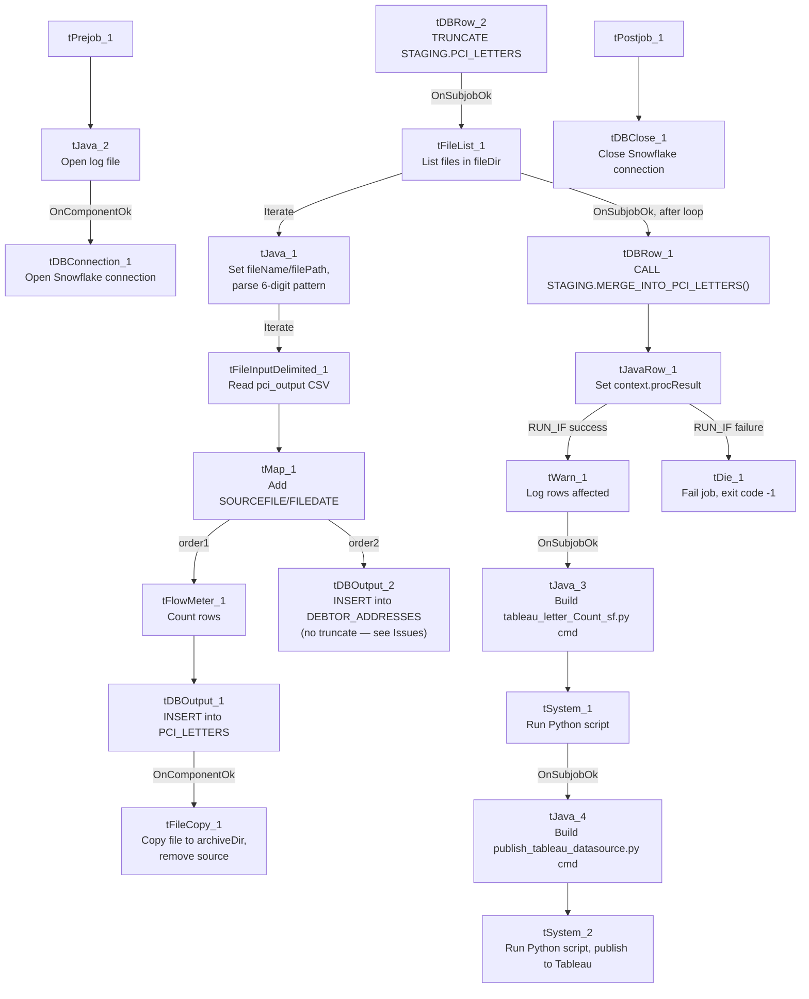

# Talend Job: Raw_PCI_Letter_Load

## Overview

Loads post-processed mail/letter output files (address-standardization results from a CASS/NCOA mail-processing vendor, per the `"pci_output"` repository schema label) into two Snowflake tables — `PCI_LETTERS` (the full per-letter record, including original vs. standardized vs. NCOA-corrected address, reject/disposition codes) and `DEBTOR_ADDRESSES` (a narrower address-only subset) — then merges the `PCI_LETTERS` staging data into a downstream table via a stored procedure, and finally republishes a Tableau data-source extract counting letters and pushes it to a Tableau server. This is the most operationally varied job in this batch: it combines a file-load/merge pattern with an external Tableau-publishing step driven by Python scripts invoked from within the Talend job.

## Detail table

| Field | Value |
|---|---|
| Job name | Raw_PCI_Letter_Load |
| Version | 0.1 |
| Project | EDW2SF |
| Author | jmach@harriscollect.com |
| Created | 2022-07-11T15:59:03.038-0700 |
| Last Modified | 2022-07-14T13:26:36.504-0700 |

## Step-by-step data flow

**Setup subjob:** `tPrejob_1` → `tJava_2` opens a per-run log file → on success (`OnComponentOk`), `tDBConnection_1` opens the Snowflake connection.

**Main subjob:**

1. `tDBRow_2` runs `TRUNCATE TABLE STAGING.PCI_LETTERS;`.
2. On success (`OnSubjobOk`), `tFileList_1` lists files in `context.fileDir` (`ERROR=true` — unlike most other jobs' `tFileList`, a listing error here does fail the subjob).
3. For each file (`ITERATE`), `tJava_1` sets `context.fileName`/`context.filePath` and extracts a 6-digit pattern from the filename (via a compiled regex, presumably a date embedded in the file name).
4. `tFileInputDelimited_1` reads the file (comma-delimited, header row, `DIE_ON_ERROR=false`) using the repository schema `"pci_output"` for both its main and reject schema (~40 address/disposition columns: `OriginalFileName`, `CustID`, `RawAddress1-3`, `StdAddress1-3`, `NcoaACSAddress1-2`, `MailAddress1-3`, `CASSErrorCode`, `NcoaCode`, `NixieCode`, `RejectType`, `RejectReason`, `MailDispositionCode`, etc.).
5. `tMap_1` maps the source columns to a target schema, adding `SOURCEFILE`/`FILEDATE` (derived from the file-list/regex steps above), and splits the flow into two branches:
   - **Branch 1 (order 1):** `tFlowMeter_1` counts rows → `tDBOutput_1` inserts the full ~40-column record into Snowflake `PCI_LETTERS` (`INSERT`, no table-recreate).
   - **Branch 2 (order 2):** `tDBOutput_2` inserts a narrower address-only subset (`FILEDATE`, `CUSTOMERKEY`, `RAWADDRESS1-3`, `MAILADDRESS1-3`, `CASSERRORCODE`, `NCOACODE`, `NIXIECODE`, `REJECTTYPE`/`REASON`, `MAILDISPOSITIONCODE`/`DISPOSITION`, `NCOAMOVETYPE`) directly into Snowflake `DEBTOR_ADDRESSES` (`INSERT`, no table-recreate, and **no truncate step precedes this insert** — see Issues observed).
6. On success (`OnComponentOk`), `tFileCopy_1` copies the source file to `context.archiveDir` and removes the original (`REMOVE_FILE=true`, `REPLACE_FILE=true`, `FAILON=false`).
7. After the entire file-list loop completes (`tFileList_1` → `tDBRow_1`, `OnSubjobOk`), `tDBRow_1` calls `CALL STAGING.MERGE_INTO_PCI_LETTERS();`.
8. `tJavaRow_1` captures the procedure's `PROCRESULT` into `context.procResult`, which branches via two ordered `RUN_IF` conditions (the branch condition text itself is not captured in this metadata, but the wiring and message content make the intent clear): the success path logs `tWarn_1` ("Rows affected: `<n>`"), the failure path fails the job with `tDie_1` ("Error: `<n>`", exit code `-1`).
9. On success (`OnSubjobOk` from `tWarn_1`), `tJava_3` builds a Python command (`tableau_letter_Count_sf.py --file <tabFile>`) → `tSystem_1` runs it → on success, `tJava_4` builds a second Python command (`publish_tableau_datasource.py --server ... --user ... --password ... --file ... --name ... --project ...`) → `tSystem_2` runs it, publishing the resulting Tableau extract to the configured Tableau server.

**Teardown subjob:** `tPostjob_1` → `tDBClose_1` (close Snowflake).

## Settings tables

### Source: `tFileInputDelimited_1`

| Setting | Value | What it means |
|---|---|---|
| FILENAME | `context.filePath` | Current file from `tFileList_1`'s iteration. |
| SCHEMA / SCHEMA_REJECT | Both repository schema `"pci_output"` | Main and reject schemas are consistently the same repository schema here (unlike the mismatch seen in `ADP_Payroll_Load`). |
| DIE_ON_ERROR | `false` | Malformed rows don't fail the job; no reject flow is wired downstream, so rejects are silently dropped. |
| ENCODING | `US-ASCII` (custom) | |
| TEMP_DIR | `"C:/Talend-Studio-20211109_1610-V8.0.1/workspace"` | Developer-workstation path — see Issues observed. |

### Target 1: `tDBOutput_1` (`tSnowflakeOutput`)

| Setting | Value | What it means |
|---|---|---|
| Table | `PCI_LETTERS` | Full per-letter record (address, standardization, disposition/reject codes). |
| Output action | `INSERT` | Relies on the prior `TRUNCATE TABLE STAGING.PCI_LETTERS` to prevent duplicate accumulation. |

### Target 2: `tDBOutput_2` (`tSnowflakeOutput`)

| Setting | Value | What it means |
|---|---|---|
| Table | `DEBTOR_ADDRESSES` | Narrower address-only subset of the same source data. |
| Output action | `INSERT` | **No corresponding truncate step precedes this insert anywhere in the job** — see Issues observed; every run appends more rows to `DEBTOR_ADDRESSES` with no reset. |

### Merge step: `tDBRow_1` (`tSnowflakeRow`)

| Setting | Value | What it means |
|---|---|---|
| Query | `CALL STAGING.MERGE_INTO_PCI_LETTERS();` | Merges the freshly loaded `STAGING.PCI_LETTERS` rows into a downstream table (not shown in this metadata). |
| Result handling | `PROCRESULT` → `context.procResult` → branch to `tWarn_1`/`tDie_1` | A failure here does fail the job outright (`tDie_1`, exit code -1), unlike some other merge-result patterns in this project that only warn. |

### Tableau publishing: `tJava_3`/`tSystem_1`, `tJava_4`/`tSystem_2`

| Setting | Value | What it means |
|---|---|---|
| Script 1 | `python3 <pyScriptDir>tableau_letter_Count_sf.py --file <tabFile>` | Presumably generates/refreshes a Tableau `.hyper` extract counting letters, using the `TableauVariables_0.1` context group's `tabFile` path. |
| Script 2 | `python3 <pyScriptDir>publish_tableau_datasource.py --server <tabServer> --user <tabUser> --password <tabPass> --file <tabFile> --name <tabName> --project <tabProject...>` (truncated) | Publishes the extract to the configured Tableau Server, using `TableauVariables_0.1`'s server/credentials/project values. `tabPass` is passed as a plain command-line argument — see Issues observed. |
| `tSystem_1`/`tSystem_2` DIRECTORY | `"C:/Talend-Studio-20211109_1610-V8.0.1/workspace"` | Developer-workstation path — see Issues observed. |

## Dependencies & configuration

- **Triggers/depends on other jobs:** none — no `tRunJob` links found, and this job is not listed as a `tRunJob` target of any other job in `06_dependency_matrix.md`.
- **Context variables used:** `archiveDir`, `fileDate`, `fileDir`, `fileName`, `filePath`, `logDir`, `procResult`, `pyCmd`, `pyScriptDir`, `tabFile`, `tabName`, `tabPass`, `tabProject`, `tabServer`, `tabUser` — the Tableau-related variables come from the `TableauVariables_0.1` context group documented in `06_dependency_matrix.md` (one of only 3 jobs referencing it project-wide).
- **4 hardcoded developer-workstation paths**: `tFileInputDelimited_1.TEMP_DIR`, `tSystem_1.DIRECTORY`, `tSystem_2.DIRECTORY`, `tFileCopy_1.SOURCE_DERECTORY` (all `C:/Talend-Studio-20211109_1610-V8.0.1/workspace`) — the same project-wide portability risk documented in `05_operational_runbook.md`.

## Glossary

| Component type | Plain-English meaning |
|---|---|
| `tFileList` | Lists files in a directory for the job to iterate over one at a time. |
| `tFileInputDelimited` | Reads a delimited (CSV-style) text file according to a schema. |
| `tMap` | Maps/transforms columns from one schema to another, and can split one input into multiple output flows. |
| `tFlowMeter` | Counts rows passing through a point in the flow, for logging/monitoring. |
| `tSnowflakeOutput` / `tSnowflakeRow` / `tSnowflakeConnection` / `tSnowflakeClose` | Write rows to Snowflake / run an arbitrary SQL statement or stored-procedure call / open and close the shared Snowflake connection. |
| `tJavaRow` | Runs custom Java code once per input row — here used to unpack a stored procedure's return value. |
| `tFileCopy` | Copies a file to a destination and optionally removes/replaces the source — used here as the archive step for processed files. |
| `tJava` (command-builder usage) | Runs custom Java code — in this job, two instances build shell command strings later executed by `tSystem`. |
| `tSystem` | Runs an external OS-level command (here, invoking Python scripts) and captures its console output. |
| `tWarn` / `tDie` | Log a warning without failing the job / end the job with a specific failure message and exit code. |

## Issues observed

- **`DEBTOR_ADDRESSES` has no truncate/reset step anywhere in this job**, unlike `PCI_LETTERS`, which is explicitly truncated (`TRUNCATE TABLE STAGING.PCI_LETTERS;`) before the load. Every run of this job appends the current file's address rows to `DEBTOR_ADDRESSES` with an `INSERT` and no prior cleanup — if `DEBTOR_ADDRESSES` is meant to hold only the latest extract (matching the staging pattern used elsewhere in this project), this job would accumulate duplicate/stale rows indefinitely. Unable to determine from metadata whether `DEBTOR_ADDRESSES` is intended as a running history table (in which case this is correct) or a staging table (in which case it's missing its reset step); verify with the team.
- **No reject flow is wired from `tFileInputDelimited_1`**, and `DIE_ON_ERROR=false`, so malformed rows are silently dropped with no record of how many or which ones failed to parse — the same unwired-reject-flow pattern documented in other jobs in this project.
- **`tabPass` (the Tableau server password) is passed as a plain command-line argument to a Python script via `tSystem_2`.** Command-line arguments are typically visible to other processes on the same machine (e.g., via a process list) while the command is running, which is a weaker exposure boundary than an environment variable or a config file read directly by the script. The value itself is `***REDACTED***` in the source metadata and is not reproduced here, but the mechanism by which it's passed is visible and worth flagging to the security team as a hardening opportunity.
- **`tFileList_1.ERROR=true`** means a file-listing error fails this subjob outright, unlike the `ERROR=false` default seen on most other `tFileList` components in this project's other jobs — a deliberate (if inconsistent project-wide) choice to fail loudly here rather than silently continue with zero files.
- **The two-branch order (`tDBOutput_1` order 1, `tDBOutput_2` order 2) means the `PCI_LETTERS` insert and its downstream `tFileCopy_1` archive step are wired only off `tDBOutput_1`**, not `tDBOutput_2` — if the `DEBTOR_ADDRESSES` insert were to fail independently while `PCI_LETTERS`'s insert succeeded, the source file would still be archived/removed based on `tDBOutput_1`'s outcome alone. Unable to determine from metadata whether Talend's `tMap` multi-output semantics would already have failed the whole subjob in that case (likely, given `tMap_1.DIE_ON_ERROR=true`), but the explicit downstream wiring only tracks one of the two output branches.
