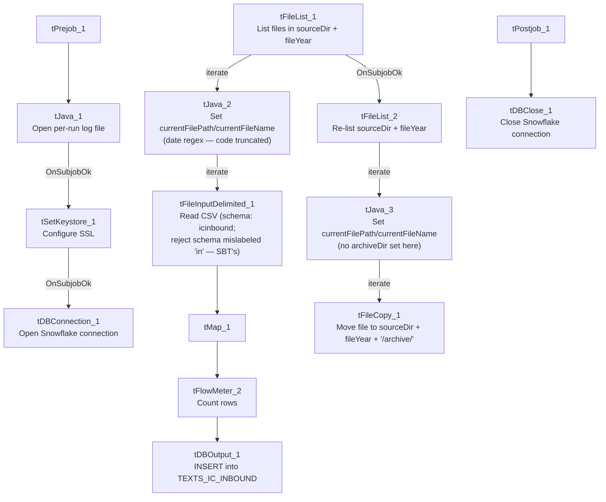

# Talend Job: SMS_IC_Inbound_Load

## Overview

Loads inbound SMS/text-message records from a second, distinct texting platform — referred to in this project as "IC" — into the Snowflake `TEXTS_IC_INBOUND` table. Its column set (`SHORTCODE`, `KEYWORD`, `CARRIER`, `CUSTOM1`-`CUSTOM10`, `OPTEDOUT`) is entirely different from the "SBT" platform's inbound schema (`SMS_Inbound_Load`'s `BrandId`/`ConsentCategory`/`Msisdn` fields), confirming these are two genuinely different source systems rather than a naming variant of the same one. Structurally the job follows the same load-then-archive, two-pass design as the SBT SMS jobs, but scans a year-partitioned subfolder (`context.sourceDir + context.fileYear`) rather than a flat directory.

## Detail table

| Field | Value |
|---|---|
| Job name | SMS_IC_Inbound_Load |
| Version | 0.1 |
| Project | EDW2SF |
| Author | jmach@harriscollect.com |
| Created | 2025-07-14T12:03:30.187-0700 |
| Last Modified | 2025-11-16T20:50:56.409-0800 |

## Step-by-step data flow

**Setup subjob:** `tPrejob_1` → `tJava_1` opens a per-run log file → on success, `tSetKeystore_1` configures SSL trust/keystore from `context.keystorePath` (passwords redacted) → `tDBConnection_1` opens the Snowflake connection.

**Main subjob (load):**

1. `tFileList_1` lists files in `context.sourceDir + context.fileYear` — a year-partitioned folder, unlike the flat `context.sourceDir` used by the SBT SMS jobs (`EXCLUDEFILEMASK="*.txt"` configured but `IFEXCLUDE=false`, not applied).
2. For each file, `tJava_2` sets `context.currentFilePath`/`context.currentFileName` and runs the same 8-digit filename regex pattern seen in the SBT jobs (code truncated in this metadata).
3. `tFileInputDelimited_1` reads the CSV (`CSV_OPTION=true`, `DIE_ON_ERROR=false`) using repository schema `"...- icinbound"` for the main (well-formed) rows, but **repository schema `"...- in"` for the reject schema — the same schema ID used as `SMS_Inbound_Load`'s (SBT) own main/reject schema, not an IC-specific one** (see Issues observed).
4. `tMap_1` passes the ~29 source columns through to an uppercase-named target schema prefixed with `FILENAME`/`FILEDATE`.
5. `tFlowMeter_2` counts rows (labeled "inb").
6. `tDBOutput_1` inserts the rows into Snowflake table `TEXTS_IC_INBOUND` (`INSERT`, table action `NONE` — no `TRUNCATE`).

**Main subjob (archive), triggered after the load loop finishes:**

7. `tFileList_2` re-lists `context.sourceDir + context.fileYear`.
8. For each file, `tJava_3` sets `context.currentFilePath`/`context.currentFileName` (this job does **not** set `context.archiveDir` here, unlike its outbound sibling — see Issues observed).
9. `tFileCopy_1` copies the current file directly to `context.sourceDir + context.fileYear + "/archive/"` and, with `REMOVE_FILE=true`, effectively moves it there.

**Teardown subjob:** `tPostjob_1` → `tDBClose_1` closes the Snowflake connection.

## Settings tables

### Source: `tFileList_1` / `tFileInputDelimited_1`

| Setting | Value | What it means |
|---|---|---|
| DIRECTORY | `context.sourceDir + context.fileYear` | Year-partitioned source folder — files for a given calendar year live in their own subdirectory. |
| SCHEMA (main) | Repository schema `"...- icinbound"` | The IC-specific inbound layout (SHORTCODE, KEYWORD, MOBILE, CARRIER, CUSTOM1-10, OPTEDOUT, etc.). |
| SCHEMA_REJECT | Repository schema `"...- in"` | **This is the same repository schema ID used as `SMS_Inbound_Load`'s (SBT) main/reject schema** — not an IC-specific reject layout. See Issues observed. |
| DIE_ON_ERROR | `false` | Malformed rows don't fail the job... |
| Reject flow | Not wired | ...but no connection carries rejected rows anywhere — silently dropped. |

### Target: `tDBOutput_1` (`tSnowflakeOutput`)

| Setting | Value | What it means |
|---|---|---|
| Table | `TEXTS_IC_INBOUND` | Destination table for inbound IC-platform text messages. |
| Output action / Table action | `INSERT` / `NONE` | Purely additive — no truncate step in this job. |

### Archive: `tFileCopy_1`

| Setting | Value | What it means |
|---|---|---|
| DESTINATION | `context.sourceDir + context.fileYear + "/archive/"` | Built directly inline here, rather than via a `context.archiveDir` variable set in `tJava_3` (contrast with `SMS_IC_Outbound_Load`, which does set `context.archiveDir`) — see Issues observed. |
| REMOVE_FILE / REPLACE_FILE | `true` / `true` | Effectively a move. |

## Dependencies & configuration

- **Triggers/depends on other jobs:** none — no `tRunJob` links found.
- **Context variables used:** `currentFileName`, `currentFilePath`, `fileDate`, `fileYear`, `keystorePath`, `logDir`, `sourceDir`.
- **3 hardcoded developer-workstation paths** (`tFileInputDelimited_1.TEMP_DIR`, `tFileCopy_1.SOURCE_DERECTORY`, `tSetKeystore_1.SSL_TRUSTSERVER_TRUSTSTORE`) — same project-wide pattern documented in `05_operational_runbook.md`.

## Glossary

| Component type | Plain-English meaning |
|---|---|
| `tFileList` | Lists files in a directory for the job to iterate over one at a time. |
| `tFileInputDelimited` | Reads a delimited (CSV-style) text file according to a schema. |
| `tMap` | Maps/transforms columns from one schema to another. |
| `tFlowMeter` | Counts rows passing through a point in the flow, for logging/monitoring. |
| `tSnowflakeOutput` / `tSnowflakeConnection` / `tSnowflakeClose` | Write rows to Snowflake / open and close the shared Snowflake connection. |
| `tFileCopy` | Copies a file to a destination path; with `REMOVE_FILE=true` this behaves as a move. |
| `tSetKeystore` | Configures SSL trust/keystore settings for the database connection. |

## Issues observed

- **The reject schema is mislabeled.** `tFileInputDelimited_1.SCHEMA_REJECT:REPOSITORY_SCHEMA_TYPE` points to the same repository schema ID (`_FdnCEFBrEe-WgPpBzwqJtg`, labeled `"- in"`) that `SMS_Inbound_Load` uses as its own main **and** reject schema for the entirely different SBT inbound format. This job's main schema is the IC-specific `"...- icinbound"` layout, so its reject schema very likely does not match its own main schema's column layout — the same class of copy-paste mislabeling documented and confirmed in `ADP_Payroll_Load` (reject schema labeled "roster" in a payroll job). Whether this actually causes a column-count/type mismatch on a rejected row depends on how the two repository schemas compare — unable to determine from this metadata; verify directly in the Talend repository.
- **`context.archiveDir` is not set in this job's `tJava_3`**, unlike the outbound `SMS_IC_Outbound_Load`/`SMS_IC_Outbound_Load_Backfill` jobs, which do compute `context.archiveDir` there. This job instead builds its archive destination path inline in `tFileCopy_1.DESTINATION`. Functionally equivalent, but an inconsistency in how the "IC" family of jobs are structured — worth normalizing if these jobs are maintained as a family going forward.
- **`tJava_2`'s date-extraction code is truncated in this metadata**, same limitation as the SBT SMS jobs — unable to confirm exactly how `context.fileDate` is derived from the filename.
- **No reject flow wired, no `TRUNCATE`/dedup step** — same patterns as `SMS_Inbound_Load`/`SMS_Outbound_Load`; see those docs for the fuller discussion of the two-pass load/archive race-condition caveat, which applies identically here.
