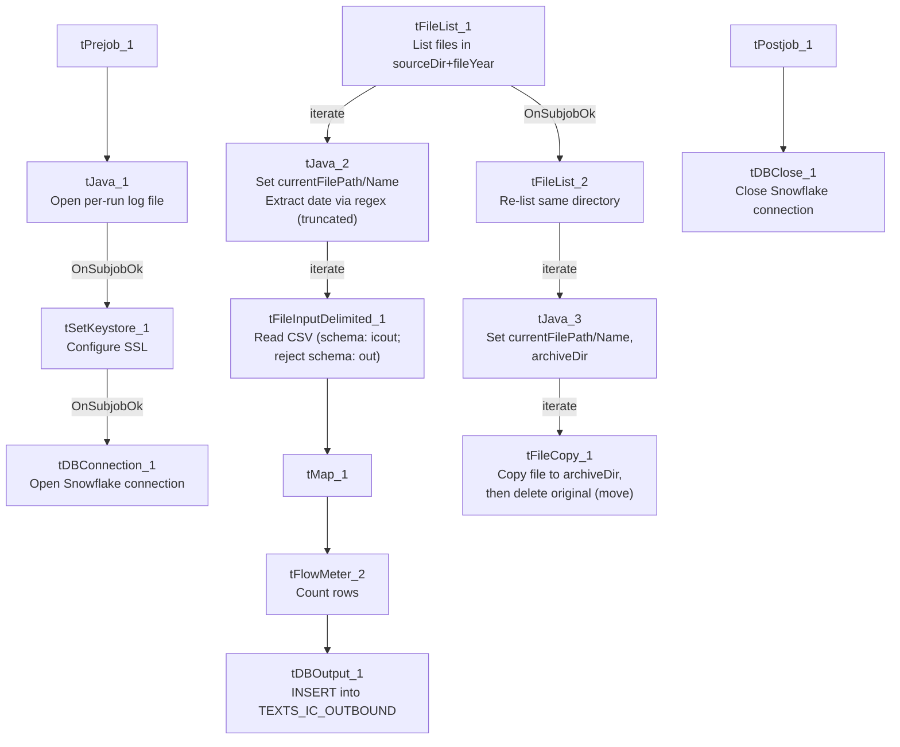

# Talend Job: SMS_IC_Outbound_Load

## Overview

Loads outbound SMS/text-message campaign result files (one row per text sent: shortcode, keyword, message body, mobile number, carrier, recipient name/address/demographics, delivery status/reason, and opt-out flag) from a year-partitioned local directory into the Snowflake `TEXTS_IC_OUTBOUND` table, then moves each processed file into an `archive` subfolder. There is no merge/dimension step — rows are inserted as-is, and de-duplication across runs relies entirely on processed files being moved out of the source directory rather than a truncate-and-reload pattern.

## Detail table

| Field | Value |
|---|---|
| Job name | SMS_IC_Outbound_Load |
| Version | 0.1 |
| Project | EDW2SF |
| Author | jmach@harriscollect.com |
| Created | 2025-07-14T12:03:05.353-0700 |
| Last Modified | 2025-11-16T20:53:45.003-0800 |

## Step-by-step data flow

**Setup subjob:** `tPrejob_1` → `tJava_1` opens a per-run log file at `context.logDir + jobName + "_" + <timestamp> + ".log"` → on success, `tSetKeystore_1` configures SSL trust/keystore from `context.keystorePath` (passwords redacted) → `tDBConnection_1` opens the Snowflake connection. This chain has no explicit link to the main subjob below — the two run as separate Talend subjobs, per the project's usual pattern (see `ADP_Payroll_Load` for the same shape).

**Main subjob (load loop):**

1. `tFileList_1` lists files in `context.sourceDir + context.fileYear` (an `EXCLUDEFILEMASK` of `*.txt` is configured but `IFEXCLUDE` is `false`, so — same as `ADP_Payroll_Load` — the exclusion is never actually applied; every file in the directory is picked up). Files are ordered by modified date, ascending.
2. For each file (`ITERATE`), `tJava_2` sets `context.currentFilePath`/`context.currentFileName` from the file-list iteration values and runs a regex (`\d{8}`) against the filename, apparently to extract an embedded date — the code capturing that match is truncated in this metadata before it's assigned to a context variable, so it's unclear exactly what it's stored as (see Issues observed).
3. `tFileInputDelimited_1` reads the CSV (comma-delimited, header row present, `DIE_ON_ERROR=false`) using repository schema `"...- icout"` for well-formed rows and reject schema `"...- out"` for rejects.
4. `tMap_1` passes the ~30 columns through to an uppercase-named target schema (`DIE_ON_ERROR=true`, so a mapping failure fails the job outright).
5. `tFlowMeter_2` counts rows passing through (labeled "MyLabel", not renamed for this job).
6. `tDBOutput_1` inserts the rows into Snowflake table `TEXTS_IC_OUTBOUND` (`INSERT`, no table-recreate action, no preceding `TRUNCATE`).

**Main subjob (archive loop), triggered only after the load loop's subjob succeeds (`tFileList_1` → `OnSubjobOk` → `tFileList_2`):**

7. `tFileList_2` re-lists the **same directory** (`context.sourceDir + context.fileYear`) independently from `tFileList_1`'s earlier listing.
8. For each file (`ITERATE`), `tJava_3` re-derives `context.currentFilePath`/`context.currentFileName` and sets `context.archiveDir = context.sourceDir + context.fileYear + "/archive"`.
9. `tFileCopy_1` copies the file into `context.archiveDir` (`CREATE_DIRECTORY=true`, `REPLACE_FILE=true`) and, because `REMOVE_FILE=true`, deletes the original — effectively a move rather than a copy.

**Teardown subjob:** `tPostjob_1` → `tDBClose_1` closes the Snowflake connection.

## Settings tables

### Source: `tFileInputDelimited_1`

| Setting | Value | What it means |
|---|---|---|
| FILENAME | `context.currentFilePath` | The current file from `tFileList_1`'s iteration. |
| FIELDSEPARATOR / HEADER | `,` / 1 header row | Comma-delimited CSV with a header row skipped. |
| SCHEMA (main) | Repository schema `"...- icout"` | Expected layout for a well-formed outbound-SMS row (~30 columns: shortcode, keyword, message, mobile, carrier, recipient demographics, delivery status/reason, opt-out). |
| SCHEMA_REJECT | Repository schema `"...- out"` | Reject-row schema (name truncated in this metadata to just "out" — the fuller repository label isn't captured). |
| DIE_ON_ERROR | `false` | Malformed rows do not fail the job... |
| Reject flow | Not wired | ...but no connection carries rejected rows anywhere in this job — they are silently dropped, same pattern flagged in `ADP_Payroll_Load`. |
| TEMP_DIR | `"C:/Talend-Studio-20211109_1610-V8.0.1/workspace"` | Hardcoded developer-workstation path — see `05_operational_runbook.md`. |

### Target: `tDBOutput_1` (`tSnowflakeOutput`)

| Setting | Value | What it means |
|---|---|---|
| Table | `TEXTS_IC_OUTBOUND` | Destination table for SMS outbound campaign results. |
| Output action | `INSERT` | Appends rows; there is no `TRUNCATE` step before this in the job, unlike the truncate-load pattern in `ADP_Payroll_Load`. |
| Table action | `NONE` | Table is not recreated/altered. |

### Archive step: `tFileCopy_1`

| Setting | Value | What it means |
|---|---|---|
| FILENAME | `context.currentFilePath` | The file currently being archived (from `tFileList_2`'s second, independent listing). |
| DESTINATION | `context.archiveDir` (= `sourceDir + fileYear + "/archive"`) | Where the file is moved to after loading. |
| REMOVE_FILE / REPLACE_FILE / CREATE_DIRECTORY | `true` / `true` / `true` | Original file is deleted after the copy (net effect: a move), overwriting any same-named file already archived, creating the archive folder if it doesn't exist. |
| SOURCE_DERECTORY | `"C:/Talend-Studio-20211109_1610-V8.0.1/workspace"` | Hardcoded developer-workstation path (component parameter name itself is misspelled "DERECTORY" in the Talend metadata, not a transcription error here). |

## Dependencies & configuration

- **Triggers/depends on other jobs:** none — no `tRunJob` links found, and this job does not appear as a target in `06_dependency_matrix.md` either.
- **Context variables used:** `sourceDir`, `fileYear` (both likely from `StandardFolders_0.1`, though `fileYear` isn't in that group as captured in `_shared_context.json` — see Issues observed), `currentFilePath`, `currentFileName`, `archiveDir`, `fileDate` (referenced but its assignment is not visible — see Issues observed), `keystorePath`, `logDir`.
- **3 hardcoded developer-workstation paths**: `tFileInputDelimited_1.TEMP_DIR`, `tFileCopy_1.SOURCE_DERECTORY` (both the standard `C:/Talend-Studio-20211109_1610-V8.0.1/workspace` path), and `tSetKeystore_1.SSL_TRUSTSERVER_TRUSTSTORE` (`"C:/clientTrustStore.trustStore"`) — same project-wide pattern documented in `05_operational_runbook.md`.

## Glossary

| Component type | Plain-English meaning |
|---|---|
| `tFileList` | Lists files in a directory for the job to iterate over one at a time. |
| `tFileInputDelimited` | Reads a delimited (CSV-style) text file according to a schema. |
| `tMap` | Maps/transforms columns from one schema to another. |
| `tFlowMeter` | Counts rows passing through a point in the flow, for logging/monitoring. |
| `tSnowflakeOutput` / `tSnowflakeConnection` / `tSnowflakeClose` | Write rows to a Snowflake table / open and close the Snowflake connection used in the job. |
| `tFileCopy` | Copies a file to a new location; with `REMOVE_FILE` enabled (as here), the original is deleted afterward, making it function as a move. |
| `tSetKeystore` | Configures SSL trust/keystore settings used by the job's secure connections. |

## Issues observed

- **The archive step re-lists the same source directory independently rather than reusing the file list already captured for loading.** `tFileList_2` runs only after `tFileList_1`'s whole subjob succeeds, so in practice it should see the same set of files (since nothing else writes to `context.sourceDir + context.fileYear` mid-run) — but the two loops are not directly linked, so if a new file were dropped into that directory between the two listings, it would be archived without ever having been loaded, or vice versa. Unable to determine from metadata whether this is a meaningful real-world risk given how the directory is fed; worth confirming with the team.
- **No `TRUNCATE` before `tDBOutput_1`'s `INSERT`**, unlike the truncate-load-merge pattern in `ADP_Payroll_Load`. Correctness instead depends entirely on `tFileCopy_1` successfully moving (not just copying) each processed file out of the source directory so it isn't picked up and re-inserted on the next run. If the copy step fails partway (e.g., permission error) but the load already succeeded, the source file could remain in place and get reloaded as a duplicate next run.
- **`tJava_2`'s date-extraction logic is truncated in this metadata.** The captured code compiles a regex (`\d{8}`) against `context.currentFileName` and starts building a `Matcher`, but the code that actually assigns the extracted value to a context variable is cut off (`"...S..."`). `context.fileDate` appears in this job's `context_vars_referenced` list, so it is very likely the target of that assignment, but this cannot be confirmed from the available metadata — verify directly in Talend Studio.
- **No reject flow wired from `tFileInputDelimited_1`.** `DIE_ON_ERROR` is `false`, so malformed rows don't fail the job, but there is also no connection carrying rejected rows anywhere — they are silently dropped with no record of how many, or which, rows failed to parse. Same pattern flagged in `ADP_Payroll_Load`.
- **No merge/stored-procedure step and no `tDie`/`tWarn` logic anywhere in this job** — a load failure would only surface as a generic Talend execution error, with no job-specific message to distinguish it in a shared log (same gap noted in `i3_CallDetail_40_Load`).
- **`fileYear`** is used to build both the source and archive paths but does not appear in any context group captured in `_shared_context.json` (`StandardFolders_0.1` has `sourceDir`/`archiveDir`/`logDir`/`sourceDCDir`/`keystorePath` but no `fileYear`). Unable to determine from metadata where `fileYear` is actually set/defaulted — verify with the team.
