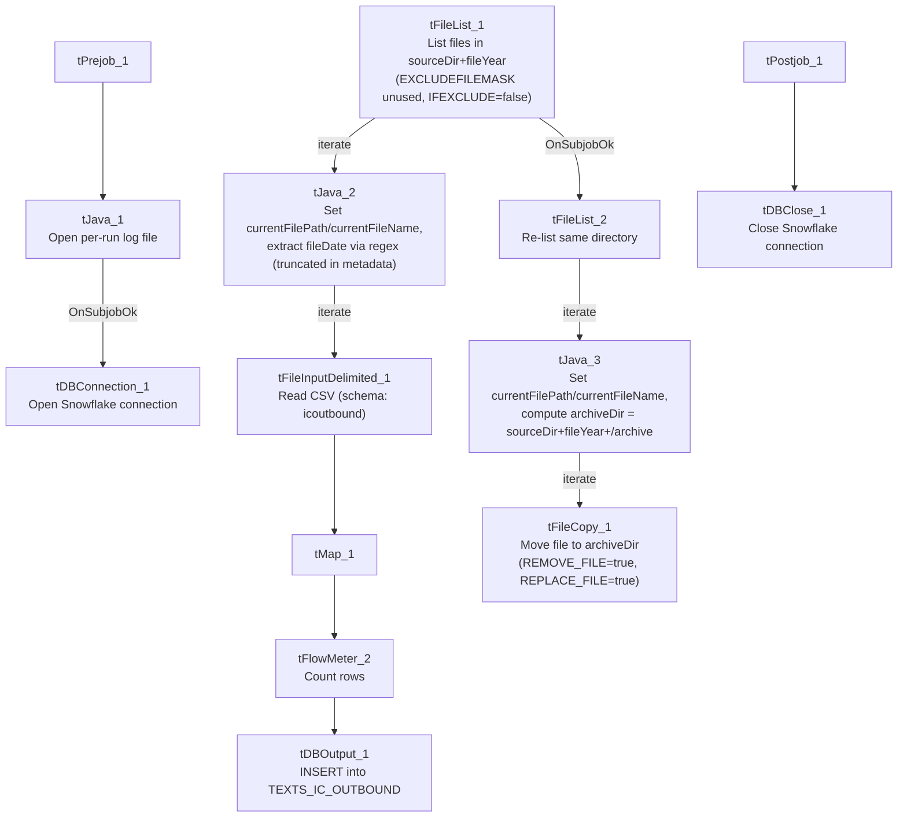

# Talend Job: SMS_IC_Outbound_Load_Backfill

## Overview

Reprocesses a whole year's worth of outbound-SMS extract files (one row per text message: mobile number, keyword, send date/time, message body, and per-debtor personalization fields like customer ID, court, case number, and pay link) from a source directory into the Snowflake `TEXTS_IC_OUTBOUND` table, then moves each processed file into an `archive` subfolder. The `_Backfill` naming and the year-level (rather than daily) directory scope indicate this is a catch-up/reload job rather than the project's regular day-to-day SMS load.

## Detail table

| Field | Value |
|---|---|
| Job name | SMS_IC_Outbound_Load_Backfill |
| Version | 0.1 |
| Project | EDW2SF |
| Author | jmach@harriscollect.com |
| Created | 2025-07-14T14:40:41.530-0700 |
| Last Modified | 2025-09-24T11:01:01.184-0700 |

## Step-by-step data flow

**Setup subjob:** `tPrejob_1` → `tJava_1` opens a per-run log file at `context.logDir+jobName+"_"+<timestamp>+".log"` → on success, `tDBConnection_1` opens the Snowflake connection.

**Load pass** (runs independently of the setup subjob):

1. `tFileList_1` lists files in `context.sourceDir+context.fileYear` (an `EXCLUDEFILEMASK` of `*.txt` is configured but `IFEXCLUDE=false`, so it has no effect — every file in the directory is picked up, ordered oldest-to-newest by modified date).
2. For each file, `tJava_2` sets `context.currentFilePath`/`context.currentFileName` from `tFileList_1`'s globals, then compiles a `\d{8}` regex against the filename to extract an embedded date — **the code that assigns the matched value to `context.fileDate` is truncated in this metadata**, so the exact assignment logic isn't visible (see Issues observed).
3. `tFileInputDelimited_1` reads the CSV (comma-delimited, `CSV_OPTION=true`, header row present, `DIE_ON_ERROR=false`) at `context.currentFilePath`, using repository schema `"icoutbound"` for well-formed rows (14 columns: `Mobile_Number`, `Keyword`, `Send_Date`, `Send_Time`, `SMS_Message`, `customerid`, `zip`, `firstname`, `paylink`, `creditor`, `pktbal`, `court`, `case_no`, `Txt_Msg_PH`) and a differently-labeled reject schema (`"out"`).
4. `tMap_1` (`DIE_ON_ERROR=true`) maps to a 16-column uppercase target schema (`FILENAME`, `FILEDATE`, `MOBILE_NUMBER`, `KEYWORD`, `SEND_DATE`, `SEND_TIME`, `SMS_MESSAGE`, `CUSTOMERID`, `ZIP`, `FIRSTNAME`, `PAYLINK`, `CREDITOR`, `PKTBAL`, `COURT`, `CASE_NO`, `TXT_MSG_PH`) — `FILENAME`/`FILEDATE` are added columns presumably populated from `context.currentFileName`/`context.fileDate`, though the actual mapping expressions aren't captured in this metadata.
5. `tFlowMeter_2` counts rows passing through (labeled "MyLabel", not renamed for this job).
6. `tDBOutput_1` inserts the rows into Snowflake table `TEXTS_IC_OUTBOUND` (`INSERT`, no table-recreate action).

**Archive pass** — starts once `tFileList_1` finishes all iterations (`SUBJOB_OK`):

7. `tFileList_2` re-lists the same directory (`context.sourceDir+context.fileYear`).
8. For each file, `tJava_3` re-derives `context.currentFilePath`/`context.currentFileName` from `tFileList_2`'s globals and computes `context.archiveDir = context.sourceDir + context.fileYear + "/archive"` — a job-local archive path, not the project-wide `context.archiveDir` convention used elsewhere (see Issues observed).
9. `tFileCopy_1` copies the file to `context.archiveDir`, with `REMOVE_FILE=true` and `REPLACE_FILE=true` (i.e., effectively **moves** each file into the archive subfolder, creating it if needed via `CREATE_DIRECTORY=true`).

**Teardown subjob:** `tPostjob_1` → `tDBClose_1` closes the Snowflake connection.

## Settings tables

### Source listing: `tFileList_1` / `tFileList_2`

| Setting | Value | What it means |
|---|---|---|
| DIRECTORY | `context.sourceDir + context.fileYear` | Scoped to a whole year's worth of files, consistent with a backfill/reload job rather than a daily incremental one. |
| EXCLUDEFILEMASK / IFEXCLUDE | `"*.txt"` / `false` | Exclusion mask configured but not applied — every file in the directory is picked up (and later moved to archive), regardless of extension. |
| ORDER_BY_MODIFIEDDATE / ASC | `true` / `true` | Processes files oldest-to-newest by modification date. |

### Source: `tFileInputDelimited_1`

| Setting | Value | What it means |
|---|---|---|
| FILENAME | `context.currentFilePath` | The current file from `tFileList_1`'s iteration. |
| SCHEMA / SCHEMA_REJECT | Repository schema `"icoutbound"` / `"out"` | Main and reject schemas carry different labels. |
| DIE_ON_ERROR | `false` | Malformed rows don't fail the job... |
| Reject flow | Not wired | ...but no connection routes rejected rows anywhere in this job (no file, no log, no table) — they are silently dropped, the same pattern flagged in `ADP_Payroll_Load`. |

### Target: `tDBOutput_1` (`tSnowflakeOutput`)

| Setting | Value | What it means |
|---|---|---|
| Table | `TEXTS_IC_OUTBOUND` | Destination table for outbound SMS/text records. |
| Output action | `INSERT` | Appends rows — no truncate/staging step is present in this job. |
| Table action | `NONE` | Table is not recreated/altered by this job. |

### Archive step: `tJava_3` / `tFileCopy_1`

| Setting | Value | What it means |
|---|---|---|
| `tJava_3` archiveDir assignment | `context.archiveDir = context.sourceDir + context.fileYear + "/archive"` | Computes a job-local archive path rather than using the project's shared `context.archiveDir` convention (see Issues observed). |
| REMOVE_FILE / REPLACE_FILE / CREATE_DIRECTORY (`tFileCopy_1`) | `true` / `true` / `true` | Effectively moves (copy-then-delete-original) each source file into the archive subfolder, creating that subfolder if it doesn't exist. |

## Dependencies & configuration

- **Triggers/depends on other jobs:** none — no `tRunJob` links found, and this job does not appear as a call target anywhere in `06_dependency_matrix.md`'s 65-link orchestration table.
- **Context variables used:** `archiveDir` (locally computed, not from `StandardFolders_0.1`), `currentFileName`, `currentFilePath`, `fileDate`, `fileYear`, `logDir`, `sourceDir`.
- **2 hardcoded developer-workstation paths** in `tFileInputDelimited_1.TEMP_DIR` and `tFileCopy_1.SOURCE_DERECTORY` (both `C:/Talend-Studio-20211109_1610-V8.0.1/workspace`, `SOURCE_DERECTORY` as spelled in the component's own parameter name) — same project-wide portability risk documented in `05_operational_runbook.md`.

## Glossary

| Component type | Plain-English meaning |
|---|---|
| `tFileList` | Lists files in a directory for the job to iterate over one at a time. |
| `tJava` | Runs custom Java code — here used to open a log file, parse filenames, and compute paths. |
| `tFileInputDelimited` | Reads a delimited (CSV-style) text file according to a schema. |
| `tMap` | Maps/transforms columns from one schema to another. |
| `tFlowMeter` | Counts rows passing through a point in the flow, for logging/monitoring. |
| `tSnowflakeOutput` / `tSnowflakeConnection` / `tSnowflakeClose` | Write rows to a Snowflake table / open and close the Snowflake connection used by the job. |
| `tFileCopy` | Copies (and here, with `REMOVE_FILE=true`, effectively moves) a file from one location to another. |

## Issues observed

- **No reject flow is wired from `tFileInputDelimited_1`.** `DIE_ON_ERROR` is `false`, and a reject schema (`"out"`) is configured, but there is no connection carrying rejected rows anywhere — they are silently dropped with no record of how many rows, or which ones, failed to parse. Same pattern flagged in `ADP_Payroll_Load`.
- **`tJava_2`'s filename-date-extraction code is truncated in this metadata** after the regex `Matcher` is constructed — the statement that actually assigns a value to `context.fileDate` is not visible. Unable to confirm from metadata whether `fileDate` is being set correctly (or at all) for every file; verify directly in Talend Studio.
- **`EXCLUDEFILEMASK="*.txt"` is configured on both `tFileList_1` and `tFileList_2` but `IFEXCLUDE=false`, so it has no effect.** Every file in the year directory is read as SMS data and later moved into the archive subfolder — if the source directory ever accumulates a non-data file (e.g., a stray `.txt` log or readme), it would be processed and moved along with the real extracts.
- **The archive path is computed locally** (`context.sourceDir + context.fileYear + "/archive"` in `tJava_3`) rather than using the shared `context.archiveDir` convention (`StandardFolders_0.1`) used by most other jobs in this project. This may be intentional for a backfill job that shouldn't touch the shared archive location, or it may be an oversight — unable to determine intent from metadata.
- **This backfill job has no `tRunJob` relationship to any other job** in the project's metadata (it neither calls nor is called by anything). Unable to determine from metadata how or when it's meant to be run relative to whatever the project's regular (non-backfill) SMS IC Outbound load job is — verify with the team.
