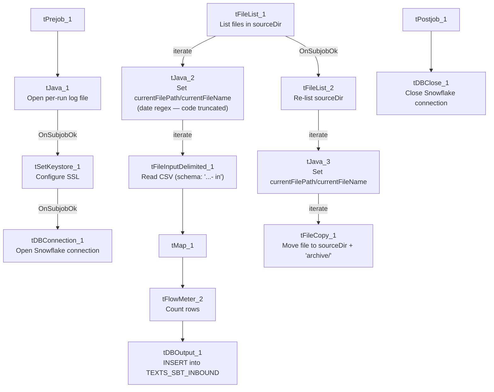

# Talend Job: SMS_Inbound_Load

## Overview

Loads inbound SMS/text-message records (consumer replies) from a delimited export file dropped by the "SBT" texting platform into the Snowflake `TEXTS_SBT_INBOUND` table — one row per received message, with brand/group identifiers, consent category, the sender's mobile number (`Msisdn`), message content, and delivery/read timestamps. After each file loads, a second pass moves the source file into a `sourceDir + "archive/"` subfolder. The table naming (`TEXTS_SBT_*`) and field set (BrandId, ConsentCategory, Msisdn) both point to this being a specific SMS vendor's compliance-oriented texting feed, distinct from the "IC" SMS family documented separately (`SMS_IC_Inbound_Load`, `SMS_IC_Outbound_Load`).

## Detail table

| Field | Value |
|---|---|
| Job name | SMS_Inbound_Load |
| Version | 0.1 |
| Project | EDW2SF |
| Author | jmach@harriscollect.com |
| Created | 2024-08-06T15:16:53.345-0700 |
| Last Modified | 2025-11-16T20:53:32.787-0800 |

## Step-by-step data flow

**Setup subjob:** `tPrejob_1` → `tJava_1` opens a per-run log file at `context.logDir + jobName + "_" + <timestamp> + ".log"` and redirects `System.out`/`System.err` to it → on success, `tSetKeystore_1` configures SSL trust/keystore from `context.keystorePath` (passwords redacted) → `tDBConnection_1` opens the Snowflake connection.

**Main subjob (load):**

1. `tFileList_1` lists files in `context.sourceDir` (an `EXCLUDEFILEMASK` of `*.txt` is configured but `IFEXCLUDE` is `false`, so it isn't actually applied — every file in the directory is picked up, same non-functional-exclusion pattern seen in `ADP_Payroll_Load`).
2. For each file, `tJava_2` sets `context.currentFilePath`/`context.currentFileName` from the iteration and runs an 8-digit regex match against the filename (the code that assigns the matched value to `context.fileDate`/`context.fileYear` is truncated in this metadata — see Issues observed).
3. `tFileInputDelimited_1` reads the CSV (comma-delimited, header row present, `DIE_ON_ERROR=false`) using repository schema `"...- in"` for both the main and reject schema.
4. `tMap_1` passes the ~24 source columns through to an uppercase-named target schema, prefixed with `FILENAME`/`FILEDATE` (`DIE_ON_ERROR=true`).
5. `tFlowMeter_2` counts rows (labeled "inb").
6. `tDBOutput_1` inserts the rows into Snowflake table `TEXTS_SBT_INBOUND` (`INSERT`, table action `NONE` — no `TRUNCATE` anywhere in this job, so the load is purely additive).

**Main subjob (archive), triggered once the load loop finishes (`tFileList_1` → `tFileList_2` on `OnSubjobOk`):**

7. `tFileList_2` re-lists the same `context.sourceDir` directory.
8. For each file, `tJava_3` sets `context.currentFilePath`/`context.currentFileName`.
9. `tFileCopy_1` copies the current file to `context.sourceDir + "archive/"` and, with `REMOVE_FILE=true`/`REPLACE_FILE=true`, effectively moves it there.

**Teardown subjob:** `tPostjob_1` → `tDBClose_1` closes the Snowflake connection.

## Settings tables

### Source: `tFileList_1` / `tFileInputDelimited_1`

| Setting | Value | What it means |
|---|---|---|
| DIRECTORY | `context.sourceDir` | Flat scan, no year/date subfolder (unlike the `SMS_IC_*` family — see Issues observed). |
| EXCLUDEFILEMASK / IFEXCLUDE | `"*.txt"` / `false` | Exclusion mask configured but not applied — every file in the directory is listed. |
| SCHEMA / SCHEMA_REJECT | Repository schema `"...- in"` (same label for both) | Main and reject schemas both point to the same repository schema entry — a self-consistent choice, unlike the mismatch seen in the `SMS_IC_*` jobs (see their own docs). |
| DIE_ON_ERROR | `false` | Malformed rows don't fail the job... |
| Reject flow | Not wired | ...but no connection carries rejected rows anywhere — they are silently dropped with no record. |

### Target: `tDBOutput_1` (`tSnowflakeOutput`)

| Setting | Value | What it means |
|---|---|---|
| Table | `TEXTS_SBT_INBOUND` | Destination table for inbound SBT text messages. |
| Output action / Table action | `INSERT` / `NONE` | No truncate step exists anywhere in this job — every run is purely additive; the file-archive-and-remove step is the only thing preventing the same file from being reloaded. |

### Archive: `tFileCopy_1`

| Setting | Value | What it means |
|---|---|---|
| FILENAME | `context.currentFilePath` | The full absolute path of the current file from `tFileList_2`'s iteration. |
| SOURCE_DERECTORY (sic) | `"C:/Talend-Studio-20211109_1610-V8.0.1/workspace"` | Hardcoded developer path; appears unused in practice since `FILENAME` already supplies a full path — see Issues observed. |
| DESTINATION | `context.sourceDir + "archive/"` | Destination archive subfolder. |
| REMOVE_FILE / REPLACE_FILE | `true` / `true` | Source file is deleted after copying — functionally a move. |

## Dependencies & configuration

- **Triggers/depends on other jobs:** none — no `tRunJob` links found.
- **Context variables used:** `currentFileName`, `currentFilePath`, `fileDate`, `fileYear` (referenced but not used to build `tFileList_1`'s directory in this job — see Issues observed), `keystorePath`, `logDir`, `sourceDir`.
- **3 hardcoded developer-workstation paths** (`tFileInputDelimited_1.TEMP_DIR`, `tFileCopy_1.SOURCE_DERECTORY`, `tSetKeystore_1.SSL_TRUSTSERVER_TRUSTSTORE`), all `C:/Talend-Studio-20211109_1610-V8.0.1/...` or `C:/clientTrustStore.trustStore` — same portability risk documented project-wide in `05_operational_runbook.md`.

## Glossary

| Component type | Plain-English meaning |
|---|---|
| `tFileList` | Lists files in a directory for the job to iterate over one at a time. |
| `tFileInputDelimited` | Reads a delimited (CSV-style) text file according to a schema. |
| `tMap` | Maps/transforms columns from one schema to another. |
| `tFlowMeter` | Counts rows passing through a point in the flow, for logging/monitoring. |
| `tSnowflakeOutput` / `tSnowflakeConnection` / `tSnowflakeClose` | Write rows to Snowflake / open and close the shared Snowflake connection. |
| `tFileCopy` | Copies a file to a destination path; with `REMOVE_FILE=true` this behaves as a move. |
| `tSetKeystore` | Configures SSL trust/keystore settings for the database connection. |

## Issues observed

- **`tJava_2`'s date-extraction code is truncated in this metadata** (ends mid-statement after the regex `Matcher` is built). Unable to determine from metadata exactly how `context.fileDate`/`context.fileYear` are derived from the filename, or whether the job behaves correctly if a filename doesn't contain an 8-digit run — verify directly in Talend Studio.
- **`context.fileYear` is referenced by this job but not used to build `tFileList_1`'s scan directory** — `DIRECTORY` is just `context.sourceDir`, whereas the related `SMS_IC_Inbound_Load`/`SMS_IC_Outbound_Load` jobs use `context.sourceDir + context.fileYear` for a year-partitioned folder structure. Unable to determine from metadata whether `fileYear` is simply unused here, used only for logging, or a vestige of an earlier version of this job.
- **No reject flow wired from `tFileInputDelimited_1`.** `DIE_ON_ERROR=false`, so malformed rows don't fail the job, but there's also no connection carrying rejected rows anywhere — they're silently dropped with no record of how many, or which, rows failed to parse.
- **No `TRUNCATE`/dedup step anywhere in this job** — every run purely inserts. The only safeguard against reprocessing the same file twice is the separate archive-and-delete pass (`tFileList_2`/`tFileCopy_1`), which runs as its own listing of the directory rather than being wired inline with the load loop per file.
- **The load pass and the archive pass are two independent scans of the same directory** (`tFileList_1` for loading, `tFileList_2` for archiving, triggered afterward via `OnSubjobOk`). If a new file were dropped into `context.sourceDir` between the two scans, `tFileList_2` could pick it up and move it to `archive/` without it ever having been loaded through `tFileInputDelimited_1`/`tDBOutput_1` — a narrow but real race window. Unable to determine from metadata how likely this is in practice (depends on how often the source system writes new files during this job's run window).
- **`tFileCopy_1.SOURCE_DERECTORY`** (note the source metadata's own typo, preserved here) **is a hardcoded developer path that appears functionally unused**, since `FILENAME` is already set to the full absolute `context.currentFilePath`. Not confirmed harmful, but worth flagging alongside the other hardcoded-path findings in `05_operational_runbook.md`.
