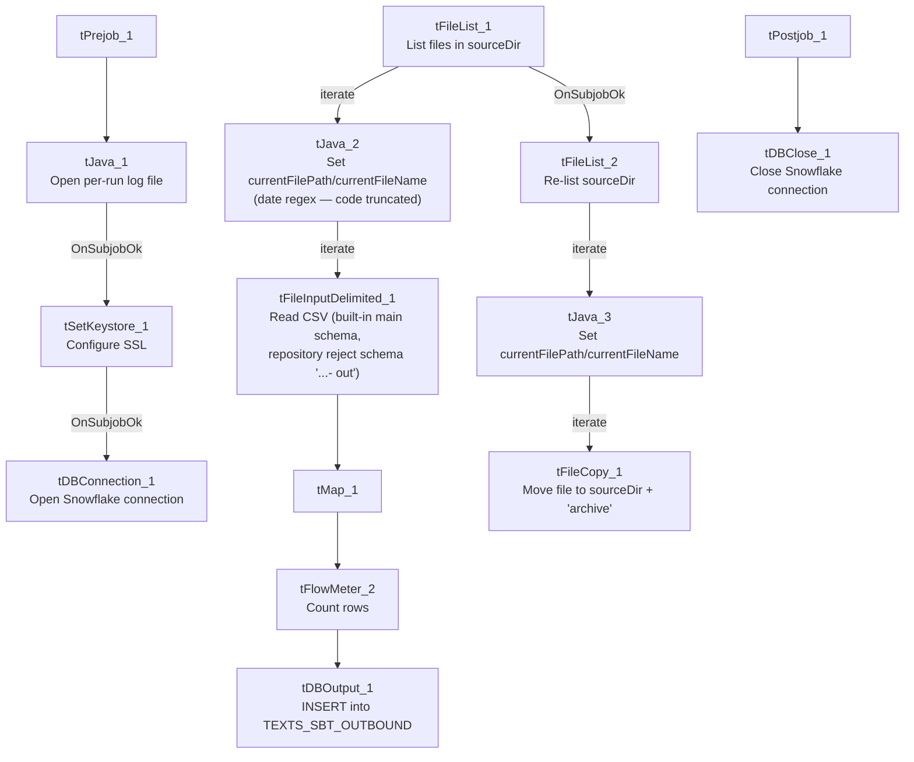

# Talend Job: SMS_Outbound_Load

## Overview

Loads outbound SMS/text-message records (messages sent to consumers) from a delimited export file dropped by the "SBT" texting platform into the Snowflake `TEXTS_SBT_OUTBOUND` table — one row per sent message, with brand/group identifiers, the recipient's mobile number (`Msisdn`), message template/category, send/delivery status and timestamps. Structurally a near-mirror of `SMS_Inbound_Load` (same setup/teardown, same two-pass load-then-archive design), but for the sent side of the same SBT texting platform, with delivery-status fields (`STATUS`, `STATUSCODE`, `DELIVEREDTIME`) that inbound messages don't have.

## Detail table

| Field | Value |
|---|---|
| Job name | SMS_Outbound_Load |
| Version | 0.1 |
| Project | EDW2SF |
| Author | jmach@harriscollect.com |
| Created | 2024-08-01T18:09:34.343-0700 |
| Last Modified | 2025-11-16T20:53:28.013-0800 |

## Step-by-step data flow

**Setup subjob:** `tPrejob_1` → `tJava_1` opens a per-run log file → on success, `tSetKeystore_1` configures SSL trust/keystore from `context.keystorePath` (passwords redacted) → `tDBConnection_1` opens the Snowflake connection.

**Main subjob (load):**

1. `tFileList_1` lists files in `context.sourceDir` (`EXCLUDEFILEMASK="*.txt"` configured but `IFEXCLUDE=false`, so not actually applied).
2. For each file, `tJava_2` sets `context.currentFilePath`/`context.currentFileName` and runs the same 8-digit filename regex seen in `SMS_Inbound_Load` (code truncated in this metadata — see Issues observed).
3. `tFileInputDelimited_1` reads the CSV (`DIE_ON_ERROR=false`) using a built-in (non-repository) main schema and a repository reject schema labeled `"...- out"`.
4. `tMap_1` passes the source columns through to an uppercase-named target schema prefixed with `FILENAME`/`FILEDATE` (`DIE_ON_ERROR=true`).
5. `tFlowMeter_2` counts rows (labeled "outb").
6. `tDBOutput_1` inserts the rows into Snowflake table `TEXTS_SBT_OUTBOUND` (`INSERT`, table action `NONE` — no `TRUNCATE` anywhere in this job).

**Main subjob (archive), triggered after the load loop finishes:**

7. `tFileList_2` re-lists `context.sourceDir`.
8. For each file, `tJava_3` sets `context.currentFilePath`/`context.currentFileName`.
9. `tFileCopy_1` copies the current file to `context.sourceDir + "archive"` and, with `REMOVE_FILE=true`/`REPLACE_FILE=true`, effectively moves it there.

**Teardown subjob:** `tPostjob_1` → `tDBClose_1` closes the Snowflake connection.

## Settings tables

### Source: `tFileList_1` / `tFileInputDelimited_1`

| Setting | Value | What it means |
|---|---|---|
| DIRECTORY | `context.sourceDir` | Flat scan, no year subfolder. |
| EXCLUDEFILEMASK / IFEXCLUDE | `"*.txt"` / `false` | Exclusion mask configured but not applied. |
| SCHEMA (main) | Built-in (no repository schema captured) | Unlike its own reject schema and unlike `SMS_Inbound_Load`'s main schema, this job's well-formed-row schema is embedded in the component itself, not a repository reference. |
| SCHEMA_REJECT | Repository schema `"...- out"` | |
| DIE_ON_ERROR | `false` | Malformed rows don't fail the job... |
| Reject flow | Not wired | ...but no connection carries rejected rows anywhere — silently dropped. |

### Target: `tDBOutput_1` (`tSnowflakeOutput`)

| Setting | Value | What it means |
|---|---|---|
| Table | `TEXTS_SBT_OUTBOUND` | Destination table for outbound SBT text messages. |
| Output action / Table action | `INSERT` / `NONE` | Purely additive — no truncate step in this job. |

### Archive: `tFileCopy_1`

| Setting | Value | What it means |
|---|---|---|
| DESTINATION | `context.sourceDir + "archive"` | Note: no trailing slash, unlike `SMS_Inbound_Load`'s `"archive/"` — likely harmless (Talend/OS path joining typically tolerates this) but a small inconsistency between the two sibling jobs. |
| REMOVE_FILE / REPLACE_FILE | `true` / `true` | Effectively a move. |
| PRESERVE_LAST_MODIFIED_TIME | `false` | Differs from `SMS_Inbound_Load`'s `true` — archived outbound files will show their copy time, not their original modified time. |

## Dependencies & configuration

- **Triggers/depends on other jobs:** none — no `tRunJob` links found.
- **Context variables used:** `currentFileName`, `currentFilePath`, `fileDate`, `fileYear` (not used to build this job's scan directory — same as `SMS_Inbound_Load`), `keystorePath`, `logDir`, `sourceDir`.
- **3 hardcoded developer-workstation paths** (`tFileInputDelimited_1.TEMP_DIR`, `tFileCopy_1.SOURCE_DERECTORY`, `tSetKeystore_1.SSL_TRUSTSERVER_TRUSTSTORE`) — same project-wide pattern documented in `05_operational_runbook.md`.

## Glossary

| Component type | Plain-English meaning |
|---|---|
| `tFileList` | Lists files in a directory for the job to iterate over one at a time. |
| `tFileInputDelimited` | Reads a delimited (CSV-style) text file according to a schema. |
| `tMap` | Maps/transforms columns from one schema to another. |
| `tFlowMeter` | Counts rows passing through a point in the flow, for logging/monitoring. |
| `tSnowflakeOutput` / `tSnowflakeConnection` / `tSnowflakeClose` | Write rows to Snowflake / open and close the shared Snowflake connection. |
| `tFileCopy` | Copies a file to a destination path; with `REMOVE_FILE=true` this behaves as a move. |
| `tSetKeystore` | Configures SSL trust/keystore settings for the database connection. |

## Issues observed

- **`tJava_2`'s date-extraction code is truncated in this metadata**, same as `SMS_Inbound_Load` — unable to confirm exactly how `context.fileDate`/`context.fileYear` are derived or used.
- **No reject flow wired from `tFileInputDelimited_1`** — malformed rows are silently dropped with `DIE_ON_ERROR=false` and no reject connection.
- **No `TRUNCATE`/dedup step anywhere in this job** — purely additive inserts; the load pass and the archive-and-delete pass are two independent directory scans (see the same race-condition caveat documented in `SMS_Inbound_Load`'s Issues section, which applies identically here).
- **Minor inconsistencies vs. its sibling `SMS_Inbound_Load`**: the archive `DESTINATION` omits a trailing slash (`"archive"` vs `"archive/"`), and `PRESERVE_LAST_MODIFIED_TIME` is `false` here vs `true` there. Neither looks functionally significant, but both suggest the two jobs were built/edited somewhat independently rather than from one shared template that stayed in sync.
- **Main input schema is a built-in schema here, but a repository schema in `SMS_Inbound_Load`.** Not necessarily a problem, but it does mean any future column change to the SBT outbound format would need to be edited directly in this job rather than in a shared repository schema — worth confirming with the team whether that's intentional.
