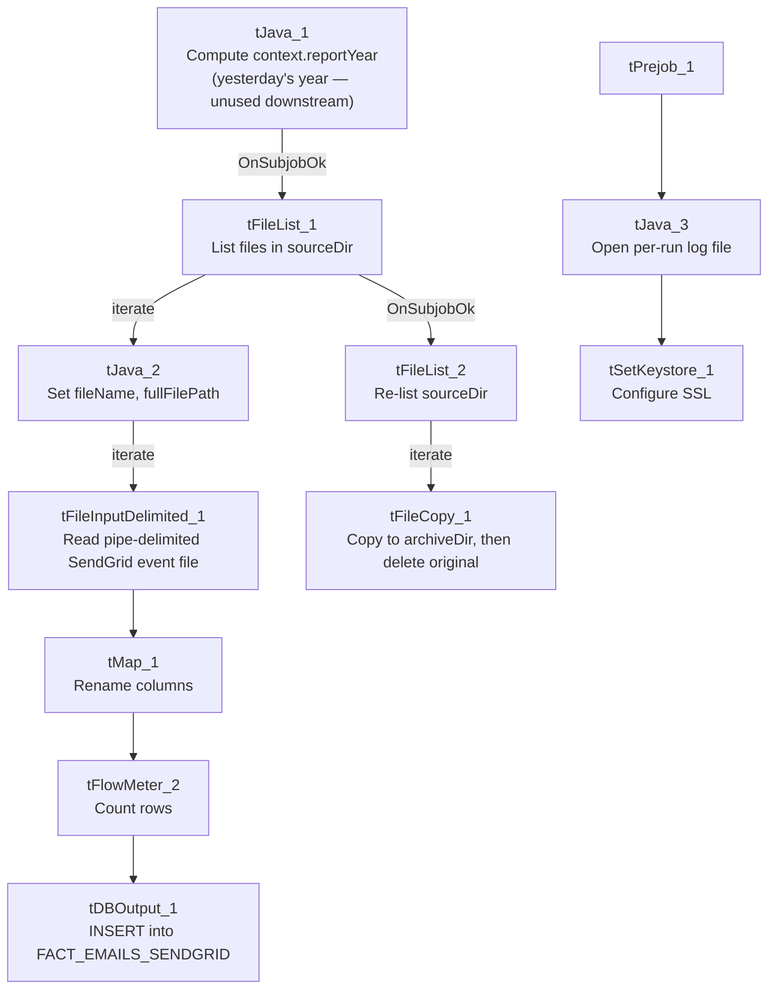

# Talend Job: SendGrid_Report_Load

## Overview

Loads SendGrid email-event report files (bounce/open/click/etc. events tied to a specific collection letter and debtor account) from a local source directory into the Snowflake `FACT_EMAILS_SENDGRID` table, then archives every file found in that directory. The job computes a "report year" value from yesterday's date but does not appear to use it anywhere in the visible flow — see Issues observed.

## Detail table

| Field | Value |
|---|---|
| Job name | SendGrid_Report_Load |
| Version | 0.1 |
| Project | EDW2SF |
| Author | jmach@harriscollect.com |
| Created | 2024-05-28T14:58:27.908-0700 |
| Last Modified | 2025-11-16T21:25:26.722-0800 |

## Step-by-step data flow

**Setup subjob (independent of the main flow):** `tPrejob_1` → `tJava_3` opens a per-run log file (`context.logDir + jobName + "_" + <timestamp> + ".log"`) → `tSetKeystore_1` configures SSL trust/keystore from `context.keystorePath` (passwords redacted). `tSetKeystore_1` has no further outgoing connection in this job — it configures JVM-wide SSL state rather than feeding a specific downstream connection component.

**Main subjob:**

1. `tJava_1` computes `context.reportYear` as the year of yesterday's date (`TalendDate.addDate(currentDate, -1, "dd")`), then prints it.
2. On success, `tFileList_1` lists files in `context.sourceDir` (`EXCLUDEFILEMASK` is set to `*.txt` but `IFEXCLUDE=false`, so the exclusion is not actually applied — every file in the directory is picked up, same pattern seen elsewhere in this project).
3. For each file, `tJava_2` sets `context.fileName`/`context.fullFilePath` from the current file and iterates into `tFileInputDelimited_1`, which reads the file as pipe-delimited (`|`) text with a repository schema of 10 SendGrid event columns (`Letter_Code`, `Letter_ID`, `Customer`, `Email_Address`, `Event`, `Comment`, `Event_Date`, `Account_Number`, `Account_Number_2`, `Logon`, `VariableField5`); `DIE_ON_ERROR=false`, no reject flow wired.
4. `tMap_1` renames the columns to their Snowflake target names (e.g. `Comment` → `EVENT_COMMENT`) and passes all 11 columns through unchanged otherwise.
5. `tFlowMeter_2` counts rows passing through (labeled "MyLabel", not renamed for this job).
6. `tDBOutput_1` inserts the rows into Snowflake table `FACT_EMAILS_SENDGRID` (`INSERT`, no table-recreate action).

**Separately, on `tFileList_1`'s success** (not gated on the read/load actually finishing): `tFileList_2` re-lists the same `context.sourceDir`, and for each file found, `tFileCopy_1` copies it to `context.archiveDir` and removes the original (`REMOVE_FILE=true`, `REPLACE_FILE=true`) — effectively a move/archive step run as a second, independent listing of the same directory rather than being wired to only the files that were actually loaded.

## Settings tables

### Source: `tFileInputDelimited_1`

| Setting | Value | What it means |
|---|---|---|
| FILENAME | `context.fullFilePath` | The current file from `tFileList_1`'s iteration. |
| FIELDSEPARATOR / HEADER | `\|` / 1 header row | Pipe-delimited, not comma — distinct from most other file loads in this project. |
| SCHEMA | Repository schema (10 SendGrid event columns) | `Letter_Code`, `Letter_ID`, `Customer`, `Email_Address`, `Event`, `Comment`, `Event_Date`, `Account_Number`, `Account_Number_2`, `Logon`, `VariableField5`. |
| DIE_ON_ERROR | `false` | Malformed rows don't fail the job... |
| Reject flow | Not wired | ...but no connection carries rejected rows anywhere — they are silently dropped, with no captured `SCHEMA_REJECT` in this job's metadata at all. |
| TEMP_DIR | `"C:/Talend-Studio-20211109_1610-V8.0.1/workspace"` | Hardcoded developer-workstation path (see Dependencies & configuration). |

### Target: `tDBOutput_1` (`tSnowflakeOutput`)

| Setting | Value | What it means |
|---|---|---|
| Table | `FACT_EMAILS_SENDGRID` | Destination fact table for SendGrid email events. |
| Output action | `INSERT` | Appends rows; there is no `TRUNCATE` step visible in this job, so repeated runs against the same file(s) would duplicate rows unless the archive step reliably removes processed files before the next run. |
| Table action | `NONE` | Table is not recreated/altered by this job. |

### Archive step: `tFileCopy_1`

| Setting | Value | What it means |
|---|---|---|
| FILENAME | `globalMap("tFileList_2_CURRENT_FILEPATH")` | Uses the second, independent file listing rather than the file(s) actually processed by the load branch. |
| DESTINATION | `context.archiveDir` | Where processed files are moved. |
| REMOVE_FILE / REPLACE_FILE | `true` / `true` | Deletes the original after copying — functions as a move, and overwrites an existing file of the same name at the destination. |

## Dependencies & configuration

- **Triggers/depends on other jobs:** none — no `tRunJob` links found.
- **Context variables used:** `archiveDir`, `fileName`, `fullFilePath`, `keystorePath`, `logDir`, `reportYear`, `sourceDir`.
- **3 hardcoded developer-workstation paths**: `tFileInputDelimited_1.TEMP_DIR`, `tFileCopy_1.SOURCE_DERECTORY`, and `tSetKeystore_1.SSL_TRUSTSERVER_TRUSTSTORE` (all `C:/Talend-Studio-20211109_1610-V8.0.1/...`) — same portability risk documented project-wide in `05_operational_runbook.md`.

## Glossary

| Component type | Plain-English meaning |
|---|---|
| `tFileList` | Lists files in a directory for the job to iterate over one at a time. |
| `tFileInputDelimited` | Reads a delimited text file according to a schema. |
| `tMap` | Maps/transforms columns from one schema to another. |
| `tFlowMeter` | Counts rows passing a point in the flow, for logging/monitoring. |
| `tSnowflakeOutput` | Writes rows to a Snowflake table. |
| `tFileCopy` | Copies a file to a new location, optionally deleting the source (used here as an archive/move step). |
| `tSetKeystore` | Configures SSL trust/keystore settings used by subsequent database connections in the job. |

## Issues observed

- **`context.reportYear`, computed in `tJava_1` from yesterday's date, is not referenced anywhere else in this job's metadata** — not in `DIRECTORY`, `FILENAME`, or any other captured parameter. Unable to determine from metadata whether it's consumed by a downstream process outside this job (e.g., another job reading the same shared context) or is simply dead code left over from an earlier version; verify with the team.
- **No reject flow is wired from `tFileInputDelimited_1`, and `DIE_ON_ERROR` is `false`.** Malformed rows are silently dropped with no file, log, or table capturing which rows failed to parse or why.
- **The archive step re-lists `context.sourceDir` independently (`tFileList_2`) rather than archiving specifically the file(s) the main branch just loaded.** Both listings run off the same `tFileList_1` success trigger, so in the normal case they see the same files, but the archive step has no direct data dependency on the load actually succeeding for each individual file — a file that failed to parse (and was silently dropped, per the point above) would still be archived and removed as if it had loaded successfully.
- **`EXCLUDEFILEMASK` is set to `"*.txt"` on both `tFileList_1` and `tFileList_2`, but `IFEXCLUDE` is `false`,** so the exclusion is configured but not actually applied — every file in `context.sourceDir` is picked up regardless of extension. This is the same non-functional-exclusion pattern documented in `job_ADP_Payroll_Load.md`.
- **No `TRUNCATE` step precedes the `INSERT` into `FACT_EMAILS_SENDGRID`,** and the archive/delete step is the only mechanism preventing a re-run from reprocessing (and duplicating) the same file. If the archive step fails after the load succeeds (or vice versa), a subsequent run could either reload the same data or skip it — no reconciliation logic is visible in this job's metadata.
