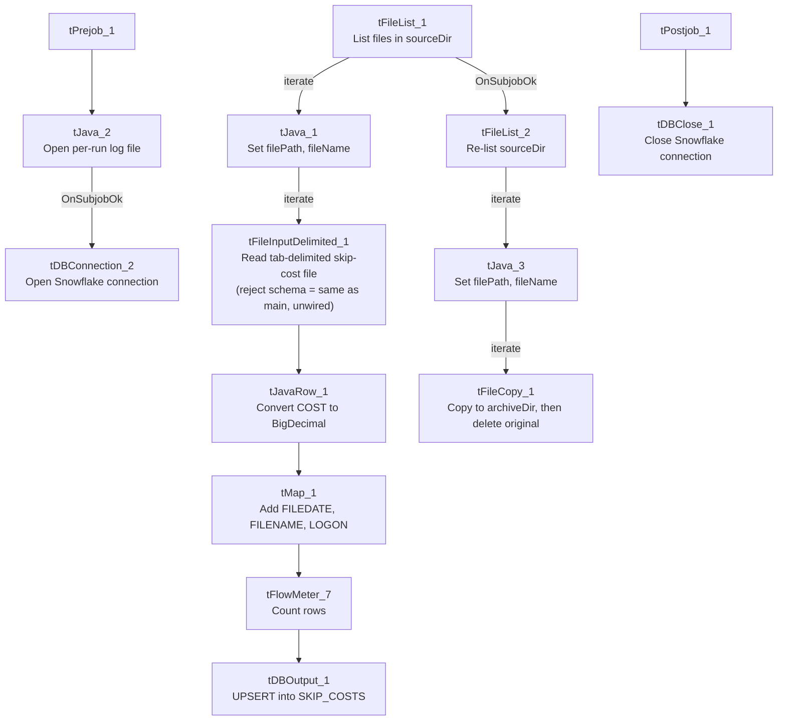

# Talend Job: Skip_Costs_Load

## Overview

Loads "skip trace" cost records (a per-debtor transaction/vendor cost record: `TID`, `DNUM`, `TYPE`, `DATE`, `COST`, `VENDOR`) from tab-delimited files in a source directory into the Snowflake `SKIP_COSTS` table, using an upsert rather than a plain insert, then archives each processed file. "Skip costs" most likely refers to costs charged by a skip-tracing vendor used to locate debtors — not otherwise defined in the metadata.

## Detail table

| Field | Value |
|---|---|
| Job name | Skip_Costs_Load |
| Version | 0.1 |
| Project | EDW2SF |
| Author | jmach@harriscollect.com |
| Created | 2025-05-02T11:01:21.739-0700 |
| Last Modified | 2025-09-24T11:00:54.127-0700 |

## Step-by-step data flow

**Setup subjob:** `tPrejob_1` → `tJava_2` opens a per-run log file → on success, `tDBConnection_2` opens the Snowflake connection.

**Main subjob:**

1. `tFileList_1` lists files in `context.sourceDir` (`EXCLUDEFILEMASK="*.txt"` is set but `IFEXCLUDE=false`, so no files are actually excluded).
2. For each file, `tJava_1` sets `context.filePath`/`context.fileName`, then `tFileInputDelimited_1` reads it as tab-delimited text using a repository schema labeled "skipcost" (`TID`, `DNUM`, `TYPE`, `DATE`, `COST`, `VENDOR`); `DIE_ON_ERROR=false`, and a `SCHEMA_REJECT` is configured (also labeled "skipcost" — the same schema as the main input, not a distinct reject-specific layout), but no reject flow is wired downstream — see Issues observed.
3. `tJavaRow_1` converts `COST` from a string to `BigDecimal` (the visible code also references `DATE`, consistent with a type-conversion pass over the raw text fields).
4. `tMap_1` adds `FILEDATE`, `FILENAME`, and `LOGON` columns alongside the passthrough `TID`/`DNUM`/`TYPE`/`DATE`/`COST`/`VENDOR` fields. The `tMap`'s own expressions aren't captured in this metadata, so how `FILEDATE`/`LOGON` are actually derived (most likely parsed from `context.fileName`, a common pattern elsewhere in this project) is unable to determine from metadata — verify directly in Talend Studio.
5. `tFlowMeter_7` counts rows passing through (labeled "MyLabel").
6. `tDBOutput_1` **upserts** the rows into Snowflake table `SKIP_COSTS`.

**Separately, on `tFileList_1`'s success:** `tFileList_2` re-lists `context.sourceDir`, and for each file `tJava_3` sets `context.filePath`/`context.fileName`, then `tFileCopy_1` copies the file to `context.archiveDir` and deletes the original (`REMOVE_FILE=true`, `REPLACE_FILE=true`).

**Teardown subjob:** `tPostjob_1` → `tDBClose_1` closes the Snowflake connection.

## Settings tables

### Source: `tFileInputDelimited_1`

| Setting | Value | What it means |
|---|---|---|
| FILENAME | `context.filePath` | The current file from `tFileList_1`'s iteration. |
| FIELDSEPARATOR / HEADER | `\t` / 1 header row | Tab-delimited with a header row skipped. |
| SCHEMA / SCHEMA_REJECT | Repository schema "skipcost" (both) | The main and reject schemas point to the identical repository schema — there is no distinct reject-row layout defined for this job. |
| DIE_ON_ERROR | `false` | Malformed rows don't fail the job... |
| Reject flow | Not wired | ...but no connection carries rejected rows anywhere — they are silently dropped. |
| TEMP_DIR | `"C:/Talend-Studio-20211109_1610-V8.0.1/workspace"` | Hardcoded developer-workstation path. |

### Target: `tDBOutput_1` (`tSnowflakeOutput`)

| Setting | Value | What it means |
|---|---|---|
| Table | `SKIP_COSTS` | Destination table for skip-cost records. |
| Output action | `UPSERT` | Updates existing rows and inserts new ones based on a key (likely `TID`, the one column marked `NOT NULL` in this job's schema) rather than a plain append — appropriate if the same cost record can appear in more than one source file/run. |
| Table action | `NONE` | Table is not recreated/altered by this job. |

## Dependencies & configuration

- **Triggers/depends on other jobs:** none — no `tRunJob` links found.
- **Context variables used:** `archiveDir`, `fileName`, `filePath`, `logDir`, `sourceDir`.
- **2 hardcoded developer-workstation paths**: `tFileInputDelimited_1.TEMP_DIR` and `tFileCopy_1.SOURCE_DERECTORY` (both `C:/Talend-Studio-20211109_1610-V8.0.1/...`).

## Glossary

| Component type | Plain-English meaning |
|---|---|
| `tFileList` | Lists files in a directory for the job to iterate over one at a time. |
| `tFileInputDelimited` | Reads a delimited text file according to a schema. |
| `tJavaRow` | Runs custom Java code once per input row — here used for a type conversion (string to `BigDecimal`). |
| `tMap` | Maps/transforms columns from one schema to another. |
| `tFlowMeter` | Counts rows passing a point in the flow, for logging/monitoring. |
| `tSnowflakeOutput` / `tSnowflakeConnection` / `tSnowflakeClose` | Write rows to a Snowflake table / open and close the Snowflake connection used throughout the job. |
| `tFileCopy` | Copies a file to a new location, optionally deleting the source (used here as an archive/move step). |

## Issues observed

- **The reject schema on `tFileInputDelimited_1` is set to the same repository schema as the main input ("skipcost"), and no reject flow is wired regardless.** With `DIE_ON_ERROR=false`, any row that fails to parse against the main schema is silently dropped — there is no file, log, or table capturing which rows failed or why.
- **`tMap_1`'s derivation logic for `FILEDATE` and `LOGON` is not captured in this metadata** (only the resulting schema is visible, not the expression each output column uses). These are very likely parsed from `context.fileName` following the pattern seen elsewhere in this project, but that is an assumption — unable to confirm from metadata; verify directly in Talend Studio.
- **The archive step (`tFileList_2`/`tFileCopy_1`) re-lists `context.sourceDir` independently of the load branch**, rather than being wired to only the specific file(s) the load branch processed — the same pattern flagged in `job_SendGrid_Report_Load.md`. A file that silently failed to parse would still be archived and removed as if it had loaded successfully.
- **`EXCLUDEFILEMASK` is set to `"*.txt"` but `IFEXCLUDE` is `false`** on both `tFileList_1` and `tFileList_2`, so the exclusion is configured but not actually applied.
