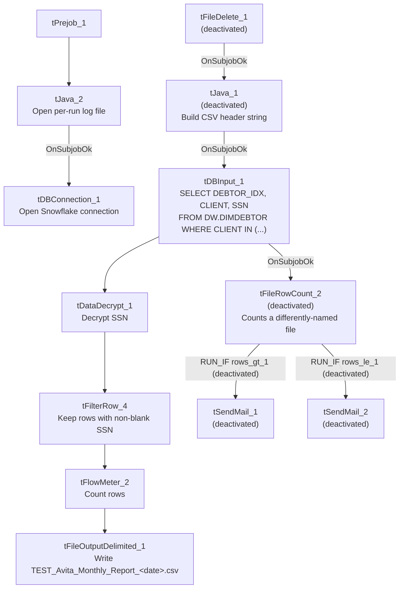

# Talend Job: TEST_Avita_Monthly_Report_Extract

## Overview

This is a test/debug variant of a monthly extract for the "Avita Health" client: it queries a fixed list of client codes (`2156AI`, `2156M`, `2156SP`, `2157`, `2157AI`, `2157M`, `2157SP`, `2158`, `2158AI`, `2158M`, `2158SP`, `2159`, `2159AI`, `2159M`, `2159SP`) from `DW.DIMDEBTOR`, decrypts each debtor's SSN, filters out rows with a blank SSN, and writes the result to a CSV — but nearly every component with a real-world side effect (`tSendMail_1`, `tSendMail_2`, `tFileDelete_1`, `tFileRowCount_2`, `tJava_1`) is explicitly deactivated (`ACTIVATE=false`), and the output file only contains 3 raw debtor columns rather than the full ~15-column report layout referenced in `tJava_1`'s (also deactivated) header-building code. This strongly suggests it is a scaled-down test harness for the real `Avita_Monthly_Report_Extract` job rather than a production report.

## Detail table

| Field | Value |
|---|---|
| Job name | TEST_Avita_Monthly_Report_Extract |
| Version | 0.1 |
| Project | EDW2SF |
| Author | jmach@harriscollect.com |
| Created | 2025-06-17T10:11:30.591-0700 |
| Last Modified | 2025-09-24T11:00:33.135-0700 |

## Step-by-step data flow

**Setup subjob:** `tPrejob_1` → `tJava_2` opens a per-run log file → on success, `tDBConnection_1` opens the Snowflake connection.

**Main subjob** (a second, disconnected chain gates the query): `tFileDelete_1` (deactivated) → `tJava_1` (deactivated, builds a CSV header string and file path but is never activated) → on success, `tDBInput_1` runs the fixed client-list query against `DW.DIMDEBTOR`.

1. `tDBInput_1` (`SELECT DEBTOR_IDX, CLIENT, SSN FROM DW.DIMDEBTOR WHERE CLIENT IN (...)`) feeds two branches: the `MAIN` row flow to `tDataDecrypt_1`, and on `SUBJOB_OK`, `tFileRowCount_2` (deactivated).
2. `tDataDecrypt_1` decrypts the `SSN` column using a job-level crypto key/file at `context.cryptoPath + "dimdbtr.crypt"` (`DIE_ON_ERROR=false`).
3. `tFilterRow_4` keeps only rows where `SSN.trim().compareTo("") > 0` (i.e., a non-blank SSN after decryption).
4. `tFlowMeter_2` counts the filtered rows.
5. `tFileOutputDelimited_1` writes the 3-column result (`DEBTOR_IDX`, `CLIENT`, `SSN`) to `context.outputDir + "TEST_Avita_Monthly_Report_" + <date> + ".csv"` (comma-delimited, header included).

**Deactivated branch (would-be row-count-based emailing):** `tFileRowCount_2` (deactivated) would count rows in a differently-named file (`Avita_Monthly_Report_...csv`, not the `TEST_` file this job actually writes) and branch via `RUN_IF` to `tSendMail_1` (deactivated, "rows_gt_1") or `tSendMail_2` (deactivated, "rows_le_1") — neither email actually fires since both `tSendMail` components and the counting step itself are deactivated.

## Settings tables

### Source: `tDBInput_1` (`tSnowflakeInput`)

| Setting | Value | What it means |
|---|---|---|
| Query | `SELECT d.DEBTOR_IDX, d.CLIENT, d.SSN FROM DW.DIMDEBTOR d WHERE CLIENT IN ('2156AI', '2156M', '2156SP', '2157', '2157AI', '2157M', '2157SP', '2158', '2158AI', '2158M', '2158SP', '2159', '2159AI', '2159M', '2159SP') ORDER BY d.CLIENT, d.DEBTOR_IDX;` | A fixed, hardcoded list of client codes tied to Avita Health, embedded directly in the query rather than parameterized via context. |

### Decrypt: `tDataDecrypt_1`

| Setting | Value | What it means |
|---|---|---|
| CRYPTO_METHOD / ALGO_VERSION | AES / 2 | Decrypts the SSN column at read time. |
| CRYPTO_FILE_PATH | `context.cryptoPath + "dimdbtr.crypt"` | Points to a shared crypto key file, not job-specific. |
| SECRET_TYPE / SECRET_KEY / PASSWORD_M1 | `***REDACTED***` | Encryption key material — preserved as redacted, not guessed. |
| DIE_ON_ERROR | `false` | A decryption failure on a given row does not fail the job. |

### Output: `tFileOutputDelimited_1`

| Setting | Value | What it means |
|---|---|---|
| FILENAME | `context.outputDir + "TEST_Avita_Monthly_Report_" + <date> + ".csv"` | Note the `TEST_` prefix baked into the actual output filename — this job writes a visibly test-named file, not the production report name. |
| Columns | `DEBTOR_IDX`, `CLIENT`, `SSN` only | 3 raw identifier/SSN columns — no name, address, balance, or other report fields, unlike the ~15-column header string built (but never used, since `tJava_1` is deactivated) elsewhere in the job. |

### Deactivated components (present but not wired to run)

| Component | What it would do if activated |
|---|---|
| `tFileDelete_1` | Delete a prior `Avita_Monthly_Report_<date>.csv` file before starting. |
| `tJava_1` | Build a ~15-column CSV header string (`CLIENT,NAME1,ADD1,CITY,ST,ZIP,PACKET,DOB,"C.D.#", SSNUM,STATUS,ASGN_AMT,ASGN_COLL,TOTAL_BA...` — truncated in metadata) for a differently-shaped, full report file. |
| `tFileRowCount_2` | Count rows in `Avita_Monthly_Report_<date>.csv` (not the file this job actually produces) to decide which email to send. |
| `tSendMail_1` / `tSendMail_2` | Email `context.mailRecipients` with subject "Avita Health Monthly Report" — either confirming the attached report or noting no valid records this month. |

## Dependencies & configuration

- **Triggers/depends on other jobs:** none — no `tRunJob` links found.
- **Context variables used:** `cryptoPath`, `logDir`, `mailRecipients`, `outputDir`.
- **2 hardcoded developer-workstation paths**: `tFileDelete_1.DIRECTORY` and `tFileDelete_1.PATH` (both `C:/Talend-Studio-20211109_1610-V8.0.1/...`) — moot in practice since `tFileDelete_1` itself is deactivated.
- Per `05_operational_runbook.md`, this job is one of the 12 project-wide jobs configured to send email — but in this `TEST_` variant, both `tSendMail` components are deactivated, so no email would actually be sent by this specific job as configured.

## Glossary

| Component type | Plain-English meaning |
|---|---|
| `tDataDecrypt` | Decrypts a column's value using a shared key/crypto file — used here to recover a plaintext SSN from an encrypted-at-rest column. |
| `tFilterRow` | Keeps only rows matching a condition, discarding the rest. |
| `tFlowMeter` | Counts rows passing a point in the flow, for logging/monitoring. |
| `tFileOutputDelimited` | Writes rows to a delimited (CSV-style) text file. |
| `tFileRowCount` | Counts the rows in an existing file (used here, when active, to decide which email branch to take). |
| `tSendMail` | Sends an email. |
| `tFileDelete` | Deletes a file or folder from disk. |

## Issues observed

- **Nearly every component with a real side effect in this job is deactivated** (`tFileDelete_1`, `tJava_1`, `tFileRowCount_2`, `tSendMail_1`, `tSendMail_2`) — only the query, decrypt, filter, and CSV-write steps actually run. This is strong, concrete evidence (not just the `TEST_` name) that this is a debug/scaled-down harness rather than a job meant to run as configured in production.
- **The deactivated `tFileRowCount_2` and `tSendMail` branch reference a completely different output filename** (`Avita_Monthly_Report_<date>.csv`) than the one this job's active branch actually writes (`TEST_Avita_Monthly_Report_<date>.csv`). Even if someone re-activated those components without also fixing the filename, the row-count check would look at the wrong (likely nonexistent) file.
- **The active output schema (`DEBTOR_IDX`, `CLIENT`, `SSN`) is a small subset of the ~15-column report header string built (but unused) in the deactivated `tJava_1`.** This test job validates the client-list query, decryption, and blank-SSN filter, but does not exercise the full report layout that the production job presumably produces — verify against `Avita_Monthly_Report_Extract`'s own metadata for the full picture.
- **This job decrypts and writes SSNs to a local CSV file** (`context.outputDir`) with `DIE_ON_ERROR=false` on the decrypt step, meaning a decryption failure on any given row would not stop the job — the resulting row would carry whatever `tDataDecrypt_1` produces on failure (unable to determine from metadata what that value is; verify in Talend Studio) rather than a hard error.
