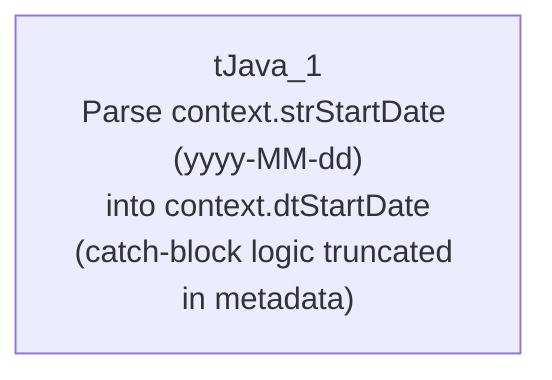

# Talend Job: TEST_Date_Params

## Overview

This is a minimal test/utility job, not a production data-mover: it contains a single `tJava` component that parses a string context variable (`context.strStartDate`) into a proper date (`context.dtStartDate`), with a fallback branch for handling bad or missing input. It moves no data between systems and has no source, target, or connection components at all — it appears to exist purely to test or demonstrate the date-parsing logic used elsewhere in the project (likely copy-pasted into other jobs that need to convert a string context parameter into a `Date`).

## Detail table

| Field | Value |
|---|---|
| Job name | TEST_Date_Params |
| Version | 0.1 |
| Project | EDW2SF |
| Author | jmach@harriscollect.com |
| Created | 2022-06-13T10:10:08.442-0700 |
| Last Modified | 2025-08-28T08:57:24.390-0700 |

## Step-by-step data flow

This job has exactly one component and no connections at all — it is a standalone snippet, not a wired pipeline.

1. `tJava_1` runs a `try`/`catch` block: it attempts `context.dtStartDate = TalendDate.TO_DATE(context.strStartDate, "yyyy-MM-dd")` and prints the resulting date. **The `catch` block's logic is truncated in this job's own metadata** — the captured code cuts off mid-statement inside a conditional that appears to check whether `context.strStartDate` is null or blank (`Relational.ISNULL(...) || StringHandling.TRIM(co...`), so the fallback behavior when parsing fails (or the input is empty) cannot be confirmed from this extraction. See Issues observed.

There is no `tPrejob`/`tPostjob`, no database or file component, and the `connections` array in this job's metadata is empty — `tJava_1` is not wired to anything else.

## Settings tables

### `tJava_1`

| Setting | Value | What it means |
|---|---|---|
| CODE (try block) | `context.dtStartDate = TalendDate.TO_DATE(context.strStartDate,"yyyy-MM-dd"); System.out.println("Start date is: " + context.dtStartDate.toString());` | Parses a `yyyy-MM-dd`-formatted string context variable into a `Date` context variable and logs the result. |
| CODE (catch block) | Truncated in metadata: `if (Relational.ISNULL(context.strStartDate) || StringHandling.TRIM(co...` | The full fallback logic (what happens if `strStartDate` is null/blank or unparseable) is not captured in this extraction. Unable to determine from metadata what `dtStartDate` becomes in that case; verify directly in Talend Studio. |

## Dependencies & configuration

- **Triggers/depends on other jobs:** none — no `tRunJob` links found, and this job does not appear in `06_dependency_matrix.md`'s orchestration table (unsurprising, since nothing calls a bare test snippet like this).
- **Context variables used:** `strStartDate` (input, a string expected in `yyyy-MM-dd` format), `dtStartDate` (output, set on successful parse).
- No hardcoded developer-workstation paths found in this job (it has no file/path-related components at all).

## Glossary

| Component type | Plain-English meaning |
|---|---|
| `tJava` | Runs arbitrary Java code once, outside of any per-row data flow — used here purely to test a date-parsing expression. |

## Issues observed

- **This job has no connections, no `tPrejob`/`tPostjob`, and no source or target of any kind** — it is a self-contained code snippet rather than a runnable ETL pipeline. Given the `TEST_` prefix on its name and its lack of any real data flow, this strongly suggests a scratch/test job used to validate the `TalendDate.TO_DATE` parsing pattern before it was used elsewhere, rather than a job that is itself scheduled to run in production. Unable to confirm its actual usage/status from metadata — verify with the team whether it is still needed or safe to retire.
- **The `catch` block's fallback logic is truncated in this metadata**, cutting off inside a null/blank check on `context.strStartDate`. What `context.dtStartDate` ends up being when the input is missing or malformed (left unset, defaulted to a specific date, etc.) cannot be determined from this extraction — verify directly in Talend Studio before assuming any particular fallback behavior.
- No other findings beyond the project-wide patterns already documented in `05_operational_runbook.md` (not applicable here in any case, since this job has no hardcoded paths, connections, or file operations to which those patterns would apply).
