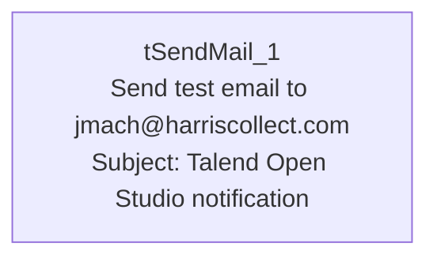

# Talend Job: TEST_Email_Alerts

## Overview

This is a minimal test/utility job: it contains a single `tSendMail` component that sends a generic "Talend Open Studio notification" email with the body "Hello" to one recipient. It moves no business data at all — it appears to exist purely to verify that the project's SMTP relay (`harriscollect-com.mail.protection.outlook.com`) and mail-authentication settings work from this Talend environment, likely used as a template or connectivity check when building the project's other alerting jobs (e.g. `Semaphore_Check`, the `LW_*` scrub jobs).

## Detail table

| Field | Value |
|---|---|
| Job name | TEST_Email_Alerts |
| Version | 0.1 |
| Project | EDW2SF |
| Author | jmach@harriscollect.com |
| Created | 2023-11-30T11:32:33.852-0800 |
| Last Modified | 2025-08-28T08:57:24.422-0700 |

## Step-by-step data flow

The job has exactly one component and no wiring to any other component — `tSendMail_1` runs as the job's entire body, with no prejob/postjob subjobs, no connections list, and no other components present in this metadata.

1. `tSendMail_1` sends a plain-text email to `jmach@harriscollect.com`, from `svc_analytics@harriscollect.com`, subject "Talend Open Studio notification", body "Hello", via SMTP host `harriscollect-com.mail.protection.outlook.com` on port 25 (no SSL/STARTTLS). `DIE_ON_ERROR` is `true`, so a failed send would fail the job.

## Settings tables

### `tSendMail_1`

| Setting | Value | What it means |
|---|---|---|
| TO / FROM | `jmach@harriscollect.com` / `svc_analytics@harriscollect.com` | Single hardcoded recipient — the job's author's own address, not a shared team inbox. |
| SUBJECT / MESSAGE | "Talend Open Studio notification" / "Hello" | Generic placeholder content, consistent with a connectivity test rather than a real business alert. |
| SMTP_HOST / SMTP_PORT | `harriscollect-com.mail.protection.outlook.com` / `25` | The project's outbound mail relay. |
| SSL / STARTTLS | `false` / `false` | No transport encryption configured on this connection. |
| AUTH_MODE / AUTH_USERNAME / AUTH_PASSWORD / TOKEN / USE_TWO_LINE_TOKEN | `***REDACTED***` (all) | Authentication details are redacted in the source metadata — preserved as-is here. |
| DIE_ON_ERROR | `true` | A failed send fails the job outright — there is no fallback logging. |
| CHECK_ATTACHMENT | `true` | Talend will validate any configured attachment exists before sending (none is configured here). |

## Dependencies & configuration

- **Triggers/depends on other jobs:** none — no `tRunJob` links found (`runjob_targets: []`), and it does not appear as a target in `06_dependency_matrix.md`.
- **Context variables used:** none — `context_vars_referenced` is empty; every setting on `tSendMail_1` is a literal, hardcoded value rather than a context variable.
- **No hardcoded developer-workstation paths** found in this job (`hardcoded_path_findings: []`) — it has no file-system components at all.

## Glossary

| Component type | Plain-English meaning |
|---|---|
| `tSendMail` | Sends an email via a configured SMTP server — used here to send a single fixed test message. |

## Issues observed

- **This job is almost certainly a test artifact, not a production alert job** — its name (`TEST_`), generic subject/body ("Talend Open Studio notification" / "Hello"), and single hardcoded personal recipient (the job's author) all point to a connectivity check rather than a real business notification. It is listed in `05_operational_runbook.md`'s "12 jobs send email on failure or completion" table alongside genuine alerting jobs like `Semaphore_Check` — worth confirming with the team whether it is still scheduled/run anywhere, since if it is, it would only ever notify one individual with a message that carries no operational information.
- **No context variables are used anywhere** in this job — every value (recipient, SMTP host, subject, body) is hardcoded directly on the component, unlike the project's other `tSendMail`-using jobs (e.g. `Semaphore_Check`, which parameterizes its recipients via literal strings but at least routes through a shared IT support inbox). If this job were ever repurposed for a real alert, none of its settings could be changed without editing the job itself.
- No other findings beyond what's already covered above; this job is too minimal to exhibit most of the project-wide patterns documented in `05_operational_runbook.md`.
