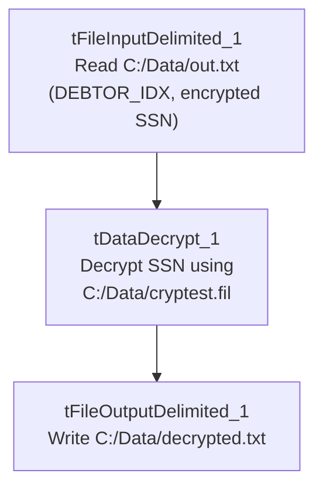

# Talend Job: Test_Decryption

## Overview

This is a small, standalone utility/test job: it reads a fixed local file of debtor SSNs (`DEBTOR_IDX`, encrypted `SSN`), decrypts the `SSN` column using Talend's built-in decryption component and a local key file, and writes the decrypted result to a second fixed local file. There is no database connection, no context variables, and no wiring to any other job — everything about this job (its hardcoded `C:/Data/...` paths and generic "Test" name) indicates it is a one-off developer test of the decryption mechanism used elsewhere in the project (e.g., for SSNs loaded from CUBS extract files), not a production data-movement job.

## Detail table

| Field | Value |
|---|---|
| Job name | Test_Decryption |
| Version | 0.1 |
| Project | EDW2SF |
| Author | jmach@harriscollect.com |
| Created | 2022-03-09T09:06:43.859-0800 |
| Last Modified | 2025-08-28T08:57:24.455-0700 |

## Step-by-step data flow

This job has no `tPrejob`/`tPostjob`, no database connection, and only a single linear chain:

1. `tFileInputDelimited_1` reads `C:/Data/out.txt` (tab-delimited, no header, `DIE_ON_ERROR=false`), producing two columns: `DEBTOR_IDX` and an encrypted `SSN`.
2. `tDataDecrypt_1` decrypts the `SSN` column using a key file at `C:/Data/cryptest.fil` (`PASSWORD_M1` and `SECRET_TYPE` both `***REDACTED***`), passing `DEBTOR_IDX` through unchanged.
3. `tFileOutputDelimited_1` writes both columns (now with a decrypted `SSN`) to `C:/Data/decrypted.txt` (tab-delimited, no header).

## Settings tables

### Source: `tFileInputDelimited_1`

| Setting | Value | What it means |
|---|---|---|
| FILENAME | `"C:/Data/out.txt"` | A fixed local file, not context-driven — no `context.sourceDir` or similar is used anywhere in this job. |
| FIELDSEPARATOR / HEADER | `\t` / 0 (no header) | Tab-delimited, no header row expected. |
| DIE_ON_ERROR | `false` | Malformed rows don't fail the job; no reject flow is wired, so any bad rows are silently dropped. |
| TEMP_DIR | `"C:/Talend-Studio-20211109_1610-V8.0.1/workspace"` | Developer workstation path — see Issues observed. |

### Transform: `tDataDecrypt_1`

| Setting | Value | What it means |
|---|---|---|
| CRYPTO_FILE_PATH | `"C:/Data/cryptest.fil"` | Local key/certificate file used to decrypt the `SSN` column. |
| PASSWORD_M1 | `***REDACTED***` | Preserved as redacted in source metadata — never guessed or reconstructed here. |
| SECRET_TYPE | `***REDACTED***` | Same — redacted in source metadata. |
| ALGO_VERSION | `1` | Decryption algorithm version used by the component. |

### Target: `tFileOutputDelimited_1`

| Setting | Value | What it means |
|---|---|---|
| FILENAME | `"C:/Data/decrypted.txt"` | Fixed local output path for the decrypted result. |
| APPEND | `false` | Output file is overwritten each run, not appended to. |

## Dependencies & configuration

- **Triggers/depends on other jobs:** none — no `tRunJob` links found, and no other job in this batch or the reference docs appears to call this one.
- **Context variables used:** none — every path in this job is a literal string, not a `context.*` reference (unusual for this project; see Issues observed).
- **Hardcoded paths:** the job's core file paths (`C:/Data/out.txt`, `C:/Data/cryptest.fil`, `C:/Data/decrypted.txt`) are all hardcoded local paths outside the standard `context.sourceDir`/`archiveDir` pattern used elsewhere in EDW2SF; the extractor separately flagged `tFileInputDelimited_1.TEMP_DIR` (`C:/Talend-Studio-20211109_1610-V8.0.1/workspace`) as a developer-workstation path per the project-wide pattern in `05_operational_runbook.md`.

## Glossary

| Component type | Plain-English meaning |
|---|---|
| `tFileInputDelimited` / `tFileOutputDelimited` | Read/write a delimited (tab- or comma-separated) text file according to a schema. |
| `tDataDecrypt` | Decrypts one or more columns using a Talend cryptographic key file, the counterpart to a `tDataEncrypt` used elsewhere to protect sensitive fields like SSN. |

## Issues observed

- **This job has no database connection, no `context.*` variables, and no `tPrejob`/`tPostjob` structure** — every other job in this batch (and the four reference docs) follows the project's standard log-file-open/connection-open/connection-close scaffolding. Its complete absence here, combined with the generic "Test" name and hardcoded `C:/Data/...` paths, strongly suggests this is a developer's local proof-of-concept for the decryption mechanism (used to decrypt SSNs loaded from CUBS extracts elsewhere in the project) rather than a job intended to run in a scheduled production pipeline. Whether it is still deployed/scheduled anywhere is unable to determine from metadata — verify with the team before assuming it's dormant.
- **No reject flow is wired from `tFileInputDelimited_1`**, and `DIE_ON_ERROR=false`, so any row that fails to parse is silently dropped with no record of it — consistent with the project-wide unwired-reject-flow pattern noted in other jobs' docs, but here with no downstream consequence since the job appears to be a test harness rather than a production load.
- **`PASSWORD_M1` and `SECRET_TYPE` on `tDataDecrypt_1` are both `***REDACTED***`** in the source metadata and are preserved as such here — the actual key/algorithm values are not available from this extraction and must not be guessed.
