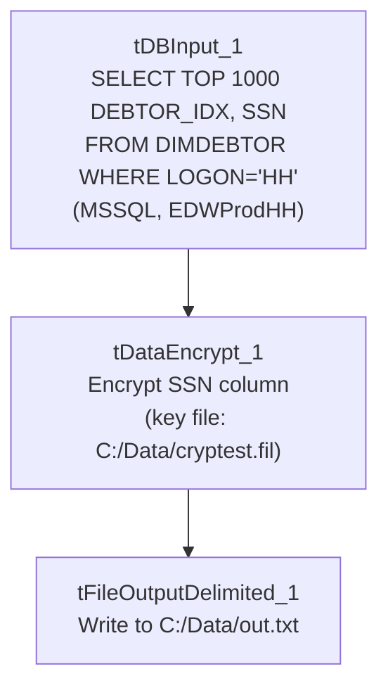

# Talend Job: Test_Encryption

## Overview

This is a small, standalone utility job — not part of the production load pipeline — that reads up to 1,000 debtor Social Security Numbers from the `EDWProdHH` MSSQL `DIMDEBTOR` table for logon `HH` (excluding rows already masked with an `XXX`-prefixed SSN), runs them through Talend's `tDataEncrypt` component, and writes the result to a local flat file. Its name and minimal structure (no logging setup, no connection-close teardown, no downstream consumer of the output file) strongly suggest it exists to test/validate the encryption component and its key file, not to run on a schedule as part of the warehouse load.

## Detail table

| Field | Value |
|---|---|
| Job name | Test_Encryption |
| Version | 0.1 |
| Project | EDW2SF |
| Author | jmach@harriscollect.com |
| Created | 2022-03-09T08:15:08.049-0800 |
| Last Modified | 2025-08-28T08:57:24.491-0700 |

## Step-by-step data flow

This job has no `tPrejob`/`tPostjob`, no explicit connection-open/-close components, and only a single linear chain:

1. `tDBInput_1` (`tMSSqlInput`) connects directly to `EDWProdHH` (`context.EDWProdHH_Server`/`Port`/`Schema`/`Database`/`Login`, password redacted) and runs `SELECT TOP 1000 [DEBTOR_IDX], SSN FROM DIMDEBTOR WHERE LOGON='HH' AND LEN(TRIM(SSN))=9 AND SSN NOT LIKE 'XXX%'` — a fixed, hardcoded logon (`'HH'`) and row limit, and a filter meant to exclude SSNs that have already been redacted/masked upstream (`'XXX%'`).
2. `tDataEncrypt_1` encrypts the `SSN` column using a password-protected crypto key file at `"C:/Data/cryptest.fil"` (`PASSWORD_M1` and `SECRET_TYPE` both redacted; `GEN_CRYPTO_FILE_CONTROLLER=false`, meaning it uses an existing key file rather than generating a new one).
3. `tFileOutputDelimited_1` writes the two-column result (`DEBTOR_IDX`, encrypted `SSN`) to a fixed local path `"C:/Data/out.txt"`, tab-delimited, no header.

## Settings tables

### Source: `tDBInput_1` (`tMSSqlInput`)

| Setting | Value | What it means |
|---|---|---|
| Connection | `context.EDWProdHH_Server`/`Port`/`Schema`/`Database`/`Login` (password `***REDACTED***`) | Connects directly to the `EDWProdHH` MSSQL database — the same operational database referenced by name throughout this project (see `01_system_architecture.md`). |
| Query | `SELECT TOP 1000 [DEBTOR_IDX], SSN FROM DIMDEBTOR WHERE LOGON='HH' AND LEN(TRIM(SSN))=9 AND SSN NOT LIKE 'XXX%'` | Pulls a bounded sample (1,000 rows) of un-masked, well-formed (9-character) SSNs for logon `HH` only — hardcoded, not parameterized by context. |

### Transform: `tDataEncrypt_1`

| Setting | Value | What it means |
|---|---|---|
| PASSWORD_M1 | `***REDACTED***` | Password protecting the encryption key/algorithm — preserved as redacted, not guessed. |
| CRYPTO_FILE_PATH | `"C:/Data/cryptest.fil"` | Local path to the crypto key file used to encrypt the `SSN` column. |
| GEN_CRYPTO_FILE_CONTROLLER | `false` | Uses the existing key file rather than generating a new one — consistent with a test job validating a pre-existing key, not provisioning one. |
| SECRET_TYPE | `***REDACTED***` | Encryption/secret type setting — redacted value preserved as-is. |

### Target: `tFileOutputDelimited_1`

| Setting | Value | What it means |
|---|---|---|
| FILENAME | `"C:/Data/out.txt"` | Fixed local output path — not driven by any context variable. |
| FIELDSEPARATOR / INCLUDEHEADER | `\t` / `false` | Tab-delimited, no header row. |
| APPEND | `false` | Overwrites the file on each run rather than appending. |

## Dependencies & configuration

- **Triggers/depends on other jobs:** none — no `tRunJob` links found, and this job is not called by (nor does it call) any other job in `06_dependency_matrix.md`.
- **Context variables used:** `EDWProdHH_Database`, `EDWProdHH_Login`, `EDWProdHH_Port`, `EDWProdHH_Schema`, `EDWProdHH_Server` — the standard `EDWProdHH_0.1` context group (see `01_system_architecture.md`/`06_dependency_matrix.md`).
- **No hardcoded-path findings were flagged by the metadata extraction for this job** — but see Issues observed; the job in fact contains several hardcoded local paths that simply weren't captured by the extractor's specific pattern-matching.

## Glossary

| Component type | Plain-English meaning |
|---|---|
| `tMSSqlInput` | Runs a query against a Microsoft SQL Server database and returns the result rows. |
| `tDataEncrypt` | Encrypts one or more columns of a row using a password-protected key file, producing an encrypted value in place of the original. |
| `tFileOutputDelimited` | Writes rows to a delimited (e.g., tab- or comma-separated) local text file. |

## Issues observed

- **This job's `hardcoded_path_findings` list came back empty from the metadata extraction, but it clearly contains hardcoded local Windows paths**: `tDataEncrypt_1.CRYPTO_FILE_PATH` (`"C:/Data/cryptest.fil"`) and `tFileOutputDelimited_1.FILENAME` (`"C:/Data/out.txt"`) are both literal, non-context-driven paths. These simply weren't flagged by whatever pattern the extractor used to detect hardcoded paths elsewhere in this project (typically the `C:/Talend-Studio-...` workspace path) — worth noting so this job isn't assumed path-clean just because the automated finding list is empty.
- **No `tPrejob`/`tPostjob`, no explicit connection-close, and the query is entirely hardcoded** (fixed `TOP 1000`, fixed `LOGON='HH'`) rather than driven by context variables the way production load jobs in this project are. Combined with the job's name (`Test_Encryption`), this strongly suggests it is a one-off validation/test utility for the `tDataEncrypt` component rather than a job intended to run on a production schedule — but this is an inference from structure, not something stated anywhere in the metadata; confirm with the team before assuming it's safe to delete or ignore in scheduling audits.
- **The output file (`C:/Data/out.txt`) has no documented downstream consumer** in this job or any other job's metadata reviewed in this batch — if this job is in fact still scheduled, it's worth asking why, since nothing appears to read its output.
