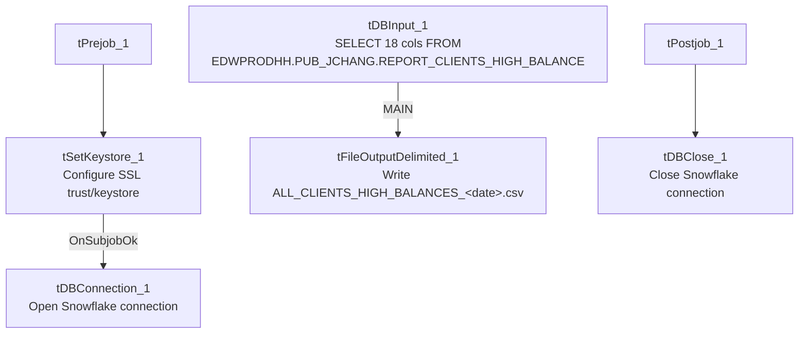

# Talend Job: Top_N_Accounts_All_Extract

## Overview

Extracts a report of high-balance client accounts (client name, debtor/packet identifiers, industry, assigned/current balance, and a set of contact-activity counters — dialer calls, manual calls, texts, letters, inbound calls, emails, VoApps — plus last-contact date and director comments) from a Snowflake reporting object and writes it to a single dated CSV file. The source query reads directly from `EDWPRODHH.PUB_JCHANG.REPORT_CLIENTS_HIGH_BALANCE` — a schema this project's system architecture documentation flags as likely individually owned rather than shared infrastructure (see Issues observed).

## Detail table

| Field | Value |
|---|---|
| Job name | Top_N_Accounts_All_Extract |
| Version | 0.1 |
| Project | EDW2SF |
| Author | jmach@harriscollect.com |
| Created | 2023-07-25T14:52:25.472-0700 |
| Last Modified | 2025-11-16T21:26:41.798-0800 |

## Step-by-step data flow

**Setup subjob:** `tPrejob_1` → `tSetKeystore_1` configures SSL trust/keystore settings from `context.keystorePath` (all passwords redacted) → on success, `tDBConnection_1` opens the Snowflake connection.

**Main subjob:**

1. `tDBInput_1` runs a fixed `SELECT` of 18 columns (`CLIENT_NAME`, `DEBTOR_IDX`, `PACKET_IDX`, `PL_GROUP`, `PARTY`, `INDUSTRY`, `BATCH_DATE`, `ASSIGNED_AMOUNT`, `BALANCE_DIMDEBTOR`, `DIALER_AGENT_CALLS`, `OUTBOUND_MANUAL_CALLS`, `TEXT_MESSAGES`, `LETTERS`, `DIALER_AGENTLESS_CALLS`, `INBOUND_AGENT_CALLS`, `EMAILS`, `VOAPPS`, `LAST_CONTACT`, `DIRECTOR_COMMENTS`) from `EDWPRODHH.PUB_JCHANG.REPORT_CLIENTS_HIGH_BALANCE`.
2. `tFileOutputDelimited_1` writes the result set directly (`MAIN` connector, no `tMap` in between) to `context.targetDir + "ALL_CLIENTS_HIGH_BALANCES_" + TalendDate.getDate("CCYYMMDD") + ".csv"` (comma-delimited, header included, file recreated each run — `APPEND=false`).

**Teardown subjob:** `tPostjob_1` → `tDBClose_1` closes the Snowflake connection.

No connector in this job's metadata explicitly links the setup subjob's `tDBConnection_1` to the main subjob's `tDBInput_1` — the query subjob relies on the shared Snowflake connection opened during setup, the same pattern seen (without an explicit link either) in other single-query extract jobs in this project.

## Settings tables

### Source: `tDBInput_1` (`tSnowflakeInput`)

| Setting | Value | What it means |
|---|---|---|
| Query | `SELECT CLIENT_NAME, DEBTOR_IDX, PACKET_IDX, PL_GROUP, PARTY, INDUSTRY, BATCH_DATE, ASSIGNED_AMOUNT, BALANCE_DIMDEBTOR, DIALER_AGENT_CALLS, OUTBOUND_MANUAL_CALLS, TEXT_MESSAGES, LETTERS, DIALER_AGENTLESS_CALLS, INBOUND_AGENT_CALLS, EMAILS, VOAPPS, LAST_CONTACT, DIRECTOR_COMMENTS FROM EDWPRODHH.PUB_JCHANG.REPORT_CLIENTS_HIGH_BALANCE;` | Reads a fully-qualified `EDWPRODHH.PUB_JCHANG.*` object — note the query hardcodes the `PUB_JCHANG` schema name rather than referencing it via a context-driven connection label. |

### Target: `tFileOutputDelimited_1`

| Setting | Value | What it means |
|---|---|---|
| FILENAME | `context.targetDir + "ALL_CLIENTS_HIGH_BALANCES_" + TalendDate.getDate("CCYYMMDD") + ".csv"` | Dated output file, one per run. |
| CSV_OPTION / INCLUDEHEADER | `true` / `true` | Standard CSV with header row. |
| APPEND | `false` | Each run creates/overwrites a fresh dated file rather than appending — since the filename includes the date, re-running on the same day would replace that day's file. |

### Setup: `tSetKeystore_1`

| Setting | Value | What it means |
|---|---|---|
| SSL_KEYSTORE | `context.keystorePath` | Client keystore path driven by context. |
| SSL_TRUSTSERVER_TRUSTSTORE | `"C:/clientTrustStore.trustStore"` (hardcoded) | A local, non-context-driven path — see Issues observed. |
| Passwords (`SSL_KEYSTORE_PASSWORD`, `SSL_TRUSTSERVER_PASSWORD`, `NEED_CLIENT_AUTH`) | `***REDACTED***` | Preserved as redacted in the source metadata. |

## Dependencies & configuration

- **Triggers/depends on other jobs:** none — no `tRunJob` links found, and this job does not appear as a call target in `06_dependency_matrix.md`'s 65-link orchestration table.
- **Context variables used:** `keystorePath`, `targetDir`.
- **1 hardcoded path finding:** `tSetKeystore_1.SSL_TRUSTSERVER_TRUSTSTORE` = `"C:/clientTrustStore.trustStore"` — a local/developer-workstation-style path, distinct from the `C:/Talend-Studio-...` pattern flagged project-wide in `05_operational_runbook.md`, but the same class of portability risk.

## Glossary

| Component type | Plain-English meaning |
|---|---|
| `tSnowflakeInput` | Runs a query against Snowflake and returns its result rows. |
| `tFileOutputDelimited` | Writes rows to a delimited (CSV-style) text file. |
| `tSetKeystore` | Configures SSL/TLS keystore and truststore settings used by the job's database connection(s). |
| `tSnowflakeConnection` / `tSnowflakeClose` | Open and close the Snowflake connection used by the job. |

## Issues observed

- **The source query directly references the `PUB_JCHANG` schema** (`EDWPRODHH.PUB_JCHANG.REPORT_CLIENTS_HIGH_BALANCE`). Per `01_system_architecture.md`, `PUB_JCHANG` is one of only two connection labels in the entire 289-job project (the other being `SF_Equabli`/`SF_Equabli_2`) that look individually owned — its name matches a personal set of initials, and it's used by only 5 jobs project-wide — rather than shared platform infrastructure. This extract's underlying report table lives in that schema, so if the owning individual's access or the schema itself changes, this job (and any consumer of its CSV) could silently break. Worth confirming ownership and business-continuity plans for this schema with the team.
- **No reject/error handling, `tDie`, `tWarn`, or `tSendMail` exists in this job** — consistent with the majority of the 289 jobs per `05_operational_runbook.md`, but worth noting there is no job-specific signal if the query returns zero rows or fails partway; a failure here would surface only as a generic Talend execution error.
- **No archiving or cleanup step for the output CSV.** Each run creates a new dated file in `context.targetDir`; nothing in this job's own metadata removes or archives older extract files, so that directory could accumulate indefinitely unless managed by an external process not captured here.
