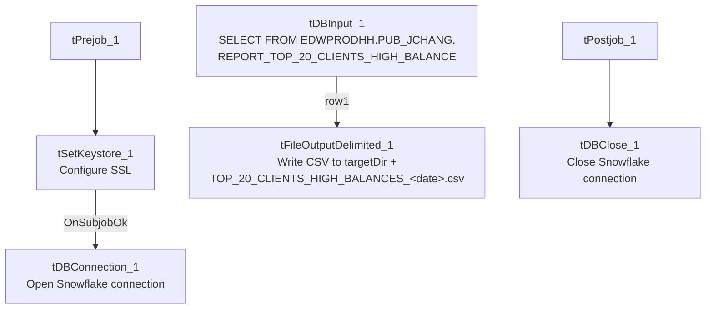

# Talend Job: Top_N_Accounts_Extract

## Overview

Extracts a pre-built "Top 20 clients by high balance" report — client name, debtor/packet identifiers, industry, assigned amount, current balance, and a set of contact-channel activity counters (dialer/agent calls, texts, letters, emails, VoApps, last contact date) — from a Snowflake view (`EDWPRODHH.PUB_JCHANG.REPORT_TOP_20_CLIENTS_HIGH_BALANCE`) and writes it straight to a dated CSV file. Despite the job's generic name ("Top N Accounts"), the underlying query and its target table name are hardcoded to a specific "Top 20 Clients" report, and its schema is per-client rather than per-account.

## Detail table

| Field | Value |
|---|---|
| Job name | Top_N_Accounts_Extract |
| Version | 0.1 |
| Project | EDW2SF |
| Author | jmach@harriscollect.com |
| Created | 2023-07-18T14:17:01.903-0700 |
| Last Modified | 2025-11-16T21:27:58.022-0800 |

## Step-by-step data flow

**Setup subjob:** `tPrejob_1` → `tSetKeystore_1` configures SSL trust/keystore (`SSL_KEYSTORE` from `context.keystorePath`, truststore path hardcoded, passwords redacted) → on success, `tDBConnection_1` opens the Snowflake connection.

**Main subjob** (runs independently of the setup subjob — there is no visible connection tying `tDBInput_1` to the connection setup chain, meaning it implicitly relies on Talend's shared/default Snowflake connection rather than being explicitly wired to `tDBConnection_1`):

1. `tDBInput_1` runs a fixed `SELECT` of 18 named columns (`CLIENT_NAME`, `DEBTOR_IDX`, `PACKET_IDX`, `PL_GROUP`, `PARTY`, `INDUSTRY`, `BATCH_DATE`, `ASSIGNED_AMOUNT`, `BALANCE_DIMDEBTOR`, and a set of contact-channel counters: `DIALER_AGENT_CALLS`, `OUTBOUND_MANUAL_CALLS`, `TEXT_MESSAGES`, `LETTERS`, `DIALER_AGENTLESS_CALLS`, `INBOUND_AGENT_CALLS`, `EMAILS`, `VOAPPS`, `LAST_CONTACT`) `FROM EDWPRODHH.PUB_JCHANG.REPORT_TOP_20_CLIENTS_HIGH_BALANCE;` — a fully qualified, three-part Snowflake object reference, reading from a view/table in a `PUB_JCHANG` schema (see `01_system_architecture.md`'s note that `PUB_JCHANG` looks like an individually-owned schema, not shared platform infrastructure).
2. `tFileOutputDelimited_1` writes the rows straight through, unmapped, to `context.targetDir + "TOP_20_CLIENTS_HIGH_BALANCES_" + TalendDate.getDate("CCYYMMDD") + ".csv"` — comma-delimited, header included, `ISO-8859-15` encoding.

**Teardown subjob:** `tPostjob_1` → `tDBClose_1` closes the Snowflake connection.

## Settings tables

### Source: `tDBInput_1` (`tSnowflakeInput`)

| Setting | Value | What it means |
|---|---|---|
| Query | `SELECT ... FROM EDWPRODHH.PUB_JCHANG.REPORT_TOP_20_CLIENTS_HIGH_BALANCE;` | A fixed, fully qualified read of a pre-built report object — no filtering, joins, or parameters visible in this job. All logic (the "top 20" selection and balance/activity aggregation) lives in that Snowflake object, not in this Talend job. |
| Columns | 18 client-level and contact-activity columns | See Overview for the full list; all typed as strings/dates/decimals matching the source view's own column types. |

### Target: `tFileOutputDelimited_1`

| Setting | Value | What it means |
|---|---|---|
| FILENAME | `context.targetDir + "TOP_20_CLIENTS_HIGH_BALANCES_" + TalendDate.getDate("CCYYMMDD") + ".csv"` | Produces a new, dated file on every run rather than overwriting a fixed name — old extracts are not automatically cleaned up by this job. |
| FIELDSEPARATOR / INCLUDEHEADER | `,` / `true` | Standard comma-delimited CSV with a header row. |
| ENCODING | `ISO-8859-15` | Non-UTF-8 encoding, consistent with other legacy-source extract jobs in this project. |
| APPEND | `false` | Each run creates a fresh file rather than appending to a prior day's extract. |

## Dependencies & configuration

- **Triggers/depends on other jobs:** none — no `tRunJob` links found, and this job does not appear in `06_dependency_matrix.md`'s orchestration table.
- **Context variables used:** `keystorePath` (SSL/keystore configuration), `targetDir` (output directory for the CSV — not confirmed against `StandardFolders_0.1` or any other documented context group in `_shared_context.json`; likely a job-specific or ad hoc variable).
- **1 hardcoded developer-workstation path:** `tSetKeystore_1.SSL_TRUSTSERVER_TRUSTSTORE` (`"C:/clientTrustStore.trustStore"`) — same project-wide risk pattern documented in `05_operational_runbook.md`.
- **Reads from `EDWPRODHH.PUB_JCHANG`**, a schema flagged in `01_system_architecture.md` as looking individually owned (the "JCHANG" initials suggest a specific person) rather than shared platform infrastructure — worth confirming who owns this schema/view and what happens to this extract if that person or their access changes.

## Glossary

| Component type | Plain-English meaning |
|---|---|
| `tSnowflakeInput` | Runs a query against Snowflake and returns its result rows. |
| `tFileOutputDelimited` | Writes rows to a delimited (CSV-style) text file. |
| `tSnowflakeConnection` / `tSnowflakeClose` | Open/close the Snowflake connection used by the job. |
| `tSetKeystore` | Configures SSL trust/keystore settings used by the Snowflake connection. |

## Issues observed

- **`tDBInput_1` has no visible connection to `tDBConnection_1`** in this job's `connections` metadata — the setup subjob (keystore → connection) and the main subjob (query → file write) are two separate, unconnected chains. This is common in Talend when a query component implicitly uses the single open/shared connection rather than being explicitly wired to it, so it's likely not a functional problem, but it does mean this job's own metadata alone doesn't prove the query actually runs against the connection the job deliberately configured (with its keystore/SSL settings) rather than some other default. Verify directly in Talend Studio if this job's connection behavior is ever in question.
- **The job's name ("Top N Accounts Extract") is more generic than what it actually does** — it runs one fixed query against a specifically-named "Top 20 Clients High Balance" report object, with no parameter controlling "N" or the ranking criteria visible anywhere in this job. Anyone expecting a configurable top-N account extract based on the job name alone would be misled; the actual selection logic lives entirely in the Snowflake view/table this job reads from, not in Talend.
- **`context.targetDir` is not a variable name found in any of the documented context groups** in `_shared_context.json` (unlike `StandardFolders_0.1`'s `sourceDir`/`archiveDir`/`logDir`). Unable to determine from this job's own metadata which context group supplies it or what path it resolves to; verify with the team.
- No other findings beyond the project-wide hardcoded-path pattern already documented in `05_operational_runbook.md`.
