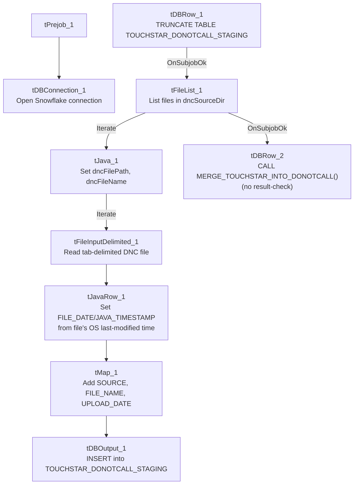

# Talend Job: Touchstar_DNC_Load

## Overview

Loads "Do Not Call" phone-number files from the Touchstar dialer system into Snowflake: it reads every file in a source directory (tab-delimited, one phone number per relevant row), tags each row with its source file name and the file's own last-modified timestamp, inserts the results into a `TOUCHSTAR_DONOTCALL_STAGING` table, then calls a stored procedure to merge them into a downstream do-not-call table. This gives the collections platform an up-to-date list of numbers it must not dial, sourced from the Touchstar system rather than the I3 dialer platform used elsewhere in this project.

## Detail table

| Field | Value |
|---|---|
| Job name | Touchstar_DNC_Load |
| Version | 0.2 |
| Project | EDW2SF |
| Author | jmach@harriscollect.com |
| Created | 2025-01-17T08:44:05.198-0800 |
| Last Modified | 2025-09-24T11:09:22.403-0700 |

## Step-by-step data flow

**Setup subjob:** `tPrejob_1` → `tDBConnection_1` opens the Snowflake connection (`OnComponentOk`). No SSL/keystore step, no MSSQL connection — this job only ever talks to Snowflake and the local file system.

**Main subjob** — starts independently at `tDBRow_1` (no incoming trigger link, so it begins as soon as the job starts):

1. `tDBRow_1` runs `TRUNCATE TABLE TOUCHSTAR_DONOTCALL_STAGING;` against Snowflake (no explicit schema prefix — see Issues observed).
2. On success (`OnSubjobOk`), `tFileList_1` lists files in `context.dncSourceDir` (`EXCLUDEFILEMASK` of `*.txt` is set but `IFEXCLUDE=false`, so the exclusion is configured but never actually applied).
3. For each file, `tJava_1` sets `context.dncFilePath`/`context.dncFileName` from the current file-list iteration values.
4. `tFileInputDelimited_1` reads the file (tab-delimited, header row present, `DIE_ON_ERROR=false`) into a schema of `PHONE_NUMBER`, `FILE_DATE`, `JAVA_TIMESTAMP`, `PHONE` — reading a repository reject schema whose stored label is a bare metadata GUID (`_3w2w4LQEEe-PfNW_65jztA - metadata`), not a descriptive name.
5. `tJavaRow_1` derives `FILE_DATE` and `JAVA_TIMESTAMP` from the source file's own OS-level last-modified timestamp (via `Files.readAttributes`), not from any value inside the file, and passes `PHONE` through.
6. `tMap_1` adds `SOURCE` and `FILE_NAME` (presumably populated from `context.dncFileName`, not directly visible in the captured mapping expressions) and `UPLOAD_DATE`, producing the final 6-column shape: `FILE_DATE`, `JAVA_TIMESTAMP`, `PHONE`, `SOURCE`, `FILE_NAME`, `UPLOAD_DATE`.
7. `tDBOutput_1` inserts the mapped rows into Snowflake table `TOUCHSTAR_DONOTCALL_STAGING` (`INSERT`, no table-recreate action).
8. Once the `tFileList_1` iteration subjob completes (`OnSubjobOk`), `tDBRow_2` runs `CALL MERGE_TOUCHSTAR_INTO_DONOTCALL();` — with **no result-checking downstream** (no `tJavaRow`/`tWarn`/`tDie` after this call).

**No teardown subjob** — no `tPostjob`/`tDBClose` component exists in this job's metadata, so the Snowflake connection opened in setup is never explicitly closed by this job.

There is also no archive/delete step for the source files after loading — this job never removes or archives what it reads from `context.dncSourceDir`.

## Settings tables

### Source: `tFileInputDelimited_1`

| Setting | Value | What it means |
|---|---|---|
| FILENAME | `context.dncFilePath` | The current file from `tFileList_1`'s iteration. |
| FIELDSEPARATOR / HEADER | `\t` / 1 header row | Tab-delimited with a header row skipped. |
| SCHEMA (main) | `PHONE_NUMBER`, `FILE_DATE`, `JAVA_TIMESTAMP`, `PHONE` (plus `errorCode`/`errorMessage` reject columns) | `PHONE_NUMBER` is read from the file but not carried forward past `tJavaRow_1` — only `PHONE` (a separately-named column) continues into the map and output. See Issues observed. |
| SCHEMA_REJECT | Repository schema ID `_3w2w4LQEEe-PfNW_65jztA - metadata` | Generic GUID-based label, not a descriptive name — unable to determine from metadata what this reject schema's actual columns are. |
| DIE_ON_ERROR | `false` | Malformed rows do not fail the job... |
| Reject flow | Not wired | ...but no connection carries rejected rows anywhere in this job — they are silently dropped with no record of how many, or which, rows failed to parse. |
| TEMP_DIR | `"C:/Talend-Studio-20211109_1610-V8.0.1/workspace"` | Hardcoded developer-workstation path. |

### Date derivation: `tJavaRow_1`

| Setting | Value | What it means |
|---|---|---|
| Logic | Reads the source file's OS-level last-modified timestamp (`Files.readAttributes(...).lastModifiedTime()`) and uses it to populate `FILE_DATE`/`JAVA_TIMESTAMP` | The "file date" recorded against every DNC number is when the file was last touched on disk, not any date encoded in the file's own content — if the file's OS timestamp is altered by a copy/transfer step before Talend reads it, the recorded date would reflect that instead of the file's true origin date. |

### Target: `tDBOutput_1` (`tSnowflakeOutput`)

| Setting | Value | What it means |
|---|---|---|
| Table | `TOUCHSTAR_DONOTCALL_STAGING` | Destination staging table for the raw DNC rows. |
| Output action | `INSERT` | Appends rows; relies on the earlier `TRUNCATE` (step 1) to prevent duplicate accumulation across runs. |

### Truncate & merge: `tDBRow_1` / `tDBRow_2`

| Setting | Value | What it means |
|---|---|---|
| Query (`tDBRow_1`) | `TRUNCATE TABLE TOUCHSTAR_DONOTCALL_STAGING;` | No explicit schema prefix (e.g. `STAGING.`) — see Issues observed. |
| Query (`tDBRow_2`) | `CALL MERGE_TOUCHSTAR_INTO_DONOTCALL();` | Calls a stored procedure (not shown in this metadata) presumably merging the staged numbers into a final do-not-call table. No `RETVALUE`/result capture follows this call. |

## Dependencies & configuration

- **Triggers/depends on other jobs:** none — no `tRunJob` links found, and this job is not listed as a target in `06_dependency_matrix.md`.
- **Context variables used:** `dncFileName`, `dncFilePath`, `dncSourceDir`. None of these are documented context groups in `_shared_context.json` — this job appears to use its own dedicated (undocumented in the shared context extract) variable set rather than the shared `StandardFolders_0.1` group used by most of the project.
- **1 hardcoded developer-workstation path**: `tFileInputDelimited_1.TEMP_DIR` — same project-wide risk documented in `05_operational_runbook.md`.

## Glossary

| Component type | Plain-English meaning |
|---|---|
| `tFileList` | Lists files in a directory for the job to iterate over one at a time. |
| `tFileInputDelimited` | Reads a delimited (tab/comma-style) text file according to a schema. |
| `tJavaRow` | Runs custom Java code once per input row — here used to stamp each row with the source file's OS last-modified date. |
| `tMap` | Maps/transforms columns from one schema to another. |
| `tSnowflakeOutput` / `tSnowflakeRow` / `tSnowflakeConnection` | Write rows to a Snowflake table / run an arbitrary SQL statement or stored-procedure call against Snowflake / open the Snowflake connection used elsewhere in the job. |

## Issues observed

- **No teardown subjob exists** — there is no `tPostjob`/`tDBClose` anywhere in this job's metadata, so the Snowflake connection opened by `tDBConnection_1` is never explicitly closed within the job itself (it would only close when the JVM exits). This is a gap relative to most other jobs in this project, which pair every `tDBConnection` with a matching `tDBClose` in a `tPostjob` subjob.
- **No archive or delete step for the source files** — after a DNC file is loaded, it is left in place in `context.dncSourceDir` with no record of having been processed. Unlike file-load jobs elsewhere in this project (e.g. `ADP_Payroll_Load`, which archives-then-deletes), a rerun of this job would reprocess every file in the directory again, potentially reloading numbers already staged (mitigated only by the preceding `TRUNCATE`, which clears the whole staging table each run regardless of which files are "new").
- **No result-checking on the `MERGE_TOUCHSTAR_INTO_DONOTCALL()` call** — a failure in the merge stored procedure would only surface as a generic Talend execution error, with no job-specific `tWarn`/`tDie` message to distinguish it, unlike jobs such as `ADP_Payroll_Load` that capture and branch on the procedure's return code.
- **No reject flow wired from `tFileInputDelimited_1`**, and its reject schema is a bare GUID-labeled repository schema (`_3w2w4LQEEe-PfNW_65jztA - metadata`) rather than a descriptively-named one — malformed rows are silently dropped with no diagnostic trail, matching the project-wide pattern already documented in `05_operational_runbook.md`.
- **`TRUNCATE TABLE TOUCHSTAR_DONOTCALL_STAGING;` has no explicit schema prefix**, unlike some other jobs in this project that qualify their truncate/merge targets with `STAGING.`. Unable to determine from this metadata whether `TOUCHSTAR_DONOTCALL_STAGING` resolves to the intended staging schema via the connection's default schema, or whether this is a portability risk if that default ever changes — verify with the team.
- **The source schema reads a `PHONE_NUMBER` column that is then dropped** — `tFileInputDelimited_1`'s schema includes both `PHONE_NUMBER` and `PHONE`, but only `PHONE` survives into `tJavaRow_1`'s output and everything downstream. Unable to determine from this metadata whether `PHONE_NUMBER` and `PHONE` are expected to always hold the same value (making the drop harmless) or whether this indicates a leftover/unused column from an earlier version of the file format; verify with the team.
