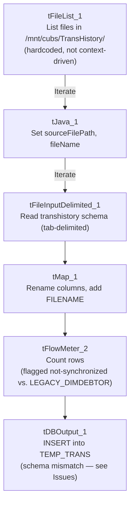

# Talend Job: Trans_History_Load

## Overview

Reads transaction-history export files (the `"transhistory"` repository schema: transaction ID, debtor, transaction code/amount/date, statement and posting fields, letter/campaign references) from a fixed Linux path (`/mnt/cubs/TransHistory/`) and loads them into a Snowflake table named `TEMP_TRANS`. Unlike every other job in this batch, this job has **no visible connection-open/close, prejob/postjob, log-file setup, merge step, or file archive/delete step** — see Issues observed, which flags several structural anomalies significant enough that this job's actual production readiness should be verified directly with the team before relying on this documentation alone.

## Detail table

| Field | Value |
|---|---|
| Job name | Trans_History_Load |
| Version | 0.1 |
| Project | EDW2SF |
| Author | jmach@harriscollect.com |
| Created | 2023-06-02T10:12:23.102-0700 |
| Last Modified | 2025-09-24T11:08:20.984-0700 |

## Step-by-step data flow

This job's metadata contains only 6 components — no `tPrejob`/`tPostjob`, no `tDBConnection`/`tDBClose`, no log-file setup, and no archive/delete step. The entire flow is:

1. `tFileList_1` lists files in the **hardcoded, non-context-driven** directory `/mnt/cubs/TransHistory/` (an `EXCLUDEFILEMASK` of `*.txt` is configured but `IFEXCLUDE=false`, so no files are actually excluded).
2. For each file (`ITERATE`), `tJava_1` sets `context.sourceFilePath` and `context.fileName`.
3. `tFileInputDelimited_1` reads the file (tab-delimited, header row, `DIE_ON_ERROR=false`) using the repository schema `"transhistory"` — roughly 80 columns covering transaction ID/code/amount/date, statement fields (`STMT_DATE`, `STMT_CODE`, `STMT_GRP`), posting fields (`POST_DATE`, `POST_BATCH`), NSF/cancellation/judgment payment fields, and letter/campaign references (`LTR_ID`, `CAMPID`).
4. `tMap_1` maps the source columns to a target schema, renaming a few columns along the way (e.g. source `DEBTOR` → target `DEBTOR_NUMBER`, source `SOURCE`/`COMMENT` → target `TRANS_SOURCE`/`TRANS_COMMENT`) and adding a `FILENAME` column.
5. `tFlowMeter_2` counts rows passing through (labeled "MyLabel", not renamed for this job; also flagged in the metadata as having a "not synchronized" reference to a `LEGACY_DIMDEBTOR` repository schema — see Issues observed).
6. `tDBOutput_1` inserts the rows into Snowflake table `TEMP_TRANS` (`INSERT`, no table-recreate action) — but see Issues observed regarding a serious schema mismatch on this final component.

## Settings tables

### Source: `tFileList_1` / `tFileInputDelimited_1`

| Setting | Value | What it means |
|---|---|---|
| DIRECTORY (`tFileList_1`) | `"/mnt/cubs/TransHistory/"` | Hardcoded literal path, not built from `context.sourceDir` as most other file-source jobs in this project do — see Issues observed. |
| FILENAME (`tFileInputDelimited_1`) | `context.sourceFilePath` | Set per-iteration by `tJava_1`. |
| SCHEMA | Repository schema `"transhistory"` | ~80-column transaction-history layout (transaction ID/code/amount, statement/posting fields, letter/campaign references). |
| FIELDSEPARATOR / HEADER | `\t` / 1 header row | Tab-delimited with a header row skipped. |
| DIE_ON_ERROR | `false` | Malformed rows don't fail the job; no reject flow is wired downstream (rejects are silently dropped). |
| TEMP_DIR | `"C:/Talend-Studio-20211109_1610-V8.0.1/workspace"` | Developer-workstation path — see Issues observed. |

### Target: `tDBOutput_1` (`tSnowflakeOutput`)

| Setting | Value | What it means |
|---|---|---|
| Table | `TEMP_TRANS` | Destination table name — the "TEMP" prefix and this job's overall thin/incomplete structure both suggest a staging or in-progress table rather than a finished production target. |
| Schema label | `table.main.schema:REPOSITORY_SCHEMA_TYPE = "... - LEGACY_DIMDEBTOR"` | **The target component's own schema reference is labeled `LEGACY_DIMDEBTOR`**, and its actual captured column list (`DEBTOR`, `DEBTOR_IDX`, `NAME1`, `NAME2`, `ADD1`, `ADD2`, `CITY`, `ST`, `ZIP`, `DOB`, `SSN`, `TOTAL_BAL`, `ASGN_AMT`, `PROM_DT`, `UPDATEKEY`, etc.) is a **debtor-dimension-shaped schema, not a transaction-shaped one** — it does not match the transaction-shaped columns (`LOGON`, `TRANS_ID`, `TRANS_IDX`, `TCODE`, `TRANS_AMT`, `TRANS_DATE`, etc.) that `tMap_1` actually outputs. See Issues observed — this is the most significant finding in this job. |
| Output action | `INSERT` | No truncate/merge step precedes or follows this insert anywhere in the job. |

## Dependencies & configuration

- **Triggers/depends on other jobs:** none — no `tRunJob` links found, and this job is not listed as a `tRunJob` target anywhere in `06_dependency_matrix.md`. Note this is a distinct job from `CUBS_Raw_Trans_Load` (which `CO_Master_Load` does call) — the two should not be confused.
- **Context variables used:** only `fileName` and `sourceFilePath` — no `context.sourceDir`, `logDir`, `archiveDir`, or database-connection context variables appear anywhere in this job's metadata, consistent with the missing connection/log/archive components noted above.
- **1 hardcoded path** flagged by the extractor: `tFileInputDelimited_1.TEMP_DIR` (`C:/Talend-Studio-20211109_1610-V8.0.1/workspace`). In addition, `tFileList_1.DIRECTORY` (`/mnt/cubs/TransHistory/`) is a hardcoded literal path not built from a context variable — not flagged by the automated extractor (it only pattern-matches the `C:/Talend-Studio...` developer path), but worth noting here since it means this job's source directory cannot be changed without editing the job itself.

## Glossary

| Component type | Plain-English meaning |
|---|---|
| `tFileList` | Lists files in a directory for the job to iterate over one at a time. |
| `tFileInputDelimited` | Reads a delimited (tab- or comma-separated) text file according to a schema. |
| `tMap` | Maps/transforms columns from one schema to another, including renames. |
| `tFlowMeter` | Counts rows passing through a point in the flow, for logging/monitoring. |
| `tSnowflakeOutput` | Writes rows to a Snowflake table. |

## Issues observed

- **`tDBOutput_1`'s captured schema is debtor-shaped (`LEGACY_DIMDEBTOR`-labeled), not transaction-shaped, while `tMap_1` immediately upstream outputs transaction-shaped columns.** The columns captured on `tDBOutput_1` (`DEBTOR`, `DEBTOR_IDX`, `NAME1`, `ADD1`, `CITY`, `SSN`, `TOTAL_BAL`, `PROM_DT`, `UPDATEKEY`, etc.) do not resemble the transaction-shaped columns produced by `tMap_1` (`LOGON`, `TRANS_ID`, `TRANS_IDX`, `DEBTOR_NUMBER`, `TCODE`, `TRANS_AMT`, `TRANS_DATE`, `CLIENT`, etc.), and `tDBOutput_1`'s own schema parameter is explicitly labeled with the repository schema name `LEGACY_DIMDEBTOR` rather than anything transaction- or `TEMP_TRANS`-related. This is either (a) a job built by copying a debtor-dimension-load job and never fully repointing its output schema to match the actual transaction data flowing into it, or (b) a metadata-extraction artifact. Given how strictly this documentation must trace to source metadata, this cannot be resolved without opening the job directly in Talend Studio — but as captured, this looks like a broken or unfinished job that would very likely fail at runtime with a column-count/type mismatch, or silently write transaction data into columns meant for debtor demographics. This is the most consequential finding in this batch and should be verified with the team before this job is assumed to be production-ready.
- **This job has no `tPrejob`/`tPostjob`, no `tDBConnection`/`tDBClose`, and no log-file-open step**, unlike every other job examined in this batch and both file-load reference docs (`ADP_Payroll_Load`, `Raw_PCI_Letter_Load`). The Snowflake connection `tDBOutput_1` uses must therefore be either an embedded/inline connection configuration not captured separately in this extraction, or a genuinely missing piece of the job. Unable to determine from metadata; if this job is actually scheduled to run, verify how (and whether) it successfully connects to Snowflake at all.
- **No truncate or merge step accompanies the `INSERT` into `TEMP_TRANS`.** Given the "TEMP" naming and the schema mismatch noted above, this reinforces the impression that `TEMP_TRANS` is an intermediate/staging table this job was never finished wiring into the rest of the warehouse (no downstream merge into a `DW`-schema fact table, unlike the `CUBS_Raw_Trans_Load`/`FACTTRANS` merge pattern documented in `CO_Master_Load`).
- **No archive or delete step processes the source file after loading** — unlike the majority of file-load jobs in this project (which zip/copy the file to `archiveDir` and delete the original), this job leaves every processed file in place in `/mnt/cubs/TransHistory/`. Combined with the hardcoded, unfiltered `tFileList_1` directory listing, repeated runs would very likely reprocess the same files indefinitely unless some external process (not visible in this metadata) removes them.
- **`tFileList_1.DIRECTORY` is a hardcoded literal Linux path (`/mnt/cubs/TransHistory/`)** rather than being built from `context.sourceDir` (as `StandardFolders_0.1` and most other file-load jobs in this project do). This means the source location cannot be reconfigured via context/environment without editing the job directly.
