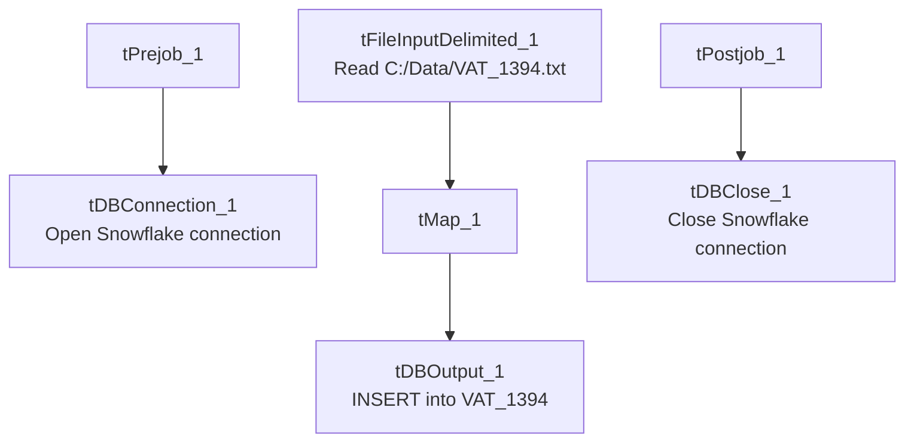

# Talend Job: VAT_1394_Load

## Overview

A small, single-purpose file-load job that reads a fixed local flat file (`VAT_1394.txt` — three columns: a debtor number, a client code, and a value) and inserts it as-is into the Snowflake `VAT_1394` table. Everything about the source location is hardcoded rather than context-driven, and there is no merge, truncate, or archive step — this looks like a narrow, purpose-built load for a specific one-off or recurring reference dataset (the name suggests a specific legal/regulatory data point, "VAT" and a case or docket number, "1394") rather than a general per-site pipeline.

## Detail table

| Field | Value |
|---|---|
| Job name | VAT_1394_Load |
| Version | 0.1 |
| Project | EDW2SF |
| Author | jmach@harriscollect.com |
| Created | 2023-02-22T09:53:55.674-0800 |
| Last Modified | 2025-08-28T08:57:24.530-0700 |

## Step-by-step data flow

**Setup subjob:** `tPrejob_1` → `tDBConnection_1` opens the Snowflake connection (`OnComponentOk`).

**Main subjob** (not explicitly linked to the setup subjob — runs as its own subjob, same pattern noted in other jobs in this project):

1. `tFileInputDelimited_1` reads `"C:/Data/VAT_1394.txt"` (tab-delimited, header row present, `DIE_ON_ERROR=false`) into a 3-column schema (`D_NUM`, `CLIENT`, `VALUE`).
2. `tMap_1` passes the row through unchanged to the same 3-column target schema (`DIE_ON_ERROR=true`, so a mapping failure fails the job).
3. `tDBOutput_1` inserts the rows into Snowflake table `VAT_1394` (`INSERT`, no table-recreate action, no preceding `TRUNCATE`).

**Teardown subjob:** `tPostjob_1` → `tDBClose_1` closes the Snowflake connection.

## Settings tables

### Source: `tFileInputDelimited_1`

| Setting | Value | What it means |
|---|---|---|
| FILENAME | `"C:/Data/VAT_1394.txt"` | Fixed, hardcoded local path — not driven by any context variable (unlike the `context.sourceDir`-based pattern used by most other jobs in this project). |
| FIELDSEPARATOR / HEADER | `\t` / 1 header row | Tab-delimited with a header row skipped. |
| Schema | `D_NUM`, `CLIENT`, `VALUE` (3 columns) | A narrow, fixed record shape — a debtor/document number, a client code, and a single value field. |
| DIE_ON_ERROR | `false` | Malformed rows do not fail the job... |
| Reject flow | Not wired | ...but there is also no connection carrying rejected rows anywhere — same silently-dropped-rejects pattern seen elsewhere in this project (e.g. `ADP_Payroll_Load`). |
| TEMP_DIR | `"C:/Talend-Studio-20211109_1610-V8.0.1/workspace"` | Hardcoded developer-workstation path — see `05_operational_runbook.md`. |

### Target: `tDBOutput_1` (`tSnowflakeOutput`)

| Setting | Value | What it means |
|---|---|---|
| Table | `VAT_1394` | Destination table. |
| Output action | `INSERT` | Appends rows; there is no `TRUNCATE` before this step, so rerunning the job against the same source file would duplicate all its rows in the target table. |
| Table action | `NONE` | Table is not recreated/altered by this job. |

## Dependencies & configuration

- **Triggers/depends on other jobs:** none — no `tRunJob` links found, and this job is not called by (nor calls) any other job in `06_dependency_matrix.md`.
- **Context variables used:** none — `context_vars_referenced` is empty for this job. Every setting (file path, table name) is a literal value.
- **1 hardcoded developer-workstation path** in `tFileInputDelimited_1.TEMP_DIR` (`C:/Talend-Studio-20211109_1610-V8.0.1/workspace`) — same risk pattern documented project-wide in `05_operational_runbook.md`.

## Glossary

| Component type | Plain-English meaning |
|---|---|
| `tFileInputDelimited` | Reads a delimited (CSV/TSV-style) text file according to a schema. |
| `tMap` | Maps/transforms columns from one schema to another. |
| `tSnowflakeOutput` / `tSnowflakeConnection` / `tSnowflakeClose` | Write rows to a Snowflake table / open and close the Snowflake connection used in the job. |

## Issues observed

- **No `TRUNCATE` before the `INSERT`, and no context-variable-driven file path** — unlike the file-list-and-archive pattern used elsewhere (e.g. `SMS_IC_Outbound_Load`, `ADP_Payroll_Load`), this job reads the exact same fixed file path every run with no archiving or deletion step visible in this metadata. If it's actually scheduled to run repeatedly against a file that isn't replaced or cleared between runs, every run would re-insert the same rows into `VAT_1394`, duplicating them indefinitely. Unable to determine from metadata whether an external process replaces or clears `C:/Data/VAT_1394.txt` between runs — verify with the team.
- **This job has zero context variables**, which is unusual for this project (most jobs reference at least `logDir`/`sourceDir`/`archiveDir` from `StandardFolders_0.1`, per `06_dependency_matrix.md`) — reinforcing that this is likely a narrowly-scoped, possibly one-off or manually-triggered load rather than part of the regular scheduled pipeline. This is an inference from structure, not stated in the metadata; confirm with the team before assuming it runs unattended.
- **No reject flow wired from `tFileInputDelimited_1`** (`DIE_ON_ERROR=false`, no downstream reject connection) — malformed rows are silently dropped with no record of how many or which ones failed to parse, same pattern flagged in other file-load jobs in this project.
- **No logging setup (`tJava`/log-file redirection), no `tDie`/`tWarn`, and no keystore/SSL configuration** in this job, unlike most other jobs reviewed in this batch — a load failure here would only produce a generic Talend execution error with no job-specific diagnostic message.
