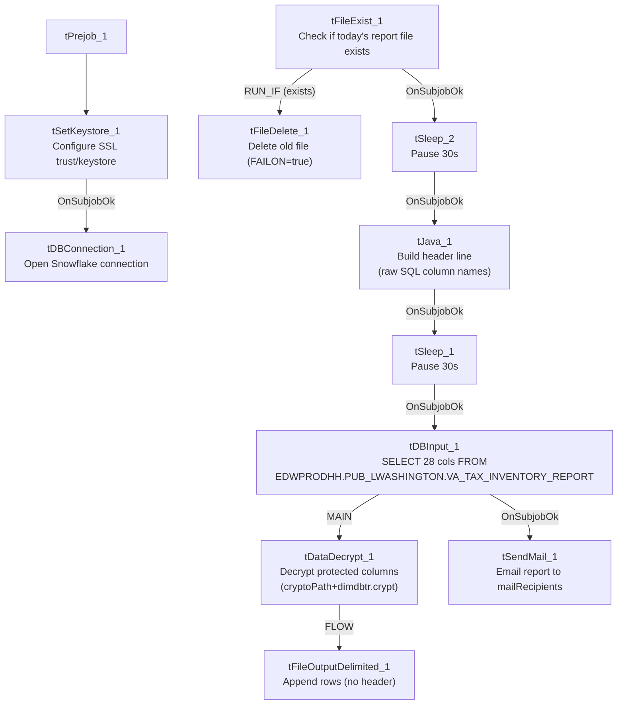

# Talend Job: VA_Tax_Inventory_Report

## Overview

Produces a bi-monthly "VA Tax Inventory" report: it extracts debtor account records with PII (name, address, SSN, employer name/address, packet/collector-rank and balance fields) from a Snowflake source, decrypts protected columns, writes the decrypted rows to a dated CSV with a manually-built header line, and emails the finished report to a distribution list. The source table lives in `EDWPRODHH.PUB_LWASHINGTON.VA_TAX_INVENTORY_REPORT` — a schema name that, like `PUB_JCHANG` flagged elsewhere in this project's architecture documentation, reads as an individual's name rather than shared platform infrastructure (see Issues observed).

## Detail table

| Field | Value |
|---|---|
| Job name | VA_Tax_Inventory_Report |
| Version | 0.1 |
| Project | EDW2SF |
| Author | jmach@harriscollect.com |
| Created | 2026-05-04T14:41:45.643-0700 |
| Last Modified | 2026-06-04T17:06:34.623-0700 |

## Step-by-step data flow

**Setup subjob:** `tPrejob_1` → `tSetKeystore_1` configures SSL trust/keystore settings from `context.keystorePath` (passwords redacted) → on success, `tDBConnection_1` opens the Snowflake connection.

**Main subjob:**

1. `tFileExist_1` checks whether today's dated output file (`context.outputDir+"VATAX_BiMonthly_Inventory_Report_"+<date>+".csv"`) already exists.
2. If it does (`RUN_IF`), `tFileDelete_1` deletes it — with `FAILON=true`, so if the delete fails (e.g., the file is locked open elsewhere), the whole job fails at that point.
3. Regardless of whether the file existed (`tFileExist_1`'s `SUBJOB_OK`), the job continues: `tSleep_2` pauses 30 seconds, then `tJava_1` builds `context.outputDir + fileName` and a custom header string using the **raw, human-readable column names from the SQL query** (e.g., `"PACKET NBR"`, not the normalized schema name `PACKET_NBR`) — the statement that actually writes this header line to the file is truncated in this metadata, but the surrounding wiring (`tFileOutputDelimited_1` has `APPEND=true` and `INCLUDEHEADER=false`) strongly implies `tJava_1` writes the header before any data rows are appended.
4. `tSleep_1` pauses another 30 seconds, then `tDBInput_1` runs the source query against `EDWPRODHH.PUB_LWASHINGTON.VA_TAX_INVENTORY_REPORT` (28 columns).
5. `tDBInput_1` → `tDataDecrypt_1` (`MAIN`) decrypts protected columns using a key file at `context.cryptoPath+"dimdbtr.crypt"` (secret type, secret key, and password all redacted; `DIE_ON_ERROR=true`, so a decryption failure — e.g., a missing or wrong key file — fails the entire job rather than letting undecrypted or garbled PII through).
6. `tDataDecrypt_1` → `tFileOutputDelimited_1` (`FLOW`) appends the decrypted rows to the same dated CSV, without a header (the header was already written by `tJava_1` in step 3).
7. Once `tDBInput_1`'s subjob completes (`SUBJOB_OK`), `tSendMail_1` emails the finished report (subject "VA Tax Inventory Report", body "The bi-monthly VA Tax Inventory report is attached.") from `svc_analytics@harriscollect.com` to `context.mailRecipients`, with `CHECK_ATTACHMENT=true` and `DIE_ON_ERROR=true` — **no attachment-file parameter is visible in this job's captured metadata** (see Issues observed).

**No teardown subjob is present in this job's metadata** — there is no `tPostjob`/`tDBClose` pair, unlike every other job in this batch (see Issues observed).

## Settings tables

### Gate / cleanup: `tFileExist_1` / `tFileDelete_1`

| Setting | Value | What it means |
|---|---|---|
| FILE_NAME (`tFileExist_1`) | `context.outputDir+"VATAX_BiMonthly_Inventory_Report_"+<date>+".csv"` | Checks for today's dated report file before rebuilding it. |
| FAILON (`tFileDelete_1`) | `true` | Unlike the `FAILON=false` default seen on equivalent `tFileDelete` components elsewhere in this project, a failed delete here fails the job outright. |

### Source: `tDBInput_1` (`tSnowflakeInput`)

| Setting | Value | What it means |
|---|---|---|
| Query | `SELECT "ACCOUNT", CLIENT, NAME, ADDRESS, CITY, ST, ZIP, "PACKET NBR", DOB, DSK, CDN, "PN-ASSIGN", "PRIN COL", SSN, "MISC COST", "MISC COST REC ", "ST CD", "EMP1 NAME", "EMP1 ADDR", "28.TEC_SSN", "MISC.3", "NOTE2 TYPE", "PKT-BAL", LST_PAY_DT, "PKT-AGN", "PKT-COL", "PACKET LOCAL RANK ESX 4", "KDOR BANK" FROM EDWPRODHH.PUB_LWASHINGTON.VA_TAX_INVENTORY_REPORT;` | Reads a fully-qualified `EDWPRODHH.PUB_LWASHINGTON.*` object, with several quoted column aliases containing spaces/punctuation that Talend's schema mechanically normalizes (e.g. `"28.TEC_SSN"` becomes schema column `_8_TEC_SSN`, dropping the leading `2` — see Issues observed). |

### Decrypt: `tDataDecrypt_1`

| Setting | Value | What it means |
|---|---|---|
| CRYPTO_FILE_PATH | `context.cryptoPath+"dimdbtr.crypt"` | Key/config file used to decrypt protected columns (e.g. `SSN`). |
| CRYPTO_METHOD / ALGO_VERSION | `AES` / `2` | Algorithm details. |
| SECRET_TYPE / SECRET_KEY / PASSWORD_M1 | `***REDACTED***` | Preserved as redacted in the source metadata. |
| DIE_ON_ERROR | `true` | A decryption failure fails the whole job rather than allowing undecrypted/garbled PII to pass through. |

### Target: `tFileOutputDelimited_1`

| Setting | Value | What it means |
|---|---|---|
| FILENAME | `context.outputDir+"VATAX_BiMonthly_Inventory_Report_"+<date>+".csv"` | Same dated file whose header `tJava_1` wrote earlier in the flow. |
| APPEND / INCLUDEHEADER | `true` / `false` | Rows are appended below the header line written separately by `tJava_1`, not by this component. |

### Notification: `tSendMail_1`

| Setting | Value | What it means |
|---|---|---|
| TO / FROM | `context.mailRecipients` / `"svc_analytics@harriscollect.com"` | Recipient list is context-driven; sender is a shared analytics service account. |
| SUBJECT / MESSAGE | `"VA Tax Inventory Report"` / `"The bi-monthly VA Tax Inventory report is attached."` | |
| CHECK_ATTACHMENT | `true` | The component expects an attachment — but no attachment-file path parameter appears anywhere in this job's captured metadata (see Issues observed). |
| DIE_ON_ERROR | `true` | A failed send fails the job. |
| SMTP_HOST / PORT / SSL / STARTTLS | `"harriscollect-com.mail.protection.outlook.com"` / `25` / `false` / `false` | Unencrypted SMTP relay, consistent with an internal mail relay setup. |

## Dependencies & configuration

- **Triggers/depends on other jobs:** none — no `tRunJob` links found, and this job does not appear as a call target in `06_dependency_matrix.md`'s 65-link orchestration table.
- **Context variables used:** `cryptoPath`, `keystorePath`, `mailRecipients`, `outputDir`.
- **3 hardcoded path findings:** `tSetKeystore_1.SSL_TRUSTSERVER_TRUSTSTORE` (`"C:/clientTrustStore.trustStore"`) and `tFileDelete_1.DIRECTORY`/`PATH` (both `C:/Talend-Studio-20211109_1610-V8.0.1/workspace/delete_folder...`) — same project-wide portability risk documented in `05_operational_runbook.md`.

## Glossary

| Component type | Plain-English meaning |
|---|---|
| `tFileExist` | Checks whether a specific file exists on disk. |
| `tFileDelete` | Deletes a file or folder. |
| `tSleep` | Pauses job execution for a fixed number of seconds. |
| `tJava` | Runs custom Java code — here used to build a filename and a custom CSV header string. |
| `tSnowflakeInput` | Runs a query against Snowflake and returns its result rows. |
| `tDataDecrypt` | Decrypts data previously encrypted with a matching key/algorithm — used here to restore protected PII columns (e.g. SSN) before they're written to the output file. |
| `tFileOutputDelimited` | Writes rows to a delimited (CSV-style) text file. |
| `tSendMail` | Sends an email, optionally with an attachment. |
| `tSetKeystore` / `tSnowflakeConnection` | Configure SSL trust/keystore settings and open the Snowflake connection used by the job. |

## Issues observed

- **`tSendMail_1` has `CHECK_ATTACHMENT=true` but no attachment-file path parameter is visible anywhere in this job's captured metadata.** The email almost certainly is meant to attach the CSV file just written (`context.outputDir+"VATAX_BiMonthly_Inventory_Report_"+<date>+".csv"`), but this cannot be confirmed from the extracted metadata alone — verify directly in Talend Studio.
- **This job has no `tPostjob`/`tDBClose` teardown at all** — unlike every other job documented in this batch. The Snowflake connection opened by `tDBConnection_1` is never explicitly closed in this job's own component list, which could leave connections open longer than necessary depending on how the Talend runtime handles job-end cleanup in this case.
- **The source query hardcodes quoted column aliases containing spaces and punctuation** (e.g. `"PACKET NBR"`, `"PN-ASSIGN"`, `"28.TEC_SSN"`), which Talend's schema mechanically normalizes into different names (e.g. `"28.TEC_SSN"` becomes the schema column `_8_TEC_SSN`, silently dropping the leading `2`). Anyone tracing this job's output columns back to source definitions should refer to the raw SQL text captured above, not the normalized schema column names, to avoid misidentifying a field.
- **Two 30-second `tSleep` pauses (`tSleep_1`, `tSleep_2`) are wired into the main flow with no comment or explanation captured in the metadata.** Unable to determine their purpose (e.g., waiting for a file-system operation to settle, or deliberately throttling) from this job's own data — verify with the team before assuming they can be shortened or removed.
- **`tFileDelete_1.FAILON=true`**, unlike the `FAILON=false` seen on equivalent `tFileDelete` components elsewhere in this project's file-load jobs — if the prior day's report file can't be deleted (e.g., locked open by another process, such as someone viewing it), this job fails outright rather than continuing.
- **The source schema (`PUB_LWASHINGTON`) reads as an individual's name**, similar to `PUB_JCHANG` (flagged in `01_system_architecture.md` as likely individually owned). `PUB_LWASHINGTON` is not itself listed among that document's named connection labels, so it may be a schema reached through an already-documented connection rather than a distinct one — but the same governance question (what happens if the underlying person/relationship changes) applies here too. Verify ownership with the team.
