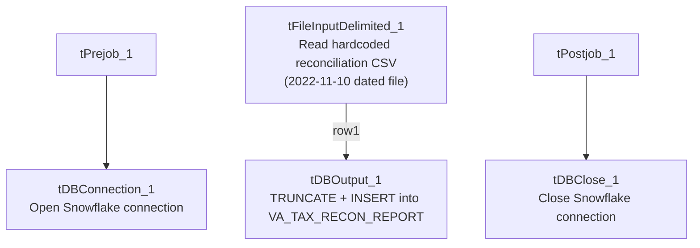

# Talend Job: VA_Tax_Report_Load

## Overview

Loads a Virginia tax-collection reconciliation report — a CSV comparing debtor balances (total/tax-principal/penalty/interest) as recorded in-house ("H_H") against balances reported in an external file, with computed differences and an error message column — into a Snowflake `VA_TAX_RECON_REPORT` table. The source file itself is a specific, dated reconciliation export (`Recon_20221110_OCAReferralSynch.OCA_HHC.20221102...csv`) rather than a generic pattern, which is unusual for a recurring load job — see Issues observed.

## Detail table

| Field | Value |
|---|---|
| Job name | VA_Tax_Report_Load |
| Version | 0.1 |
| Project | EDW2SF |
| Author | jmach@harriscollect.com |
| Created | 2022-11-16T11:00:35.838-0800 |
| Last Modified | 2025-09-24T11:07:21.544-0700 |

## Step-by-step data flow

**Setup subjob:** `tPrejob_1` → `tDBConnection_1` opens the Snowflake connection.

**Main subjob:**

1. `tFileInputDelimited_1` reads a fixed, hardcoded CSV file path (`/mnt/va_tax/HHC-Collections/Reconciliation_Reports/2022/Recon_20221110_OCAReferralSynch.OCA_HHC.20221102.09_44_01.csv`) using a repository schema labeled `"recon_report"` for both the main and reject branches (comma-delimited, 2 header rows skipped, `DIE_ON_ERROR=false`), covering 21 columns: `Debtor`, `Client`, `Agn_Date`, `Status`, `Cancel_Date`, `Last_Pay_Date`, `Last_Pay_Amt`, `CDN`, three "H_H" balance columns (`H_H_Total_Bal`, `H_H_Tax_Prin_Bal`, `H_H_Penalty_Bal`, `H_H_Interest_Bal`), `Error_Message`, four "File" balance columns, four "Diff" balance columns, and `COLL_AGENCY`.
2. `tDBOutput_1` inserts the rows directly into Snowflake table `VA_TAX_RECON_REPORT` (`INSERT`, `tableAction: TRUNCATE` — the table is truncated as part of this same output step, not via a separate explicit `TRUNCATE` statement like some other jobs in this project).

**Teardown subjob:** `tPostjob_1` → `tDBClose_1` closes the Snowflake connection.

## Settings tables

### Source: `tFileInputDelimited_1`

| Setting | Value | What it means |
|---|---|---|
| FILENAME | `"/mnt/va_tax/HHC-Collections/Reconciliation_Reports/2022/Recon_20221110_OCAReferralSynch.OCA_HHC.20221102.09_44_01.csv"` | A single, specific, dated file path — **not** a `context.sourceDir`/pattern-based reference like most file-load jobs in this project. See Issues observed. |
| HEADER | `2` | Skips 2 header rows, not the usual single header row — suggests this source file has a two-line header block. |
| SCHEMA (main) / SCHEMA_REJECT | Both repository schema `"recon_report"` (same ID for main and reject) | Main and reject branches correctly share one schema definition, unlike some other jobs in this project (e.g. `ProInsight_CCU_Scorecard_Load`) where main/reject schemas diverge. |
| DIE_ON_ERROR | `false` | Malformed rows don't fail the job... |
| Reject flow | Not wired | ...but no connection carries rejected rows anywhere in this job — silently dropped, same gap documented project-wide in `05_operational_runbook.md`. |
| TEMP_DIR | `"C:/Talend-Studio-20211109_1610-V8.0.1/workspace"` | Hardcoded developer-workstation path. |

### Target: `tDBOutput_1` (`tSnowflakeOutput`)

| Setting | Value | What it means |
|---|---|---|
| Table | `VA_TAX_RECON_REPORT` | Destination table for the reconciliation rows. |
| Output action | `INSERT` | Appends rows. |
| Table action | `TRUNCATE` | The table is cleared immediately before the insert, as part of this single component's configuration (rather than via a separate `tDBRow`/`TRUNCATE` step used elsewhere in the project) — same net effect (fresh data every run), different mechanism. |

## Dependencies & configuration

- **Triggers/depends on other jobs:** none — no `tRunJob` links found, and this job does not appear in `06_dependency_matrix.md`'s orchestration table.
- **Context variables used:** none found in this job's metadata (`context_vars_referenced` is empty) — every path and setting visible here is either hardcoded or comes from the component's own static configuration, not a shared context group.
- **1 hardcoded path:** `tFileInputDelimited_1.TEMP_DIR` (`"C:/Talend-Studio-20211109_1610-V8.0.1/workspace"`) — same project-wide risk pattern documented in `05_operational_runbook.md`. Note the source `FILENAME` itself is also effectively hardcoded (a specific dated file path), though it wasn't flagged by the extraction's `hardcoded_path_findings` list — see Issues observed.

## Glossary

| Component type | Plain-English meaning |
|---|---|
| `tFileInputDelimited` | Reads a delimited (CSV-style) text file according to a schema. |
| `tSnowflakeOutput` / `tSnowflakeConnection` / `tSnowflakeClose` | Write rows to a Snowflake table / open and close the Snowflake connection used by the job. |

## Issues observed

- **The source file path is a single, specific, dated file** (`Recon_20221110_OCAReferralSynch.OCA_HHC.20221102.09_44_01.csv`) hardcoded directly into `tFileInputDelimited_1.FILENAME`, rather than a `context.sourceDir`-based path or a wildcard/pattern picked up via `tFileList` like nearly every other recurring file-load job in this project. If this job is actually scheduled to run on a recurring basis, it would re-read and re-load the exact same November 2022 file every time, never picking up a newer reconciliation export — which would make `VA_TAX_RECON_REPORT` permanently stale. Alternatively, this job may simply be a one-off/historical load that was never intended to run again, or the file path is meant to be edited by hand before each run. Unable to determine actual usage pattern from metadata; verify with the team whether this job is still active and, if so, how the file path is supposed to be kept current.
- **No reject flow is wired from `tFileInputDelimited_1`.** `DIE_ON_ERROR=false` means malformed rows don't fail the job, but there is also no connection carrying rejected rows anywhere (no file, log, or table) — they are silently dropped with no record of how many, or which, rows failed to parse. Same gap documented project-wide in `05_operational_runbook.md`.
- **No context variables are used anywhere in this job** — unlike nearly every other job in this batch, it has no `StandardFolders_0.1`, connection-label, or environment-specific variables at all. Combined with the hardcoded file path, this makes the job effectively non-portable: every environment-specific detail (source path, table name) is baked directly into the job rather than parameterized, so promoting this job between dev/test/prod environments would require editing the job itself rather than just supplying different context values.
