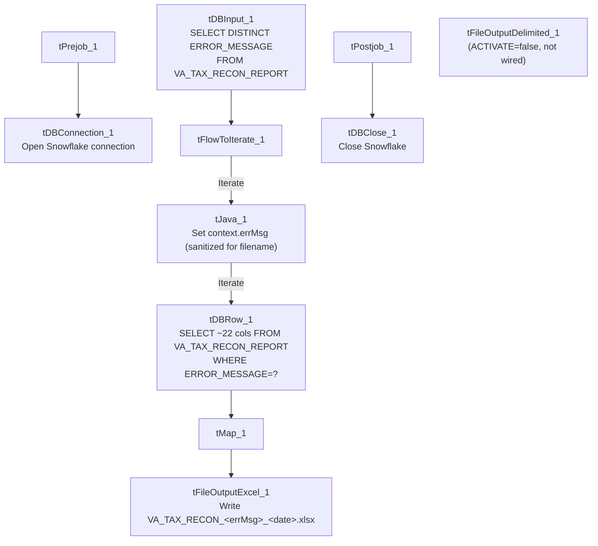

# Talend Job: VA_Tax_Report_Split

## Overview

Splits an existing Virginia tax-reconciliation report (`VA_TAX_RECON_REPORT` in Snowflake — debtor tax-account balances, agency/collection fields, and a computed `ERROR_MESSAGE`) into one Excel workbook per distinct error message. It reads the list of distinct error messages already present in the table, then for each one re-queries the full report filtered to that message and writes the matching rows to their own `.xlsx` file, so each category of reconciliation error can be reviewed as a separate spreadsheet. This job does not compute or populate `ERROR_MESSAGE` itself — it only reads and re-splits a report some other job (not present in this batch) has already produced.

## Detail table

| Field | Value |
|---|---|
| Job name | VA_Tax_Report_Split |
| Version | 0.1 |
| Project | EDW2SF |
| Author | jmach@harriscollect.com |
| Created | 2022-11-18T10:25:37.774-0800 |
| Last Modified | 2025-09-24T11:07:11.543-0700 |

## Step-by-step data flow

**Setup subjob:** `tPrejob_1` → `tDBConnection_1` opens the Snowflake connection.

**Main subjob** — starts independently at `tDBInput_1` (no incoming trigger, runs as soon as the job starts):

1. `tDBInput_1` runs `SELECT DISTINCT RTRIM(ERROR_MESSAGE) AS ERROR_MESSAGE FROM VA_TAX_RECON_REPORT;` against Snowflake, producing the distinct list of error messages currently in the report.
2. `tFlowToIterate_1` converts that result set into an iteration loop — one pass per distinct error message.
3. For each message, `tJava_1` sets `context.errMsg` from the current row's `ERROR_MESSAGE`, sanitizing it for use in a filename: commas are stripped, `"<+"` is replaced with `"LT"`, `>` with `"GT"`, and spaces with underscores.
4. `tDBRow_1` re-queries `VA_TAX_RECON_REPORT` with a full ~22-column `SELECT` (debtor, client, agency dates, last-payment info, multiple `H_H_*`/`FILE_*`/`DIFF_*` balance-and-difference columns, `COLL_AGENCY`) filtered `WHERE ERROR_MESSAGE=?` — bound to the current iteration's raw (unsanitized) error message value.
5. `tMap_1` passes the 22 columns straight through with no transformation.
6. `tFileOutputExcel_1` writes the matching rows to `context.outputDir+"VA_TAX_RECON_"+context.errMsg+"_"+TalendDate.getDate("CCYYMMDD")+".xlsx"`, with the sheet named after `context.errMsg` and `APPEND_FILE`/`APPEND_SHEET` both `true` (append rather than overwrite, in case the job runs more than once against the same date).

**Teardown subjob:** `tPostjob_1` → `tDBClose_1` (close Snowflake).

A second output component, `tFileOutputDelimited_1` (would write a `.txt` version of the same rows to `context.outputDir+"VA_TAX_RECON_"+context.errMsg+"_"+TalendDate.getDate("CCYYMMDD")+".txt"`), exists in the job but has `ACTIVATE=false` and no connection wired to it in this metadata — see Issues observed.

## Settings tables

### Distinct-value driver: `tDBInput_1`

| Setting | Value | What it means |
|---|---|---|
| Query | `SELECT DISTINCT RTRIM(ERROR_MESSAGE) AS ERROR_MESSAGE FROM VA_TAX_RECON_REPORT;` | Trailing whitespace is trimmed from the error message before it's used to drive the loop — but see Issues observed regarding the re-query step, which does not apply the same trim. |

### Per-message re-query: `tDBRow_1` (`tSnowflakeRow`)

| Setting | Value | What it means |
|---|---|---|
| Query | `SELECT LEFT(DEBTOR,50) AS DEBTOR, ..., LEFT(ERROR_MESSAGE,100) AS ERROR_MESSAGE, ... FROM VA_TAX_RECON_REPORT WHERE ERROR_MESSAGE=?` | Re-pulls the full report a second time per distinct message rather than splitting the first result set in-memory — for a report with many distinct error messages, this means the table is scanned once per message. Several numeric fields use `TRY_TO_NUMERIC`/`TRY_TO_DATE` (non-throwing conversions), so a malformed value becomes `NULL` rather than failing the row. |
| Bind parameter | `?` = the current iteration's `ERROR_MESSAGE` value from `tDBInput_1` (not the `context.errMsg`-sanitized version) | The filter uses the original, un-sanitized message text — appropriate, since it must match what's actually stored in the table; only the *filename* uses the sanitized `context.errMsg`. |

### Output: `tFileOutputExcel_1`

| Setting | Value | What it means |
|---|---|---|
| FILENAME | `context.outputDir+"VA_TAX_RECON_"+context.errMsg+"_"+TalendDate.getDate("CCYYMMDD")+".xlsx"` | One file per distinct error message, dated by run date (not by any date column in the data). |
| SHEETNAME | `context.errMsg` | Names the worksheet after the (sanitized) error message. |
| APPEND_FILE / APPEND_SHEET | `true` / `true` | If the job is run more than once on the same calendar date, new rows are appended to the existing file/sheet rather than overwriting it — worth knowing if a rerun is expected to produce a clean file. |
| PASSWORD | `***REDACTED***` | Workbook protection password, redacted in source metadata — preserved as-is. |

### Inactive output: `tFileOutputDelimited_1`

| Setting | Value | What it means |
|---|---|---|
| ACTIVATE | `false` | This component is present in the job design but disabled — it does not run. |
| FILENAME (configured) | `context.outputDir+"VA_TAX_RECON_"+context.errMsg+"_"+TalendDate.getDate("CCYYMMDD")+".txt"` | Would write a tab-delimited `.txt` twin of the Excel output, if enabled. |
| Wiring | Not connected to any other component in this job's `connections` list | Even if re-activated, it currently has no incoming data flow — see Issues observed. |

## Dependencies & configuration

- **Triggers/depends on other jobs:** none — no `tRunJob` links found, and this job does not appear in `06_dependency_matrix.md`'s orchestration table. It depends on `VA_TAX_RECON_REPORT` already being populated by some other, unidentified job or process not present in this batch.
- **Context variables used:** `errMsg` (set internally per iteration), `outputDir`.
- No hardcoded developer-workstation paths found in this job (`hardcoded_path_findings: []`).
- **Possible relation to other VA_Tax jobs:** the project is known to include `VA_Tax_Report_Load` and `VA_Tax_Inventory_Report` (the latter listed in `05_operational_runbook.md`'s email-alert job list). This job's own metadata does not reference either by name, and neither appears in its `runjob_targets` — unable to determine from this job's own metadata whether it runs downstream of `VA_Tax_Report_Load` (which one would guess populates `VA_TAX_RECON_REPORT`) or independently; verify with the team, and cross-check those jobs' own docs if available.

## Glossary

| Component type | Plain-English meaning |
|---|---|
| `tSnowflakeConnection` / `tSnowflakeInput` / `tSnowflakeRow` / `tSnowflakeClose` | Open a Snowflake connection, run a query and return its rows, run an arbitrary SQL statement, and close the connection. |
| `tFlowToIterate` | Converts a set of query result rows into a loop, running downstream components once per row/value. |
| `tMap` | Maps/transforms columns from one schema to another — here, a straight pass-through with no changes. |
| `tFileOutputExcel` | Writes rows to an Excel (`.xlsx`) workbook, one sheet (or appended sheet) per configured name. |
| `tFileOutputDelimited` | Writes rows to a delimited (CSV/TSV-style) text file — present in this job but disabled. |

## Issues observed

- **The distinct-message query trims the error message (`RTRIM`), but the per-message re-query's `WHERE ERROR_MESSAGE=?` filters against the untrimmed value passed through the iteration**, and the `tJava_1` filename-sanitizing logic operates on that same untrimmed value. If any row in `VA_TAX_RECON_REPORT` has trailing whitespace variance in `ERROR_MESSAGE` (which is exactly why the distinct-list query bothers to `RTRIM` at all), the re-query in step 4 binds against a value that was only trimmed for *deduplication purposes* upstream — unable to fully determine from this metadata whether this could cause a message with trailing whitespace to match zero rows in the re-query (producing an empty/missing Excel file for that category) or whether `RTRIM` in the distinct query is enough to guarantee an exact match downstream; verify directly against the data before relying on every error category producing a populated file.
- **The report is re-queried once per distinct error message** rather than the first query's result set being split in memory — for a report with many distinct categories, this means a full scan of `VA_TAX_RECON_REPORT` per category. Not a correctness issue, but worth knowing if the report is large and this job's runtime becomes a concern.
- **`tFileOutputDelimited_1` is present but inactive (`ACTIVATE=false`) and has no wiring** in this job's `connections` list. It appears to be a leftover or planned-but-unfinished alternate output format (a `.txt` twin of the `.xlsx` file) rather than something currently in use — confirm with the team whether a text-file version of this report is still needed before assuming it can be safely deleted.
- **`APPEND_FILE`/`APPEND_SHEET` are both `true`** on the Excel output, meaning a second run on the same calendar date appends to the existing workbook/sheet rather than replacing it. If this job is ever re-run to correct a bad output (rather than only running once per day), the corrected data would sit alongside the original bad rows in the same file rather than replacing them — verify whether that's the intended operational behavior.
- **This job's relationship to `VA_Tax_Report_Load`/`VA_Tax_Inventory_Report`** (which populate or consume similar Virginia tax-reconciliation data, per `05_operational_runbook.md`) is unable to determine from this job's own metadata — no `tRunJob` link or shared context variable ties them together in what was extracted here; verify with the team or cross-reference those jobs' own documentation if available in this or another batch.
