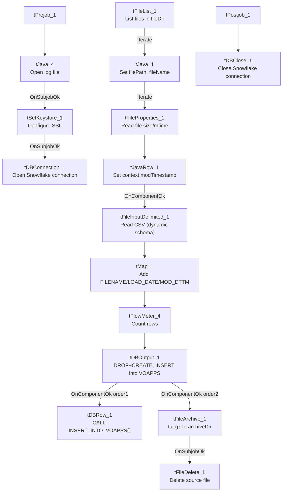

# Talend Job: Voapp_File_Load

## Overview

Loads files dropped in a shared "Voapp" source directory into the Snowflake `VOAPPS` table (dropping and recreating the table each run), then calls a merge stored procedure to fold the newly loaded rows into a downstream table. "Voapp" is not otherwise defined in the metadata — the target column set (`FILENAME`, `LOAD_DATE`, `MOD_DTTM`, plus a fully dynamic column) suggests this job ingests whatever columns happen to be in each incoming file rather than a fixed known layout, tracking only file identity and timestamps as its own explicit columns.

## Detail table

| Field | Value |
|---|---|
| Job name | Voapp_File_Load |
| Version | 0.1 |
| Project | EDW2SF |
| Author | jmach@harriscollect.com |
| Created | 2023-06-14T10:47:27.598-0700 |
| Last Modified | 2025-11-04T11:08:04.636-0800 |

## Step-by-step data flow

**Setup subjob:** `tPrejob_1` → `tJava_4` opens a per-run log file at `context.logDir + jobName + "_" + <timestamp> + ".log"` → on success (`OnSubjobOk`), `tSetKeystore_1` configures SSL trust/keystore from `context.keystorePath` (passwords redacted) → on success, `tDBConnection_1` opens the Snowflake connection.

**Main subjob:**

1. `tFileList_1` lists files in `context.fileDir` (an `EXCLUDEFILEMASK` of `*.txt` is configured but `IFEXCLUDE=false`, so no files are actually excluded — every file in the directory is picked up, same non-functional-exclusion pattern seen in other jobs in this project).
2. For each file (`ITERATE`), `tJava_1` sets `context.filePath`/`context.fileName` and logs "Processing file `<name>`".
3. `tFileProperties_1` reads OS-level file metadata (path, size, modified time as a string) for the current file.
4. `tJavaRow_1` parses that modified-time string into `context.modTimestamp` using the pattern `"EEE MMM dd HH:mm:ss z yyyy"`.
5. On success (`OnComponentOk`), `tFileInputDelimited_1` reads the file itself as CSV (comma-delimited, header row, `DIE_ON_ERROR=false`) into a fully **dynamic schema** (`newColumn` of type `id_Dynamic`) — meaning the actual column layout is discovered at runtime from each file's header rather than fixed at design time.
6. `tMap_1` passes the dynamic columns through alongside two derived columns, `FILENAME` and `LOAD_DATE`/`MOD_DTTM` (populated from the file-list/file-properties steps above).
7. `tFlowMeter_4` counts rows passing through (labeled "MyLabel", not renamed for this job).
8. `tDBOutput_1` writes the rows into Snowflake table `VOAPPS`, with `tableAction=DROP_IF_EXISTS_AND_CREATE` — the table is dropped and recreated fresh on **every run**, not just truncated.
9. On success, two things happen in parallel: `tDBRow_1` calls `CALL INSERT_INTO_VOAPPS()` (a merge/insert procedure, presumably moving the freshly loaded rows into a permanent downstream table before the next run drops `VOAPPS` again), and `tFileArchive_1` tars/gzips the source file to `context.archiveDir + context.fileName + ".tar.gz"`, then on success `tFileDelete_1` deletes the original.

A second, **disabled** file-list branch (`tFileList_2` → `tJava_2`, both with `ACTIVATE=false`) exists in the job but does not run — see Issues observed.

## Settings tables

### Source: `tFileInputDelimited_1`

| Setting | Value | What it means |
|---|---|---|
| FILENAME | `context.filePath` | The current file from `tFileList_1`'s iteration. |
| SCHEMA | Fully dynamic (`newColumn`, `id_Dynamic`) | Column names/types are inferred from each file's own header at runtime rather than fixed — this job can ingest files whose layout varies. |
| HEADER | `1` | First row treated as a header. |
| DIE_ON_ERROR | `false` | Malformed rows don't fail the job; no reject flow is wired (see Issues observed). |
| TEMP_DIR | `"C:/Talend-Studio-20211109_1610-V8.0.1/workspace"` | Developer-workstation path — see Issues observed. |

### Target: `tDBOutput_1` (`tSnowflakeOutput`)

| Setting | Value | What it means |
|---|---|---|
| Table | `VOAPPS` | Destination table. |
| Output action | `INSERT` | Straightforward append of the loaded rows. |
| Table action | `DROP_IF_EXISTS_AND_CREATE` | The table is dropped and recreated from scratch on every run — a stronger reset than the `TRUNCATE` pattern used elsewhere in this project, appropriate given the schema is dynamic and can differ file to file. |

### Merge step: `tDBRow_1` (`tSnowflakeRow`)

| Setting | Value | What it means |
|---|---|---|
| Query | `CALL INSERT_INTO_VOAPPS()` | Stored procedure (not shown in this metadata), presumably moving the just-loaded `VOAPPS` rows into a permanent table before the table is dropped again next run. Unlike other jobs in this project, this job does **not** capture the procedure's return value or branch on success/failure — see Issues observed. |

## Dependencies & configuration

- **Triggers/depends on other jobs:** none — no `tRunJob` links found.
- **Context variables used:** `archiveDir`, `fileDir`, `fileName`, `filePath`, `keystorePath`, `logDir`, `modTimestamp`.
- **5 hardcoded developer-workstation paths**: `tFileArchive_1.SOURCE_FILE` (`C:/Talend-Studio-.../workspace/source.csv`), `tFileInputDelimited_1.TEMP_DIR`, `tFileDelete_1.DIRECTORY`/`PATH` (both under `C:/Talend-Studio-.../workspace/delete_folder`), and `tSetKeystore_1.SSL_TRUSTSERVER_TRUSTSTORE` (`C:/clientTrustStore.trustStore`) — the same project-wide portability risk documented in `05_operational_runbook.md`.

## Glossary

| Component type | Plain-English meaning |
|---|---|
| `tFileList` | Lists files in a directory for the job to iterate over one at a time. |
| `tFileProperties` | Reads OS-level metadata (size, modified time, path) for a file without reading its contents. |
| `tFileInputDelimited` (dynamic schema) | Reads a delimited file whose column layout is determined at runtime from the file itself, rather than fixed in the job design. |
| `tMap` | Maps/transforms columns from one schema to another. |
| `tFlowMeter` | Counts rows passing through a point in the flow, for logging/monitoring. |
| `tSnowflakeOutput` / `tSnowflakeRow` / `tSnowflakeConnection` / `tSnowflakeClose` | Write rows to Snowflake / run an arbitrary SQL statement or stored-procedure call / open and close the shared Snowflake connection. |
| `tFileArchive` / `tFileDelete` | Zip a processed file to an archive location, then delete the original from the source directory. |
| `tSetKeystore` | Configures the SSL trust store/keystore used for the job's encrypted database connections. |

## Issues observed

- **`tDBOutput_1` uses `DROP_IF_EXISTS_AND_CREATE` rather than `TRUNCATE`.** Combined with the fully dynamic input schema, this means the `VOAPPS` table's actual column set can change from run to run depending on what columns are in whichever file(s) were processed that run. If two files with different column layouts both land before a run, or if a run processes a file with fewer columns than a prior run, downstream consumers of `VOAPPS` (including the `INSERT_INTO_VOAPPS()` procedure) could see a changing table shape — unable to determine from metadata whether the merge procedure is written defensively enough to handle that; verify with the team.
- **The merge call `tDBRow_1` (`CALL INSERT_INTO_VOAPPS()`) does not capture or check a return value**, unlike the `tDBRow_1`/`tJavaRow_1`/`tWarn`/`tDie` pattern used for merge-result checking in other jobs (e.g. `ADP_Payroll_Load`, `CO_Master_Load`). A failure inside this procedure would only surface as a generic Talend execution error, with no job-specific success/failure message.
- **No reject flow is wired from `tFileInputDelimited_1`, and `DIE_ON_ERROR=false`** — malformed rows are silently dropped with no record of how many or which ones failed to parse, the same unwired-reject-flow pattern seen elsewhere in this project.
- **A second, disabled file-list branch exists in the job** (`tFileList_2` → `tJava_2`, both `ACTIVATE=false`), duplicating `tFileList_1`/`tJava_1`'s directory and logic almost exactly. This looks like a leftover from an earlier version of the job (or an in-progress edit) rather than active logic — it does not run, but its presence alongside the live branch is worth cleaning up so a future editor doesn't mistake it for something intentional.
- **`tFileDelete_1.FAILON` is `false`**, so a failed delete doesn't stop the job; `tFileDelete_1` → `tJava_3` (`OnComponentOk`) prints the delete status/path/error message to the log afterward, giving at least a diagnostic trail even though the job itself won't fail on a delete problem.
