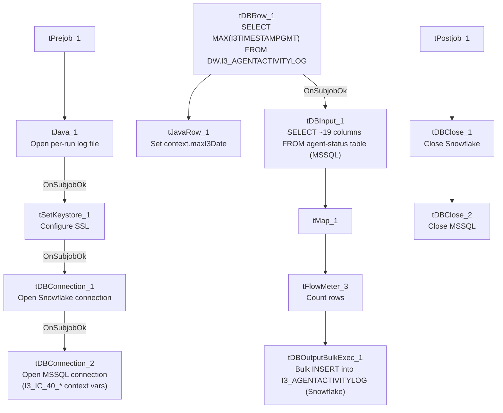

# Talend Job: i3_AgentActivityLog_Load

## Overview

Loads call-center agent status/activity events (login/logout, ACD status changes, hold/DND/ACW state transitions, per-state durations, timestamps) from the I3 (Interactive Intelligence) telephony platform's MSSQL database into the Snowflake `I3_AGENTACTIVITYLOG` table. Like `i3_CallDetail_40_Load`, it computes the latest timestamp already loaded before pulling from the source — but whether that value is actually applied as a filter on the source query can't be confirmed from this metadata (see Issues observed).

## Detail table

| Field | Value |
|---|---|
| Job name | i3_AgentActivityLog_Load |
| Version | 0.1 |
| Project | EDW2SF |
| Author | jmach@harriscollect.com |
| Created | 2022-02-09T15:39:10.010-0800 |
| Last Modified | 2025-11-04T11:36:33.855-0800 |

## Step-by-step data flow

**Setup subjob:** `tPrejob_1` → `tJava_1` opens a per-run log file → on success, `tSetKeystore_1` configures SSL trust/keystore from `context.keystorePath` → `tDBConnection_1` opens the Snowflake connection → on success, `tDBConnection_2` opens the MSSQL connection to `context.I3_IC_40_Server`/`Port`/`Schema`/`Database`/`Login` (password redacted) — correctly using the `I3_IC_40` context group for an I3 telephony job, unlike the naming mismatch flagged in `i3_CallDetail_40_Load`.

**Main subjob:**

1. `tDBRow_1` runs `SELECT COALESCE(TO_VARCHAR(MAX(I3TIMESTAMPGMT)),'2015-01-01') AS MAX_DT FROM DW.I3_AGENTACTIVITYLOG;` against Snowflake to find the latest event timestamp already loaded (defaulting to `2015-01-01` if the table is empty).
2. `tJavaRow_1` captures that value into `context.maxI3Date`.
3. On success, `tDBInput_1` runs a fixed `SELECT` (using the shared MSSQL connection) against the source agent-status table, pulling `UserId`, `StatusDateTime`/`StatusDateTimeGMT`, several `Changed*` status flags, hold/ACW/DND durations, `SeqNo`, `I3TimeStampGMT`, `SiteId`/`SubSiteId`, etc. (~19 columns). **The captured query text is truncated in this metadata after the initial column list and does not visibly reference `context.maxI3Date`** — see Issues observed.
4. `tMap_1` passes the ~19 source columns through to a same-shaped uppercase-named target schema.
5. `tFlowMeter_3` counts rows passing through (labeled "MyLabel", not renamed for this job).
6. `tDBOutputBulkExec_1` bulk-inserts the rows into Snowflake table `I3_AGENTACTIVITYLOG` (`INSERT`, no table-recreate action) — this job uses the bulk-exec variant of the Snowflake output component rather than the plain `tSnowflakeOutput` used in `i3_CallDetail_40_Load`.

Separately, `tStatCatcher_1` and `tFlowMeterCatcher_1` feed two `tLogRow` components that print job statistics and flow-meter counts to the log — standard Talend internal instrumentation, not part of the business data path.

**Teardown subjob:** `tPostjob_1` → `tDBClose_1` (close Snowflake) → `tDBClose_2` (close MSSQL).

## Settings tables

### Source: `tDBInput_1` (`tMSSqlInput`)

| Setting | Value | What it means |
|---|---|---|
| Connection | Shared `tDBConnection_2` | Reuses the job's single MSSQL connection. |
| Query | Fixed `SELECT` of ~19 named columns (agent status change flags, hold/ACW/DND durations, `SeqNo`, `I3TimeStampGMT`, `SiteId`/`SubSiteId`) | The visible portion does not reference `context.maxI3Date` — see Issues observed. |

### Aggregate check: `tDBRow_1` (`tSnowflakeRow`)

| Setting | Value | What it means |
|---|---|---|
| Query | `SELECT COALESCE(TO_VARCHAR(MAX(I3TIMESTAMPGMT)),'2015-01-01') AS MAX_DT FROM DW.I3_AGENTACTIVITYLOG;` | Finds the latest event timestamp already loaded, defaulting to `2015-01-01` for a first/empty run. Result captured into `context.maxI3Date` by `tJavaRow_1`. |

### Target: `tDBOutputBulkExec_1` (`tSnowflakeOutputBulkExec`)

| Setting | Value | What it means |
|---|---|---|
| Table | `I3_AGENTACTIVITYLOG` | Destination table in Snowflake. |
| Output action | `INSERT` | Appends rows — there is no `TRUNCATE`/staging step, consistent with an incremental-append design, assuming the max-date check is actually applied upstream. |

## Dependencies & configuration

- **Triggers/depends on other jobs:** none — no `tRunJob` links found.
- **Context variables used:** `I3_IC_40_Server`, `I3_IC_40_Port`, `I3_IC_40_Schema`, `I3_IC_40_Database`, `I3_IC_40_Login` (MSSQL connection details), `keystorePath`, `logDir`, `maxI3Date` (computed internally from the Snowflake max-date query).
- **1 hardcoded developer-workstation path** in `tSetKeystore_1.SSL_TRUSTSERVER_TRUSTSTORE` (`"C:/clientTrustStore.trustStore"`) — same pattern documented project-wide in `05_operational_runbook.md`.

## Glossary

| Component type | Plain-English meaning |
|---|---|
| `tSnowflakeConnection` / `tSnowflakeClose` | Open/close a Snowflake database connection shared by other components in the job. |
| `tMSSqlConnection` / `tMSSqlInput` / `tMSSqlClose` | Open a Microsoft SQL Server connection, run a query against it, and close it. |
| `tSnowflakeRow` | Runs an arbitrary SQL statement or stored-procedure call against Snowflake — here, used for a single aggregate `SELECT`. |
| `tSnowflakeOutputBulkExec` | A bulk-loading variant of the Snowflake output component, typically faster for larger row volumes than the plain `tSnowflakeOutput`. |
| `tJavaRow` | Runs custom Java code once per input row — here used to unpack a single query result into a context variable. |
| `tFlowMeter` | Counts rows passing a point in the flow for logging/monitoring. |
| `tSetKeystore` | Configures SSL trust/keystore settings for the job's secure connections. |
| `tStatCatcher` / `tFlowMeterCatcher` / `tLogRow` | Talend's built-in job-statistics and flow-meter capture components, which print execution stats to the log; not part of the business data flow. |

## Issues observed

- **The incremental-load logic may not actually be applied**, the same open question flagged in `i3_CallDetail_40_Load`. The job computes `context.maxI3Date` from Snowflake before reading the MSSQL source, but the `tDBInput_1.QUERY` text captured in this metadata is truncated after the initial column list and does not show a `WHERE I3TimeStampGMT > ...`-style clause referencing `context.maxI3Date` in the visible portion. **Unable to determine from this metadata whether the query is actually filtered** — if it isn't, every run re-reads and re-inserts the entire source table, duplicating all previously loaded rows in Snowflake (there is no `TRUNCATE` before the bulk `INSERT`). Verify directly in Talend Studio before assuming the incremental design works as intended.
- **Unlike `i3_CallDetail_40_Load`, this job's MSSQL connection is correctly labeled with `I3_IC_40_*` context variables** for an I3 telephony source — worth calling out as a positive contrast, since the sibling `i3_CallDetail_40_Load` job instead uses `EDWProdHH_*` variables for what is also I3 data.
- **No error/row-count logging specific to this job's business outcome** (no `tWarn`/`tDie`/`tSendMail`) — a load failure here would only surface as a generic Talend execution error, with no job-specific message to distinguish it in a shared log, consistent with most of the 289 jobs per `05_operational_runbook.md`.
