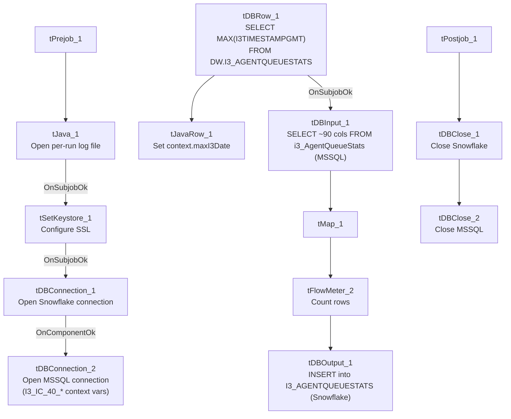

# Talend Job: i3_AgentQueueStats_Load

## Overview

Loads Interactive Intelligence (I3) contact-center agent/queue interval statistics (entered/abandoned/answered ACD call counts, hold/talk/after-call-work durations, agent status timers, service-level buckets, and custom values, per statistics set/site/sub-site/interval) from the I3 IC system's `i3_AgentQueueStats` MSSQL table into the Snowflake `I3_AGENTQUEUESTATS` table. Follows the same incremental-load *shape* as `i3_CallDetail_40_Load` — it first computes the maximum timestamp already loaded — though (as with that job) the captured source query is truncated and does not show a filter referencing that value in the visible portion.

## Detail table

| Field | Value |
|---|---|
| Job name | i3_AgentQueueStats_Load |
| Version | 0.1 |
| Project | EDW2SF |
| Author | jmach@harriscollect.com |
| Created | 2022-03-23T09:28:24.001-0700 |
| Last Modified | 2025-11-05T10:32:11.057-0800 |

## Step-by-step data flow

**Setup subjob:** `tPrejob_1` → `tJava_1` opens a per-run log file (`context.logDir+jobName+"_"+<timestamp>+".log"`) → on success, `tSetKeystore_1` configures SSL trust/keystore settings → on success, `tDBConnection_1` opens the Snowflake connection → on success, `tDBConnection_2` opens the MSSQL connection using `context.I3_IC_40_Server`/`Port`/`Schema`/`Database`/`Login` (password redacted).

**Main subjob:**

1. `tDBRow_1` runs `SELECT COALESCE(TO_VARCHAR(MAX(I3TIMESTAMPGMT)),'2010-01-01') AS MAX_DT FROM DW.I3_AGENTQUEUESTATS;` against Snowflake to find the latest interval timestamp already loaded.
2. `tJavaRow_1` captures that value into `context.maxI3Date`.
3. On success, `tDBInput_1` runs a fixed `SELECT` (using the shared MSSQL connection) against the source `i3_AgentQueueStats` table, pulling roughly 90 columns of ACD queue-statistics data (statistics set, call-handling counters and durations, agent-status timers, service-level bucket counts, custom values, site/sub-site IDs, `I3TimeStampGMT`, schema version). **The captured query text is truncated in this metadata and does not visibly reference `context.maxI3Date`** — see Issues observed.
4. `tMap_1` passes the ~90 source columns through to a same-shaped uppercase-named target schema.
5. `tFlowMeter_2` counts rows passing through (labeled "MyLabel" internally but wired with link label "QStats").
6. `tDBOutput_1` inserts the rows into Snowflake table `I3_AGENTQUEUESTATS` (`INSERT`, no table-recreate action).

**Teardown subjob:** `tPostjob_1` → `tDBClose_1` (close Snowflake) → `tDBClose_2` (close MSSQL).

## Settings tables

### Max-date check: `tDBRow_1` (`tSnowflakeRow`)

| Setting | Value | What it means |
|---|---|---|
| Query | `SELECT COALESCE(TO_VARCHAR(MAX(I3TIMESTAMPGMT)),'2010-01-01') AS MAX_DT FROM DW.I3_AGENTQUEUESTATS;` | Finds the newest interval timestamp already in Snowflake, defaulting to `2010-01-01` if the table is empty. |
| Result handling | `MAX_DT` → `context.maxI3Date` via `tJavaRow_1` | Intended to drive an incremental filter on the source query — see Issues observed on whether that filter is actually applied. |

### Source: `tDBInput_1` (`tMSSqlInput`)

| Setting | Value | What it means |
|---|---|---|
| Connection | Shared `tDBConnection_2` | Reuses the job's single MSSQL connection. |
| Table | `i3_AgentQueueStats` | Source I3 queue-statistics table. |
| Query | Fixed `SELECT` of ~90 named columns (statistics set, call-handling counters/durations, agent-status timers, service-level buckets, custom values, site/sub-site IDs, `I3TimeStampGMT`, schema version) | The visible portion of the query does not reference `context.maxI3Date` — see Issues observed. |

### Setup: `tDBConnection_2` (`tMSSqlConnection`)

| Setting | Value | What it means |
|---|---|---|
| HOST / PORT / SCHEMA_DB / DBNAME / USER | `context.I3_IC_40_Server` / `context.I3_IC_40_Port` / `context.I3_IC_40_Schema` / `context.I3_IC_40_Database` / `context.I3_IC_40_Login` | Correctly uses the `I3_IC_40` context group for this I3-system source — unlike `i3_CallDetail_40_Load`, whose MSSQL connection is (per that job's own metadata) configured with `EDWProdHH_*` context variables despite also reading I3 telephony data. |

### Target: `tDBOutput_1` (`tSnowflakeOutput`)

| Setting | Value | What it means |
|---|---|---|
| Table | `I3_AGENTQUEUESTATS` | Destination table in Snowflake. |
| Output action | `INSERT` | Appends rows — there is no `TRUNCATE`/staging step in this job, consistent with an incremental-append design, assuming the max-date check is actually applied upstream. |

## Dependencies & configuration

- **Triggers/depends on other jobs:** none — no `tRunJob` links found.
- **Context variables used:** `I3_IC_40_Database`, `I3_IC_40_Login`, `I3_IC_40_Port`, `I3_IC_40_Schema`, `I3_IC_40_Server` (MSSQL connection details), `keystorePath`, `logDir`, `maxI3Date` (computed internally from the Snowflake max-date query).
- **1 hardcoded path finding:** `tSetKeystore_1.SSL_TRUSTSERVER_TRUSTSTORE` = `"C:/clientTrustStore.trustStore"` — same project-wide portability risk documented in `05_operational_runbook.md`.

## Glossary

| Component type | Plain-English meaning |
|---|---|
| `tSnowflakeConnection` / `tSnowflakeClose` | Open/close a Snowflake database connection shared by other components in the job. |
| `tMSSqlConnection` / `tMSSqlInput` / `tMSSqlClose` | Open a Microsoft SQL Server connection, run a query against it, and close it. |
| `tSnowflakeRow` | Runs an arbitrary SQL statement or query against Snowflake — here used once for a single aggregate value. |
| `tJavaRow` | Runs custom Java code once per input row — here used to unpack a single query result into a context variable. |
| `tMap` | Maps/transforms columns from one schema to another. |
| `tFlowMeter` | Counts rows passing a point in the flow for logging/monitoring. |
| `tSetKeystore` | Configures SSL/TLS keystore and truststore settings used by the job's database connections. |
| `tJava` | Runs custom Java code — here used to open a log file. |

## Issues observed

- **The incremental-load logic may not actually be applied.** The job computes `context.maxI3Date` from Snowflake before reading the MSSQL source, strongly suggesting the intent is to pull only rows with a newer `I3TimeStampGMT` than what's already loaded. However, the `tDBInput_1.QUERY` text captured in this metadata is truncated after the column list and does not show a `WHERE` clause referencing `context.maxI3Date` anywhere in the visible portion. **Unable to determine from this metadata whether the query is actually filtered** — if it isn't, every run re-reads and re-inserts the entire source table, duplicating all previously loaded rows in Snowflake (there is no `TRUNCATE` step before the `INSERT`). This is the same open question flagged in `i3_CallDetail_40_Load`'s documentation and should be verified directly in Talend Studio before assuming the incremental design works as intended.
- **This job's MSSQL connection is correctly configured with `I3_IC_40_*` context variables**, matching the I3 IC system it actually reads from. This is a useful positive contrast to `i3_CallDetail_40_Load`, whose otherwise-similar MSSQL connection uses `EDWProdHH_*` variables despite reading the same class of I3 telephony data — confirming the mislabeling flagged in that job's doc is not a universal project convention, and should be checked case-by-case rather than assumed.
- **No error/row-count logging specific to this job's business outcome** (no `tWarn`/`tDie`/`tSendMail`) — a load failure here would only surface as a generic Talend execution error, with no job-specific message to distinguish it in a shared log.
