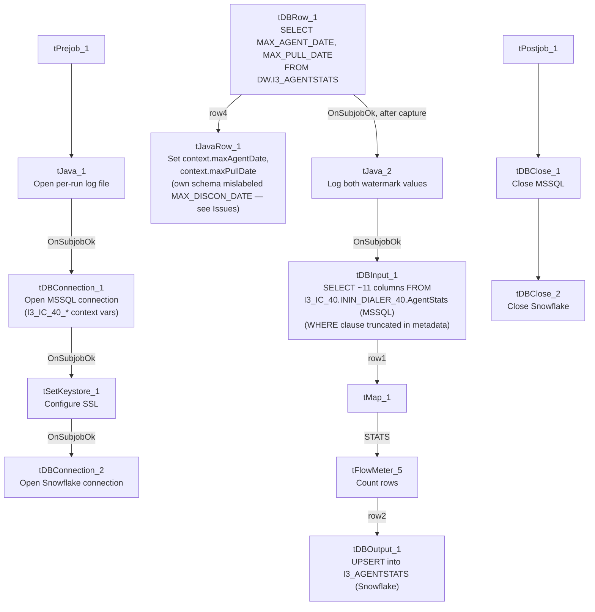

# Talend Job: i3_AgentStats

## Overview

Loads agent-level call-center activity records (campaign, site, agent ID, call/stage identifiers, a property name/value pair, and an internal `agentstats_id`) from the I3 (Interactive Intelligence) telephony system's `AgentStats` MSSQL table into the Snowflake `I3_AGENTSTATS` table, joined against a `DIMLOGON`-style lookup query computed from the current Snowflake data. It follows a "compute watermark, then pull and upsert" incremental pattern similar to `i3_CallDetail_40_Load`, but here the two watermark values it computes (`maxAgentDate`, `maxPullDate`) are only ever logged, not visibly used to filter the source query — see Issues observed.

## Detail table

| Field | Value |
|---|---|
| Job name | i3_AgentStats |
| Version | 0.1 |
| Project | EDW2SF |
| Author | jmach@harriscollect.com |
| Created | 2023-06-06T14:27:21.680-0700 |
| Last Modified | 2025-11-05T10:47:35.966-0800 |

## Step-by-step data flow

**Setup subjob:** `tPrejob_1` → `tJava_1` opens a per-run log file at `context.logDir + jobName + "_" + <timestamp> + ".log"` → on success (`OnSubjobOk`), `tDBConnection_1` (`tMSSqlConnection`) opens the MSSQL connection using `context.I3_IC_40_*` variables (Server/Port/Schema/Database/Login, password redacted) → on success, `tSetKeystore_1` configures SSL trust/keystore from `context.keystorePath` → on success, `tDBConnection_2` opens the Snowflake connection.

**Main subjob** (runs independently of the setup chain until it needs each connection):

1. `tDBRow_1` (`tSnowflakeRow`) runs a query against `DW.I3_AGENTSTATS` computing `MAX_AGENT_DATE` (`COALESCE(CAST(DATEADD(min,-30,MAX(agenttimeUTC)) AS VARCHAR(30)), '2019-01-01')`) and `MAX_PULL_DATE` (current time converted to the session's timezone via `CONVERT_TIMEZONE`/`GET_CURRENT_TIMEZONE`).
2. `tDBRow_1` feeds two branches simultaneously: (a) `MAIN` → `tJavaRow_1` captures the two computed values into `context.maxAgentDate` and `context.maxPullDate`; (b) `SUBJOB_OK` (which in Talend fires only once the whole row-processing subjob, including the `tJavaRow_1` branch, has finished) → `tJava_2` prints both values to the log.
3. `tJava_2` then fires `SUBJOB_OK` → `tDBInput_1` (`tMSSqlInput`, reusing the shared MSSQL connection `tDBConnection_1`) runs a fixed `SELECT` of 11 columns (`campaignname`, `siteid`, `odsoffset`, `agenttimeUTC`, `agentid`, `stageid`, `callid`, `callidkey`, `propertyname`, `propertyvalue`, `agentstats_id`) `FROM I3_IC_40.ININ_DIALER_40.AgentStats WHERE [agenttimeUT...` — **the query text is truncated in this metadata immediately after the `WHERE` clause begins**, so whether it actually filters using `context.maxAgentDate`/`context.maxPullDate` cannot be confirmed. See Issues observed.
4. `tMap_1` passes the 11 columns through unchanged to a same-shaped target schema.
5. `tFlowMeter_5` counts rows passing through (labeled "MyLabel", not renamed for this job).
6. `tDBOutput_1` upserts the rows into Snowflake table `I3_AGENTSTATS` (`UPSERT`, `tableAction: NONE` — no `TRUNCATE`, consistent with an incremental design).

**Teardown subjob:** `tPostjob_1` → `tDBClose_1` (close MSSQL) → `tDBClose_2` (close Snowflake).

## Settings tables

### Watermark query: `tDBRow_1` (`tSnowflakeRow`) / `tJavaRow_1`

| Setting | Value | What it means |
|---|---|---|
| Query | `SELECT COALESCE(CAST(DATEADD(min,-30,MAX(agenttimeUTC)) AS VARCHAR(30)), '2019-01-01') AS MAX_AGENT_DATE, CAST(CONVERT_TIMEZONE(GET_CURRENT_TIMEZONE(),'UTC',CURRENT_TIMESTAMP) AS VARCHAR(30)) AS MAX_PULL_DATE FROM DW.I3_AGENTSTATS;` | Computes the latest agent-activity timestamp already loaded (minus a 30-minute safety buffer, defaulting to `2019-01-01` if the table is empty) and the current pull time. |
| Result handling | `tJavaRow_1`: `context.maxAgentDate = input_row.MAX_AGENT_DATE; context.maxPullDate = input_row.MAX_PULL_DATE;` | Captures both values for use (in principle) as an incremental-load filter downstream. **`tJavaRow_1`'s own declared schema columns are `MAX_DISCON_DATE`/`MAX_PULL_DATE`, not `MAX_AGENT_DATE`/`MAX_PULL_DATE`** — a naming mismatch with the actual code and with `tDBRow_1`'s own output columns; see Issues observed. |

### Source: `tDBInput_1` (`tMSSqlInput`)

| Setting | Value | What it means |
|---|---|---|
| Connection | Shared `tDBConnection_1` (`USE_EXISTING_CONNECTION=true`) | Reuses the job's single MSSQL connection. |
| HOST / PORT / DB_SCHEMA / DBNAME / USER (component's own params) | `context.EDWProdHH_Server` / `_Port` / `_Schema` / `_Database` / `_Login` | **These are dead/unused values** — since `USE_EXISTING_CONNECTION=true`, the component actually connects via `tDBConnection_1`, which is configured with `context.I3_IC_40_*` variables, not `EDWProdHH_*`. See Issues observed. |
| Query | `SELECT campaignname, siteid, CONVERT(NUMERIC,odsoffset), agenttimeUTC, agentid, stageid, callid, callidkey, propertyname, propertyvalue, CONVERT(NUMERIC,agentstats_id) FROM I3_IC_40.ININ_DIALER_40.AgentStats WHERE [agenttimeUT...` (truncated) | Reads from a fully qualified `I3_IC_40.ININ_DIALER_40.AgentStats` MSSQL table. The visible portion of the query does not show whether the `WHERE` clause actually filters using `context.maxAgentDate` — see Issues observed. |
| TRIM_ALL_COLUMN | `true` | Whitespace is trimmed from all extracted columns. |

### Connection: `tDBConnection_1` (`tMSSqlConnection`)

| Setting | Value | What it means |
|---|---|---|
| HOST / PORT / SCHEMA / DBNAME / USER | `context.I3_IC_40_Server` / `_Port` / `_Schema` / `_Database` / `_Login` | The job's real MSSQL connection is configured for the "I3_IC_40" telephony database context group (see `_shared_context.json`), correctly matching the table it reads (`I3_IC_40.ININ_DIALER_40.AgentStats`). |
| DRIVER | `JTDS` | Standard JTDS driver for this connection. |

### Target: `tDBOutput_1` (`tSnowflakeOutput`)

| Setting | Value | What it means |
|---|---|---|
| Table | `I3_AGENTSTATS` | Destination table in Snowflake. |
| Output action | `UPSERT` | Inserts new rows and updates existing ones on match — no separate `TRUNCATE`/staging step, consistent with an incremental-append/update design (assuming the watermark filter is actually applied upstream). |

## Dependencies & configuration

- **Triggers/depends on other jobs:** none — no `tRunJob` links found.
- **Context variables used:** `EDWProdHH_Database`, `EDWProdHH_Login`, `EDWProdHH_Port`, `EDWProdHH_Schema`, `EDWProdHH_Server` (referenced only in `tDBInput_1`'s own dead/unused parameters — see Issues observed), `I3_IC_40_Database`, `I3_IC_40_Login`, `I3_IC_40_Port`, `I3_IC_40_Schema`, `I3_IC_40_Server` (the connection actually used), `keystorePath`, `logDir`, `maxAgentDate`, `maxPullDate` (both set internally from the watermark query).
- **1 hardcoded path:** `tSetKeystore_1.SSL_TRUSTSERVER_TRUSTSTORE` (`"C:/clientTrustStore.trustStore"`) — same project-wide risk pattern documented in `05_operational_runbook.md`.

## Glossary

| Component type | Plain-English meaning |
|---|---|
| `tMSSqlConnection` / `tMSSqlInput` / `tMSSqlClose` | Open a Microsoft SQL Server connection, run a query against it, and close it. |
| `tSnowflakeConnection` / `tSnowflakeRow` / `tSnowflakeOutput` / `tSnowflakeClose` | Open a Snowflake connection, run an arbitrary SQL statement or stored-procedure call against it, write rows to a table, and close it. |
| `tMap` | Maps/transforms columns from one schema to another. |
| `tFlowMeter` | Counts rows passing a point in the flow for logging/monitoring. |
| `tJavaRow` | Runs custom Java code once per input row — here used to unpack query results into context variables. |
| `tSetKeystore` | Configures SSL trust/keystore settings used by subsequent secure connections. |

## Issues observed

- **`tDBInput_1`'s own (unused) connection parameters reference `context.EDWProdHH_*` variables, even though the actual shared connection it uses (`tDBConnection_1`) is configured with `context.I3_IC_40_*` variables** pointing at the I3 telephony database. Because `USE_EXISTING_CONNECTION=true`, the `HOST`/`PORT`/`DB_SCHEMA`/`DBNAME`/`USER` values stored directly on `tDBInput_1` are dead configuration that Talend ignores at runtime — but their presence strongly suggests this component was copied from an EDWProdHH-sourced job template and not fully cleaned up, similar to other cross-job naming/copy-paste artifacts documented elsewhere in this project (e.g. `ADP_Payroll_Load`'s mislabeled reject schema). Not a functional bug since the dead values are never used, but it could mislead anyone reading this component's configuration in Talend Studio into thinking it connects to EDWProdHH.
- **The incremental-load logic may not actually be applied.** The job computes `context.maxAgentDate` (latest loaded `agenttimeUTC`, minus a 30-minute buffer) before reading the MSSQL source, strongly suggesting an incremental design — but `tDBInput_1`'s `QUERY` text is truncated in this metadata immediately after `WHERE [agenttimeUT`, so whether the query actually filters using `context.maxAgentDate` cannot be confirmed. If it isn't filtered, and given the target uses `UPSERT` (not `INSERT`+`TRUNCATE`), every run would re-pull the full source history and upsert it — functionally safe against duplicates (thanks to `UPSERT`), but potentially a large and unnecessary read against the source MSSQL table on every run. Verify directly in Talend Studio before assuming the incremental filter works as intended. This is the same category of gap flagged in `i3_CallDetail_40_Load`'s own doc.
- **`tJavaRow_1`'s own declared output schema uses the column name `MAX_DISCON_DATE`, not `MAX_AGENT_DATE`**, even though its actual code (`context.maxAgentDate = input_row.MAX_AGENT_DATE;`) and its upstream source (`tDBRow_1`'s `MAX_AGENT_DATE` column) both use "AGENT," not "DISCON." This is very likely a copy-paste artifact from a different job (a "disconnect date" watermark job elsewhere in the project) whose schema was never renamed to match this job's own use case. Since the actual generated code correctly references `input_row.MAX_AGENT_DATE`, this appears to be a cosmetic/schema-metadata inconsistency rather than a functional bug — but it's worth a cleanup pass so the repository schema doesn't mislead someone reading it later, similar to the `LEGACY_DIMDEBTOR` artifact documented in the `ProInsight_*_Scorecard_Load` jobs.
- **No error/row-count logging specific to this job's business outcome** (no `tWarn`/`tDie`/`tSendMail` tied to the load itself) — a load failure here would only surface as a generic Talend execution error, with no job-specific message to distinguish it in a shared log. Same gap documented in `i3_CallDetail_40_Load`'s own doc.
