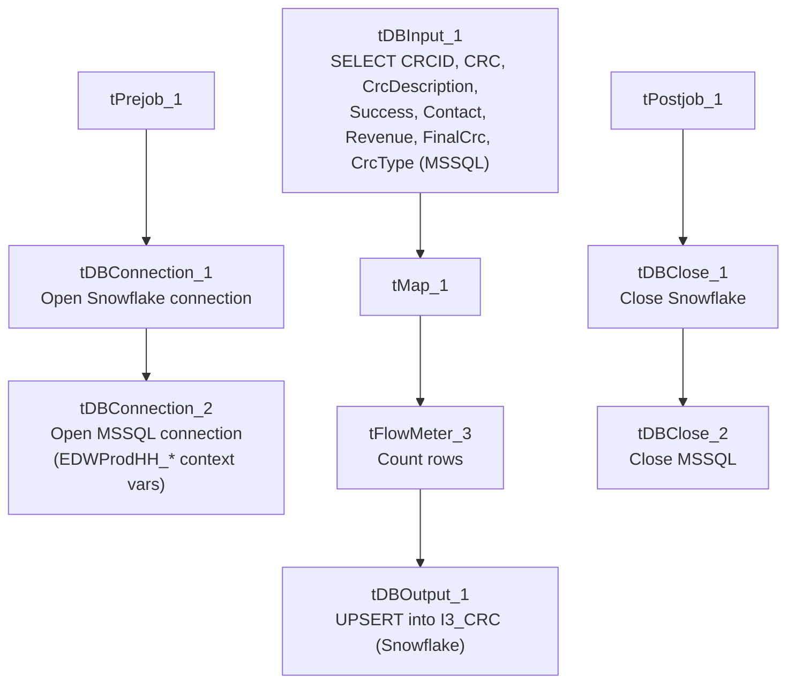

# Talend Job: i3_CRC_Load

## Overview

Loads call-result-code (CRC) reference data — the lookup table that translates the I3 dialer's numeric call-disposition codes (e.g. success/contact/revenue flags, a "final CRC" and CRC-type classification) into human-readable descriptions — from the I3 telephony MSSQL database into the Snowflake `I3_CRC` table. This is a small reference/dimension-style load rather than a transactional one: it upserts (rather than truncates-and-reloads) so existing CRC codes are updated in place and new ones are added, with no data removed.

## Detail table

| Field | Value |
|---|---|
| Job name | i3_CRC_Load |
| Version | 0.1 |
| Project | EDW2SF |
| Author | jmach@harriscollect.com |
| Created | 2022-01-25T14:56:54.779-0800 |
| Last Modified | 2022-05-24T09:48:38.280-0700 |

## Step-by-step data flow

**Setup subjob:** `tPrejob_1` → `tDBConnection_1` opens the Snowflake connection → on success, `tDBConnection_2` opens the MSSQL connection to `context.EDWProdHH_Server`/`Port`/`Schema`/`Database`/`Login` (password redacted; as in `i3_CallDetail_40_Load`, this connection is configured using `EDWProdHH_*` context variables even though it reads I3 telephony reference data — see Issues observed).

**Main subjob:**

1. `tDBInput_1` runs a fixed `SELECT` (with explicit `CAST`s to `numeric`) against the source `CRC` table via MSSQL, pulling `CRCID`, `CRC`, `CrcDescription`, `Success`, `Contact`, `Revenue`, `FinalCrc`, `CrcType`. The captured query text is truncated in this metadata after the visible column list (cuts off mid-`SELECT`), so the exact source table name and any `WHERE`/`ORDER BY` clause are not confirmed.
2. `tMap_1` passes the 8 columns through to a same-shaped, uppercase-named target schema (`CRCID`, `CRC`, `CRCDESCRIPTION`, `SUCCESS`, `CONTACT`, `REVENUE`, `FINALCRC`, `CRCTYPE`).
3. `tFlowMeter_3` counts rows passing through (labeled "MyLabel", not renamed for this job — same generic-label pattern seen elsewhere in the project).
4. `tDBOutput_1` writes the rows into Snowflake table `I3_CRC` using `outputAction: UPSERT` — unlike the truncate-then-insert pattern used by most other load jobs in this project, this job updates matching rows and inserts new ones without ever clearing the table first.

Separately, `tStatCatcher_1` and `tFlowMeterCatcher_1` (Talend's built-in statistics/flow-meter catchers) feed two `tLogRow` components that print job statistics and flow-meter counts to the log — these run automatically alongside the main flow and aren't part of the business data path.

**Teardown subjob:** `tPostjob_1` → `tDBClose_1` (close Snowflake) → `tDBClose_2` (close MSSQL).

## Settings tables

### Source: `tDBInput_1` (`tMSSqlInput`)

| Setting | Value | What it means |
|---|---|---|
| Connection | Shared `tDBConnection_2` | Reuses the job's single MSSQL connection. |
| Query | `SELECT CAST([CRCID] AS numeric(10,0)) AS CRCID, [CRC], [CrcDescription], CAST([Success] AS numeric(4,0)) AS [Success], CAST([Contact] AS numeric(4,0)) AS [Contact], CAST([Revenue] AS numeric(4,0)) AS [Revenue], ...` (truncated in metadata) | Explicit numeric casts suggest the source columns may be stored as a looser type (e.g. varchar/bit) in MSSQL and are being normalized on the way in. The visible portion doesn't show a `FROM`/`WHERE` clause. |

### Target: `tDBOutput_1` (`tSnowflakeOutput`)

| Setting | Value | What it means |
|---|---|---|
| Table | `I3_CRC` | Destination reference table in Snowflake. |
| Output action | `UPSERT` | Updates existing rows (matched presumably on `CRCID`, though the match key is not itself visible in this component's captured parameters) and inserts new ones — no rows are ever deleted by this job, appropriate for a slowly-changing reference table. |

## Dependencies & configuration

- **Triggers/depends on other jobs:** none — no `tRunJob` links found, and this job does not appear in `06_dependency_matrix.md`'s orchestration table.
- **Context variables used:** `EDWProdHH_Database`, `EDWProdHH_Login`, `EDWProdHH_Port`, `EDWProdHH_Schema`, `EDWProdHH_Server` (MSSQL connection details — see Issues observed on naming, same pattern as `i3_CallDetail_40_Load`).
- No hardcoded developer-workstation paths found in this job (`hardcoded_path_findings: []`).

## Glossary

| Component type | Plain-English meaning |
|---|---|
| `tSnowflakeConnection` / `tSnowflakeClose` | Open/close a Snowflake database connection shared by other components in the job. |
| `tMSSqlConnection` / `tMSSqlInput` / `tMSSqlClose` | Open a Microsoft SQL Server connection, run a query against it, and close it. |
| `tMap` | Maps/transforms columns from one schema to another. |
| `tFlowMeter` | Counts rows passing a point in the flow, for logging/monitoring. |
| `tSnowflakeOutput` | Writes rows to a Snowflake table — here configured to `UPSERT` (update-or-insert) rather than plain `INSERT`. |
| `tStatCatcher` / `tFlowMeterCatcher` / `tLogRow` | Talend's built-in job-statistics and flow-meter capture components, which print execution stats to the log; not part of the business data flow. |

## Issues observed

- **The MSSQL source query is truncated in this metadata**, cutting off after the visible column-cast list. The actual source table name (presumably `CRC` based on the columns being selected, but not directly confirmed) and any filtering clause are not visible — unable to determine from this metadata whether the query pulls the full reference table every run (consistent with a small lookup table and the `UPSERT` target behavior) or applies some filter; verify directly in Talend Studio.
- **The MSSQL connection is configured using `context.EDWProdHH_*` variables**, the same naming convention documented in `i3_CallDetail_40_Load` for the "EDWProdHH" operational database, even though this job loads I3 telephony CRC reference data, not EDWProdHH data. As with that job, this may mean the I3 database shares a physical SQL Server with EDWProdHH, or it may be a mislabeled/reused context group — unable to determine from metadata; verify with the team.
- **No error/row-count logging specific to this job's business outcome** (no `tWarn`/`tDie`/`tSendMail`) — a load failure here would only surface as a generic Talend execution error, with no job-specific message to distinguish it in a shared log. This matches the project-wide pattern documented in `05_operational_runbook.md` for the majority of jobs that lack explicit `tDie`/`tWarn` logic.
- No other findings — this is a small, self-contained reference-data load with no file handling, no hardcoded paths, and a straightforward `UPSERT` target pattern.
