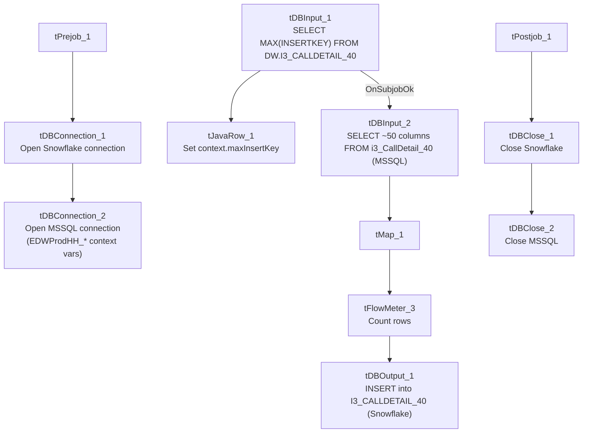

# Talend Job: i3_CallDetail_40_Load

## Overview

Loads call-detail records from the I3 (Interactive Intelligence) telephony/dialer system's `i3_CallDetail_40` MSSQL table into the Snowflake `I3_CALLDETAIL_40` table. Uses an incremental-load pattern keyed on `INSERTKEY`: it first checks the maximum key already loaded into Snowflake, though (see Issues observed) that value doesn't actually appear to be used to filter the source query in this version of the job.

## Detail table

| Field | Value |
|---|---|
| Job name | i3_CallDetail_40_Load |
| Version | 0.1 |
| Project | EDW2SF |
| Author | jmach@harriscollect.com |
| Created | 2022-01-20T10:38:12.148-0800 |
| Last Modified | 2022-05-24T09:48:52.910-0700 |

## Step-by-step data flow

**Setup subjob:** `tPrejob_1` → `tDBConnection_1` opens the Snowflake connection → `tDBConnection_2` opens the MSSQL connection to `context.EDWProdHH_Server`/`Port`/`Schema`/`Database`/`Login` (password redacted; note this connection is labeled/configured for "EDWProdHH" context variables even though it's reading I3 telephony data — see Issues observed).

**Main subjob:**

1. `tDBInput_1` runs `SELECT CAST(COALESCE(MAX(INSERTKEY),0) AS VARCHAR(10)) AS MAX_INSERT_KEY FROM DW.I3_CALLDETAIL_40;` against Snowflake to find the highest `InsertKey` already loaded.
2. `tJavaRow_1` captures that value into `context.maxInsertKey`.
3. On success, `tDBInput_2` runs a fixed `SELECT` (using the shared MSSQL connection) against the source `i3_CallDetail_40` table, pulling roughly 50 columns of call-detail data (campaign, site, call timing fields, call duration/hold/line-duration metrics, agent/debtor/client identifiers, `InsertKey`, etc.). **The captured query text is truncated in this metadata and does not visibly reference `context.maxInsertKey` in the portion available** — see Issues observed regarding whether this load is actually incremental.
4. `tMap_1` passes the ~50 source columns through to a same-shaped uppercase-named target schema.
5. `tFlowMeter_3` counts rows passing through (labeled "MyLabel", not renamed for this job; also has `TSTATCATCHER_STATS` enabled, feeding the job's stats/log-catcher components).
6. `tDBOutput_1` inserts the rows into Snowflake table `I3_CALLDETAIL_40` (`INSERT`, no table-recreate action).

Separately, `tStatCatcher_1` and `tFlowMeterCatcher_1` (standard Talend internal statistics/flow-meter catchers) feed two `tLogRow` components that print job statistics and flow-meter counts to the log — these run automatically alongside the main flow and aren't part of the business data path.

**Teardown subjob:** `tPostjob_1` → `tDBClose_1` (close Snowflake) → `tDBClose_2` (close MSSQL).

## Settings tables

### Source: `tDBInput_2` (`tMSSqlInput`)

| Setting | Value | What it means |
|---|---|---|
| Connection | Shared `tDBConnection_2` | Reuses the job's single MSSQL connection rather than opening a new one. |
| Table | `i3_CallDetail_40` | Source telephony call-detail table. |
| Query | Fixed `SELECT` of ~50 named columns (call timing, duration metrics, agent/debtor identifiers, `InsertKey`, etc.) | The visible portion of the query does not reference `context.maxInsertKey` — see Issues observed. |

### Target: `tDBOutput_1` (`tSnowflakeOutput`)

| Setting | Value | What it means |
|---|---|---|
| Table | `I3_CALLDETAIL_40` | Destination table in Snowflake. |
| Output action | `INSERT` | Appends rows — there is no `TRUNCATE`/staging step in this job (unlike the file-load jobs), consistent with an incremental-append design, assuming the max-key check is actually applied upstream. |

## Dependencies & configuration

- **Triggers/depends on other jobs:** none — no `tRunJob` links found.
- **Context variables used:** `EDWProdHH_Server`, `EDWProdHH_Port`, `EDWProdHH_Schema`, `EDWProdHH_Database`, `EDWProdHH_Login` (MSSQL connection details — see Issues observed on naming), `maxInsertKey` (computed internally from the Snowflake max-key query).
- No hardcoded developer-workstation paths found in this job.

## Glossary

| Component type | Plain-English meaning |
|---|---|
| `tSnowflakeConnection` / `tSnowflakeClose` | Open/close a Snowflake database connection shared by other components in the job. |
| `tMSSqlConnection` / `tMSSqlInput` / `tMSSqlClose` | Open a Microsoft SQL Server connection, run a query against it, and close it. |
| `tSnowflakeInput` | Runs a query against Snowflake and returns its result rows (here, used just once for a single aggregate value). |
| `tJavaRow` | Runs custom Java code once per input row — here used to unpack a single query result into a context variable. |
| `tFlowMeter` | Counts rows passing a point in the flow for logging/monitoring. |
| `tStatCatcher` / `tFlowMeterCatcher` / `tLogRow` | Talend's built-in job-statistics and flow-meter capture components, which print execution stats to the log; not part of the business data flow. |

## Issues observed

- **The incremental-load logic may not actually be applied.** The job computes `context.maxInsertKey` from Snowflake before reading the MSSQL source, which strongly suggests the intent is to pull only rows with a higher `InsertKey` than what's already loaded. However, the `tDBInput_2.QUERY` text captured in this metadata is truncated after the initial column list and does not show a `WHERE InsertKey > ...` clause referencing `context.maxInsertKey` anywhere in the visible portion. **Unable to determine from this metadata whether the query is actually filtered** — if it isn't, every run re-reads and re-inserts the entire source table, duplicating all previously loaded rows in Snowflake (there is no `TRUNCATE` step before the `INSERT`, so old and new rows would both persist). This should be verified directly in Talend Studio before assuming the incremental design works as intended.
- **The MSSQL connection is configured using `context.EDWProdHH_*` variables**, which is the naming convention used elsewhere in this project for the "EDWProdHH" operational database (see `01_system_architecture.md`), even though this job reads I3 telephony call-detail data, not EDWProdHH data. This may mean the I3 database is hosted on the same SQL Server instance as EDWProdHH (in which case the shared context variables are appropriate), or it may be a mislabeled/reused context group — unable to determine from metadata; verify with the team which physical database `context.EDWProdHH_Database` actually points to for this job.
- **No error/row-count logging specific to this job's business outcome** (no `tWarn`/`tDie`/`tSendMail`) — a load failure here would only surface as a generic Talend execution error, with no job-specific message to distinguish it in a shared log.
