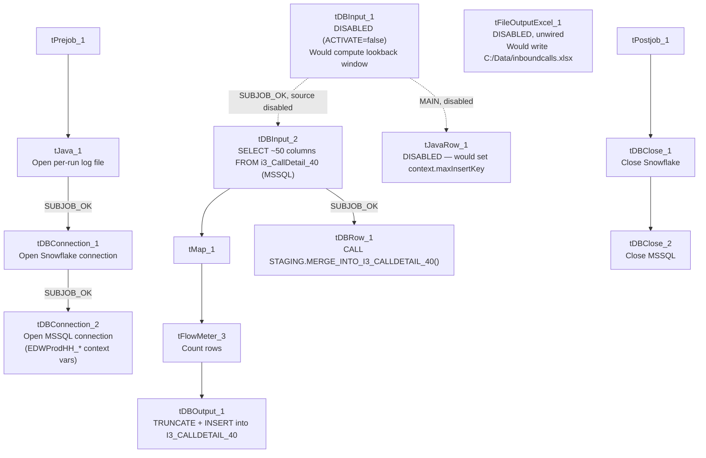

# Talend Job: i3_CallDetail_40_Load_Copy

## Overview

This job is a modified copy of `i3_CallDetail_40_Load` (same source table `i3_CallDetail_40` on the I3 telephony MSSQL database, same target `I3_CALLDETAIL_40` in Snowflake), but at version 0.3 it has diverged in several concrete ways: its incremental-key calculation components are disabled, its Snowflake output now truncates the target table before every load (a full-reload pattern rather than an append), and it adds a merge-procedure call and a per-run log file that the original job doesn't have. It is not a byte-for-byte duplicate — see Issues observed for exactly what changed.

## Detail table

| Field | Value |
|---|---|
| Job name | i3_CallDetail_40_Load_Copy |
| Version | 0.3 |
| Project | EDW2SF |
| Author | jmach@harriscollect.com |
| Created | 2024-03-13T08:59:54.762-0700 |
| Last Modified | 2025-08-28T08:57:24.666-0700 |

## Step-by-step data flow

**Setup subjob:** `tPrejob_1` → `tJava_1` opens a per-run log file at `context.logDir + jobName + "_" + <timestamp> + ".log"` and redirects `System.out`/`System.err` to it (a pattern the original `i3_CallDetail_40_Load` does not have) → on success, `tDBConnection_1` opens the Snowflake connection → `tDBConnection_2` opens the MSSQL connection using `context.EDWProdHH_*` variables (same naming-mismatch pattern already flagged in the original job's doc).

**Main subjob:**

1. `tDBInput_1` (Snowflake, `SELECT ... FROM DW.I3_CALLDETAIL_40` computing a lookback window off `callplacedtime` and `context.lookBack`) is present but **`ACTIVATE=false` — this component is disabled** and does not run.
2. `tJavaRow_1`, which would capture that result into `context.maxInsertKey`, is **also disabled** (`ACTIVATE=false`).
3. `tDBInput_2` runs a fixed `SELECT` of ~50 named columns (same column list as the original job) against the source `i3_CallDetail_40` table on MSSQL. The captured query text is truncated after the column list, same limitation as the original job — whether a `WHERE` clause exists is unable to determine from this metadata.
4. `tMap_1` passes the columns through to the same uppercase-named target schema as the original job (`DIE_ON_ERROR=true`).
5. `tFlowMeter_3` counts rows passing through (labeled "MyLabel").
6. `tDBOutput_1` writes to Snowflake table `I3_CALLDETAIL_40` with **`tableAction=TRUNCATE`** (the original job uses `tableAction=NONE`/plain append) — every run now clears the table before reloading it.
7. On the main subjob's success (`tDBInput_2 → tDBRow_1`, `SUBJOB_OK`), `tDBRow_1` runs `CALL STAGING.MERGE_INTO_I3_CALLDETAIL_40();` — a merge-procedure call the original job does not have.

A disabled, unwired `tFileOutputExcel_1` component (`ACTIVATE=false`, no incoming or outgoing connections) also exists in this job, configured to write to `C:/Data/inboundcalls.xlsx` with a full ~53-column schema matching the call-detail data — it never runs and is not part of any data path. This job also has **no `tStatCatcher`/`tLogRow`/`tFlowMeterCatcher` components**, unlike the original job, which does.

**Teardown subjob:** `tPostjob_1` → `tDBClose_1` (close Snowflake) → `tDBClose_2` (close MSSQL).

## Settings tables

### Disabled incremental-key components: `tDBInput_1` / `tJavaRow_1`

| Setting | Value | What it means |
|---|---|---|
| ACTIVATE (`tDBInput_1`) | `false` | This component is turned off in the job design — it does not execute at run time. |
| Query (`tDBInput_1`, if it were enabled) | `SELECT CAST(DATEADD(DAY,-"+context.lookBack+",COALESCE(MAX(callplacedtime),'2014-01-01')) AS VARCHAR(30)) AS MAX_INSERT_KEY FROM DW.I3_CALLDETAIL_40;` | A **different** incremental strategy than the original job (date-lookback off `callplacedtime` rather than `MAX(INSERTKEY)`), but moot since the component is disabled. |
| ACTIVATE (`tJavaRow_1`) | `false` | Also disabled; the `context.maxInsertKey` assignment it would perform never runs. |

### Source: `tDBInput_2` (`tMSSqlInput`)

| Setting | Value | What it means |
|---|---|---|
| Connection | Shared `tDBConnection_2` | Reuses the job's MSSQL connection. |
| Table | `i3_CallDetail_40` | Source telephony call-detail table, same as the original job. |
| Query | Fixed `SELECT` of ~50 named columns; truncated before any `WHERE` clause in this metadata | Same truncation limitation as `i3_CallDetail_40_Load` — whether this is filtered by any date/key window is unable to determine from metadata. |

### Target: `tDBOutput_1` (`tSnowflakeOutput`)

| Setting | Value | What it means |
|---|---|---|
| Table | `I3_CALLDETAIL_40` | Destination table in Snowflake — same table the original job writes to. |
| Output action | `INSERT` | Appends rows. |
| Table action | **`TRUNCATE`** | Clears the entire table before every load — a full-reload behavior, **different from the original job's `NONE`** (plain append). Combined with the disabled max-key logic, this job now behaves as a full truncate-and-reload rather than an incremental append. |

### Merge step: `tDBRow_1` (`tSnowflakeRow`)

| Setting | Value | What it means |
|---|---|---|
| Query | `CALL STAGING.MERGE_INTO_I3_CALLDETAIL_40();` | Calls a stored procedure after the load subjob completes — a step the original `i3_CallDetail_40_Load` does not have at all. |

### Dead component: `tFileOutputExcel_1`

| Setting | Value | What it means |
|---|---|---|
| ACTIVATE | `false` | Disabled; not part of any data path (no incoming/outgoing connections in this metadata). |
| FILENAME | `"C:/Data/inboundcalls.xlsx"` | A hardcoded, unrelated-looking output path ("inboundcalls") that was never wired up — likely leftover from an unrelated experiment or copy-paste. |
| PASSWORD | `***REDACTED***` | File-protection password is set but redacted in this metadata; preserved as-is. |

## Dependencies & configuration

- **Triggers/depends on other jobs:** none — no `tRunJob` links found.
- **Context variables used:** `EDWProdHH_Server`, `EDWProdHH_Port`, `EDWProdHH_Schema`, `EDWProdHH_Database`, `EDWProdHH_Login` (MSSQL connection details), `logDir` (new in this version, for the per-run log file), `maxInsertKey` (only meaningful if the disabled components were re-enabled). Note: `context.lookBack`, referenced in the disabled `tDBInput_1` query text, does **not** appear in this job's own `context_vars_referenced` list — likely because the extraction only tracks variables on active components; unable to confirm from metadata.
- No hardcoded developer-workstation paths found in this job's own components (the `tFileOutputExcel_1` path is a fixed literal, not a workspace path, and the component is disabled).

## Glossary

| Component type | Plain-English meaning |
|---|---|
| `tSnowflakeConnection` / `tSnowflakeClose` | Open/close a Snowflake database connection shared by other components in the job. |
| `tMSSqlConnection` / `tMSSqlInput` / `tMSSqlClose` | Open a Microsoft SQL Server connection, run a query against it, and close it. |
| `tSnowflakeInput` | Runs a query against Snowflake and returns its result rows. |
| `tSnowflakeRow` | Runs an arbitrary SQL statement or stored-procedure call against Snowflake. |
| `tJavaRow` | Runs custom Java code once per input row — here intended to unpack a query result into a context variable (disabled in this job). |
| `tJava` | Runs a block of custom Java code once — here used to redirect the job's console output to a per-run log file. |
| `tFlowMeter` | Counts rows passing a point in the flow for logging/monitoring. |
| `tFileOutputExcel` | Writes rows to an Excel (`.xlsx`) file — present but disabled and unwired in this job. |

## Issues observed

- **The incremental-load logic is explicitly disabled, and the output now truncates the table on every run.** Both `tDBInput_1` (the max-key/lookback query) and `tJavaRow_1` (which would capture that value into `context.maxInsertKey`) have `ACTIVATE=false`. Combined with `tDBOutput_1.tableAction` now being `TRUNCATE` instead of the original job's `NONE`, this version behaves as a full truncate-and-reload of `I3_CALLDETAIL_40` from the entire MSSQL source table every run, not an incremental append. Whether this was an intentional simplification (moving incremental logic into the new `MERGE_INTO_I3_CALLDETAIL_40()` stored procedure instead) or an unfinished change is unable to determine from metadata — verify with the team, especially since the disabled components' query logic (date-lookback off `callplacedtime`, using an as-yet-undocumented `context.lookBack`) suggests a different incremental approach was being tried and abandoned mid-edit.
- **Whether `tDBInput_2` still runs at all is ambiguous.** Its only trigger link in this metadata is `tDBInput_1 -> tDBInput_2` (`SUBJOB_OK`), but `tDBInput_1` is disabled. Depending on how this specific Talend version handles a disabled trigger component, the downstream `SUBJOB_OK` link may or may not still fire. Unable to determine from metadata alone whether this job's main load path actually executes at run time; this should be verified directly in Talend Studio before assuming the job runs as designed.
- **A disabled, unwired `tFileOutputExcel_1` component is left in the job**, targeting `C:/Data/inboundcalls.xlsx` with a full call-detail-shaped schema and a redacted protection password. It has no connections in or out and does not affect the job's behavior, but it is dead design-time clutter that could confuse anyone reviewing the job in Talend Studio.
- **No `tStatCatcher`/`tLogRow`/`tFlowMeterCatcher` components exist in this job**, unlike the original `i3_CallDetail_40_Load`, so this copy loses the standard Talend job-statistics logging the original has (though it gains the per-run log file via `tJava_1` instead, which the original lacks).
- **The same `EDWProdHH_*`-named MSSQL connection mislabeling flagged in `i3_CallDetail_40_Load` is inherited here** — this job reads I3 telephony data but its connection variables are named for the "EDWProdHH" operational database context group. See that job's doc for the same caveat.
