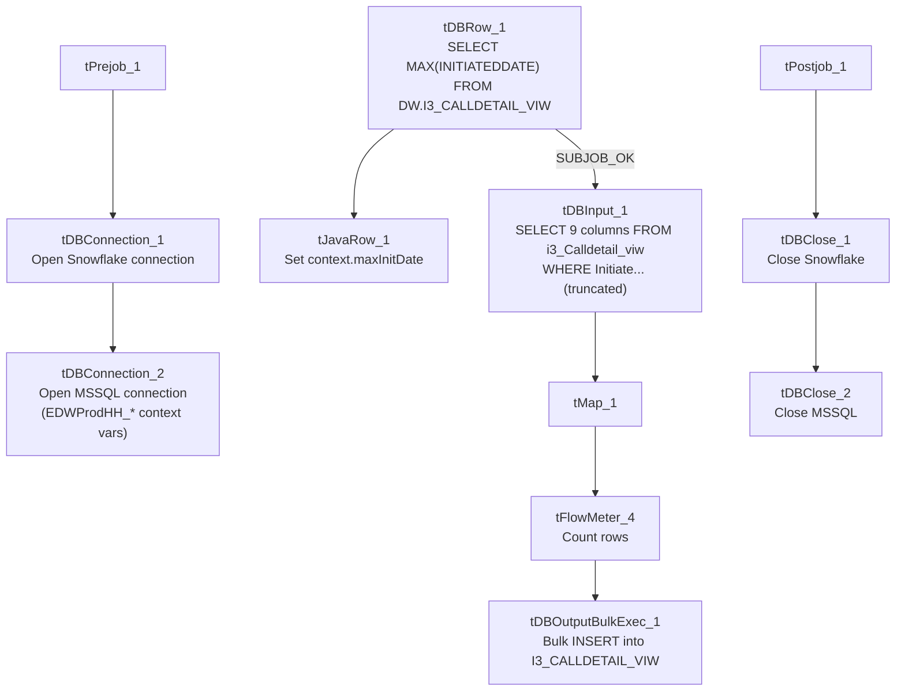

# Talend Job: i3_CallDetail_viw_Load

## Overview

Loads call-detail-view records from the I3 telephony MSSQL view `i3_Calldetail_viw` into the Snowflake `I3_CALLDETAIL_VIW` table, using an incremental pattern keyed on `InitiatedDate`: it first computes the latest `InitiatedDate` already loaded into Snowflake, then reads only newer source rows (the source query's `WHERE` clause is visible in this metadata, unlike the sibling `i3_CallDetail_40_Load` job, though it is still cut off before its full condition can be confirmed). It moves a small set of call-linkage fields (call ID, direction, local/remote party, initiation time, event log, and three custom string fields) rather than full call-duration/outcome detail.

## Detail table

| Field | Value |
|---|---|
| Job name | i3_CallDetail_viw_Load |
| Version | 0.1 |
| Project | EDW2SF |
| Author | jmach@harriscollect.com |
| Created | 2022-02-07T10:41:05.209-0800 |
| Last Modified | 2022-05-24T09:48:53.412-0700 |

## Step-by-step data flow

**Setup subjob:** `tPrejob_1` → `tDBConnection_1` opens the Snowflake connection → `tDBConnection_2` opens the MSSQL connection to `context.EDWProdHH_Server`/`Port`/`Schema`/`Database`/`Login` (password redacted; same "EDWProdHH"-named connection used for I3 telephony data as in `i3_CallDetail_40_Load`).

**Main subjob:**

1. `tDBRow_1` runs `SELECT COALESCE(CAST(MAX(INITIATEDDATE) AS VARCHAR(30)), '2014-12-31') AS MAX_INIT_DATE FROM DW.I3_CALLDETAIL_VIW;` against Snowflake to find the latest `InitiatedDate` already loaded (defaulting to 2014-12-31 if the table is empty).
2. `tJavaRow_1` captures that value into `context.maxInitDate`.
3. On success (`SUBJOB_OK`), `tDBInput_1` runs a fixed `SELECT` against the source `i3_Calldetail_viw` view (using the shared MSSQL connection), pulling `CallId`, `CallDirection`, `LocalUserId`, `RemoteNumber`, `InitiatedDate`, `CallEventLog`, and three `CustomString` fields, with a **visible `WHERE Initiate...` clause** — the metadata cuts off right after the keyword, so whether it actually compares against `context.maxInitDate` cannot be confirmed, but the presence of a `WHERE` fragment referencing the same column used for the max-date calculation is a stronger signal of an actually-applied incremental filter than in `i3_CallDetail_40_Load`.
4. `tMap_1` passes the 9 source columns through to a same-shaped target schema (`DIE_ON_ERROR=true`).
5. `tFlowMeter_4` counts rows passing through (labeled "MyLabel").
6. `tDBOutputBulkExec_1` bulk-loads the rows into Snowflake table `I3_CALLDETAIL_VIW` (`INSERT`, no table-recreate action) — this job uses the **bulk-exec variant** of the Snowflake output component, unlike the plain `tSnowflakeOutput` used in most sibling I3 jobs.

Separately, `tStatCatcher_1` and `tFlowMeterCatcher_1` feed two `tLogRow` components that print job statistics and flow-meter counts to the log — standard Talend instrumentation, not part of the business data path.

**Teardown subjob:** `tPostjob_1` → `tDBClose_1` (close Snowflake) → `tDBClose_2` (close MSSQL).

## Settings tables

### Incremental key: `tDBRow_1` / `tJavaRow_1`

| Setting | Value | What it means |
|---|---|---|
| Query (`tDBRow_1`) | `SELECT COALESCE(CAST(MAX(INITIATEDDATE) AS VARCHAR(30)), '2014-12-31') AS MAX_INIT_DATE FROM DW.I3_CALLDETAIL_VIW;` | Finds the latest `InitiatedDate` already in Snowflake, defaulting to 2014-12-31 for an empty table. |
| Code (`tJavaRow_1`) | `context.maxInitDate = input_row.MAX_INIT_DATE;` | Stores the result for use in the source query. |

### Source: `tDBInput_1` (`tMSSqlInput`)

| Setting | Value | What it means |
|---|---|---|
| Connection | Shared `tDBConnection_2` | Reuses the job's single MSSQL connection. |
| View | `i3_Calldetail_viw` | Source telephony call-linkage view. |
| Query | Fixed `SELECT` of 9 named columns with a `WHERE Initiate...` clause (cut off in this metadata) | The visible fragment suggests filtering on `InitiatedDate`, presumably against `context.maxInitDate`, but the full condition is unable to be confirmed from this metadata. |

### Target: `tDBOutputBulkExec_1` (`tSnowflakeOutputBulkExec`)

| Setting | Value | What it means |
|---|---|---|
| Table | `I3_CALLDETAIL_VIW` | Destination table in Snowflake. |
| Output action | `INSERT` | Appends rows — there is no `TRUNCATE`/staging step, consistent with an incremental-append design (assuming the `WHERE` clause does what it appears to). |
| Table action | `NONE` | Table is not recreated by this job. |
| Component variant | `tSnowflakeOutputBulkExec` (bulk load) | Uses Snowflake's bulk-loading mechanism rather than row-by-row inserts — more efficient for larger volumes, and different from the plain `tSnowflakeOutput` used elsewhere in this project's I3 jobs. |

## Dependencies & configuration

- **Triggers/depends on other jobs:** none — no `tRunJob` links found.
- **Context variables used:** `EDWProdHH_Server`, `EDWProdHH_Port`, `EDWProdHH_Schema`, `EDWProdHH_Database`, `EDWProdHH_Login` (MSSQL connection details — same naming convention concern as `i3_CallDetail_40_Load`), `maxInitDate` (computed internally from the Snowflake max-date query).
- No hardcoded developer-workstation paths found in this job.

## Glossary

| Component type | Plain-English meaning |
|---|---|
| `tSnowflakeConnection` / `tSnowflakeClose` | Open/close a Snowflake database connection shared by other components in the job. |
| `tMSSqlConnection` / `tMSSqlInput` / `tMSSqlClose` | Open a Microsoft SQL Server connection, run a query against it, and close it. |
| `tSnowflakeRow` | Runs an arbitrary SQL statement against Snowflake and returns its result — here used just once for a single aggregate value. |
| `tSnowflakeOutputBulkExec` | Loads rows into Snowflake using its bulk-load mechanism rather than row-by-row inserts. |
| `tJavaRow` | Runs custom Java code once per input row — here used to unpack a single query result into a context variable. |
| `tFlowMeter` | Counts rows passing a point in the flow for logging/monitoring. |
| `tStatCatcher` / `tFlowMeterCatcher` / `tLogRow` | Talend's built-in job-statistics and flow-meter capture components, which print execution stats to the log; not part of the business data flow. |

## Issues observed

- **The source query's `WHERE` clause is visible but still truncated** in this metadata (`WHERE Initiate...`), so it is not possible to confirm with certainty that it actually references `context.maxInitDate` rather than some other fixed condition. Unlike `i3_CallDetail_40_Load` (whose captured query shows no `WHERE` fragment at all), this job's partial fragment is at least suggestive that the incremental design is applied — but this should still be verified directly in Talend Studio before relying on it.
- **This job uses `tSnowflakeOutputBulkExec` while most sibling I3 load jobs use plain `tSnowflakeOutput`.** Not a functional problem on its own, but worth knowing this project does not use one consistent Snowflake-write component across similar jobs — verify per job rather than assuming a uniform loading mechanism.
- **The same `EDWProdHH_*`-named MSSQL connection is used to read I3 telephony data**, the same naming/labeling concern already flagged in `i3_CallDetail_40_Load`'s doc — see that doc for the full discussion.
- **No error/row-count logging specific to this job's business outcome** (no `tWarn`/`tDie`/`tSendMail`) — a load failure here would only surface as a generic Talend execution error.
