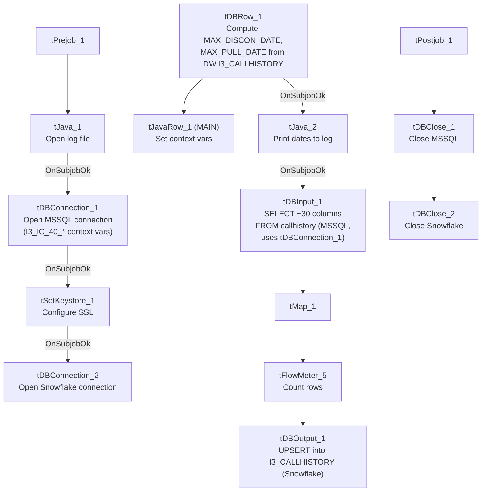

# Talend Job: i3_CallHistory_Load

## Overview

Loads call-history records (per-call outcome data: campaign, agent, phone number, call result/wrap-up codes, timing) from the I3 (Interactive Intelligence) telephony system's `callhistory` MSSQL table into the Snowflake `I3_CALLHISTORY` table, using an `UPSERT` write so repeated runs update existing rows rather than duplicate them. Before reading the source, the job computes the latest disconnect time already loaded into Snowflake, apparently to support an incremental pull, though (see Issues observed) the query text captured in this metadata is truncated and does not show whether that value is actually used as a filter.

## Detail table

| Field | Value |
|---|---|
| Job name | i3_CallHistory_Load |
| Version | 0.1 |
| Project | EDW2SF |
| Author | jmach@harriscollect.com |
| Created | 2023-04-11T09:57:23.505-0700 |
| Last Modified | 2025-11-06T09:13:29.707-0800 |

## Step-by-step data flow

**Setup subjob:** `tPrejob_1` → `tJava_1` opens a per-run log file → on success (`OnSubjobOk`), `tDBConnection_1` opens the MSSQL connection (configured with `context.I3_IC_40_*` variables — Server/Port/Schema/Database/Login, password redacted) → on success, `tSetKeystore_1` configures SSL trust/keystore from `context.keystorePath` → on success, `tDBConnection_2` opens the Snowflake connection.

**Main subjob:**

1. `tDBRow_1` runs a Snowflake query against `DW.I3_CALLHISTORY` to compute `MAX_DISCON_DATE` (the latest call-disconnect time already loaded, minus a 30-minute safety buffer, defaulting to `'2019-01-01'` if the table is empty) and `MAX_PULL_DATE` (the current timestamp, converted to UTC).
2. `tJavaRow_1` captures those two values into `context.maxDisconDate` and `context.maxPullDate`.
3. On success (`OnSubjobOk`), `tJava_2` prints both values to the log.
4. On success, `tDBInput_1` (`tMSSqlInput`) runs a fixed `SELECT` of ~30 columns against the source `callhistory` table (via the shared connection `tDBConnection_1`, i.e. the I3 IC 40 MSSQL database — see Issues observed regarding a naming mismatch on this component's own parameters), pulling campaign name, site ID, call ID, wrap-up category/code, phone number, agent ID, call timing fields (`previewpoptimeUTC`, `callplacedtimeUTC`, etc.), call length, contact/success flags, and `callhistory_id`.
5. `tMap_1` passes the ~30 source columns through to a same-shaped uppercase-named target schema.
6. `tFlowMeter_5` counts rows passing through (labeled "MyLabel", not renamed for this job).
7. `tDBOutput_1` upserts the rows into Snowflake table `I3_CALLHISTORY` (`UPSERT`, no table-recreate action) — presumably keyed on `CALLHISTORY_ID`.

**Teardown subjob:** `tPostjob_1` → `tDBClose_1` (close MSSQL) → `tDBClose_2` (close Snowflake).

## Settings tables

### Incremental-marker query: `tDBRow_1` (`tSnowflakeRow`)

| Setting | Value | What it means |
|---|---|---|
| Query | `SELECT COALESCE(CAST(DATEADD(min,-30,MAX(CALLDISCONNECTEDTIMEUTC)) AS VARCHAR(30)),'2019-01-01') AS MAX_DISCON_DATE, CAST(CONVERT_TIMEZONE(...,CURRENT_TIMESTAMP) AS VARCHAR(30)) AS MAX_PULL_DATE FROM DW.I3_CALLHISTORY;` | Finds the latest call-disconnect time already in Snowflake (minus a 30-minute buffer, to re-catch any calls that finished writing after the last run's cutoff), and the current UTC timestamp as the new high-water mark. |
| Captured into | `context.maxDisconDate`, `context.maxPullDate` | Set by `tJavaRow_1` immediately after; printed to the log by `tJava_2` before the source read. |

### Source: `tDBInput_1` (`tMSSqlInput`)

| Setting | Value | What it means |
|---|---|---|
| Connection | `USE_EXISTING_CONNECTION=true`, `CONNECTION=tDBConnection_1` | Reuses the job's shared MSSQL connection rather than opening a new one. |
| Component's own HOST/PORT/SCHEMA/DBNAME/USER params | `context.EDWProdHH_Server`, `EDWProdHH_Port`, `EDWProdHH_Schema`, `EDWProdHH_Database`, `EDWProdHH_Login` | **Mismatched with the actual connection** — see Issues observed. |
| Table (implied) | `callhistory` | Source I3 telephony call-history table (per the query text and the job's own naming). |
| Query | Truncated in this metadata after the initial column list | Does not visibly reference `context.maxDisconDate` in the captured portion — see Issues observed regarding whether the load is truly incremental. |

### Target: `tDBOutput_1` (`tSnowflakeOutput`)

| Setting | Value | What it means |
|---|---|---|
| Table | `I3_CALLHISTORY` | Destination table in Snowflake. |
| Output action | `UPSERT` | Updates existing rows and inserts new ones — unlike a plain `INSERT`, this design tolerates re-running the same source rows without creating duplicates, assuming a stable match key (likely `CALLHISTORY_ID`). |
| Table action | `NONE` | Table itself is not recreated or truncated by this job — consistent with an incremental/upsert design rather than the truncate-and-reload pattern used by the file-load jobs. |

## Dependencies & configuration

- **Triggers/depends on other jobs:** none — no `tRunJob` links found.
- **Context variables used:** `EDWProdHH_Database`, `EDWProdHH_Login`, `EDWProdHH_Port`, `EDWProdHH_Schema`, `EDWProdHH_Server` (referenced on `tDBInput_1`'s own parameters, but see Issues observed), `I3_IC_40_Database`, `I3_IC_40_Login`, `I3_IC_40_Port`, `I3_IC_40_Schema`, `I3_IC_40_Server` (used on the actual `tDBConnection_1` component), `keystorePath`, `logDir`, `maxDisconDate`, `maxPullDate`.
- **1 hardcoded path**: `tSetKeystore_1.SSL_TRUSTSERVER_TRUSTSTORE` (`C:/clientTrustStore.trustStore`) — the same project-wide SSL truststore path seen in other jobs.

## Glossary

| Component type | Plain-English meaning |
|---|---|
| `tMSSqlConnection` / `tMSSqlInput` / `tMSSqlClose` | Open a Microsoft SQL Server connection, run a query against it, and close it. |
| `tSnowflakeConnection` / `tSnowflakeRow` / `tSnowflakeOutput` / `tSnowflakeClose` | Open a Snowflake connection, run an arbitrary SQL statement, write rows to a table, and close the connection. |
| `tJavaRow` | Runs custom Java code once per input row — here used to unpack a single query result row into context variables. |
| `tFlowMeter` | Counts rows passing a point in the flow, for logging/monitoring. |
| `tSetKeystore` | Configures the SSL trust store/keystore used for the job's encrypted database connections. |

## Issues observed

- **`tDBInput_1`'s own HOST/PORT/SCHEMA/DBNAME/USER parameters reference `context.EDWProdHH_*` variables, but the component actually reuses `tDBConnection_1`, which is itself configured with `context.I3_IC_40_*` variables** (`USE_EXISTING_CONNECTION=true`). Since Talend uses the shared connection's own settings when `USE_EXISTING_CONNECTION` is true, `tDBInput_1`'s own `EDWProdHH_*`-labeled parameters are very likely vestigial/ignored at runtime — but their presence is a real, visible naming inconsistency (this is a call-history/I3 job, yet one component's leftover configuration is labeled for the unrelated "EDWProdHH" operational database). This looks like a copy-paste artifact from an EDWProdHH-based job template. Unable to confirm from metadata whether these unused parameters have any runtime effect; verify directly in Talend Studio.
- **Whether this load is actually incremental cannot be confirmed from this metadata.** The job computes `context.maxDisconDate` from Snowflake, logs it, and only then reads the MSSQL source — strongly suggesting the intent is to filter the source query to rows after that date. However, the captured `tDBInput_1.QUERY` text is truncated after the initial column list and does not show a `WHERE` clause referencing `context.maxDisconDate` anywhere in the visible portion. If the query is not actually filtered, every run re-reads the entire source table; because the target write is an `UPSERT` (not a plain `INSERT` with no truncate), this would at least avoid duplicate rows, but it could still mean unnecessarily reprocessing the full history table every run. This should be verified directly in Talend Studio before assuming the incremental design is complete.
- **No job-specific error/row-count logging** (no `tWarn`/`tDie`/`tSendMail`) beyond the two log-print statements — a load failure would surface only as a generic Talend execution error, with no job-specific message to distinguish it in a shared log, matching the pattern noted for `i3_CallDetail_40_Load` in the reference docs.
