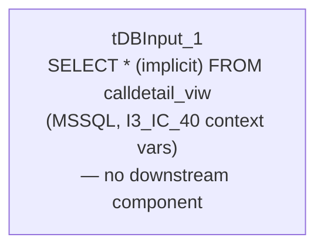

# Talend Job: i3_Call_Detail_View_Init_Load

## Overview

This job's extracted metadata contains a single component and nothing else — no connections, no `tPrejob`/`tPostjob`, no output, no downstream flow of any kind. It is configured to read from an MSSQL table/view named `calldetail_viw` (a "call detail view," presumably related to the I3 telephony platform's call-detail data covered by `i3_CallDetail_40_Load`) using the `I3_IC_40` connection context, but as captured it does not move data anywhere or perform any complete extract-load cycle. Based purely on what this metadata shows, this reads as an incomplete or scratch/test job rather than a functioning part of the pipeline — see Issues observed.

## Detail table

| Field | Value |
|---|---|
| Job name | i3_Call_Detail_View_Init_Load |
| Version | 0.1 |
| Project | EDW2SF |
| Author | jmach@harriscollect.com |
| Created | 2023-05-12T10:48:14.000-0700 |
| Last Modified | 2025-08-28T08:57:22.188-0700 |

## Step-by-step data flow

The job's `components` list contains exactly one entry, `tDBInput_1`, and its `connections` list is empty — there is no wiring to any other component, no setup/teardown subjob, and no captured schema for what this component would actually return. Unable to determine from metadata whether this component is left completely disconnected on the canvas, or whether downstream components exist in the job but were not captured by this extraction.

## Settings tables

### Source: `tDBInput_1` (`tMSSqlInput`)

| Setting | Value | What it means |
|---|---|---|
| Connection | `context.I3_IC_40_Server`/`Port`/`Schema`/`Database`/`Login` (password `***REDACTED***`) | Same I3 telephony connection context used by other `i3_*` jobs in this project (e.g. `i3_AgentActivityLog_Load`, `i3_InteractionWrapup_Load`). |
| TABLE | `"calldetail_viw"` | Reads from a table or view named "call detail view" — presumably a source-side view over call-detail data, distinct from the `i3_CallDetail_40` table read by `i3_CallDetail_40_Load`. |
| QUERY | `""` (empty) | No custom query is set — the component would default to selecting from the `TABLE` value directly, whatever columns that view exposes. |
| USE_EXISTING_CONNECTION | `false` | This component opens its own ad hoc MSSQL connection rather than sharing one — there is no separate `tMSSqlConnection` component in this job's metadata for it to share. |

No `schema_columns` were captured for this component, so the actual column layout of `calldetail_viw` is not visible in this metadata.

## Dependencies & configuration

- **Triggers/depends on other jobs:** none — no `tRunJob` links found, and this job does not appear as a caller or target in `06_dependency_matrix.md`.
- **Context variables used:** `I3_IC_40_Database`, `I3_IC_40_Login`, `I3_IC_40_Port`, `I3_IC_40_Schema`, `I3_IC_40_Server` (the standard `I3_IC_40_0.1` context group).
- No hardcoded paths found in this job's single component.

## Glossary

| Component type | Plain-English meaning |
|---|---|
| `tMSSqlInput` | Runs a query (or, with no query set, an implicit select) against a Microsoft SQL Server table/view and returns the result rows. |

## Issues observed

- **This job does not perform a complete data flow as captured.** It has exactly one component, no `tPrejob`/`tPostjob`, no connection-open/-close pair, no output destination (file or database), and no logging or error-handling components — in contrast to every other job reviewed in this batch, all of which have at minimum a source, transform, and destination. Running this job as-is would query `calldetail_viw` and discard the result with nothing consuming it.
- **No schema was captured for `tDBInput_1`**, so even the shape of `calldetail_viw` (what columns it exposes) is not visible in this metadata — unable to determine from metadata what this job would actually retrieve if run.
- **The job name ("Init_Load") and its minimal, disconnected structure suggest this is a development scratch job or an abandoned starting point** — possibly created to explore the `calldetail_viw` source ahead of building a real load job, and left in the repository unfinished. This is an inference from structure, not stated anywhere in the metadata. Recommend confirming with the team whether this job is actually scheduled/deployed; if it is, that would be worth flagging as an operational gap (a job that runs but accomplishes nothing), and if it isn't, it's a candidate for cleanup so it doesn't get mistaken for a working `i3_CallDetail`-family load in future audits.
