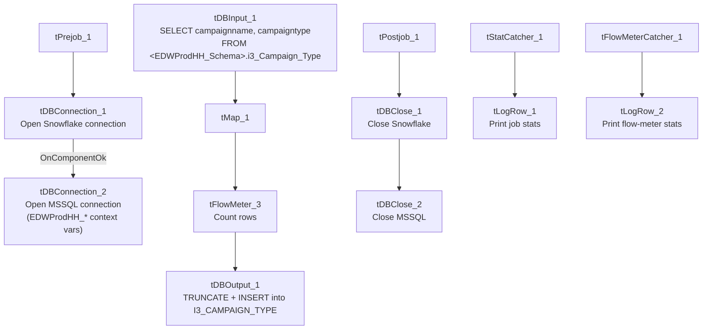

# Talend Job: i3_Campaign_Type_Load

## Overview

Loads a small reference table of I3 dialer campaign name/type pairs (`i3_Campaign_Type`) from the source SQL Server database into the Snowflake `I3_CAMPAIGN_TYPE` table, using a full truncate-and-reload pattern appropriate for a small, slowly-changing lookup table. Like `i3_CallDetail_40_Load`, this job's MSSQL connection is configured with `EDWProdHH_*` context variables even though the table itself is I3-named — but here the query text literally schema-qualifies the table using `context.EDWProdHH_Schema`, which is stronger evidence that the I3 tables genuinely live inside the same SQL Server database/schema as EDWProdHH data (see Issues observed).

## Detail table

| Field | Value |
|---|---|
| Job name | i3_Campaign_Type_Load |
| Version | 0.1 |
| Project | EDW2SF |
| Author | jmach@harriscollect.com |
| Created | 2022-01-25T15:19:09.044-0800 |
| Last Modified | 2025-09-24T10:59:42.536-0700 |

## Step-by-step data flow

**Setup subjob:** `tPrejob_1` → `tDBConnection_1` opens the Snowflake connection → on success, `tDBConnection_2` opens the MSSQL connection using `context.EDWProdHH_Server`/`Port`/`Schema`/`Database`/`Login` (password redacted).

**Main subjob:**

1. `tDBInput_1` runs `SELECT "<EDWProdHH_Schema>".i3_Campaign_Type.campaignname, "<EDWProdHH_Schema>".i3_Campaign_Type.campaigntype FROM "<EDWProdHH_Schema>".i3_Campaign_Type` — the query text is built dynamically at design time using `context.EDWProdHH_Schema` as the schema qualifier for the `i3_Campaign_Type` table.
2. `tMap_1` passes the 2 source columns through to an uppercase-named target schema (`CAMPAIGNNAME`, `CAMPAIGNTYPE`).
3. `tFlowMeter_3` counts rows passing through (labeled "MyLabel").
4. `tDBOutput_1` **truncates and reloads** Snowflake table `I3_CAMPAIGN_TYPE` (`outputAction=INSERT`, `tableAction=TRUNCATE`) — a full-refresh pattern, unlike the incremental-append design used by this project's larger I3 fact-style loads (`i3_CallDetail_40_Load`, `i3_AgentQueueStats_Load`).

Separately, `tStatCatcher_1` and `tFlowMeterCatcher_1` (standard Talend internal statistics/flow-meter catchers) feed two `tLogRow` components that print job statistics and flow-meter counts to the log — these run automatically alongside the main flow and aren't part of the business data path.

**Teardown subjob:** `tPostjob_1` → `tDBClose_1` (close Snowflake) → `tDBClose_2` (close MSSQL).

## Settings tables

### Source: `tDBInput_1` (`tMSSqlInput`)

| Setting | Value | What it means |
|---|---|---|
| Table | `i3_Campaign_Type` | Source lookup table of campaign name/type pairs. |
| Query | `SELECT "<EDWProdHH_Schema>".i3_Campaign_Type.campaignname, "<EDWProdHH_Schema>".i3_Campaign_Type.campaigntype FROM "<EDWProdHH_Schema>".i3_Campaign_Type` | Dynamically schema-qualifies the table using `context.EDWProdHH_Schema` — direct evidence that this i3-named table lives inside the same SQL Server schema as EDWProdHH data. |

### Target: `tDBOutput_1` (`tSnowflakeOutput`)

| Setting | Value | What it means |
|---|---|---|
| Table | `I3_CAMPAIGN_TYPE` | Destination table in Snowflake. |
| Output action | `INSERT` | Loads all current source rows. |
| Table action | `TRUNCATE` | Clears the table before loading — a full reload every run, appropriate for a small reference/lookup table. |

### Setup: `tDBConnection_2` (`tMSSqlConnection`)

| Setting | Value | What it means |
|---|---|---|
| HOST / PORT / SCHEMA_DB / DBNAME / USER | `context.EDWProdHH_Server` / `context.EDWProdHH_Port` / `context.EDWProdHH_Schema` / `context.EDWProdHH_Database` / `context.EDWProdHH_Login` | Same `EDWProdHH` context group used for the operational database elsewhere in the project — see Issues observed for what this implies about where I3 tables physically live. |

## Dependencies & configuration

- **Triggers/depends on other jobs:** none — no `tRunJob` links found.
- **Context variables used:** `EDWProdHH_Database`, `EDWProdHH_Login`, `EDWProdHH_Port`, `EDWProdHH_Schema`, `EDWProdHH_Server`.
- **No hardcoded developer-workstation paths found in this job** — notably cleaner than most of the 210 jobs flagged project-wide in `05_operational_runbook.md`, though this job's simplicity (no file I/O, no keystore configuration) likely explains the absence rather than any deliberate cleanup.

## Glossary

| Component type | Plain-English meaning |
|---|---|
| `tSnowflakeConnection` / `tSnowflakeClose` | Open/close a Snowflake database connection shared by other components in the job. |
| `tMSSqlConnection` / `tMSSqlInput` / `tMSSqlClose` | Open a Microsoft SQL Server connection, run a query against it, and close it. |
| `tMap` | Maps/transforms columns from one schema to another. |
| `tFlowMeter` | Counts rows passing a point in the flow for logging/monitoring. |
| `tSnowflakeOutput` | Writes rows to a Snowflake table — here with `TRUNCATE` table action, meaning the table is cleared before each load. |
| `tStatCatcher` / `tFlowMeterCatcher` / `tLogRow` | Talend's built-in job-statistics and flow-meter capture components, which print execution stats to the log; not part of the business data flow. |

## Issues observed

- **This job's MSSQL connection uses `EDWProdHH_*` context variables for a table named `i3_Campaign_Type`** — the same pattern flagged as ambiguous in `i3_CallDetail_40_Load`'s documentation. Here, though, the query text itself schema-qualifies the table with `context.EDWProdHH_Schema`, which is direct evidence that the I3 tables genuinely live in the same SQL Server database/schema as EDWProdHH data (rather than the connection label simply being reused/mislabeled). This job's own metadata supports resolving that open question — worth cross-referencing when reviewing `i3_CallDetail_40_Load`'s equivalent finding.
- **Full truncate-and-reload (`tableAction=TRUNCATE`) means a query failure mid-run could leave `I3_CAMPAIGN_TYPE` empty or partially loaded** until the next successful run — there is no staging table or two-step swap in this job. Anything actively querying `I3_CAMPAIGN_TYPE` during a run window could see a transient empty or partial table.
- **No error/row-count-specific logging** (no `tWarn`/`tDie`/`tSendMail`) — the same absence noted in this project's other I3 load jobs; a failure here would only surface as a generic Talend execution error.
