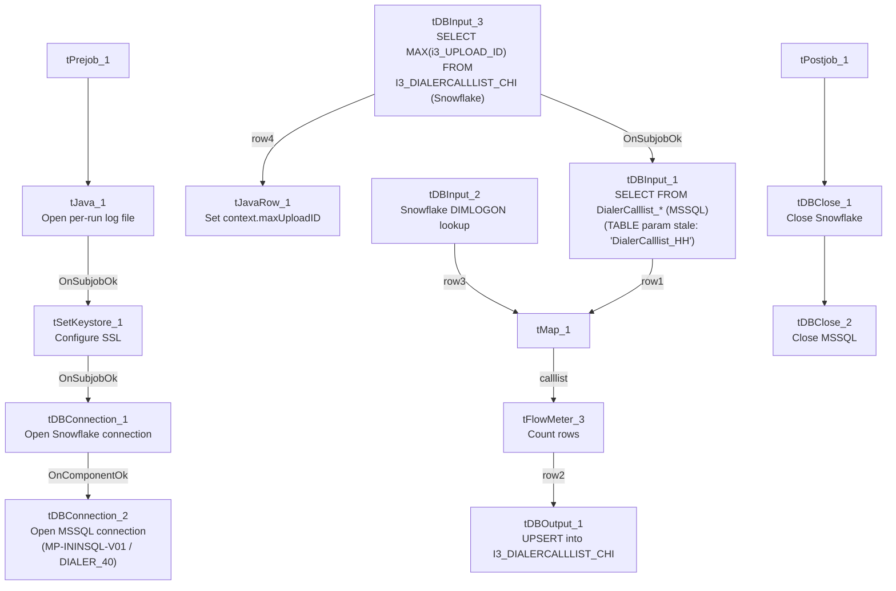

# Talend Job: i3_DialerCallListCHI_Load

## Overview

Refreshes the "CHI" site's dialer call-list table (`I3_DIALERCALLLIST_CHI`) in Snowflake directly from MSSQL: it computes the current maximum `I3_UPLOAD_ID` already in Snowflake, extracts debtor/campaign/phone/call-attempt data (roughly 60 columns, including HH-style skip-trace columns `SKPPHN1`/`SKPPHN2`/`PHO1`) from the MSSQL `DialerCalllist_*` source, joins it against a Snowflake `DIMLOGON` lookup, and directly `UPSERT`s the mapped rows into the final Snowflake table — with no separate staging table, no `TRUNCATE`, and no downstream `MERGE` call. This is a third distinct load pattern within the `i3_DialerCallList*` job family (alongside `i3_DialerCallListHH_Load`'s truncate-staging-then-watermark-append pattern and the key-based `MERGE` pattern used by `CO_Load`/`DC_Load_Backup`/`TOL_Load`, per that job's own doc) — the simplest of the three, relying entirely on Snowflake's native `UPSERT` to avoid duplicates.

## Detail table

| Field | Value |
|---|---|
| Job name | i3_DialerCallListCHI_Load |
| Version | 0.2 |
| Project | EDW2SF |
| Author | jmach@harriscollect.com |
| Created | 2023-06-01T10:33:42.092-0700 |
| Last Modified | 2025-11-16T19:32:33.058-0800 |

## Step-by-step data flow

**Setup subjob:** `tPrejob_1` → `tJava_1` opens a per-run log file at `context.logDir + jobName + "_" + <timestamp> + ".log"` → on success (`OnSubjobOk`), `tSetKeystore_1` configures SSL trust/keystore from `context.keystorePath` (passwords redacted) → on success, `tDBConnection_1` opens the Snowflake connection → on success (`OnComponentOk`), `tDBConnection_2` (`tMSSqlConnection`, hardcoded `HOST="MP-ININSQL-V01"`, `DBNAME="DIALER_40"`, driver `JTDS`, user `svc_ssa_snflk`) opens the MSSQL connection.

**Main subjob:**

1. `tDBInput_3` (`tSnowflakeInput`) runs `SELECT CAST(COALESCE(MAX(i3_UPLOAD_ID),1) AS VARCHAR(20)) AS MAXUPLOADID FROM I3_DIALERCALLLIST_CHI` to find the highest upload ID already loaded.
2. `tDBInput_3` feeds two branches: `MAIN` → `tJavaRow_1` captures the value into `context.maxUploadID`; `SUBJOB_OK` (fires only once that capture completes) → `tDBInput_1` (`tMSSqlInput`, reusing the shared MSSQL connection) runs a fixed `SELECT` of ~60 named columns (`I3_IDENTITY`, `ACCOUNT AS DEBTORNUMBER`, `LOGON`, a derived `DEBTOR_IDX`, `CAMPAIGN`, `DEBTORNAME`, address/phone fields, `SKPPHN1`/`SKPPHN2`/`PHO1`, call-attempt counters, `I3_UPLOAD_ID`, etc.) against the source dialer table. **The component's own `TABLE` parameter is hardcoded to `"DialerCalllist_HH"`** — not `_CHI` — even though this is the CHI job (see Issues observed); the actual `QUERY` text is truncated in this metadata after the column list, so the real `FROM`/`WHERE` clause (and whether it filters using `context.maxUploadID`) cannot be confirmed.
3. `tMap_1` joins the MSSQL flow (`row1`) against `tDBInput_2` (`tSnowflakeInput` reading Snowflake table `DIMLOGON`, `row3`), adding a `DIMLOGON` surrogate key column.
4. `tFlowMeter_3` counts rows passing through.
5. `tDBOutput_1` upserts the mapped rows directly into Snowflake table `I3_DIALERCALLLIST_CHI` (`UPSERT`, `tableAction: NONE` — no truncate, no staging table).

**Teardown subjob:** `tPostjob_1` → `tDBClose_1` (close Snowflake) → `tDBClose_2` (close MSSQL).

## Settings tables

### Source: `tDBInput_1` (`tMSSqlInput`)

| Setting | Value | What it means |
|---|---|---|
| Connection | Shared `tDBConnection_2` | Reuses the job's single MSSQL connection. |
| TABLE (component's own parameter) | `"DialerCalllist_HH"` | **Stale/incorrect for this job** — this is the CHI job, but the dead `TABLE` field still reads "HH." See Issues observed. |
| Query | Fixed `SELECT` of ~60 named columns (identity, debtor/campaign identifiers, address, `SKPPHN1`/`SKPPHN2`/`PHO1`, call-history flags, `I3_UPLOAD_ID`) — captured text truncated after the visible column list | The actual `FROM`/`WHERE` clause, and whether it filters on `context.maxUploadID`, is not visible in this metadata. |
| ENCODING | `ISO-8859-15` | Non-UTF-8 encoding, consistent with other legacy-source jobs in this project. |
| TRIM_ALL_COLUMN | `false` | No whitespace trimming applied to extracted columns. |

### MSSQL connection: `tDBConnection_2` (`tMSSqlConnection`)

| Setting | Value | What it means |
|---|---|---|
| DRIVER | `JTDS` | Matches `i3_DialerCallListPRE_Load`'s connection, not `HH_Load`'s (`MSSQL_PROP`). |
| HOST | `"MP-ININSQL-V01"` (hardcoded) | Same physical server as `PRE_Load`/`TOL_Load` per that job family's documentation. |
| DBNAME | `"DIALER_40"` (hardcoded) | Same database as `PRE_Load`/`TOL_Load` — unlike `HH_Load`, which hits a differently-named `EDWPRODHH` database on a different server. |
| USER | `"svc_ssa_snflk"` | Hardcoded service account name. |

### Lookup: `tDBInput_2` (`tSnowflakeInput`)

| Setting | Value | What it means |
|---|---|---|
| Table | `DIMLOGON` | Small dimension table joined in `tMap_1` to attach a `DIMLOGON` surrogate key based on `LOGON`. |

### Watermark query: `tDBInput_3` / `tJavaRow_1`

| Setting | Value | What it means |
|---|---|---|
| Query | `SELECT CAST(COALESCE(MAX(i3_UPLOAD_ID),1) AS VARCHAR(20)) AS MAXUPLOADID FROM I3_DIALERCALLLIST_CHI` | Computes the highest upload ID already loaded into the CHI Snowflake table. |
| Result handling | `context.maxUploadID = input_row.MAXUPLOADID;` | Captured into context, but not visibly referenced in `tDBInput_1`'s (truncated) query text — see Issues observed. |

### Target: `tDBOutput_1` (`tSnowflakeOutput`)

| Setting | Value | What it means |
|---|---|---|
| Table | `I3_DIALERCALLLIST_CHI` | Destination table in Snowflake. |
| Output action | `UPSERT` | Inserts new rows and updates existing rows on match — no `TRUNCATE`/staging step, so this design tolerates re-running without needing the `maxUploadID` filter to work correctly (unlike `HH_Load`'s append-only `INSERT ... WHERE LOAD_DTTM > MAX(...)` pattern, which can produce duplicates if its watermark logic misfires). |

## Dependencies & configuration

- **Triggers/depends on other jobs:** none — no `tRunJob` links found (`runjob_targets: []`); not listed as a target in `06_dependency_matrix.md` either.
- **Context variables used:** `keystorePath`, `logDir`, `maxUploadID` (computed internally, but not confirmed to be actually applied as a filter — see Issues observed). This job does not use `context.EDWProdHH_*` or any `StandardFolders_0.1` variable; its MSSQL host/database/driver are all hardcoded.
- **1 hardcoded path:** `tSetKeystore_1.SSL_TRUSTSERVER_TRUSTSTORE` (`"C:/clientTrustStore.trustStore"`) — same project-wide risk documented in `05_operational_runbook.md`.

## Glossary

| Component type | Plain-English meaning |
|---|---|
| `tMSSqlConnection` / `tMSSqlInput` / `tMSSqlClose` | Open a Microsoft SQL Server connection, run a query against it, and close it. |
| `tSnowflakeConnection` / `tSnowflakeInput` / `tSnowflakeOutput` / `tSnowflakeClose` | Open/close a Snowflake connection, read a table, and write rows to a table. |
| `tMap` | Maps/transforms and optionally joins (lookup) columns from one or more input schemas to an output schema. |
| `tFlowMeter` | Counts rows passing a point in the flow for logging/monitoring. |
| `tJavaRow` | Runs custom Java code once per input row — here used to unpack a single query result into a context variable. |
| `tSetKeystore` | Configures SSL trust/keystore settings used by subsequent secure connections. |

## Issues observed

- **`tDBInput_1`'s own `TABLE` parameter is hardcoded to `"DialerCalllist_HH"`, not `"DialerCalllist_CHI"`**, even though this job is `i3_DialerCallListCHI_Load` and its actual `QUERY` (not the `TABLE` field) is what really drives the extraction. This is almost certainly dead/unused configuration left over from copying this job from the HH sibling (or a shared template), since `tMSSqlInput` uses the free-form `QUERY` text, not `TABLE`, when a custom query is present — but its presence here is worth flagging directly, since if anyone (or any future automation) ever switches this component from "query mode" to "guess query from table," it would silently start reading the wrong site's table. Unable to confirm from this truncated metadata what the actual `QUERY`'s `FROM` clause names; verify directly in Talend Studio.
- **The incremental-load logic (`context.maxUploadID`) may not actually be applied.** The job computes the current max `I3_UPLOAD_ID` from Snowflake before reading MSSQL, suggesting an incremental design, but `tDBInput_1`'s `QUERY` text is truncated in this metadata after the column list, so whether a `WHERE ... > context.maxUploadID`-style filter actually exists cannot be confirmed. Unlike `HH_Load`'s append-only design, this job's `UPSERT` target action means even an unfiltered full re-read would not create duplicate rows — but it could mean every run unnecessarily re-reads the entire source table. Verify directly in Talend Studio. Same category of gap documented in `i3_CallDetail_40_Load`'s and `i3_AgentStats`' own docs.
- **This job's MSSQL connection (`MP-ININSQL-V01` / `DIALER_40`, driver `JTDS`) matches `i3_DialerCallListPRE_Load`'s connection** (see that job's own doc) but differs from `HH_Load`'s (`MP-BI-V01` / `EDWPRODHH`, driver `MSSQL_PROP`) — reinforcing `HH_Load`'s own finding that these "site" jobs are not all pointed at one shared dialer database.
- **This job's source schema includes `SKPPHN1`/`SKPPHN2`/`PHO1`** (skip-trace/directory-assistance-style columns), which `i3_DialerCallListHH_Load`'s own doc described as "HH-specific" relative to the DC/TOL/CO/PRE siblings it was directly compared against at the time. Seeing the same columns present in CHI's own source schema here suggests those columns are not actually unique to HH — they may simply not have been present in whichever specific siblings that comparison covered. Worth a follow-up comparison across the full `i3_DialerCallList*` family rather than assuming any one column set is site-specific without checking each job's own metadata.
- No other findings beyond the project-wide hardcoded-path pattern already documented in `05_operational_runbook.md`.
