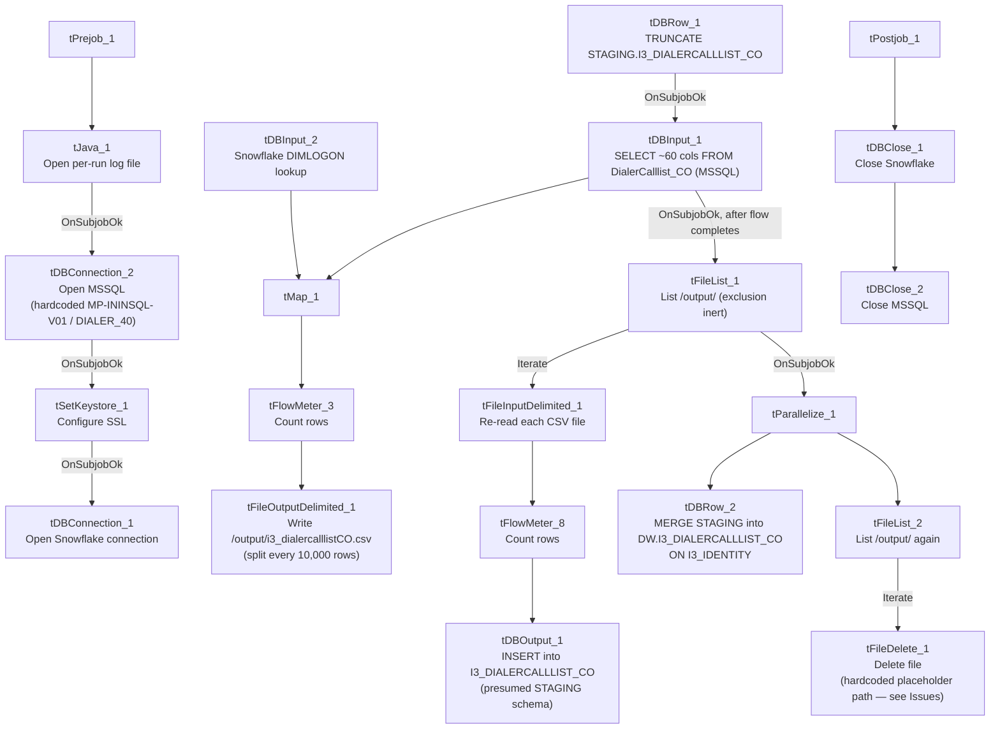

# Talend Job: i3_DialerCallListCO_Load

## Overview

Refreshes the "CO" site's dialer call-list table in Snowflake (`I3_DIALERCALLLIST_CO`) from the I3 telephony MSSQL system: it extracts debtor/campaign/phone/call-attempt data from MSSQL table `DialerCalllist_CO`, joins it against a Snowflake `DIMLOGON` lookup, writes the enriched result to an intermediate CSV file, then re-reads that same file to load a Snowflake staging table and finally merges the staged rows into the `DW` warehouse table keyed on `I3_IDENTITY`. Unlike its `i3_DialerCallListHH_Load` sibling (which loads MSSQL straight into Snowflake with no file round-trip), this job goes through a full extract-to-file-and-back cycle before landing in staging, and — like `CO_Load`/`CO_Load_Backup` more generally — uses a proper key-based `MERGE` into the warehouse rather than a simple append.

## Detail table

| Field | Value |
|---|---|
| Job name | i3_DialerCallListCO_Load |
| Version | 0.2 |
| Project | EDW2SF |
| Author | jmach@harriscollect.com |
| Created | 2023-07-06T09:51:28.197-0700 |
| Last Modified | 2025-11-10T15:43:45.237-0800 |

## Step-by-step data flow

**Setup subjob:** `tPrejob_1` → `tJava_1` opens a per-run log file at `context.logDir + jobName + "_" + <timestamp> + ".log"` → on success (`OnSubjobOk`), `tDBConnection_2` opens the MSSQL connection (hardcoded host/database — see Settings tables) → on success, `tSetKeystore_1` configures SSL trust/keystore from `context.keystorePath` (passwords redacted) → on success, `tDBConnection_1` opens the Snowflake connection.

**Main subjob, phase 1 — extract MSSQL to CSV:**

1. `tDBRow_1` runs `TRUNCATE TABLE STAGING.I3_DIALERCALLLIST_CO;` on Snowflake (starts independently, with no incoming trigger link, as soon as the job's main subjob begins).
2. On success (`OnSubjobOk`), `tDBInput_1` runs a fixed `SELECT` against MSSQL table `DialerCalllist_CO`, pulling `I3_IDENTITY`, `ACCOUNT AS DEBTORNUMBER`, `LOGON`, a derived `DEBTOR_IDX`, `CAMPAIGN`, `DEBTORNAME`, address/phone fields (`PHONE1`–`PHONE7`), call-attempt counters (`I3_ATTEMPTS*`, 8 columns), `I3_UPLOAD_ID`, campaign-owner fields, and more (~60 columns total). The captured query text is truncated in this metadata after the initial column list, so any `WHERE` clause is not visible.
3. `tDBInput_1`'s output flows (`FLOW`) into `tMap_1`, which also receives a lookup input (`MAIN`) from `tDBInput_2` (`tSnowflakeInput` reading Snowflake table `DIMLOGON`), adding a `DIMLOGON` surrogate key column based on `LOGON`.
4. `tMap_1` → `tFlowMeter_3` (row count) → `tFileOutputDelimited_1`, which writes the enriched list to a fixed path `/output/i3_dialercalllistCO.csv` (comma-delimited, no header, split every 10,000 rows).

**Main subjob, phase 2 — reload CSV into Snowflake staging:**

5. Once phase 1's flow subjob completes, `tDBInput_1` also fires `OnSubjobOk` into `tFileList_1`, which lists every file in `/output/` (hardcoded, not a context variable — `EXCLUDEFILEMASK="*.txt"` with `IFEXCLUDE=false`, so the exclusion is configured but never applied).
6. `tFileList_1` `ITERATE`s into `tFileInputDelimited_1`, which re-reads each listed file (same ~60-column schema) → `tFlowMeter_8` (row count) → `tDBOutput_1`, which `INSERT`s the rows into Snowflake table `I3_DIALERCALLLIST_CO` (presumed to be the `STAGING`-schema copy given the earlier explicit truncate of `STAGING.I3_DIALERCALLLIST_CO`, though the component's own `db.table` field does not itself show a schema prefix).

**Main subjob, phase 3 — merge and cleanup (parallel):**

7. Once `tFileList_1`'s iteration subjob completes (`OnSubjobOk`), `tParallelize_1` starts two branches concurrently:
   - `tDBRow_2` runs a `MERGE INTO DW.I3_DIALERCALLLIST_CO AS tgt USING STAGING.I3_DIALERCALLLIST_CO AS src ON (tgt.I3_IDENTITY = src.I3_IDENTITY)` — updating all ~60 columns on match, inserting new rows on no match, with `I3_UPLOAD_ID` coalesced to `0` if null on both branches.
   - `tFileList_2` re-lists `/output/` and `ITERATE`s into `tFileDelete_1`, which attempts to delete each file found there.

**Teardown subjob:** `tPostjob_1` → `tDBClose_1` (close Snowflake) → `tDBClose_2` (close MSSQL).

## Settings tables

### Source: `tDBInput_1` (`tMSSqlInput`)

| Setting | Value | What it means |
|---|---|---|
| Connection | Shared `tDBConnection_2` | Reuses the job's single hardcoded MSSQL connection. |
| TABLE | `"DialerCalllist_CO"` | Correctly named for the CO site. |
| Query | Fixed `SELECT` of ~60 named columns — captured text truncated after the initial column list | Any `WHERE` clause is not visible in this metadata. |
| TRIM_ALL_COLUMN | `true` | Whitespace trimmed from all extracted columns. |

### MSSQL connection: `tDBConnection_2` (`tMSSqlConnection`)

| Setting | Value | What it means |
|---|---|---|
| DRIVER | `JTDS` | |
| HOST | `"MP-ININSQL-V01"` (hardcoded) | Same physical server as `i3_DialerCallListTOL_Load` (this batch) — both CO and TOL point at the same dialer SQL Server. |
| DBNAME | `"DIALER_40"` (hardcoded) | Same source database as the TOL sibling. |
| USER | `"svc_ssa_snflk"` | Hardcoded service account. |

### Intermediate file: `tFileOutputDelimited_1` / `tFileInputDelimited_1`

| Setting | Value | What it means |
|---|---|---|
| FILENAME (write) | `"/output/i3_dialercalllistCO.csv"` | Hardcoded path, not driven by any context variable (contrast with `context.sourceDir`/`context.fileDir` patterns used elsewhere in the project). |
| SPLIT / SPLIT_EVERY | `true` / `10000` | Large lists are split into multiple numbered files rather than one large file. |
| DIRECTORY (`tFileList_1`/`tFileList_2`) | `"/output/"` (hardcoded) | Same hardcoded output directory is listed twice — once to reload the file into Snowflake, once to delete it afterward. |
| TEMP_DIR (`tFileInputDelimited_1`) | `"C:/Talend-Studio-20211109_1610-V8.0.1/workspace"` | Hardcoded developer-workstation path. |

### Lookup: `tDBInput_2` (`tSnowflakeInput`)

| Setting | Value | What it means |
|---|---|---|
| Table | `DIMLOGON` | Small dimension table (`DIMLOGON`, `LOGON`, `DESCRIPTION`) joined in `tMap_1` to attach a `DIMLOGON` surrogate key based on `LOGON`. |

### Target (staging): `tDBOutput_1` (`tSnowflakeOutput`)

| Setting | Value | What it means |
|---|---|---|
| Table | `I3_DIALERCALLLIST_CO` | `INSERT`, `tableAction: NONE` — relies entirely on `tDBRow_1`'s earlier explicit `TRUNCATE TABLE STAGING.I3_DIALERCALLLIST_CO` to keep this idempotent; the component's own `db.table` field shows no schema prefix, so the assumption that this lands in `STAGING` (not some other schema) is inferred from the truncate step, not directly confirmed. |

### Warehouse merge: `tDBRow_2` (`tSnowflakeRow`)

| Setting | Value | What it means |
|---|---|---|
| Query | `MERGE INTO DW.I3_DIALERCALLLIST_CO AS tgt USING STAGING.I3_DIALERCALLLIST_CO AS src ON (tgt.I3_IDENTITY = src.I3_IDENTITY) WHEN MATCHED THEN UPDATE SET ... WHEN NOT MATCHED THEN INSERT (...)` | Full column-by-column update on match, insert on no match — a proper key-based merge, not a simple append. `I3_UPLOAD_ID` is coalesced to `0` if null on both the update and insert branches. |

### Cleanup: `tFileDelete_1`

| Setting | Value | What it means |
|---|---|---|
| FILENAME | `globalMap.get("tFileList_2_CURRENT_FILEPATH")` | The current file from `tFileList_2`'s iteration — dynamically the right file. |
| DIRECTORY / PATH | `"C:/Talend-Studio-20211109_1610-V8.0.1/workspace/delete_folder"` / `"C:/Talend-Studio-20211109_1610-V8.0.1/workspace/delete_folder or delete_file"` | Hardcoded, template-placeholder-looking values (the literal text "delete_folder or delete_file" strongly suggests these were never actually configured) — see Issues observed regarding whether cleanup functions at all. |
| FAILON | `true` | Unlike some other jobs' `tFileDelete` components in this project, a failed delete here **does** fail the job. |

## Dependencies & configuration

- **Triggers/depends on other jobs:** none — no `tRunJob` links found, and this job does not appear in `06_dependency_matrix.md`'s orchestration table.
- **Context variables used:** `keystorePath`, `logDir` only — this job's MSSQL host/database, output CSV path, and file-list directories are all hardcoded rather than driven by `StandardFolders_0.1` or any other context group.
- **4 hardcoded paths found:** `tSetKeystore_1.SSL_TRUSTSERVER_TRUSTSTORE` (`C:/clientTrustStore.trustStore`), `tFileInputDelimited_1.TEMP_DIR`, and `tFileDelete_1.DIRECTORY`/`PATH` — same project-wide risk documented in `05_operational_runbook.md`. The `/output/` directory itself and the CSV filename are also hardcoded, though not flagged in `hardcoded_path_findings` (they are Unix-style paths, not the Windows developer-workstation pattern that finding set specifically targets).

## Glossary

| Component type | Plain-English meaning |
|---|---|
| `tMSSqlConnection` / `tMSSqlInput` / `tMSSqlClose` | Open a Microsoft SQL Server connection, run a query against it, and close it. |
| `tSnowflakeConnection` / `tSnowflakeInput` / `tSnowflakeOutput` / `tSnowflakeRow` / `tSnowflakeClose` | Open/close a Snowflake connection, read a table, write rows to a table, or run an arbitrary SQL statement against Snowflake. |
| `tMap` | Maps/transforms and optionally joins (lookup) columns from one or more input schemas to an output schema. |
| `tFlowMeter` | Counts rows passing a point in the flow for logging/monitoring. |
| `tFileList` | Lists files in a directory for the job to iterate over one at a time. |
| `tFileInputDelimited` / `tFileOutputDelimited` | Read/write a delimited (CSV-style) text file. |
| `tFileDelete` | Deletes a specific file from disk. |
| `tParallelize` | Runs its downstream branches at the same time instead of one after another. |
| `tSetKeystore` | Configures SSL trust/keystore settings used by subsequent secure connections. |

## Issues observed

- **The cleanup step's `tFileDelete_1.DIRECTORY`/`PATH` values look like unconfigured template placeholders** (`"...delete_folder"` / `"...delete_folder or delete_file"`), not a real path pointing at `/output/`. Combined with `FAILON=true`, this raises a real operational question: if `tFileDelete_1` actually attempts to delete against these literal Windows paths rather than the dynamic `FILENAME` (`globalMap.get("tFileList_2_CURRENT_FILEPATH")`), either the delete silently targets the wrong location, or — if `FILENAME` does take precedence at runtime over `DIRECTORY`/`PATH` (which is plausible; `FILENAME` is Talend's actual delete-target field, with `DIRECTORY`/`PATH` typically only relevant for folder-deletion mode) — cleanup may work correctly despite these placeholder-looking values. Unable to fully determine from this metadata which parameter Talend actually honors here; verify directly in Talend Studio, since if cleanup silently fails, every run leaves its intermediate CSV files behind in `/output/`.
- **The MSSQL source query in `tDBInput_1` is truncated in this metadata**, cutting off after the initial column list — any `WHERE` clause (e.g. a date or upload-ID filter limiting the extract to new/changed rows) is not visible, so it's unable to be determined from this metadata whether this is a full-table extract every run or an incrementally filtered one.
- **The output CSV path (`/output/i3_dialercalllistCO.csv`) and both `tFileList` directories (`/output/`) are hardcoded** rather than driven by a context variable, unlike most file-handling jobs elsewhere in this project that use `context.sourceDir`/`context.archiveDir`/etc. from `StandardFolders_0.1`. Moving this job to a different environment or output location would require editing the job directly.
- **No reject-row handling, no `tWarn`/`tDie` on the merge result** — a bad row from the MSSQL extract or a failed `MERGE` would only surface as a generic Talend execution error, with no job-specific diagnostic message, unlike `ADP_Payroll_Load`'s explicit merge-result branching.
- No other findings beyond the project-wide hardcoded-path pattern already documented in `05_operational_runbook.md`.
