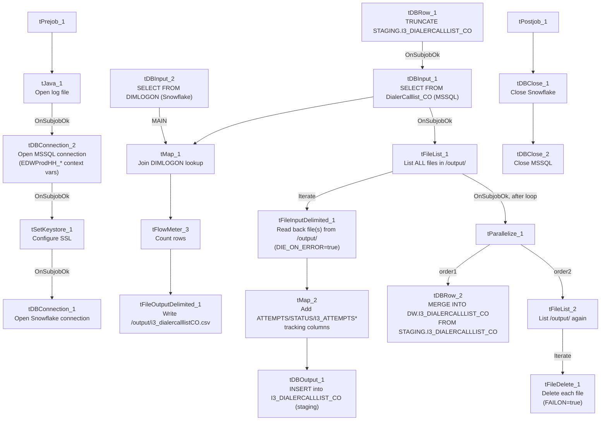

# Talend Job: i3_DialerCallListCO_Load_Backup

## Overview

Builds an outbound "dialer call list" for the CO site: it reads debtor/account records from the MSSQL `DialerCalllist_CO` table, enriches them with a logon-to-`DIMLOGON` lookup from Snowflake, and writes the result as a CSV file (`/output/i3_dialercalllistCO.csv`) intended for the I3 telephony/dialer system. In the same run, it also lists every file currently sitting in that same `/output/` directory, reads each one back with an expanded schema that adds dialer-response/attempt-tracking fields (call attempts, disposition status, campaign-owner info), loads that into Snowflake staging, merges it into the `DW.I3_DIALERCALLLIST_CO` warehouse table, and then deletes every file from `/output/`. The `_Backup` suffix in the job name, its blank author field, and its very recent/narrow create-modify window (created and modified one day apart in November 2025) all suggest this is a snapshot or working copy rather than the long-standing production version of this job — see Issues observed.

## Detail table

| Field | Value |
|---|---|
| Job name | i3_DialerCallListCO_Load_Backup |
| Version | 0.2 |
| Project | EDW2SF |
| Author | *(blank in source metadata)* |
| Created | 2025-11-10T15:14:37.779-0800 |
| Last Modified | 2025-11-11T10:32:00.005-0800 |

## Step-by-step data flow

**Setup subjob:** `tPrejob_1` → `tJava_1` opens a per-run log file → on success (`OnSubjobOk`), `tDBConnection_2` opens the MSSQL connection (`context.EDWProdHH_*` variables, password redacted) → on success, `tSetKeystore_1` configures SSL trust/keystore from `context.keystorePath` → on success, `tDBConnection_1` opens the Snowflake connection.

**Main subjob — outbound call-list generation:**

1. `tDBRow_1` runs `TRUNCATE TABLE STAGING.I3_DIALERCALLLIST_CO;`.
2. On success (`OnSubjobOk`), `tDBInput_1` (`tMSSqlInput`, reusing the shared `tDBConnection_2`) runs a query against `DialerCalllist_CO`, building `I3_IDENTITY`, `DEBTORNUMBER` (aliased from `ACCOUNT`), `LOGON`, a computed `DEBTOR_IDX` (`LOGON + '-' + ACCOUNT`), `CAMPAIGN`, `DEBTORNAME`, address fields, `CLIENTNAME`, `BALANCE`, multiple phone-number columns (`PHONERES`, `EMP1PHN`, `EMP2PHN`, `APPHONE`, `PHONE1`–`PHONE7`), last-payment/letter-notice fields, `SSN`, desk/status codes, a promise-to-pay date (`PLDATE`), a dialer `SCORE`/`MEDIAN`, and load-tracking fields (`CSVFILENAME`, `DATELOADED`, `TIMELOADED`, `ZONE`).
3. `tMap_1` joins that against `tDBInput_2` (a `tSnowflakeInput` reading the `DIMLOGON` table: `DIMLOGON`, `LOGON`, `DESCRIPTION`), adding a `DIMLOGON` surrogate-key column keyed on `LOGON`.
4. `tFlowMeter_3` counts rows, then `tFileOutputDelimited_1` writes the result as a headerless, comma-delimited CSV to `/output/i3_dialercalllistCO.csv` (split every 10,000 rows).

**Main subjob — read-back, load, and merge (runs after the MSSQL read completes):**

5. On success (`OnSubjobOk` from `tDBInput_1`), `tFileList_1` lists **every file** in `/output/` (no filename filter is applied — `EXCLUDEFILEMASK="*.txt"` but `IFEXCLUDE=false`).
6. For each file (`ITERATE`), `tFileInputDelimited_1` reads it back (headerless CSV, `DIE_ON_ERROR=true` — unlike most file reads in this project, a malformed row here **does** fail the job) using the same base column layout as step 2/3.
7. `tMap_2` adds a substantially larger set of columns not present in the outbound file's own generation logic: `LOAD_DTTM`, `STATUS`, `ATTEMPTS`, `HHCUSTVAR1`–`3`, `HHCUSTINT1`, several `I3_ATTEMPTS*` counters (remote hangup, system hangup, abandoned, busy, fax, no-answer, machine, rescheduled, sit-callable, daily), `I3_SITEID`, `I3_ACTIVECAMPAIGNID`, `I3_LASTCALLED_UTC`, `I3_UPLOAD_ID`, `SUCCESSRESULT`, and `I3_CAMPAIGNOWNERID`/`NAME`/`EXPIRATION`. This set of dialer-attempt/tracking fields is consistent with a **dialer response/results file** rather than the original outbound call-list content — see Issues observed regarding which specific file(s) actually populate these columns at runtime.
8. `tDBOutput_1` inserts the enriched rows into Snowflake (`I3_DIALERCALLLIST_CO`, `INSERT`, no table-recreate — presumably landing in the `STAGING` schema truncated in step 1, though this component's own `db.table` parameter shows only the bare table name, not a schema-qualified one).
9. After the entire file-list loop in step 5–8 completes (`tFileList_1` → `tParallelize_1`, `OnSubjobOk`), `tParallelize_1` runs two branches at once:
   - `tDBRow_2` runs an inline `MERGE INTO DW.I3_DIALERCALLLIST_CO AS tgt USING STAGING.I3_DIALERCALLLIST_CO AS src ON (tgt.I3_IDENTITY = src.I3_IDENTITY)` — a full-column `WHEN MATCHED THEN UPDATE` / `WHEN NOT MATCHED THEN INSERT` upsert (including `COALESCE(src.I3_UPLOAD_ID,0)` to default a null upload ID to zero).
   - `tFileList_2` lists `/output/` again → for each file (`ITERATE`), `tFileDelete_1` deletes it (`FAILON=true` — unlike most delete steps in this project, a failed delete here **does** fail the job).

**Teardown subjob:** `tPostjob_1` → `tDBClose_1` (close Snowflake) → `tDBClose_2` (close MSSQL).

## Settings tables

### Source: `tDBInput_1` (`tMSSqlInput`)

| Setting | Value | What it means |
|---|---|---|
| Table | `DialerCalllist_CO` | Source table of debtor/account records eligible for outbound dialing at the CO site. |
| Connection | Shared `tDBConnection_2` | Reuses the job's single MSSQL connection. |
| Key derived column | `DEBTOR_IDX = COALESCE(LOGON,'')+'-'+COALESCE(ACCOUNT,'')` | Composite key built in-query, matching the `DEBTOR_IDX` pattern used for dialer-family tables elsewhere in this project. |

### Lookup: `tDBInput_2` (`tSnowflakeInput`)

| Setting | Value | What it means |
|---|---|---|
| Table | `DIMLOGON` | A logon-name-to-surrogate-key dimension table in Snowflake, joined in `tMap_1` to attach a `DIMLOGON` ID to each row. |

### Outbound file: `tFileOutputDelimited_1`

| Setting | Value | What it means |
|---|---|---|
| FILENAME | `"/output/i3_dialercalllistCO.csv"` | Hardcoded absolute path, not built from a `context.*` variable. |
| HEADER | Not included (`INCLUDEHEADER=false`) | Output file has no header row, matching the headerless read-back step. |
| SPLIT / SPLIT_EVERY | `true` / `10000` | Splits the output into multiple files if the row count exceeds 10,000 per file — meaning `tFileList_1`/`tFileList_2` could pick up more than one generated file per run. |

### Read-back and enrichment: `tFileInputDelimited_1` / `tMap_2`

| Setting | Value | What it means |
|---|---|---|
| FILENAME | Current file from `tFileList_1` | **Lists every file in `/output/`, not just the one just written** — see Issues observed. |
| DIE_ON_ERROR | `true` | Unlike most file reads in this project, a malformed row here fails the job outright rather than being silently dropped. |
| Added columns (`tMap_2`) | `ATTEMPTS`, `STATUS`, `I3_ATTEMPTS*` counters, `I3_SITEID`, `I3_LASTCALLED_UTC`, `I3_CAMPAIGNOWNERID`/`NAME`/`EXPIRATION`, etc. | These fields describe dial-attempt outcomes and campaign ownership — content that would not exist in the file at the moment this job itself generates it, implying these values are expected to come from a dialer-produced response file also landing in `/output/`. Which exact file supplies them is not shown in this metadata. |

### Target: `tDBOutput_1` (`tSnowflakeOutput`)

| Setting | Value | What it means |
|---|---|---|
| Table | `I3_DIALERCALLLIST_CO` | No explicit schema in this component's own parameters; presumably resolves to `STAGING` via the connection's default schema, consistent with the `TRUNCATE TABLE STAGING.I3_DIALERCALLLIST_CO` that precedes it. |
| Output action | `INSERT` | Relies on the earlier truncate to avoid duplicate accumulation. |

### Merge step: `tDBRow_2` (`tSnowflakeRow`)

| Setting | Value | What it means |
|---|---|---|
| Query | Inline `MERGE INTO DW.I3_DIALERCALLLIST_CO ... USING STAGING.I3_DIALERCALLLIST_CO ... ON (tgt.I3_IDENTITY = src.I3_IDENTITY)` with a full-column `UPDATE`/`INSERT` | Unlike most CUBS/dialer jobs in this project, which call a `MERGE_INTO_<table>()` stored procedure, this job embeds the entire `MERGE` statement directly in the Talend job — see Issues observed. |

### Cleanup: `tFileDelete_1`

| Setting | Value | What it means |
|---|---|---|
| FAILON | `true` | A failed delete fails the job — the opposite of the `FAILON=false` pattern used in most other file-load jobs in this project (e.g. `Voapp_File_Load`). |
| DIRECTORY / PATH | `"C:/Talend-Studio-20211109_1610-V8.0.1/workspace/delete_folder"` / similar | These parameters (used only as Talend's internal placeholders when `FILENAME` is set directly) are still developer-workstation paths — see Issues observed. |

## Dependencies & configuration

- **Triggers/depends on other jobs:** none — no `tRunJob` links found, and this job is not listed as a `tRunJob` target anywhere in `06_dependency_matrix.md`. This job's job-name pattern (`i3_DialerCallListCO_Load`) resembles the `i3_DialerCallList<Site>_Load` family referenced in this batch's instructions as having sibling docs elsewhere in the project — but this is the `_Backup` variant specifically, which should not be assumed identical to a canonical `i3_DialerCallListCO_Load` job unless one is confirmed to exist separately.
- **Context variables used:** `EDWProdHH_Database`, `EDWProdHH_Login`, `EDWProdHH_Port`, `EDWProdHH_Schema`, `EDWProdHH_Server`, `keystorePath`, `logDir`.
- **4 hardcoded paths**: `tSetKeystore_1.SSL_TRUSTSERVER_TRUSTSTORE` (`C:/clientTrustStore.trustStore`), `tFileInputDelimited_1.TEMP_DIR`, and `tFileDelete_1.DIRECTORY`/`PATH` (both `C:/Talend-Studio-20211109_1610-V8.0.1/workspace/delete_folder...`) — the same project-wide developer-workstation portability risk. In addition, `/output/` itself (used by `tFileList_1`, `tFileList_2`, and `tFileOutputDelimited_1`) is a hardcoded absolute path not built from any `context.*` variable — not flagged by the automated extractor, but notable since it means this job's file exchange location cannot be reconfigured without editing the job.

## Glossary

| Component type | Plain-English meaning |
|---|---|
| `tMSSqlConnection` / `tMSSqlInput` / `tMSSqlClose` | Open a Microsoft SQL Server connection, run a query against it, and close it. |
| `tSnowflakeConnection` / `tSnowflakeInput` / `tSnowflakeOutput` / `tSnowflakeRow` / `tSnowflakeClose` | Open a Snowflake connection, read/write rows, run arbitrary SQL, and close the connection. |
| `tMap` | Maps/transforms columns from one schema to another, and can join a second input as a lookup. |
| `tFlowMeter` | Counts rows passing a point in the flow, for logging/monitoring. |
| `tFileList` | Lists files in a directory for the job to iterate over one at a time. |
| `tFileInputDelimited` / `tFileOutputDelimited` | Read/write a delimited text file according to a schema. |
| `tFileDelete` | Deletes a file from disk. |
| `tParallelize` | Runs its downstream branches at the same time instead of one after another. |
| `tSetKeystore` | Configures the SSL trust store/keystore used for the job's encrypted database connections. |

## Issues observed

- **`tFileList_1` and `tFileList_2` both list every file in `/output/` with no name filter matching just this job's own CSV.** Since `EXCLUDEFILEMASK="*.txt"` is set but `IFEXCLUDE=false` (the exclusion is never actually applied), any file present in `/output/` — a leftover from a prior failed run, a file dropped by another job or process sharing that directory, or an unrelated dialer response file — would be read into `I3_DIALERCALLLIST_CO` and then deleted by `tFileDelete_1`. Given `/output/` is a generic, non-job-specific directory name, this is a real risk of cross-contamination if any other process writes to the same path. Unable to confirm from metadata whether `/output/` is in practice dedicated solely to this job; verify with the team.
- **The job's own generation step (steps 1–4) does not populate the dial-attempt/tracking columns that `tMap_2` adds in step 7** (`ATTEMPTS`, `STATUS`, `I3_ATTEMPTS*` counters, `I3_LASTCALLED_UTC`, campaign-owner fields). This strongly suggests the read-back step is meant to process a *different* file — a response file from the I3 dialer system reporting call outcomes — that is expected to also land in `/output/` sometime during or after this job's own file-write. However, because both file-list steps scan the same directory indiscriminately (see previous point), there is no way from this metadata to confirm that only the intended response file is processed, or that the job even waits for one to arrive before its file-list steps run.
- **The `_Backup` suffix, blank `author` field, and one-day-apart create/modify timestamps (2025-11-10 to 2025-11-11) together suggest this is a snapshot, working copy, or experiment**, not the long-standing production job for CO dialer call-list processing. Whether a separate, canonical `i3_DialerCallListCO_Load` (without `_Backup`) also exists and is the one actually scheduled is unable to determine from this job's own metadata — verify with the team so this backup copy isn't mistaken for (or accidentally scheduled as) the production job.
- **`tFileDelete_1.FAILON=true`** is the opposite of the `FAILON=false` pattern used by delete steps in other file-processing jobs in this project (e.g. `Voapp_File_Load`). Combined with the unfiltered directory listing above, if any file in `/output/` cannot be deleted (permissions, file lock, etc.), this job fails outright — which is arguably safer than silently leaving files behind, but is inconsistent with the rest of the project's convention.
- **The merge step (`tDBRow_2`) embeds a full inline `MERGE` statement directly in the Talend job rather than calling a `MERGE_INTO_<table>()` stored procedure**, unlike the CUBS/ADP/PCI-letter jobs documented elsewhere in this batch and in the reference docs. This is not necessarily wrong, but it means a future change to the merge logic must be made inside this Talend job itself rather than in a centrally-maintained Snowflake procedure — worth flagging as an inconsistency in how this project manages its merge logic.
