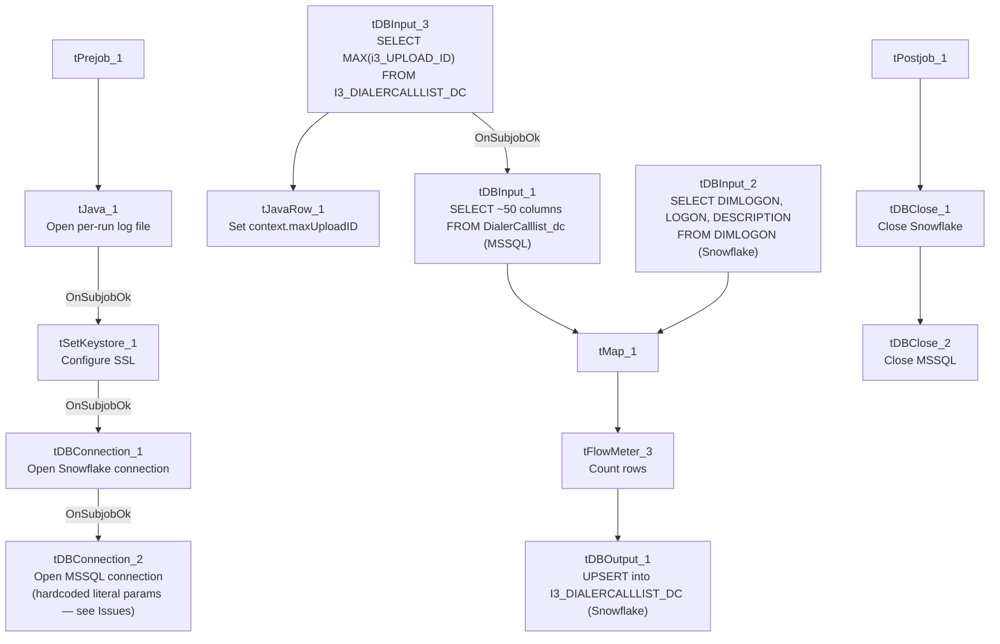

# Talend Job: i3_DialerCallListDC_Load

## Overview

Loads the DC (site code) dialer call list — debtor contact and campaign-dialing data (name, address, phone numbers, balance, campaign, per-outcome attempt counters, upload/campaign-owner metadata) — from the I3 dialer platform's MSSQL `DialerCalllist_dc` table into the Snowflake `I3_DIALERCALLLIST_DC` table, enriching each row with a `DIMLOGON` dimension-key lookup along the way. Unlike most other jobs in this batch, the final write uses `UPSERT` rather than plain `INSERT`, so re-running the job does not risk duplicating rows even if the source query re-reads more than just the newest records.

## Detail table

| Field | Value |
|---|---|
| Job name | i3_DialerCallListDC_Load |
| Version | 0.2 |
| Project | EDW2SF |
| Author | jmach@harriscollect.com |
| Created | 2023-10-18T11:51:51.702-0700 |
| Last Modified | 2025-11-06T14:02:15.701-0800 |

## Step-by-step data flow

**Setup subjob:** `tPrejob_1` → `tJava_1` opens a per-run log file → on success, `tSetKeystore_1` configures SSL trust/keystore from `context.keystorePath` → `tDBConnection_1` opens the Snowflake connection → on success, `tDBConnection_2` opens the MSSQL connection — but see Issues observed regarding how this connection is configured.

**Main subjob:**

1. `tDBInput_3` (`tSnowflakeInput`) runs `SELECT CAST(COALESCE(MAX(i3_UPLOAD_ID),1) AS VARCHAR(20)) AS MAXUPLOADID FROM I3_DIALERCALLLIST_DC;` to find the highest upload ID already loaded (defaulting to `1`).
2. `tJavaRow_1` captures that value into `context.maxUploadID`.
3. On success, `tDBInput_1` runs a fixed `SELECT` against the source `DialerCalllist_dc` table (shared `tDBConnection_2`), pulling `I3_IDENTITY`, `DEBTORNAME`, `ACCOUNT AS DEBTORNUMBER`, `ADDRESS`, `APPHONE`, `BALANCE`, a computed `DEBTOR_IDX` (`LOGON + '-' + ACCOUNT`), `CAMPAIGN`, and more (~50 columns total per this component's schema). **The captured query text is truncated after the initial columns and does not visibly reference `context.maxUploadID`** — see Issues observed.
4. In parallel, `tDBInput_2` (`tSnowflakeInput`) reads the `DIMLOGON` dimension table (`DIMLOGON` surrogate key, `LOGON`, `DESCRIPTION`) from Snowflake.
5. `tMap_1` joins the MSSQL row flow with the `DIMLOGON` lookup (adding a `DIMLOGON` surrogate-key column to the output) and passes ~53 columns through to an uppercase-named target schema.
6. `tFlowMeter_3` counts rows passing through (labeled "MyLabel", not renamed for this job).
7. `tDBOutput_1` **upserts** the rows into Snowflake table `I3_DIALERCALLLIST_DC`.

**Teardown subjob:** `tPostjob_1` → `tDBClose_1` (close Snowflake) → `tDBClose_2` (close MSSQL).

## Settings tables

### Setup: `tDBConnection_2` (`tMSSqlConnection`)

| Setting | Value | What it means |
|---|---|---|
| HOST | `"MP-ININSQL-V01"` (literal) | Hardcoded server name, not a context variable — see Issues observed. |
| DBNAME | `"DIALER_40"` (literal) | Hardcoded database name. |
| SCHEMA_DB | `"dbo"` (literal) | Hardcoded schema. |
| USER | `"svc_ssa_snflk"` (literal) | Hardcoded service-account username; password `***REDACTED***`. |

### Source: `tDBInput_1` (`tMSSqlInput`)

| Setting | Value | What it means |
|---|---|---|
| Connection | Shared `tDBConnection_2` | Reuses the job's hardcoded-parameter MSSQL connection. |
| TABLE | `"DialerCalllist_dc"` | Source dialer call-list table for the DC site. |
| Query | Fixed `SELECT` computing `DEBTOR_IDX` as `COALESCE(LOGON,'')+'-'+COALESCE(ACCOUNT,'')`, casting `I3_IDENTITY` and `BALANCE` to numeric types, plus ~50 named columns (campaign, contact attempts by outcome, campaign-owner metadata) | The visible portion does not reference `context.maxUploadID` — see Issues observed. |

### Lookup: `tDBInput_2` (`tSnowflakeInput`)

| Setting | Value | What it means |
|---|---|---|
| Table | `DIMLOGON` | Dimension table mapping `LOGON` text codes to a `DIMLOGON` surrogate key and description — joined into the main flow via `tMap_1` to enrich each dialer record with its logon dimension key. |

### Target: `tDBOutput_1` (`tSnowflakeOutput`)

| Setting | Value | What it means |
|---|---|---|
| Table | `I3_DIALERCALLLIST_DC` | Destination table for the DC site's dialer call list. |
| Output action | `UPSERT` | Inserts new rows and updates existing ones by key rather than appending duplicates — unlike the plain `INSERT` pattern used in most other jobs reviewed in this batch. |
| Table action | `NONE` | Table is not recreated/altered by this job. |

## Dependencies & configuration

- **Triggers/depends on other jobs:** none — no `tRunJob` links found, and this job does not appear as a caller or target in `06_dependency_matrix.md`.
- **Context variables used:** `keystorePath`, `logDir`, `maxUploadID` (computed internally from the Snowflake max-upload-ID query). Notably, **no `I3_*` context variables are referenced** — see Issues observed regarding the hardcoded MSSQL connection.
- **1 hardcoded developer-workstation path** in `tSetKeystore_1.SSL_TRUSTSERVER_TRUSTSTORE` (`"C:/clientTrustStore.trustStore"`) — same pattern documented project-wide in `05_operational_runbook.md`.

## Glossary

| Component type | Plain-English meaning |
|---|---|
| `tSnowflakeConnection` / `tSnowflakeClose` | Open/close a Snowflake database connection shared by other components in the job. |
| `tMSSqlConnection` / `tMSSqlInput` / `tMSSqlClose` | Open a Microsoft SQL Server connection, run a query against it, and close it. |
| `tSnowflakeInput` | Runs a query against Snowflake and returns its result rows — used here both for a lookup dimension (`DIMLOGON`) and a single aggregate value (max upload ID). |
| `tMap` | Maps/transforms columns from one schema to another, and here also performs the `DIMLOGON` lookup join. |
| `tFlowMeter` | Counts rows passing a point in the flow for logging/monitoring. |
| `tSnowflakeOutput` | Writes rows to a Snowflake table — here configured for `UPSERT` rather than plain `INSERT`. |
| `tSetKeystore` | Configures SSL trust/keystore settings for the job's secure connections. |

## Issues observed

- **This job's MSSQL connection (`tDBConnection_2`) uses hardcoded literal values (`"MP-ININSQL-V01"`, `"DIALER_40"`, `"dbo"`, `"svc_ssa_snflk"`) instead of context variables**, unlike every other MSSQL-sourced job reviewed in this batch (`i3_AgentActivityLog_Load`, `i3_InteractionWrapup_Load`, `i3_Call_Detail_View_Init_Load`, `Test_Encryption`), which all reference `context.I3_IC_40_*` or `context.EDWProdHH_*` variables for the equivalent settings. This means changing the DC dialer database's host, name, or service account would require editing this job directly, rather than updating a shared context group — a real deviation from this project's otherwise consistent connection-configuration pattern, and worth flagging for consistency/maintainability.
- **The incremental-load logic may not actually be applied.** The job computes `context.maxUploadID` from Snowflake before reading the MSSQL source, but the `tDBInput_1.QUERY` text captured in this metadata is truncated after the initial column list and does not show a `WHERE ... i3_UPLOAD_ID > ...`-style clause referencing `context.maxUploadID` in the visible portion. **Unable to determine from this metadata whether the query is actually filtered.** Unlike the plain-`INSERT` jobs in this batch, the risk here is more about unnecessary full-table re-reads/performance than duplicate rows, since the target write is an `UPSERT` — but it's still worth confirming directly in Talend Studio.
- **`i3_UPLOAD_ID` in the Snowflake max-ID query is lowercase (`i3_UPLOAD_ID`) while the equivalent target column elsewhere in this job's own schema is `I3_UPLOAD_ID`** (all-caps) — Snowflake identifiers are typically case-insensitive unless quoted, so this is likely harmless, but it's a naming inconsistency worth being aware of if anyone is grepping this project's source for the column name.
- **Job version is 0.2**, unlike the `0.1` seen on most other jobs in this batch — indicating at least one revision since its initial creation, though the specific changes aren't captured in this metadata.
