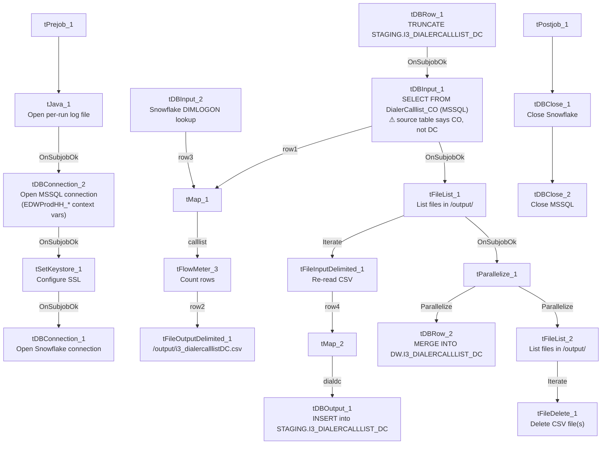

# Talend Job: i3_DialerCallListDC_Load_Backup

## Overview

This job rebuilds the "DC" site's dialer call-list table (`I3_DIALERCALLLIST_DC`) in Snowflake: it extracts debtor/campaign/phone/call-attempt data from an MSSQL table via a context-parameterized `EDWProdHH_*` connection, writes the extract to a local CSV, immediately re-reads that same CSV, stages it into Snowflake, and merges the staged rows into the `DW` warehouse table keyed on `I3_IDENTITY`. It is structurally the DC-site sibling of `Copy_of_i3_DialerCallListTOL_Load_Backup` (already documented) and `i3_DialerCallListCO_Load_Backup` — same export→reimport→stage→merge→cleanup template — but **its MSSQL source table parameter literally says `DialerCalllist_CO`, not a DC-named table**, which is the central issue with this job (see Issues observed).

## Detail table

| Field | Value |
|---|---|
| Job name | i3_DialerCallListDC_Load_Backup |
| Version | 0.2 |
| Project | EDW2SF |
| Author | jmach@harriscollect.com |
| Created | 2025-11-17T11:12:56.537-0800 |
| Last Modified | 2025-11-17T11:42:21.805-0800 (~30 minutes after creation) |

## Step-by-step data flow

**Setup subjob:** `tPrejob_1` → `tJava_1` opens a per-run log file at `context.logDir + jobName + "_" + <timestamp> + ".log"` → on success, `tDBConnection_2` opens the MSSQL connection using `context.EDWProdHH_*` variables (password and Active Directory auth redacted) → on success, `tSetKeystore_1` configures SSL trust/keystore from `context.keystorePath` (all passwords redacted) → on success, `tDBConnection_1` opens the Snowflake connection.

**Main subjob:**

1. `tDBRow_1` runs `TRUNCATE TABLE STAGING.I3_DIALERCALLLIST_DC;` on Snowflake.
2. On success, `tDBInput_1` runs a fixed `SELECT` against MSSQL table **`DialerCalllist_CO`** (not a DC table — see Issues observed), pulling `I3_IDENTITY`, `ACCOUNT AS DEBTORNUMBER`, `LOGON`, a derived `DEBTOR_IDX`, `CAMPAIGN`, `DEBTORNAME`, address fields, and phone/call-history fields — 37 columns total (the captured query text is truncated after the visible column list, so any `WHERE` clause is not visible in this metadata).
3. `tMap_1` joins that MSSQL flow against `tDBInput_2` (`tSnowflakeInput` reading Snowflake table `DIMLOGON`, columns `DIMLOGON`/`LOGON`/`DESCRIPTION`) as a lookup, adding a `DIMLOGON` surrogate key column.
4. `tFlowMeter_3` counts rows passing through (labeled "MyLabel", not customized for this job).
5. `tFileOutputDelimited_1` writes the enriched rows to a hardcoded local file `/output/i3_dialercalllistDC.csv` (comma-delimited, no header, split every 10,000 rows).
6. On `tDBInput_1`'s subjob success, `tFileList_1` lists files in the hardcoded directory `/output/`; for each, `tFileInputDelimited_1` re-reads the just-written CSV (`DIE_ON_ERROR=true`).
7. `tMap_2` passes the re-read rows through to a wider 61-column target schema, adding `LOAD_DTTM`, `STATUS`, `ATTEMPTS`, `HHCUSTVAR1-3`, `HHCUSTINT1`, a dozen `I3_ATTEMPTS*`/`I3_*` call-detail counters, and `SUCCESS_RESULT` (note the underscore — see Issues observed) not present in the original 37-column extract.
8. `tDBOutput_1` inserts the rows into Snowflake table `I3_DIALERCALLLIST_DC` (`INSERT`, `tableAction: NONE`) — lands in the `STAGING` schema per the preceding truncate in step 1.
9. On `tFileList_1`'s subjob success, `tParallelize_1` starts two branches concurrently:
   - `tDBRow_2` runs `MERGE INTO DW.I3_DIALERCALLLIST_DC` from `STAGING.I3_DIALERCALLLIST_DC`, keyed on `I3_IDENTITY`, casting `BALANCE` through `TRY_TO_NUMERIC(src.BALANCE,16,2)` on insert.
   - `tFileList_2` lists files in `/output/` again and `tFileDelete_1` deletes each one found.

**Teardown subjob:** `tPostjob_1` → `tDBClose_1` (close Snowflake) → `tDBClose_2` (close MSSQL).

## Settings tables

### Source: `tDBInput_1` (`tMSSqlInput`)

| Setting | Value | What it means |
|---|---|---|
| Connection | Shared `tDBConnection_2` (`EDWProdHH_*` context vars) | Reuses the job's single MSSQL connection, driven entirely by context variables rather than hardcoded host/db. |
| Table | `"DialerCalllist_CO"` | **Says CO, but this job is named/targets DC end-to-end otherwise** — see Issues observed. |
| Query | Fixed 37-column `SELECT` (identity, debtor/campaign identifiers, address, phone fields, call-history flags) — captured text truncated after the visible column list | Any `WHERE` clause filtering to a specific site is not visible in this metadata. |
| ENCODING | `ISO-8859-15` | Non-UTF-8 encoding, consistent with other legacy-source jobs in this project. |

### Lookup: `tDBInput_2` (`tSnowflakeInput`)

| Setting | Value | What it means |
|---|---|---|
| Table | `DIMLOGON` | Small dimension table (`DIMLOGON`, `LOGON`, `DESCRIPTION`) joined in `tMap_1` to attach a `DIMLOGON` surrogate key based on `LOGON`. |

### Intermediate file: `tFileOutputDelimited_1` / `tFileInputDelimited_1`

| Setting | Value | What it means |
|---|---|---|
| FILENAME (write) | `"/output/i3_dialercalllistDC.csv"` | Hardcoded literal path — correctly named for DC, unlike the source table above. |
| SPLIT / SPLIT_EVERY | `true` / `10000` | Output may split into multiple part-files past 10,000 rows. |
| FILENAME (read) | `globalMap.get("tFileList_1_CURRENT_FILEPATH")` | Re-reads whatever file(s) `tFileList_1` found in `/output/` — not guaranteed to be only the file just written. |
| DIE_ON_ERROR (read) | `true` | A malformed row in the re-read step fails the job outright. |

### Target: `tDBOutput_1` (`tSnowflakeOutput`)

| Setting | Value | What it means |
|---|---|---|
| Table | `I3_DIALERCALLLIST_DC` | `INSERT`, `tableAction: NONE`; lands in `STAGING` per the preceding `TRUNCATE STAGING.I3_DIALERCALLLIST_DC`. |

### Merge step: `tDBRow_2` (`tSnowflakeRow`)

| Setting | Value | What it means |
|---|---|---|
| Query | `MERGE INTO DW.I3_DIALERCALLLIST_DC AS tgt USING STAGING.I3_DIALERCALLLIST_DC AS src ON (tgt.I3_IDENTITY = src.I3_IDENTITY)` — updates all columns on match, inserts on no-match | Standard staging→warehouse upsert, keyed on `I3_IDENTITY`. |
| BALANCE cast | `TRY_TO_NUMERIC(src.BALANCE,16,2)` on insert | Source `BALANCE` is carried as a string through the whole pipeline; this defensively converts it to a numeric on write. |
| Column name | `SUCCESS_RESULT` (with underscore) | Differs from the `SUCCESSRESULT` (no underscore) column name used by every sibling job in this family — see Issues observed. |

### Cleanup: `tFileDelete_1`

| Setting | Value | What it means |
|---|---|---|
| FILENAME | `globalMap.get("tFileList_2_CURRENT_FILEPATH")` | Actual file(s) deleted are whatever `tFileList_2` iterates in `/output/`. |
| DIRECTORY | `"C:/Talend-Studio-20211109_1610-V8.0.1/workspace/delete_folder"` | Hardcoded developer-workstation path, unused since `FILENAME` drives the actual delete. |
| PATH | `"C:/Talend-Studio-20211109_1610-V8.0.1/workspace/delete_folder or delete_file"` | Same unedited placeholder text found verbatim in `Copy_of_i3_DialerCallListTOL_Load_Backup` — confirms this whole family was built from one shared template. |

## Dependencies & configuration

- **Triggers/depends on other jobs:** none — no `tRunJob` links found (`runjob_targets: []`); not listed as a target in `06_dependency_matrix.md` either.
- **Context variables used:** `EDWProdHH_Database`, `EDWProdHH_Login`, `EDWProdHH_Port`, `EDWProdHH_Schema`, `EDWProdHH_Server` (MSSQL connection), `keystorePath`, `logDir`.
- **4 hardcoded paths** found: `tSetKeystore_1.SSL_TRUSTSERVER_TRUSTSTORE` (`C:/clientTrustStore.trustStore`), `tFileInputDelimited_1.TEMP_DIR`, and `tFileDelete_1.DIRECTORY`/`PATH` (all `C:/Talend-Studio-20211109_1610-V8.0.1/workspace/...`) — same project-wide portability risk documented in `05_operational_runbook.md`.

## Glossary

| Component type | Plain-English meaning |
|---|---|
| `tMSSqlConnection` / `tMSSqlInput` / `tMSSqlClose` | Open a Microsoft SQL Server connection, run a query against it, and close it. |
| `tSnowflakeConnection` / `tSnowflakeInput` / `tSnowflakeOutput` / `tSnowflakeRow` / `tSnowflakeClose` | Open/close a Snowflake connection, read a table, write rows to a table, or run an arbitrary SQL/merge statement against Snowflake. |
| `tMap` | Maps/transforms and optionally joins (lookup) columns from one or more input schemas to an output schema. |
| `tFlowMeter` | Counts rows passing a point in the flow for logging/monitoring. |
| `tFileOutputDelimited` / `tFileInputDelimited` | Write or read a delimited (CSV-style) text file according to a schema. |
| `tFileList` | Lists files in a directory for the job to iterate over one at a time. |
| `tFileDelete` | Deletes a file (or, per its own config fields, potentially a folder) from disk. |
| `tParallelize` | Runs its downstream branches at the same time rather than one after another. |
| `tSetKeystore` | Configures SSL trust/keystore settings used by subsequent secure connections. |

## Issues observed

- **The MSSQL source table (`tDBInput_1.TABLE`) is `"DialerCalllist_CO"`, not a DC-named table**, while every other part of this job — the output CSV (`i3_dialercalllistDC.csv`), the Snowflake target (`STAGING.I3_DIALERCALLLIST_DC` / `DW.I3_DIALERCALLLIST_DC`), and the job name itself — consistently says DC. Unlike `Copy_of_i3_DialerCallListTOL_Load_Backup` (where *everything* said CO, making it look like an obviously-inert leftover copy), this job is internally self-consistent as "DC" except for the one line that actually decides what data gets pulled. If this job runs under its current name, it would load CO's raw dialer records into the DC warehouse table. Verify with the team whether `DialerCalllist_CO` is genuinely the correct/shared MSSQL source for DC, or whether this is a copy-paste error from a CO-based template job that was never corrected.
- **The target column name `SUCCESS_RESULT` (with an underscore)** appears in this job's `tMap_2`/`tDBOutput_1` schema and its own `MERGE` SQL, whereas every sibling in this job family reviewed (`HH_Load`, `HH_Load_Backup`, `PRE_Load`, `TOL_Load`, and the already-documented `CO_Load`/`CO_Load_Backup`) uses `SUCCESSRESULT` (no underscore). Whether `DW.I3_DIALERCALLLIST_DC` actually has a differently-named column (intentional drift) or this is itself a typo relative to the rest of the family is unable to determine from metadata — verify with team.
- **The MSSQL connection is parameterized via `context.EDWProdHH_*` variables** even though the table being queried (`DialerCalllist_CO`) is I3 dialer/telephony data, not EDWProdHH operational data — the same naming ambiguity already flagged in `i3_CallDetail_40_Load`'s doc and in `Copy_of_i3_DialerCallListTOL_Load_Backup`'s doc. Confirm which physical database `context.EDWProdHH_Database` resolves to here, and whether a table literally named `DialerCalllist_CO` exists in it.
- **The export→reimport round trip** (write `/output/i3_dialercalllistDC.csv`, then immediately have `tFileList_1`/`tFileInputDelimited_1` re-read whatever is in `/output/`) is the same pattern already flagged as a risk in `Copy_of_i3_DialerCallListTOL_Load_Backup`'s doc — the re-read step isn't guaranteed to pick up only the file just written if other files are present in `/output/` at run time.
- **`tFileDelete_1`'s `DIRECTORY` and `PATH` parameters are the same unedited placeholder text** (`".../delete_folder"` and `".../delete_folder or delete_file"`) found verbatim in the already-documented `Copy_of_i3_DialerCallListTOL_Load_Backup` — strong evidence this entire job family was cloned from one shared template without those fields ever being customized. The actual delete target is driven by `FILENAME`, not these fields.
- Beyond the items above, this job follows the same hardcoded-path and unconfigured-connection-entry patterns already documented project-wide in `05_operational_runbook.md`.
