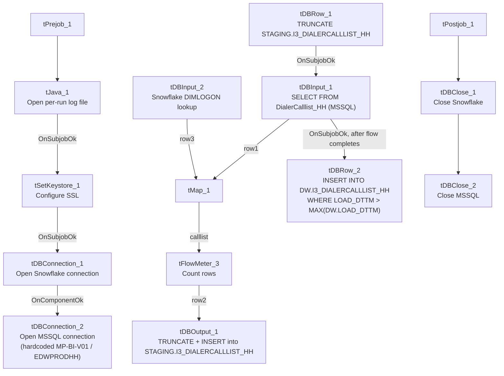

# Talend Job: i3_DialerCallListHH_Load

## Overview

This job refreshes the "HH" site's dialer call-list table (`I3_DIALERCALLLIST_HH`) in Snowflake directly from MSSQL, with no CSV round trip: it extracts debtor/campaign/phone/call-attempt data from MSSQL table `DialerCalllist_HH`, joins it against a Snowflake `DIMLOGON` lookup, truncates and reloads a `STAGING` copy of the table, then incrementally appends any newer rows into the `DW` warehouse table based on a `LOAD_DTTM` watermark. It is the simplest member of the `i3_DialerCallList*` family reviewed in this batch — no file export/reimport, no `tParallelize`, no key-based `MERGE` — and its DW-load logic is meaningfully different from its `MERGE`-based siblings (see Issues observed).

## Detail table

| Field | Value |
|---|---|
| Job name | i3_DialerCallListHH_Load |
| Version | 0.2 |
| Project | EDW2SF |
| Author | jmach@harriscollect.com |
| Created | 2023-05-31T09:10:38.919-0700 |
| Last Modified | 2026-02-18T10:29:57.236-0800 |

## Step-by-step data flow

**Setup subjob:** `tPrejob_1` → `tJava_1` opens a per-run log file at `context.logDir + jobName + "_" + <timestamp> + ".log"` → on success, `tSetKeystore_1` configures SSL trust/keystore from `context.keystorePath` (passwords redacted) → on success, `tDBConnection_1` opens the Snowflake connection, which on success opens `tDBConnection_2` (MSSQL, hardcoded host — see Settings tables).

**Main subjob:**

1. `tDBRow_1` runs `TRUNCATE TABLE STAGING.I3_DIALERCALLLIST_HH;` on Snowflake.
2. On success, `tDBInput_1` runs a fixed `SELECT` against MSSQL table `DialerCalllist_HH`, pulling `I3_IDENTITY`, `ACCOUNT AS DEBTORNUMBER`, `LOGON`, a derived `DEBTOR_IDX`, `CAMPAIGN`, `DEBTORNAME`, address/phone fields, call-history fields, `SKPPHN1`/`SKPPHN2`/`PHO1`/`DIRASS1` (HH-specific skip-trace/directory-assistance columns not present in the DC/TOL/CO source query), call-attempt counters, and — notably — `I3_UPLOAD_ID` already sourced directly from MSSQL (unlike `PRE_Load`, which separately re-derives an upload-ID watermark; see that job's doc).
3. `tMap_1` joins the MSSQL flow against `tDBInput_2` (`tSnowflakeInput` reading Snowflake table `DIMLOGON`), adding a `DIMLOGON` surrogate key column.
4. `tFlowMeter_3` counts rows passing through.
5. `tDBOutput_1` inserts the mapped rows into Snowflake table `I3_DIALERCALLLIST_HH` with `tableAction: TRUNCATE` — i.e., it truncates and reloads this table itself as part of the insert (the `STAGING` copy, per step 1's explicit truncate immediately before this branch runs).
6. In parallel (triggered directly by `tDBInput_1`'s subjob success, which in Talend fires only once the whole flow subjob — including `tDBOutput_1` — has finished), `tDBRow_2` runs an `INSERT INTO DW.I3_DIALERCALLLIST_HH (...) SELECT ... FROM STAGING.I3_DIALERCALLLIST_HH src WHERE src.LOAD_DTTM > (SELECT MAX(LOAD_DTTM) FROM DW.I3_DIALERCALLLIST_HH)` — an append-only, watermark-based copy of newly-staged rows into the warehouse table.

**Teardown subjob:** `tPostjob_1` → `tDBClose_1` (close Snowflake) → `tDBClose_2` (close MSSQL).

## Settings tables

### Source: `tDBInput_1` (`tMSSqlInput`)

| Setting | Value | What it means |
|---|---|---|
| Connection | Shared `tDBConnection_2` | Reuses the job's single hardcoded MSSQL connection. |
| Table | `"DialerCalllist_HH"` | Correctly named for the HH site. |
| Query | Fixed `SELECT` of ~60 named columns (identity, debtor/campaign identifiers, address, `SKPPHN1`/`SKPPHN2`/`PHO1`/`DIRASS1`, call-history flags, `I3_UPLOAD_ID`) — captured text truncated after the visible column list | Any `WHERE` clause is not visible in this metadata. |
| ENCODING | `ISO-8859-15` | Non-UTF-8 encoding, consistent with other legacy-source jobs in this project. |
| TRIM_ALL_COLUMN | `false` | Unlike `DC_Load_Backup`/`TOL_Load` (both `true`), this job does not trim whitespace from all extracted columns. |

### MSSQL connection: `tDBConnection_2` (`tMSSqlConnection`)

| Setting | Value | What it means |
|---|---|---|
| DRIVER | `MSSQL_PROP` | Different driver than the `JTDS` driver used by `TOL_Load`/`PRE_Load`/`DC_Load_Backup`'s MSSQL connections. |
| HOST | `"MP-BI-V01"` (hardcoded) | Different physical server than `PRE_Load`/`TOL_Load`, which hit `"MP-ININSQL-V01"`. |
| DBNAME | `"EDWPRODHH"` (hardcoded) | Different database name than `PRE_Load`/`TOL_Load`'s `"DIALER_40"` — this job's dialer call-list source lives in a differently-named database from its siblings'. |
| USER | `"dwuser"` | Hardcoded service account name. |

### Lookup: `tDBInput_2` (`tSnowflakeInput`)

| Setting | Value | What it means |
|---|---|---|
| Table | `DIMLOGON` | Small dimension table (`DIMLOGON`, `LOGON`, `DESCRIPTION`) joined in `tMap_1` to attach a `DIMLOGON` surrogate key based on `LOGON`. |

### Target (staging): `tDBOutput_1` (`tSnowflakeOutput`)

| Setting | Value | What it means |
|---|---|---|
| Table | `I3_DIALERCALLLIST_HH` | `INSERT` with `tableAction: TRUNCATE` — this component itself truncates and reloads the table (redundant with `tDBRow_1`'s explicit truncate one step earlier, unless they target different schemas — see Issues observed). |

### Warehouse append: `tDBRow_2` (`tSnowflakeRow`)

| Setting | Value | What it means |
|---|---|---|
| Query | `INSERT INTO DW.I3_DIALERCALLLIST_HH (...) SELECT ... FROM STAGING.I3_DIALERCALLLIST_HH src WHERE src.LOAD_DTTM > (SELECT MAX(LOAD_DTTM) FROM DW.I3_DIALERCALLLIST_HH)` | Append-only, watermark-based load — not a key-based `MERGE`. Any row in `STAGING` whose `LOAD_DTTM` is not newer than the current `DW` maximum is silently skipped; any existing `DW` row is never updated. See Issues observed. |

## Dependencies & configuration

- **Triggers/depends on other jobs:** none — no `tRunJob` links found (`runjob_targets: []`); not listed as a target in `06_dependency_matrix.md` either.
- **Context variables used:** `keystorePath`, `logDir` only — this job does not use `context.EDWProdHH_*` or any `StandardFolders_0.1` variable; its MSSQL host/database/driver are all hardcoded (see Settings tables).
- **1 hardcoded path** found: `tSetKeystore_1.SSL_TRUSTSERVER_TRUSTSTORE` (`C:/clientTrustStore.trustStore`) — same project-wide risk documented in `05_operational_runbook.md`.

## Glossary

| Component type | Plain-English meaning |
|---|---|
| `tMSSqlConnection` / `tMSSqlInput` / `tMSSqlClose` | Open a Microsoft SQL Server connection, run a query against it, and close it. |
| `tSnowflakeConnection` / `tSnowflakeInput` / `tSnowflakeOutput` / `tSnowflakeRow` / `tSnowflakeClose` | Open/close a Snowflake connection, read a table, write rows to a table, or run an arbitrary SQL statement against Snowflake. |
| `tMap` | Maps/transforms and optionally joins (lookup) columns from one or more input schemas to an output schema. |
| `tFlowMeter` | Counts rows passing a point in the flow for logging/monitoring. |
| `tSetKeystore` | Configures SSL trust/keystore settings used by subsequent secure connections. |

## Issues observed

- **This job's warehouse load (`tDBRow_2`) is an append-only `INSERT ... WHERE LOAD_DTTM > MAX(DW.LOAD_DTTM)`, not a key-based `MERGE`**, unlike its `CO_Load`/`CO_Load_Backup`, `DC_Load_Backup`, and `TOL_Load` siblings, all of which run a `MERGE INTO DW... ON (tgt.I3_IDENTITY = src.I3_IDENTITY)` that updates existing rows on match. Under this job's logic, if a previously-loaded debtor record's data changes but its `LOAD_DTTM` in `STAGING` is not newer than the current `DW` maximum, the update is silently never applied to `DW` — and if the same `LOAD_DTTM` is reused across every row of a staging load (as is common with a single "as-of" timestamp column), a correction reprocessed on the same run would still exceed the *previous* run's max and get inserted, potentially producing **duplicate `I3_IDENTITY` rows in `DW`** rather than a clean overwrite. Verify with the team whether this divergence from the sibling jobs' `MERGE` pattern is intentional.
- **`tDBOutput_1` truncates via `tableAction: TRUNCATE` on the same run that `tDBRow_1` already explicitly runs `TRUNCATE TABLE STAGING.I3_DIALERCALLLIST_HH`.** If both target the same `STAGING.I3_DIALERCALLLIST_HH` table, the second truncate is redundant; if `tDBOutput_1`'s implicit schema differs from `STAGING` (not specified in this component's own metadata), the two truncates are targeting different tables and neither documentation nor this metadata makes that unambiguous — verify with team.
- **This job's MSSQL connection (`MP-BI-V01` / `EDWPRODHH`, driver `MSSQL_PROP`) differs from `PRE_Load`/`TOL_Load`'s (`MP-ININSQL-V01` / `DIALER_40`, driver `JTDS`)** despite all being members of the same `i3_DialerCallList*` family pulling dialer call-list data — confirms these "site" jobs are not all pointed at one shared dialer database; verify with team which source is authoritative for which site.
- No other findings beyond the project-wide hardcoded-path pattern already documented in `05_operational_runbook.md`.
