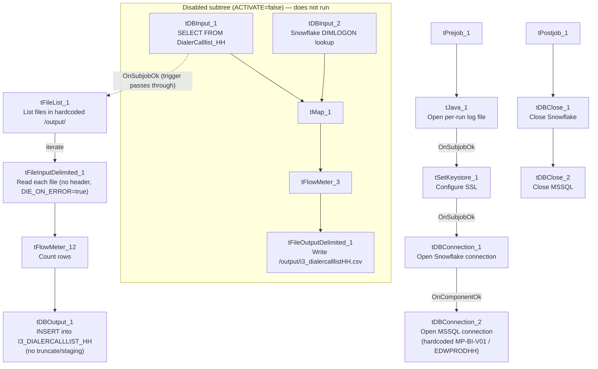

# Talend Job: i3_DialerCallListHH_Load_Backup

## Overview

This is a "backup"/manual-reload variant of `i3_DialerCallListHH_Load`. Its designed live-extraction path (MSSQL `DialerCalllist_HH` → Snowflake `DIMLOGON` lookup → CSV export) is present in the job but **entirely deactivated** (`ACTIVATE=false` on every component in that chain). What actually runs today is a much simpler active path: it lists whatever CSV file(s) already exist in a hardcoded `/output/` directory and inserts them straight into the Snowflake `I3_DIALERCALLLIST_HH` table, with no truncate, no staging table, and no deduplication — a materially different (and simpler, riskier) load than the primary `i3_DialerCallListHH_Load` job's truncate-STAGING-then-watermark-append-to-DW design.

## Detail table

| Field | Value |
|---|---|
| Job name | i3_DialerCallListHH_Load_Backup |
| Version | 0.2 |
| Project | EDW2SF |
| Author | jmach@harriscollect.com |
| Created | 2025-11-06T14:47:54.278-0800 |
| Last Modified | 2025-11-09T22:17:45.053-0800 |

## Step-by-step data flow

**Setup subjob:** `tPrejob_1` → `tJava_1` opens a per-run log file (`context.logDir+jobName+"_"+<timestamp>+".log"`) → on success, `tSetKeystore_1` configures SSL trust/keystore settings → on success, `tDBConnection_1` opens the Snowflake connection → on success, `tDBConnection_2` opens the MSSQL connection using **hardcoded** values (`HOST="MP-BI-V01"`, `DBNAME="EDWPRODHH"`, `SCHEMA_DB="dbo"`, `USER="dwuser"`, `DRIVER=MSSQL_PROP`) — the same hardcoded connection details used by the non-backup `i3_DialerCallListHH_Load` job.

**Disabled subtree (`ACTIVATE=false` on every component — does not execute in this job's current state):**

- `tDBInput_1` would run a fixed `SELECT` of ~40 columns (`I3_IDENTITY`, `DEBTORNUMBER`, `LOGON`, a derived `DEBTOR_IDX`, `CAMPAIGN`, `DEBTORNAME`, address fields, `SSN`, phone fields including HH-specific `SKPPHN1`/`SKPPHN2`/`PHO1`/`DIRASS1`, call-history fields, `LOAD_DTTM`) against MSSQL table `DialerCalllist_HH` — matching the live-extraction query used by `i3_DialerCallListHH_Load`.
- `tDBInput_2` (`tSnowflakeInput`, disabled) would read the Snowflake `DIMLOGON` lookup table.
- `tMap_1` (disabled) would join the two, adding a `DIMLOGON` surrogate key.
- `tFlowMeter_3` (disabled) would count rows.
- `tFileOutputDelimited_1` (disabled) would write the rows to a hardcoded file, `"/output/i3_dialercalllistHH.csv"` (`SPLIT=true`, `SPLIT_EVERY=10000`, no header).

**Active path:** because `tDBInput_1` (and everything downstream of it in the disabled subtree) is switched off, Talend's standard deactivation behavior skips that subtree and passes its `OnSubjobOk` trigger straight through, so **`tFileList_1` fires unconditionally**:

1. `tFileList_1` lists files in a hardcoded `"/output/"` directory (not context-driven).
2. For each file found (`ITERATE`), `tFileInputDelimited_1` reads it (`HEADER=0`, no header row expected — consistent with files matching the disabled `tFileOutputDelimited_1`'s `INCLUDEHEADER=false` setting; `DIE_ON_ERROR=true`) using the same ~40-column schema as the disabled MSSQL extraction.
3. `tFlowMeter_12` counts rows passing through.
4. `tDBOutput_1` inserts the rows into Snowflake table `I3_DIALERCALLLIST_HH` (`INSERT`, `tableAction=NONE` — no truncate, no staging/DW split).

**Teardown subjob:** `tPostjob_1` → `tDBClose_1` (close Snowflake) → `tDBClose_2` (close MSSQL).

## Settings tables

### Disabled extraction (kept in the job but not executed): `tDBInput_1` / `tFileOutputDelimited_1`

| Setting | Value | What it means |
|---|---|---|
| ACTIVATE (`tDBInput_1`, `tMap_1`, `tFlowMeter_3`, `tDBInput_2`, `tFileOutputDelimited_1`) | `false` | This entire branch is switched off; none of it runs in the job's current configuration. |
| Table / Query (`tDBInput_1`) | `DialerCalllist_HH` / fixed `SELECT` of ~40 columns incl. `I3_IDENTITY`, `DEBTOR_IDX`, `SSN`, phone fields, `LOAD_DTTM` | Matches the live-extraction query used by the non-backup `i3_DialerCallListHH_Load` job. |
| FILENAME (`tFileOutputDelimited_1`) | `"/output/i3_dialercalllistHH.csv"` (hardcoded) | Would be the output file if this branch were active — matches the directory the active `tFileList_1` reads from. |

### Active source: `tFileList_1`

| Setting | Value | What it means |
|---|---|---|
| DIRECTORY | `"/output/"` (hardcoded, not context-driven) | Lists whatever file(s) already exist there — presumably CSVs dropped in manually or produced by a prior run of the (now-disabled) extraction branch. |

### Active source: `tFileInputDelimited_1`

| Setting | Value | What it means |
|---|---|---|
| FILENAME | `((String)globalMap.get("tFileList_1_CURRENT_FILEPATH"))` | Current file from `tFileList_1`'s iteration. |
| HEADER | `0` | No header row expected. |
| DIE_ON_ERROR | `true` | Unlike most file-load jobs in this project (which set this `false` and route bad rows to a reject flow), a single malformed row here fails the entire job. |

### Active target: `tDBOutput_1` (`tSnowflakeOutput`)

| Setting | Value | What it means |
|---|---|---|
| Table | `I3_DIALERCALLLIST_HH` | Same table name the primary job's `STAGING`/`DW` design ultimately serves, but reached with a single flat `INSERT`. |
| Output action | `INSERT` | Appends rows. |
| Table action | `NONE` | No truncate — rows are appended directly with no staging table and no `DW`-vs-`STAGING` split, unlike `i3_DialerCallListHH_Load`'s two-tier design. |

## Dependencies & configuration

- **Triggers/depends on other jobs:** none — no `tRunJob` links found, and this job does not appear as a call target in `06_dependency_matrix.md`'s 65-link orchestration table.
- **Context variables used:** `keystorePath`, `logDir` only — the MSSQL host/database/driver/user are all hardcoded (matching the primary job's pattern of not using `EDWProdHH_*` or any `StandardFolders_0.1` variable).
- **2 hardcoded path findings** captured by the extraction: `tSetKeystore_1.SSL_TRUSTSERVER_TRUSTSTORE` (`"C:/clientTrustStore.trustStore"`) and `tFileInputDelimited_1.TEMP_DIR` (`"C:/Talend-Studio-20211109_1610-V8.0.1/workspace"`) — same project-wide portability risk documented in `05_operational_runbook.md`. **Additionally**, `tFileList_1.DIRECTORY` (`"/output/"`) and the disabled `tFileOutputDelimited_1.FILENAME` (`"/output/i3_dialercalllistHH.csv"`) are also hardcoded absolute paths in this job's own parameters, though they weren't captured in the standard hardcoded-path findings list (which appears scoped to Windows-style `C:/...` developer paths).

## Glossary

| Component type | Plain-English meaning |
|---|---|
| `tFileList` | Lists files in a directory for the job to iterate over one at a time. |
| `tFileInputDelimited` | Reads a delimited (CSV-style) text file according to a schema. |
| `tFlowMeter` | Counts rows passing a point in the flow for logging/monitoring. |
| `tMSSqlConnection` / `tMSSqlInput` / `tMSSqlClose` | Open a Microsoft SQL Server connection, run a query against it, and close it. |
| `tSnowflakeConnection` / `tSnowflakeInput` / `tSnowflakeOutput` / `tSnowflakeClose` | Open a Snowflake connection, read a table, write rows to a table, and close the connection. |
| `tMap` | Maps/transforms and optionally joins (lookup) columns from one or more input schemas to an output schema. |
| `tSetKeystore` | Configures SSL trust/keystore settings used by subsequent secure connections. |
| `tJava` | Runs custom Java code — here used to open a log file. |

## Issues observed

- **The job's currently-active data source is whatever CSV file(s) already sit in a hardcoded `/output/` directory — not a live database extraction.** The MSSQL-extraction-to-CSV branch that would normally populate that directory (`tDBInput_1` → `tMap_1` → `tFlowMeter_3` → `tFileOutputDelimited_1`) is entirely deactivated (`ACTIVATE=false` on all four components). Standard Talend behavior propagates the `OnSubjobOk` trigger through a deactivated component without running it, so `tFileList_1` still fires — but this means the job's real current behavior (load pre-existing files) is substantially different from what its still-present, disabled components describe. Confirm with the team whether this is a deliberate "backup/manual-reload" mode (e.g., for recovering from a failed primary run using a manually-supplied extract) or an accidentally-left-disabled path.
- **`tDBOutput_1` has `tableAction=NONE` (no truncate) and there is no companion `STAGING`/`DW` split or `MERGE` step**, unlike the primary `i3_DialerCallListHH_Load` job (which truncates `STAGING`, reloads it, then appends newer rows into `DW` by a `LOAD_DTTM` watermark). Re-running this backup job against the same file(s) more than once would insert duplicate rows into `I3_DIALERCALLLIST_HH`, since nothing in this job's own metadata deduplicates or checks for previously-loaded `I3_IDENTITY` values.
- **`tFileInputDelimited_1.DIE_ON_ERROR=true`** — unlike most file-load jobs in this project (which typically set this `false` and route bad rows to a reject flow), a single malformed row in whatever file is sitting in `/output/` would fail this entire backup/reload job outright, with no reject-row capture.
- **`tFileList_1.DIRECTORY` and the disabled `tFileOutputDelimited_1.FILENAME` are hardcoded to `/output/`** rather than being context-driven — if this job is ever run somewhere the `/output/` path doesn't exist or doesn't hold the intended file, it would either find nothing to load or (worse) pick up an unrelated file left there by another process.
