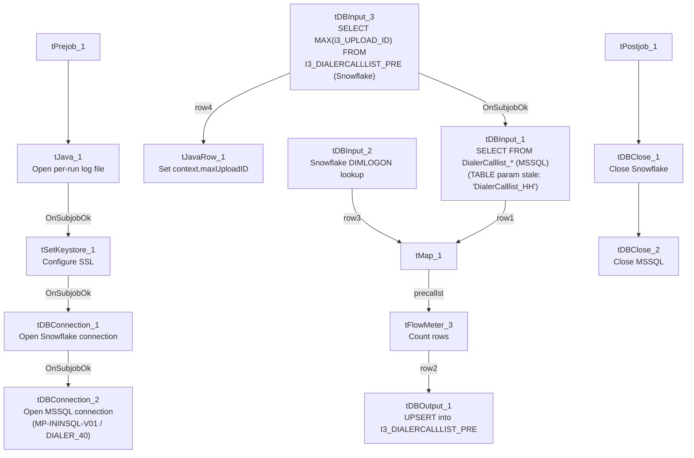

# Talend Job: i3_DialerCallListPRE_Load

## Overview

Refreshes the "PRE" site's dialer call-list table (`I3_DIALERCALLLIST_PRE`) in Snowflake directly from MSSQL: it computes the current maximum `I3_UPLOAD_ID` already in Snowflake, extracts debtor/campaign/phone/call-attempt data (roughly 60 columns, including PRE-specific columns `CALLIDCAP`, `CBC1`/`CBC2`/`CBC3`, and `PHONE5`/`PHONE6`/`PHONE7`) from the MSSQL `DialerCalllist_*` source, joins it against a Snowflake `DIMLOGON` lookup, and directly `UPSERT`s the mapped rows into the final Snowflake table — with no separate staging table, no `TRUNCATE`, and no downstream `MERGE` call. This job is structurally almost identical to `i3_DialerCallListCHI_Load` (same component wiring, same watermark-then-read-then-upsert shape, same MSSQL server/database), differing mainly in its own site-specific source column set.

## Detail table

| Field | Value |
|---|---|
| Job name | i3_DialerCallListPRE_Load |
| Version | 0.2 |
| Project | EDW2SF |
| Author | jmach@harriscollect.com |
| Created | 2023-06-01T10:51:18.411-0700 |
| Last Modified | 2025-11-06T14:15:45.400-0800 |

## Step-by-step data flow

**Setup subjob:** `tPrejob_1` → `tJava_1` opens a per-run log file at `context.logDir + jobName + "_" + <timestamp> + ".log"` → on success (`OnSubjobOk`), `tSetKeystore_1` configures SSL trust/keystore from `context.keystorePath` (passwords redacted) → on success, `tDBConnection_1` opens the Snowflake connection → on success (`OnSubjobOk`), `tDBConnection_2` (`tMSSqlConnection`, hardcoded `HOST="MP-ININSQL-V01"`, `DBNAME="DIALER_40"`, driver `JTDS`, user `svc_ssa_snflk`) opens the MSSQL connection. (Note this last link uses `OnSubjobOk`, whereas the equivalent link in `i3_DialerCallListCHI_Load` uses `OnComponentOk` — a minor wiring difference between the two otherwise near-identical jobs.)

**Main subjob:**

1. `tDBInput_3` (`tSnowflakeInput`) runs `SELECT CAST(COALESCE(MAX(i3_UPLOAD_ID),1) AS VARCHAR(20)) AS MAXUPLOADID FROM I3_DIALERCALLLIST_PRE` to find the highest upload ID already loaded.
2. `tDBInput_3` feeds two branches: `MAIN` → `tJavaRow_1` captures the value into `context.maxUploadID`; `SUBJOB_OK` (fires only once that capture completes) → `tDBInput_1` (`tMSSqlInput`, reusing the shared MSSQL connection) runs a fixed `SELECT` of ~60 named columns (`I3_IDENTITY`, `DEBTORNAME`, `ACCOUNT AS DEBTORNUMBER`, `ADDRESS`, `APPHONE`, `BALANCE` cast to `NUMERIC(16,2)`, a derived `DEBTOR_IDX`, and further columns including `CALLIDCAP`, `CAMPAIGN`, `CBC1`/`CBC2`/`CBC3`, city/state/zip, `PHONE5`/`PHONE6`/`PHONE7`, call-attempt counters, `I3_UPLOAD_ID`, etc.). **The component's own `TABLE` parameter is hardcoded to `"DialerCalllist_HH"`** — not `_PRE` — even though this is the PRE job, the same stale value found in `i3_DialerCallListCHI_Load`'s equivalent component (see Issues observed); the actual `QUERY` text is truncated in this metadata after the initial columns, so the real `FROM`/`WHERE` clause cannot be confirmed.
3. `tMap_1` joins the MSSQL flow (`row1`) against `tDBInput_2` (`tSnowflakeInput` reading Snowflake table `DIMLOGON`, `row3`), adding a `DIMLOGON` surrogate key column.
4. `tFlowMeter_3` counts rows passing through (labeled "precallst").
5. `tDBOutput_1` upserts the mapped rows directly into Snowflake table `I3_DIALERCALLLIST_PRE` (`UPSERT`, `tableAction: NONE` — no truncate, no staging table).

**Teardown subjob:** `tPostjob_1` → `tDBClose_1` (close Snowflake) → `tDBClose_2` (close MSSQL).

## Settings tables

### Source: `tDBInput_1` (`tMSSqlInput`)

| Setting | Value | What it means |
|---|---|---|
| Connection | Shared `tDBConnection_2` | Reuses the job's single MSSQL connection. |
| TABLE (component's own parameter) | `"DialerCalllist_HH"` | **Stale/incorrect for this job** — this is the PRE job, but the dead `TABLE` field still reads "HH," the same copy-paste artifact found in `i3_DialerCallListCHI_Load`'s equivalent component. See Issues observed. |
| Query | Fixed `SELECT` beginning with `I3_IDENTITY`, `DEBTORNAME`, `ACCOUNT AS DEBTORNUMBER`, `ADDRESS`, `APPHONE`, `BALANCE`, derived `DEBTOR_IDX` — captured text truncated shortly after | Includes PRE-specific columns (`CALLIDCAP`, `CBC1`/`CBC2`/`CBC3`, `PHONE5`/`PHONE6`/`PHONE7`) not present in `i3_DialerCallListCHI_Load`'s or `i3_DialerCallListHH_Load`'s own source schemas — confirms each site's job pulls a genuinely different column set from the shared `DIALER_40` source database, not just a differently-named table. |
| ENCODING | `ISO-8859-15` | Non-UTF-8 encoding, consistent with other legacy-source jobs in this project. |
| TRIM_ALL_COLUMN | `false` | No whitespace trimming applied to extracted columns. |

### MSSQL connection: `tDBConnection_2` (`tMSSqlConnection`)

| Setting | Value | What it means |
|---|---|---|
| DRIVER | `JTDS` | Same as `i3_DialerCallListCHI_Load`'s connection, different from `HH_Load`'s (`MSSQL_PROP`). |
| HOST | `"MP-ININSQL-V01"` (hardcoded) | Same physical server as `CHI_Load`. |
| DBNAME | `"DIALER_40"` (hardcoded) | Same database as `CHI_Load` — unlike `HH_Load`'s differently-named `EDWPRODHH` database on a different server. |
| USER | `"svc_ssa_snflk"` | Hardcoded service account name. |

### Lookup: `tDBInput_2` (`tSnowflakeInput`)

| Setting | Value | What it means |
|---|---|---|
| Table | `DIMLOGON` | Small dimension table joined in `tMap_1` to attach a `DIMLOGON` surrogate key based on `LOGON`. |

### Watermark query: `tDBInput_3` / `tJavaRow_1`

| Setting | Value | What it means |
|---|---|---|
| Query | `SELECT CAST(COALESCE(MAX(i3_UPLOAD_ID),1) AS VARCHAR(20)) AS MAXUPLOADID FROM I3_DIALERCALLLIST_PRE` | Computes the highest upload ID already loaded into the PRE Snowflake table. |
| Result handling | `context.maxUploadID = input_row.MAXUPLOADID;` | Captured into context, but not visibly referenced in `tDBInput_1`'s (truncated) query text — see Issues observed. |

### Target: `tDBOutput_1` (`tSnowflakeOutput`)

| Setting | Value | What it means |
|---|---|---|
| Table | `I3_DIALERCALLLIST_PRE` | Destination table in Snowflake. |
| Output action | `UPSERT` | Inserts new rows and updates existing rows on match — no `TRUNCATE`/staging step, tolerating re-runs without depending on the `maxUploadID` filter working correctly. |

## Dependencies & configuration

- **Triggers/depends on other jobs:** none — no `tRunJob` links found (`runjob_targets: []`); not listed as a target in `06_dependency_matrix.md` either.
- **Context variables used:** `keystorePath`, `logDir`, `maxUploadID` (computed internally, but not confirmed to be actually applied as a filter — see Issues observed). This job does not use `context.EDWProdHH_*` or any `StandardFolders_0.1` variable; its MSSQL host/database/driver are all hardcoded.
- **1 hardcoded path:** `tSetKeystore_1.SSL_TRUSTSERVER_TRUSTSTORE` (`"C:/clientTrustStore.trustStore"`) — same project-wide risk documented in `05_operational_runbook.md`.

## Glossary

| Component type | Plain-English meaning |
|---|---|
| `tMSSqlConnection` / `tMSSqlInput` / `tMSSqlClose` | Open a Microsoft SQL Server connection, run a query against it, and close it. |
| `tSnowflakeConnection` / `tSnowflakeInput` / `tSnowflakeOutput` / `tSnowflakeClose` | Open/close a Snowflake connection, read a table, and write rows to a table. |
| `tMap` | Maps/transforms and optionally joins (lookup) columns from one or more input schemas to an output schema. |
| `tFlowMeter` | Counts rows passing a point in the flow for logging/monitoring. |
| `tJavaRow` | Runs custom Java code once per input row — here used to unpack a single query result into a context variable. |
| `tSetKeystore` | Configures SSL trust/keystore settings used by subsequent secure connections. |

## Issues observed

- **`tDBInput_1`'s own `TABLE` parameter is hardcoded to `"DialerCalllist_HH"`, not `"DialerCalllist_PRE"`**, the same stale-copy-paste value also found in `i3_DialerCallListCHI_Load`'s equivalent component. Seeing this exact same wrong value in two different sibling jobs (CHI and PRE) confirms it isn't a one-off typo — it's very likely a fixed value copied forward from a shared job template (perhaps originally built from the HH job) and never updated in either downstream copy. Since `tMSSqlInput` uses the free-form `QUERY` text (not the `TABLE` field) when a custom query is present, this is almost certainly dead/unused configuration rather than a functional bug today — but it means the `TABLE` field cannot be trusted as documentation of what this job actually reads, and it would become a real bug if the component were ever switched out of "query mode." Unable to confirm the real `FROM` clause from this truncated metadata; verify directly in Talend Studio.
- **The incremental-load logic (`context.maxUploadID`) may not actually be applied.** As with `i3_DialerCallListCHI_Load`, the job computes the current max `I3_UPLOAD_ID` from Snowflake before reading MSSQL, but `tDBInput_1`'s `QUERY` text is truncated after the initial columns, so whether it actually filters on `context.maxUploadID` cannot be confirmed. The `UPSERT` output action means this wouldn't create duplicates even if unfiltered, but it could mean unnecessary full re-reads of the source table on every run. Verify directly in Talend Studio.
- **This job's source schema differs meaningfully from both `CHI_Load`'s and `HH_Load`'s** — it includes `CALLIDCAP`, `CBC1`/`CBC2`/`CBC3`, and `PHONE5`/`PHONE6`/`PHONE7` that don't appear in either sibling's own schema, and it does *not* include `SKPPHN1`/`SKPPHN2`/`PHO1` (present in both HH and CHI). This reinforces that each site's job in this family queries a genuinely different column set from the shared `DIALER_40` MSSQL database — useful to know before assuming any two site jobs in this family are interchangeable beyond their shared component wiring.
- No other findings beyond the project-wide hardcoded-path pattern already documented in `05_operational_runbook.md`.
