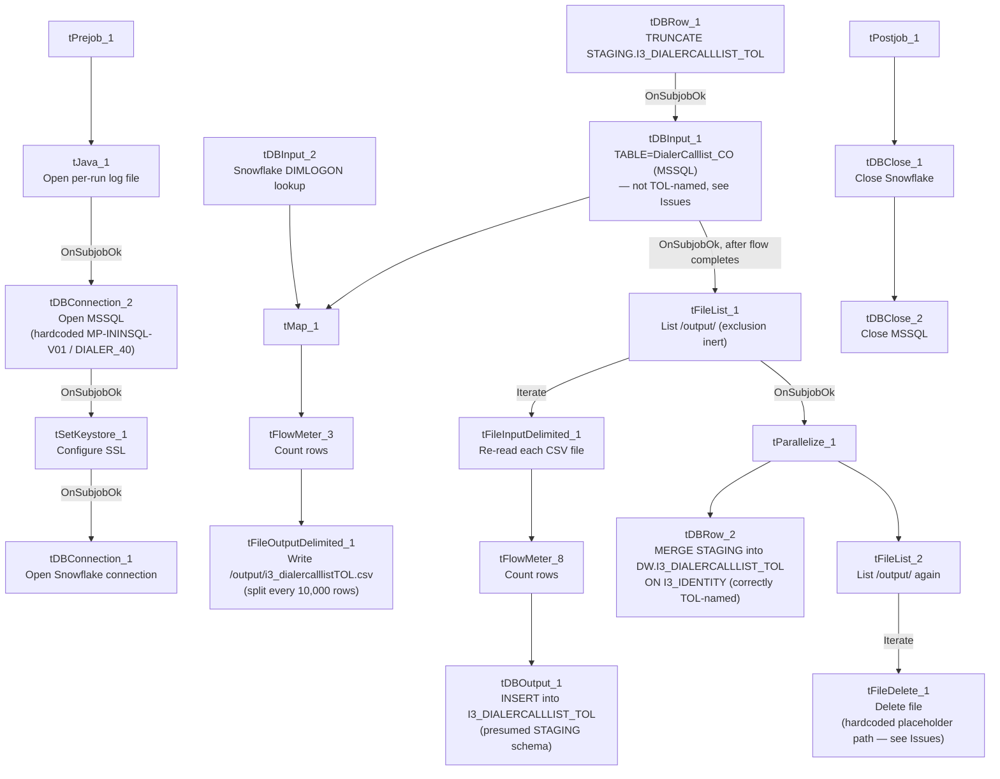

# Talend Job: i3_DialerCallListTOL_Load

## Overview

Refreshes the "TOL" site's dialer call-list table in Snowflake (`I3_DIALERCALLLIST_TOL`) from the I3 telephony MSSQL system, following the exact same extract-to-CSV-and-back, truncate/stage/merge pattern as its `i3_DialerCallListCO_Load` sibling (this batch): read from MSSQL, join a `DIMLOGON` lookup, write an intermediate CSV, reload it into a Snowflake staging table, then `MERGE` into the `DW` warehouse table keyed on `I3_IDENTITY`. The two jobs share the same MSSQL server/database and nearly identical component wiring — but this job's source-table parameter is configured as `DialerCalllist_CO`, not a TOL-named table (see Issues observed), distinct from (though similar in kind to) the mismatch already documented in the separate `i3_DialerCallListTOL_Load_Backup` job.

## Detail table

| Field | Value |
|---|---|
| Job name | i3_DialerCallListTOL_Load |
| Version | 0.2 |
| Project | EDW2SF |
| Author | jmach@harriscollect.com |
| Created | 2023-07-06T09:51:28.197-0700 |
| Last Modified | 2025-11-10T15:43:45.237-0800 |

## Step-by-step data flow

**Setup subjob:** `tPrejob_1` → `tJava_1` opens a per-run log file at `context.logDir + jobName + "_" + <timestamp> + ".log"` → on success (`OnSubjobOk`), `tDBConnection_2` opens the MSSQL connection (hardcoded host/database — see Settings tables) → on success, `tSetKeystore_1` configures SSL trust/keystore from `context.keystorePath` (passwords redacted) → on success, `tDBConnection_1` opens the Snowflake connection.

**Main subjob, phase 1 — extract MSSQL to CSV:**

1. `tDBRow_1` runs `TRUNCATE TABLE STAGING.I3_DIALERCALLLIST_TOL;` on Snowflake (starts independently as soon as the main subjob begins).
2. On success (`OnSubjobOk`), `tDBInput_1` runs a fixed `SELECT` configured with `TABLE = "DialerCalllist_CO"` — **not a TOL-named table** (see Issues observed) — pulling `I3_IDENTITY`, `ACCOUNT AS DEBTORNUMBER`, `LOGON`, a derived `DEBTOR_IDX`, `CAMPAIGN`, `DEBTORNAME`, address/phone fields (`PHONE1`–`PHONE7`), call-attempt counters (`I3_ATTEMPTS*`, 8 columns), `I3_UPLOAD_ID`, campaign-owner fields, and more (~60 columns total). The captured query text is truncated in this metadata after the initial column list, so the query's actual `FROM` clause (and thus which physical table is really queried at runtime) cannot be confirmed beyond the `TABLE` parameter.
3. `tDBInput_1`'s output flows (`FLOW`) into `tMap_1`, which also receives a lookup input (`MAIN`) from `tDBInput_2` (`tSnowflakeInput` reading Snowflake table `DIMLOGON`), adding a `DIMLOGON` surrogate key column based on `LOGON`.
4. `tMap_1` → `tFlowMeter_3` (row count) → `tFileOutputDelimited_1`, which writes the enriched list to a fixed path `/output/i3_dialercalllistTOL.csv` (correctly TOL-named, comma-delimited, no header, split every 10,000 rows).

**Main subjob, phase 2 — reload CSV into Snowflake staging:**

5. Once phase 1's flow subjob completes, `tDBInput_1` also fires `OnSubjobOk` into `tFileList_1`, which lists every file in `/output/` (hardcoded — `EXCLUDEFILEMASK="*.txt"` with `IFEXCLUDE=false`, so the exclusion is configured but never applied).
6. `tFileList_1` `ITERATE`s into `tFileInputDelimited_1`, which re-reads each listed file (same ~60-column schema) → `tFlowMeter_8` (row count) → `tDBOutput_1`, which `INSERT`s the rows into Snowflake table `I3_DIALERCALLLIST_TOL` (presumed `STAGING`-schema, per the earlier explicit truncate — the component's own `db.table` field shows no schema prefix).

**Main subjob, phase 3 — merge and cleanup (parallel):**

7. Once `tFileList_1`'s iteration subjob completes (`OnSubjobOk`), `tParallelize_1` starts two branches concurrently:
   - `tDBRow_2` runs `MERGE INTO DW.I3_DIALERCALLLIST_TOL AS tgt USING STAGING.I3_DIALERCALLLIST_TOL AS src ON (tgt.I3_IDENTITY = src.I3_IDENTITY)` — correctly TOL-named throughout, updating all ~60 columns on match, inserting new rows on no match, with `I3_UPLOAD_ID` coalesced to `0` if null.
   - `tFileList_2` re-lists `/output/` and `ITERATE`s into `tFileDelete_1`, which attempts to delete each file found there.

**Teardown subjob:** `tPostjob_1` → `tDBClose_1` (close Snowflake) → `tDBClose_2` (close MSSQL).

## Settings tables

### Source: `tDBInput_1` (`tMSSqlInput`)

| Setting | Value | What it means |
|---|---|---|
| Connection | Shared `tDBConnection_2` | Reuses the job's single hardcoded MSSQL connection. |
| TABLE | `"DialerCalllist_CO"` | **Not TOL-named** — see Issues observed. This is the exact same value configured on the sibling `i3_DialerCallListCO_Load` job's `tDBInput_1.TABLE`. |
| Query | Fixed `SELECT` of ~60 named columns, identical in structure to the CO job's query — captured text truncated after the initial column list | The visible portion does not show a `FROM` clause, so it cannot be confirmed from this metadata whether the underlying query text (as opposed to the `TABLE` parameter) actually targets a CO or TOL source table. |
| TRIM_ALL_COLUMN | `true` | Whitespace trimmed from all extracted columns. |

### MSSQL connection: `tDBConnection_2` (`tMSSqlConnection`)

| Setting | Value | What it means |
|---|---|---|
| DRIVER | `JTDS` | |
| HOST | `"MP-ININSQL-V01"` (hardcoded) | Same physical server as `i3_DialerCallListCO_Load`. |
| DBNAME | `"DIALER_40"` (hardcoded) | Same source database as the CO sibling — both CO and TOL call-list data lives in the same MSSQL database, differentiated only by table name (in principle). |
| USER | `"svc_ssa_snflk"` | Hardcoded service account. |

### Intermediate file: `tFileOutputDelimited_1` / `tFileInputDelimited_1`

| Setting | Value | What it means |
|---|---|---|
| FILENAME (write) | `"/output/i3_dialercalllistTOL.csv"` | Correctly TOL-named, hardcoded path (not context-variable-driven). |
| SPLIT / SPLIT_EVERY | `true` / `10000` | Large lists are split into multiple numbered files rather than one large file. |
| DIRECTORY (`tFileList_1`/`tFileList_2`) | `"/output/"` (hardcoded) | Same shared hardcoded output directory used by the CO job — both jobs' intermediate CSVs and any leftover files from either site would sit in this same directory, subject to the same inert-exclusion-mask issue (see Issues observed). |
| TEMP_DIR (`tFileInputDelimited_1`) | `"C:/Talend-Studio-20211109_1610-V8.0.1/workspace"` | Hardcoded developer-workstation path. |

### Lookup: `tDBInput_2` (`tSnowflakeInput`)

| Setting | Value | What it means |
|---|---|---|
| Table | `DIMLOGON` | Small dimension table joined in `tMap_1` to attach a `DIMLOGON` surrogate key based on `LOGON`. |

### Target (staging): `tDBOutput_1` (`tSnowflakeOutput`)

| Setting | Value | What it means |
|---|---|---|
| Table | `I3_DIALERCALLLIST_TOL` | `INSERT`, `tableAction: NONE` — correctly TOL-named, relies on `tDBRow_1`'s earlier `TRUNCATE TABLE STAGING.I3_DIALERCALLLIST_TOL` for idempotency. |

### Warehouse merge: `tDBRow_2` (`tSnowflakeRow`)

| Setting | Value | What it means |
|---|---|---|
| Query | `MERGE INTO DW.I3_DIALERCALLLIST_TOL AS tgt USING STAGING.I3_DIALERCALLLIST_TOL AS src ON (tgt.I3_IDENTITY = src.I3_IDENTITY) WHEN MATCHED THEN UPDATE SET ... WHEN NOT MATCHED THEN INSERT (...)` | Correctly TOL-named throughout (unlike the source-side `TABLE` parameter) — full column-by-column update on match, insert on no match, `I3_UPLOAD_ID` coalesced to `0` if null. |

### Cleanup: `tFileDelete_1`

| Setting | Value | What it means |
|---|---|---|
| DIRECTORY / PATH | `"C:/Talend-Studio-20211109_1610-V8.0.1/workspace/delete_folder"` / `"...delete_folder or delete_file"` | Same placeholder-looking hardcoded values as the CO sibling — see that job's Issues section for the same open question about whether cleanup actually functions. |

## Dependencies & configuration

- **Triggers/depends on other jobs:** none — no `tRunJob` links found, and this job does not appear in `06_dependency_matrix.md`'s orchestration table.
- **Context variables used:** `keystorePath`, `logDir` only.
- **4 hardcoded paths found:** `tSetKeystore_1.SSL_TRUSTSERVER_TRUSTSTORE` (`C:/clientTrustStore.trustStore`), `tFileInputDelimited_1.TEMP_DIR`, and `tFileDelete_1.DIRECTORY`/`PATH` — same project-wide risk documented in `05_operational_runbook.md`.
- **Relationship to `i3_DialerCallListTOL_Load_Backup`:** a separate, already-documented job with the same TOL naming, also configured with `TABLE = "DialerCalllist_CO"` on its own MSSQL read step, but a structurally different pipeline (uses `EDWProdHH_*` context-variable connections rather than this job's hardcoded `MP-ININSQL-V01`/`DIALER_40`, and adds outcome columns via a second `tMap_2` after re-reading its CSV rather than carrying the full schema through in one pass). The two jobs are not the same design reused twice — they independently share the same CO/TOL table-name mismatch, which may point to a common root cause (e.g. both copied from the same CO-site template) rather than one job's mistake being copied into the other.

## Glossary

| Component type | Plain-English meaning |
|---|---|
| `tMSSqlConnection` / `tMSSqlInput` / `tMSSqlClose` | Open a Microsoft SQL Server connection, run a query against it, and close it. |
| `tSnowflakeConnection` / `tSnowflakeInput` / `tSnowflakeOutput` / `tSnowflakeRow` / `tSnowflakeClose` | Open/close a Snowflake connection, read a table, write rows to a table, or run an arbitrary SQL statement against Snowflake. |
| `tMap` | Maps/transforms and optionally joins (lookup) columns from one or more input schemas to an output schema. |
| `tFlowMeter` | Counts rows passing a point in the flow for logging/monitoring. |
| `tFileList` | Lists files in a directory for the job to iterate over one at a time. |
| `tFileInputDelimited` / `tFileOutputDelimited` | Read/write a delimited (CSV-style) text file. |
| `tFileDelete` | Deletes a specific file from disk. |
| `tParallelize` | Runs its downstream branches at the same time instead of one after another. |
| `tSetKeystore` | Configures SSL trust/keystore settings used by subsequent secure connections. |

## Issues observed

- **`tDBInput_1`'s `TABLE` parameter is configured as `"DialerCalllist_CO"`, not a TOL-named table**, even though this job is `i3_DialerCallListTOL_Load`, truncates/loads/merges exclusively TOL-named Snowflake tables (`STAGING.I3_DIALERCALLLIST_TOL`, `DW.I3_DIALERCALLLIST_TOL`), and writes its intermediate file to `i3_dialercalllistTOL.csv`. This is the single clearest anomaly in this job. Two things keep this from being a certain functional bug: (1) in Talend's `tMSSqlInput`, when a custom `QUERY` is supplied (as it is here), the `TABLE` field is typically a vestigial leftover from whenever the query was last auto-generated via "Guess Query" and is not necessarily what actually executes — the real table reference would live in the `QUERY` text's `FROM` clause; and (2) that `QUERY` text is truncated in this metadata after the column list, so the actual `FROM` clause is not visible either way. **Unable to determine from this metadata whether this job actually pulls CO-site data into a TOL-labeled warehouse table, or whether the `TABLE` field is simply stale UI metadata with no runtime effect.** This should be verified directly in Talend Studio (or by comparing a sample of loaded `I3_DIALERCALLLIST_TOL` rows' `CAMPAIGN`/`DEBTORNAME` values against known CO vs. TOL debtor populations) before assuming this job's data is correct.
- **The identical `DialerCalllist_CO` value also appears on the separate `i3_DialerCallListTOL_Load_Backup` job's own MSSQL read step** (see that job's own documentation). The two jobs are structurally different otherwise, so this is not simply one job's config copied wholesale into the other — but it does suggest a shared CO-site template was the starting point for building out TOL support project-wide, with this leftover field never corrected in either descendant. Worth a single cleanup pass across both jobs rather than treating them as unrelated incidents.
- **The cleanup step's `tFileDelete_1.DIRECTORY`/`PATH` values look like unconfigured template placeholders**, identical to the CO sibling's — see that job's Issues section for the same open question about whether the delete step actually targets `/output/` or these literal placeholder paths.
- **The MSSQL source query is truncated in this metadata**, cutting off after the initial column list — any `WHERE` clause is not visible, so it's unable to be determined whether this is a full-table extract every run or an incrementally filtered one.
- **The output CSV path and both `tFileList` directories are hardcoded to `/output/`**, shared with the CO sibling job, rather than driven by a context variable — moving either job to a different environment would require direct edits, and running both jobs against the same `/output/` directory concurrently could mean one job's `tFileList` iteration picks up the other's leftover files (mitigated only by each file's TOL/CO-specific filename, since the exclusion mask on both jobs is inert).
- No other findings beyond the project-wide hardcoded-path pattern already documented in `05_operational_runbook.md`.
