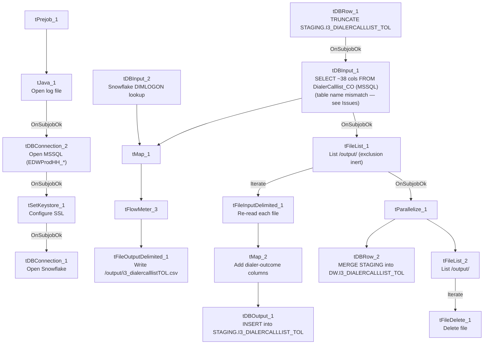

# Talend Job: i3_DialerCallListTOL_Load_Backup

## Overview

This job builds a dialer call list for the "TOL" site and loads a record of it into Snowflake. It reads collections-account records from a SQL Server table via the `EDWProdHH`-labeled connection, attaches a `DIMLOGON` surrogate key from Snowflake, writes the enriched list out as a CSV file (presumably the actual file the I3 dialer system consumes), then re-reads that file together with a set of dialer outcome/tracking columns and merges it into the Snowflake `I3_DIALERCALLLIST_TOL` table using the project's standard truncate-staging → load → merge-into-DW pattern. However, the source table configured on the read step is literally named `DialerCalllist_CO` — a different site's table — which, combined with this job's own `_Load_Backup` name and its version 0.2 being created and last modified within the same second, strongly suggests this is an unfinished or leftover copy of a `CO`-site job rather than a verified TOL pipeline (see Issues observed).

## Detail table

| Field | Value |
|---|---|
| Job name | i3_DialerCallListTOL_Load_Backup |
| Version | 0.2 |
| Project | EDW2SF |
| Author | jmach@harriscollect.com |
| Created | 2025-11-11T10:29:15.117-0800 |
| Last Modified | 2025-11-11T10:29:15.283-0800 |

## Step-by-step data flow

**Setup subjob:** `tPrejob_1` → `tJava_1` opens a per-run log file at `context.logDir + jobName + "_" + <timestamp> + ".log"` → on success, `tDBConnection_2` opens the MSSQL connection using `context.EDWProdHH_Server/Port/Schema/Database/Login` (password redacted) → on success, `tSetKeystore_1` configures SSL/keystore settings from `context.keystorePath` (all passwords redacted) → on success, `tDBConnection_1` opens the Snowflake connection (no connection-label parameters were captured for this component).

**Main subjob** — starts independently at `tDBRow_1`:

1. `tDBRow_1` runs `TRUNCATE TABLE STAGING.I3_DIALERCALLLIST_TOL;` against Snowflake.
2. On success, `tDBInput_1` (reusing the shared `tDBConnection_2` MSSQL connection) runs a fixed `SELECT` of ~38 columns — account/debtor identifiers, campaign, name/address, multiple phone numbers, balance, last-payment/letter fields, SSN, desk code, score — configured with `TABLE = "DialerCalllist_CO"`. **This does not match the job's own TOL naming** — see Issues observed.
3. `tDBInput_1`'s output flows (`FLOW`) into `tMap_1`, which also receives a `MAIN`-labeled lookup input from `tDBInput_2` (`tSnowflakeInput`, table `DIMLOGON`) to attach a `DIMLOGON` surrogate key based on `LOGON`.
4. `tMap_1` → `tFlowMeter_3` (row count, labeled "calllist") → `tFileOutputDelimited_1`, which writes the enriched list to a fixed path `/output/i3_dialercalllistTOL.csv` (comma-delimited, no header, split every 10,000 rows).
5. On `tDBInput_1`'s success, `tFileList_1` lists every file in `/output/` (`EXCLUDEFILEMASK = "*.txt"` but `IFEXCLUDE = false`, so the exclusion is configured but never applied — the same inert-exclusion pattern documented in `ADP_Payroll_Load`).
6. `tFileList_1` `ITERATE`s into `tFileInputDelimited_1`, which re-reads each listed file using the same base schema. `tMap_2` then adds a further set of I3 dialer-outcome columns not present in the file just written (`STATUS`, `ATTEMPTS`, `HHCUSTVAR1-3`, `HHCUSTINT1`, `I3_ATTEMPTS*` counters, `I3_SITEID`, `I3_ACTIVECAMPAIGNID`, `I3_LASTCALLED_UTC`, `I3_UPLOAD_ID`, `SUCCESSRESULT`, `I3_CAMPAIGNOWNERID/NAME/EXPIRATION`, `LOAD_DTTM`) — see Issues observed regarding what values these actually get.
7. `tMap_2` → `tDBOutput_1`, which `INSERT`s the result into Snowflake table `I3_DIALERCALLLIST_TOL` (in the connection's default/staging schema, consistent with the earlier `TRUNCATE TABLE STAGING.I3_DIALERCALLLIST_TOL`).
8. Separately, `tFileList_1` also fires (`SUBJOB_OK`) into `tParallelize_1`, which runs two branches concurrently:
   - `tDBRow_2` runs a `MERGE INTO DW.I3_DIALERCALLLIST_TOL` from `STAGING.I3_DIALERCALLLIST_TOL`, keyed on `I3_IDENTITY` (update on match, insert on no match).
   - `tFileList_2` re-lists `/output/` and `ITERATE`s into `tFileDelete_1`, deleting every file found there.

## Settings tables

### Source: `tDBInput_1` (`tMSSqlInput`)

| Setting | Value | What it means |
|---|---|---|
| Connection | Shared `tDBConnection_2` (`EDWProdHH_*` context vars) | Reuses the job's MSSQL connection. |
| TABLE | `"DialerCalllist_CO"` | Configured against the **CO** site's call-list table, not TOL — see Issues observed. |
| QUERY | Fixed `SELECT` of ~38 named columns (account, campaign, name/address, phones, balance, tax/legal-adjacent fields absent here — this table is collections-focused, not tax) | Query text is truncated in this metadata after the column list; the actual `FROM` clause (and thus which physical table is really queried) could not be confirmed beyond the `TABLE` parameter above. |

### Lookup: `tDBInput_2` (`tSnowflakeInput`)

| Setting | Value | What it means |
|---|---|---|
| Table | `DIMLOGON` | A logon-name dimension table, joined in `tMap_1` to attach a `DIMLOGON` surrogate key to each call-list row. |

### Output file: `tFileOutputDelimited_1`

| Setting | Value | What it means |
|---|---|---|
| FILENAME | `"/output/i3_dialercalllistTOL.csv"` | Fixed path — likely the actual file the I3 dialer system picks up. |
| INCLUDEHEADER / SPLIT | `false` / every 10,000 rows | No header row; large lists are split into multiple files. |

### Target: `tDBOutput_1` (`tSnowflakeOutput`) / Merge: `tDBRow_1` / `tDBRow_2`

| Setting | Value | What it means |
|---|---|---|
| Table (tDBOutput_1) | `I3_DIALERCALLLIST_TOL` | Loaded via `INSERT` after `tDBRow_1`'s `TRUNCATE TABLE STAGING.I3_DIALERCALLLIST_TOL;` — standard truncate-and-reload staging pattern. |
| Merge (tDBRow_2) | `MERGE INTO DW.I3_DIALERCALLLIST_TOL ... ON (tgt.I3_IDENTITY = src.I3_IDENTITY)` | Updates matching rows, inserts new ones, keyed on `I3_IDENTITY`; `I3_UPLOAD_ID` is coalesced to `0` if null on both the update and insert branches. |

## Dependencies & configuration

- **Triggers/depends on other jobs:** none — no `tRunJob` links found, and no other job in `06_dependency_matrix.md` calls this job either.
- **Context variables used:** `EDWProdHH_Database`, `EDWProdHH_Login`, `EDWProdHH_Port`, `EDWProdHH_Schema`, `EDWProdHH_Server`, `keystorePath`, `logDir`. Notably, **no `I3_IC_40_*` variables are referenced anywhere** despite the job name and output table both being I3-branded.
- **4 hardcoded developer-workstation paths**: `tSetKeystore_1.SSL_TRUSTSERVER_TRUSTSTORE`, `tFileInputDelimited_1.TEMP_DIR`, and `tFileDelete_1.DIRECTORY`/`PATH` (all `C:/Talend-Studio-20211109_1610-V8.0.1/workspace/...` or `C:/clientTrustStore.trustStore`) — same project-wide risk documented in `05_operational_runbook.md`.

## Glossary

| Component type | Plain-English meaning |
|---|---|
| `tFileList` | Lists files in a directory for the job to iterate over one at a time. |
| `tFileInputDelimited` / `tFileOutputDelimited` | Read/write a delimited (CSV-style) text file. |
| `tMap` | Maps/transforms columns from one schema to another, optionally joining in lookup data. |
| `tSnowflakeRow` | Runs an arbitrary SQL statement (here, a `TRUNCATE` and a `MERGE`) against Snowflake. |
| `tSnowflakeOutput` / `tSnowflakeInput` / `tSnowflakeConnection` / `tSnowflakeClose` | Write to / read from / open / close a Snowflake connection. |
| `tParallelize` | Runs its downstream branches at the same time instead of one after another. |
| `tFileDelete` | Deletes a specific file from disk. |
| `tFlowMeter` | Counts rows passing a point in the flow, for logging/monitoring. |
| `tSetKeystore` | Configures the SSL trust/keystore used for secure connections in the job. |

## Issues observed

- **The source table is configured as `DialerCalllist_CO`, not a TOL-named table**, even though this job is `i3_DialerCallListTOL_Load_Backup` and writes to `I3_DIALERCALLLIST_TOL`. Combined with the `_Load_Backup` suffix and the fact that this job's `created_date` and `modified_date` are identical to the second (2025-11-11T10:29:15), this looks like an unfinished or accidental copy of a CO-site version of this job, with the `TABLE` parameter never repointed to a TOL-specific source. Unable to confirm from this metadata whether the job has ever actually run in this state, or whether the truncated `QUERY` text's `FROM` clause overrides the `TABLE` parameter with something else — verify directly in Talend Studio before assuming this job is safe to schedule.
- **The job writes a CSV file and then immediately reads it back**, adding a set of dialer-outcome columns (`STATUS`, `ATTEMPTS`, all `I3_ATTEMPTS*` counters, `I3_UPLOAD_ID`, `SUCCESSRESULT`, campaign-owner fields) that do not exist in the file that was just written. Unless `tFileList_1`'s directory listing is actually picking up a *different*, pre-existing file (e.g., a return/results file the I3 dialer system already dropped in `/output/`) rather than the one this job just wrote, those columns would load into Snowflake as null/default on every run. `tFileList_1`'s exclusion mask is also inert (see below), so which files actually get processed depends entirely on what else happens to be sitting in `/output/` at run time — unable to determine the intended behavior from metadata alone; verify with the team.
- **`tFileList_1` and `tFileList_2` both have `EXCLUDEFILEMASK = "*.txt"` with `IFEXCLUDE = false`**, meaning the exclusion is configured but never actually applied — every file in `/output/` is picked up by both the reload step and the delete step, not just the ones this job produced. Same inert-exclusion pattern already documented in `ADP_Payroll_Load`.
- **A possible race between reading and deleting files in `/output/`**: the cleanup branch (`tFileList_2` → `tFileDelete_1`) runs in parallel with the reload branch (`tFileList_1` → `tFileInputDelimited_1` → ... → `tDBOutput_1`), both operating on the same shared directory. `tParallelize_1` only starts after `tFileList_1` has already finished listing, but the reload branch's own file processing may still be in flight when the delete branch's own separate listing (`tFileList_2`) runs — unable to confirm from metadata whether this creates a "file deleted before it's fully loaded" risk; verify before assuming it's safe.
- **4 hardcoded developer-workstation paths** (`C:/Talend-Studio-20211109_1610-V8.0.1/workspace/...`) — same portability risk documented project-wide in `05_operational_runbook.md`.
- **This job's own naming and context variables are internally inconsistent**: it's branded `i3_...TOL` and writes to an `I3_`-prefixed Snowflake table, but every context variable it actually uses is `EDWProdHH_*` — no `I3_IC_40_*` telephony-database variables appear anywhere. This is the same kind of connection/naming mismatch flagged in `i3_CallDetail_40_Load` and `i3_Individual_Load`; whether `EDWProdHH` and the I3 systems share a physical SQL Server, or this is simply a mislabeled job, is unable to determine from metadata — verify with the team.
- Given the version number, timestamps, and `_Backup` suffix, **it is unclear whether this job is an active production pipeline at all** — verify with the team before assuming it runs on any schedule.
