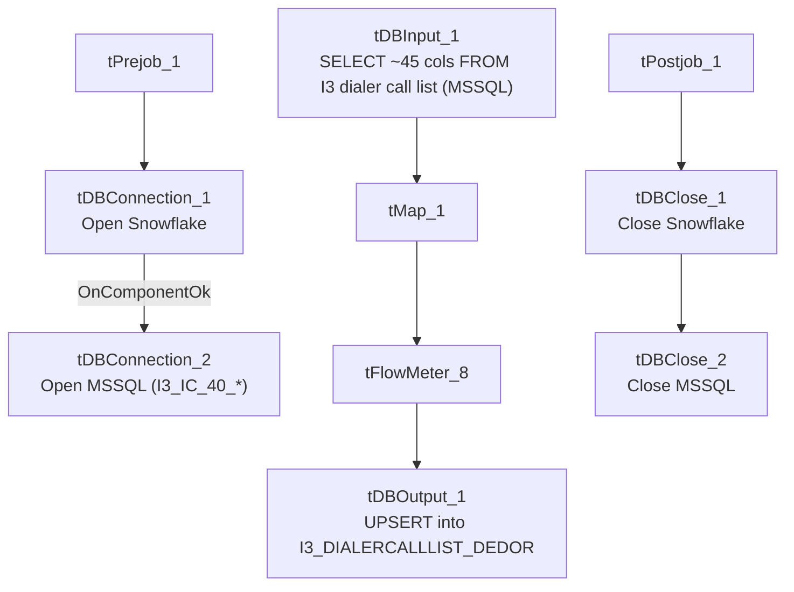

# Talend Job: i3_DialerCallList_DEDOR_Load

## Overview

Loads the "DEDOR" outbound dialer call list from the I3 telephony/dialer MSSQL database into the Snowflake `I3_DIALERCALLLIST_DEDOR` table. The source columns (`TAX_PERIOD_BEGIN_DATE`, `TAX_PERIOD_END_DATE`, `JUDGEMENT_STATUS`, `TAX_TYPE`, `CASE_TYPE`/`CASE_SUBTYPE`) indicate this call list is for a tax/judgment-related collections portfolio rather than a general commercial one. Unlike the `i3_Interaction*_Load` jobs, this is a straightforward full-refresh `UPSERT` with no max-key/incremental filtering, no staging truncate, and no merge step.

## Detail table

| Field | Value |
|---|---|
| Job name | i3_DialerCallList_DEDOR_Load |
| Version | 0.1 |
| Project | EDW2SF |
| Author | jmach@harriscollect.com |
| Created | 2023-09-15T12:52:14.515-0700 |
| Last Modified | 2025-09-24T11:00:30.144-0700 |

## Step-by-step data flow

**Setup subjob:** `tPrejob_1` → `tDBConnection_1` opens the Snowflake connection → on success, `tDBConnection_2` opens the MSSQL connection using `context.I3_IC_40_Server/Port/Schema/Database/Login` (password redacted). Notably, this job has **no `tJava` per-run log-file setup and no `tSetKeystore`** SSL configuration — both present in most of this job's siblings (see Issues observed).

**Main subjob:**

1. `tDBInput_1` (reusing the shared `tDBConnection_2` MSSQL connection via `USE_EXISTING_CONNECTION=true`) runs a fixed `SELECT` of ~45 columns from the I3 dialer call-list table: identity/zone/attempts/status, a full set of `I3_ATTEMPTS*` outcome counters, upload/entity/case identifiers, name/address/phone fields, balance, tax-period dates, case type/status, and several `HH_*` (collections-system) fields (last wrap-up code, last call time, agent ID, custom variables).
2. `tMap_1` passes the row through to a same-shaped uppercase-named target schema.
3. `tFlowMeter_8` counts rows passing through (labeled "DLR").
4. `tDBOutput_1` `UPSERT`s the rows into Snowflake table `I3_DIALERCALLLIST_DEDOR` (`tableAction=NONE`).

**Teardown subjob:** `tPostjob_1` → `tDBClose_1` (close Snowflake) → `tDBClose_2` (close MSSQL).

## Settings tables

### Source: `tDBInput_1` (`tMSSqlInput`)

| Setting | Value | What it means |
|---|---|---|
| Connection | Shared `tDBConnection_2` (`I3_IC_40_*` context vars) | Reuses the job's single MSSQL connection. |
| Query | Fixed `SELECT` of ~45 columns (truncated in this metadata after the initial column list) | No visible `WHERE` clause — this appears to be a full-table read every run, not an incremental one. |

### Target: `tDBOutput_1` (`tSnowflakeOutput`)

| Setting | Value | What it means |
|---|---|---|
| Table | `I3_DIALERCALLLIST_DEDOR` | Destination table in Snowflake. |
| Output action | `UPSERT` | Update-or-insert per row — safe to re-run without duplicating rows, unlike a plain `INSERT`. |
| Table action | `NONE` | Table itself is not recreated/altered. |

## Dependencies & configuration

- **Triggers/depends on other jobs:** none — no `tRunJob` links found, and this job is not called by any other job in `06_dependency_matrix.md`.
- **Context variables used:** `I3_IC_40_Database`, `I3_IC_40_Login`, `I3_IC_40_Port`, `I3_IC_40_Schema`, `I3_IC_40_Server` — this job correctly and exclusively uses the I3 telephony connection group, unlike some of its siblings (see `i3_Individual_Load` and `i3_DialerCallListTOL_Load_Backup`, which use `EDWProdHH_*` instead).
- No hardcoded developer-workstation paths found in this job.

## Glossary

| Component type | Plain-English meaning |
|---|---|
| `tMSSqlConnection` / `tMSSqlInput` / `tMSSqlClose` | Open a Microsoft SQL Server connection, run a query against it, and close it. |
| `tSnowflakeConnection` / `tSnowflakeOutput` / `tSnowflakeClose` | Open a Snowflake connection, write rows to a table, and close the connection. |
| `tMap` | Maps/transforms columns from one schema to another. |
| `tFlowMeter` | Counts rows passing a point in the flow, for logging/monitoring. |

## Issues observed

- **No incremental filter is applied** — the source query reads the entire I3 dialer call-list table every run. Because the target uses `UPSERT` (not `INSERT`), this is safe from a duplication standpoint, but it does mean every run re-transfers the full table regardless of how much has actually changed, which could be a performance/cost consideration at scale — unable to determine table size or run frequency from this metadata.
- **This job has no per-run log-file setup (`tJava`) and no `tSetKeystore` SSL configuration**, both of which are present in the structurally similar `i3_InteractionSummary_Load`, `i3_InteractionSummaryEx_Load`, `i3_InteractionCustomAttributes_Load`, and `i3_InteractionWrapup_Load` jobs. Whether this job's MSSQL connection needs the same SSL trust configuration as its siblings (and is simply missing it) is unable to determine from metadata — verify with the team, particularly if this job has ever failed with a certificate/SSL-related error.
- **No error/row-count logging specific to this job's business outcome** (no `tWarn`/`tDie`/`tSendMail`) — a load failure here would only surface as a generic Talend execution error. Beyond this, no findings beyond the project-wide patterns already documented in `05_operational_runbook.md`.
