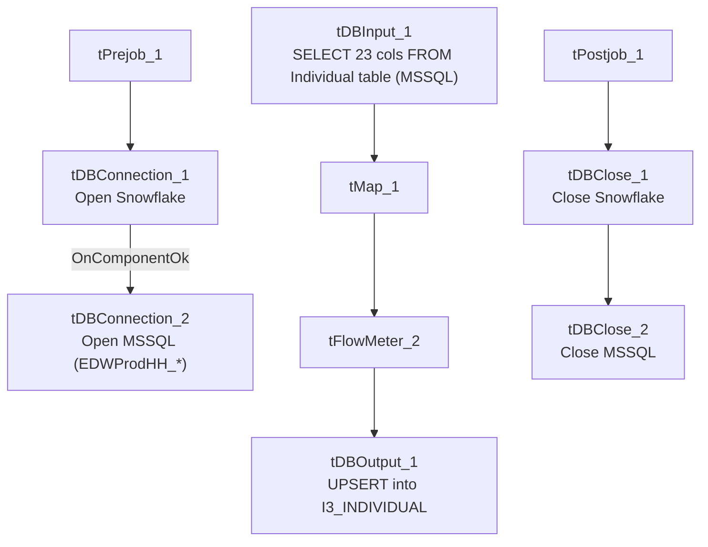

# Talend Job: i3_Individual_Load

## Overview

Loads individual/contact records (name, title, department, company, job title, web login, IC user ID, active/private flags) from a SQL Server table into the Snowflake `I3_INDIVIDUAL` table. Although the job is named with the `i3_` prefix (the I3/Interactive Intelligence telephony system) and its columns (`ICUserID`, `WebLogin`, `AppIndivID`) look like I3 Interaction Center user/contact data, the connection it actually uses is labeled with `EDWProdHH_*` context variables — the same connection group used by the project's general operational database (see Issues observed). This is a simple full-refresh `UPSERT`, with no incremental filtering, no staging/merge step, and no per-run logging or SSL setup.

## Detail table

| Field | Value |
|---|---|
| Job name | i3_Individual_Load |
| Version | 0.1 |
| Project | EDW2SF |
| Author | jmach@harriscollect.com |
| Created | 2022-03-07T08:52:34.951-0800 |
| Last Modified | 2022-05-24T09:48:39.646-0700 |

## Step-by-step data flow

**Setup subjob:** `tPrejob_1` → `tDBConnection_1` opens the Snowflake connection → on success, `tDBConnection_2` opens the MSSQL connection using `context.EDWProdHH_Server/Port/Schema/Database/Login` (password redacted).

**Main subjob:**

1. `tDBInput_1` (reusing the shared `tDBConnection_2` MSSQL connection via `USE_EXISTING_CONNECTION=true`) runs a fixed `SELECT` of 23 columns from the source individual/contact table: `IndivID`, type/title IDs, name fields, department/company/job title, assistant name, web login, modify timestamp, org/location/site IDs, active/private flags, version, `AppIndivID`, `ICUserID`, owner ID, external ID/source.
2. `tMap_1` passes the row through to a same-shaped uppercase-named target schema.
3. `tFlowMeter_2` counts rows passing through (labeled "MyLabel", not renamed for this job).
4. `tDBOutput_1` `UPSERT`s the rows into Snowflake table `I3_INDIVIDUAL` (`tableAction=NONE`).

**Teardown subjob:** `tPostjob_1` → `tDBClose_1` (close Snowflake) → `tDBClose_2` (close MSSQL).

## Settings tables

### Source: `tDBInput_1` (`tMSSqlInput`)

| Setting | Value | What it means |
|---|---|---|
| Connection | Shared `tDBConnection_2` (`EDWProdHH_*` context vars) | See Issues observed — this connection group is documented project-wide as the "EDWProdHH" operational database, not I3. |
| Query | Fixed `SELECT` of 23 columns (truncated in this metadata after the column list) | No visible `WHERE` clause — a full-table read every run. |

### Target: `tDBOutput_1` (`tSnowflakeOutput`)

| Setting | Value | What it means |
|---|---|---|
| Table | `I3_INDIVIDUAL` | Destination table in Snowflake. |
| Output action | `UPSERT` | Update-or-insert per row, keyed presumably on `INDIVID` — safe to re-run without duplicating rows. |
| Table action | `NONE` | Table itself is not recreated/altered. |

## Dependencies & configuration

- **Triggers/depends on other jobs:** none — no `tRunJob` links found, and this job is not called by any other job in `06_dependency_matrix.md`.
- **Context variables used:** `EDWProdHH_Database`, `EDWProdHH_Login`, `EDWProdHH_Port`, `EDWProdHH_Schema`, `EDWProdHH_Server`.
- No hardcoded developer-workstation paths found in this job.

## Glossary

| Component type | Plain-English meaning |
|---|---|
| `tMSSqlConnection` / `tMSSqlInput` / `tMSSqlClose` | Open a Microsoft SQL Server connection, run a query against it, and close it. |
| `tSnowflakeConnection` / `tSnowflakeOutput` / `tSnowflakeClose` | Open a Snowflake connection, write rows to a table, and close the connection. |
| `tMap` | Maps/transforms columns from one schema to another. |
| `tFlowMeter` | Counts rows passing a point in the flow, for logging/monitoring. |

## Issues observed

- **This job's MSSQL connection is configured using `context.EDWProdHH_*` variables**, the naming convention this project uses elsewhere for the general operational "EDWProdHH" database (see `01_system_architecture.md`), yet the job is named `i3_Individual_Load` and its source columns (`ICUserID`, `AppIndivID`, `WebLogin`) look like I3 Interaction Center contact/user data, not general EDWProdHH data. This is the same mismatch pattern flagged in `i3_CallDetail_40_Load` — either the I3 database is physically hosted on the same SQL Server instance as EDWProdHH (making the shared context appropriate), or this is a mislabeled/reused connection. Unable to determine from metadata; verify with the team which physical database `context.EDWProdHH_Database` actually points to for this job.
- **No incremental filter, no per-run log file, and no SSL/keystore setup** — unlike most of this project's other I3-family jobs (e.g. the `i3_Interaction*_Load` jobs), this one has none of the `tJava` log-opening or `tSetKeystore` components. Whether that's because this connection doesn't require SSL, or because this job simply predates that pattern being adopted (it's one of the older jobs in this batch, created 2022-03-07), is unable to determine from metadata.
- No other findings beyond the project-wide patterns already documented in `05_operational_runbook.md` — this is otherwise a simple, low-risk full-refresh load.
