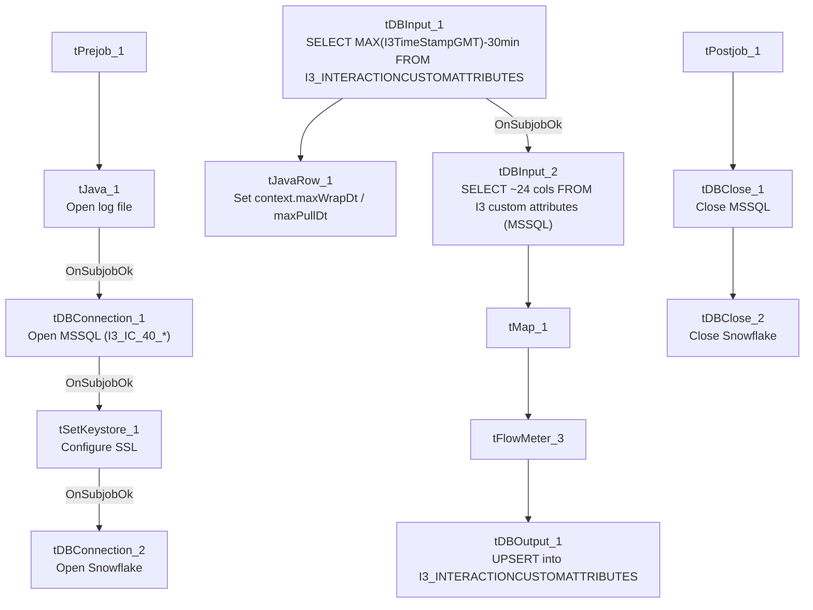

# Talend Job: i3_InteractionCustomAttributes_Load

## Overview

Loads custom-attribute data attached to I3 telephony interactions (up to 9 custom numeric fields, 9 custom string fields, and 2 custom date/time fields per interaction) from the I3 IC MSSQL database into the Snowflake `I3_INTERACTIONCUSTOMATTRIBUTES` table. Uses a rolling watermark pattern: it first computes the latest timestamp already loaded into Snowflake (minus a 30-minute safety overlap) and captures the current pull time, intending to pull only newer source rows, though the captured metadata does not show the source query's `WHERE` clause actually applying that filter (see Issues observed — the same open question flagged in this job's `i3_InteractionSummary_Load` and `i3_InteractionSummaryEx_Load` siblings).

## Detail table

| Field | Value |
|---|---|
| Job name | i3_InteractionCustomAttributes_Load |
| Version | 0.1 |
| Project | EDW2SF |
| Author | jmach@harriscollect.com |
| Created | 2023-05-24T09:42:30.149-0700 |
| Last Modified | 2025-11-06T10:04:49.840-0800 |

## Step-by-step data flow

**Setup subjob:** `tPrejob_1` → `tJava_1` opens a per-run log file at `context.logDir + jobName + "_" + <timestamp> + ".log"` → on success, `tDBConnection_1` opens the MSSQL connection using `context.I3_IC_40_Server/Port/Schema/Database/Login` (password redacted) → on success, `tSetKeystore_1` configures SSL/keystore settings from `context.keystorePath` (all passwords redacted) → on success, `tDBConnection_2` opens the Snowflake connection.

**Main subjob** — starts independently at `tDBInput_1`:

1. `tDBInput_1` (`tSnowflakeInput`) runs `SELECT COALESCE(CAST(DATEADD(min,-30,MAX(I3TimeStampGMT)) AS VARCHAR(30)),'2019-01-01') AS MAX_WRAP_DT, CAST(CONVERT_TIMEZONE(...,CURRENT_TIMESTAMP) AS VARCHAR(30)) AS MAX_PULL_DT FROM I3_INTERACTIONCUSTOMATTRIBUTES;` against Snowflake to find the latest already-loaded timestamp (with a 30-minute overlap for safety, defaulting to `2019-01-01` if the table is empty).
2. `tJavaRow_1` captures the two result values into `context.maxWrapDt` and `context.maxPullDt`.
3. On success, `tDBInput_2` (`tMSSqlInput`) runs a fixed `SELECT` against the I3 IC source, pulling `InteractionIDKey`, `SiteID`, `SeqNo`, 6 `CustomNum` fields, 6 `CustomString` fields, `CustomDateTime`, `CustomDateTimeGMT`, `I3TimeStampGMT`, plus 3 more `CustomNum`/`CustomString` pairs (24 columns total). **The captured query text is truncated after the column list and does not visibly reference `context.maxWrapDt`** — see Issues observed.
4. `tMap_1` passes the ~24 source columns through to a same-shaped uppercase-named target schema (`DIE_ON_ERROR=true`).
5. `tFlowMeter_3` counts rows passing through (labeled "custattr").
6. `tDBOutput_1` `UPSERT`s the rows into Snowflake table `I3_INTERACTIONCUSTOMATTRIBUTES` (`tableAction=NONE`).

**Teardown subjob:** `tPostjob_1` → `tDBClose_1` (close MSSQL) → `tDBClose_2` (close Snowflake).

## Settings tables

### Watermark: `tDBInput_1` (`tSnowflakeInput`)

| Setting | Value | What it means |
|---|---|---|
| Query | `SELECT COALESCE(CAST(DATEADD(min,-30,MAX(I3TimeStampGMT))...),'2019-01-01') AS MAX_WRAP_DT, ... AS MAX_PULL_DT FROM I3_INTERACTIONCUSTOMATTRIBUTES;` | Computes the incremental-load starting point (with a 30-minute overlap) and the current pull time, both captured into context for the source query to (presumably) use as filter bounds. |

### Source: `tDBInput_2` (`tMSSqlInput`)

| Setting | Value | What it means |
|---|---|---|
| Connection | `I3_IC_40_*` context vars | Reads from the I3 IC telephony database. |
| Query | Fixed `SELECT` of ~24 columns (truncated in this metadata) | Does not visibly reference `context.maxWrapDt` in the captured portion — see Issues observed. |

### Target: `tDBOutput_1` (`tSnowflakeOutput`)

| Setting | Value | What it means |
|---|---|---|
| Table | `I3_INTERACTIONCUSTOMATTRIBUTES` | Destination table in Snowflake. |
| Output action | `UPSERT` | Update-or-insert per row, keyed presumably on `INTERACTIONIDKEY`/`SEQNO` — safe against duplication even if the incremental filter re-pulls overlapping rows. |
| Table action | `NONE` | Table itself is not recreated/altered. |

## Dependencies & configuration

- **Triggers/depends on other jobs:** none — no `tRunJob` links found.
- **Context variables used:** `I3_IC_40_Database`, `I3_IC_40_Login`, `I3_IC_40_Port`, `I3_IC_40_Schema`, `I3_IC_40_Server`, `keystorePath`, `logDir`, `maxPullDt`, `maxWrapDt` (the latter two computed internally from the watermark query).
- **1 hardcoded path**: `tSetKeystore_1.SSL_TRUSTSERVER_TRUSTSTORE = "C:/clientTrustStore.trustStore"` — same pattern as other I3 jobs in this project.

## Glossary

| Component type | Plain-English meaning |
|---|---|
| `tSnowflakeConnection` / `tSnowflakeInput` / `tSnowflakeOutput` / `tSnowflakeClose` | Open a Snowflake connection, run a query, write rows, and close it. |
| `tMSSqlConnection` / `tMSSqlInput` / `tMSSqlClose` | Open a Microsoft SQL Server connection, run a query, and close it. |
| `tJavaRow` | Runs custom Java code once per input row — here used to unpack the watermark query's two result values into context variables. |
| `tMap` | Maps/transforms columns from one schema to another. |
| `tFlowMeter` | Counts rows passing a point in the flow, for logging/monitoring. |
| `tSetKeystore` | Configures the SSL trust/keystore used for secure connections in the job. |

## Issues observed

- **The incremental-load logic may not actually be applied** — same open question as `i3_InteractionSummary_Load`/`i3_InteractionSummaryEx_Load`: the job computes `context.maxWrapDt` before reading the MSSQL source, but the `tDBInput_2.QUERY` text captured in this metadata is truncated after the initial column list and does not show a `WHERE` clause referencing it. Because the target is an `UPSERT` (not a plain `INSERT`), a missing filter wouldn't cause duplicate rows, but it would mean every run re-reads and re-transfers the entire source table rather than only new/changed interactions — a performance and cost concern at scale. Verify directly in Talend Studio.
- **This job is structurally identical to `i3_InteractionSummary_Load` and `i3_InteractionSummaryEx_Load`** (same watermark pattern, same component wiring, same `UPSERT` target) — the three appear to be built from a shared template, differing only in source columns and target table. Worth keeping in sync as a set if the watermark logic is ever fixed or changed in one of them.
- No other findings beyond the project-wide patterns already documented in `05_operational_runbook.md`.
