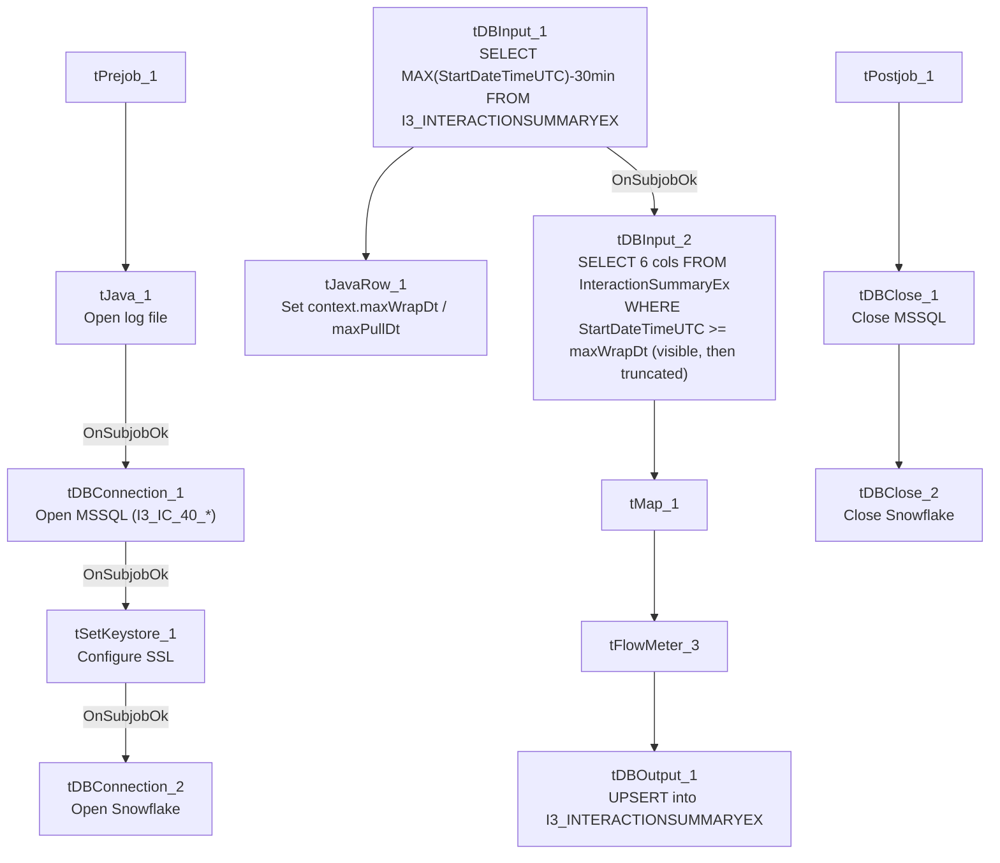

# Talend Job: i3_InteractionSummaryEx_Load

## Overview

Loads extended call-event-log data for I3 telephony interactions (interaction key/site/sequence, start time and offset, and a `CallEventLog` text field) from the I3 IC MSSQL database into the Snowflake `I3_INTERACTIONSUMMARYEX` table. Uses the same rolling-watermark pattern as its `i3_InteractionSummary_Load` and `i3_InteractionCustomAttributes_Load` siblings: it computes the latest already-loaded timestamp from Snowflake (minus a 30-minute safety overlap) before reading the source, though the captured query text does not show that watermark actually being applied as a filter (see Issues observed).

## Detail table

| Field | Value |
|---|---|
| Job name | i3_InteractionSummaryEx_Load |
| Version | 0.1 |
| Project | EDW2SF |
| Author | jmach@harriscollect.com |
| Created | 2023-05-23T11:24:16.680-0700 |
| Last Modified | 2025-11-06T10:21:10.425-0800 |

## Step-by-step data flow

**Setup subjob:** `tPrejob_1` → `tJava_1` opens a per-run log file → on success, `tDBConnection_1` opens the MSSQL connection using `context.I3_IC_40_Server/Port/Schema/Database/Login` (password redacted) → on success, `tSetKeystore_1` configures SSL/keystore settings from `context.keystorePath` (all passwords redacted) → on success, `tDBConnection_2` opens the Snowflake connection.

**Main subjob** — starts independently at `tDBInput_1`:

1. `tDBInput_1` (`tSnowflakeInput`) runs `SELECT COALESCE(CAST(DATEADD(min,-30,MAX(StartDateTimeUTC))...),'2019-01-01') AS MAX_WRAP_DT, ... AS MAX_PULL_DT FROM I3_INTERACTIONSUMMARYEX;` against Snowflake to find the incremental-load starting point.
2. `tJavaRow_1` captures the two result values into `context.maxWrapDt` and `context.maxPullDt`.
3. On success, `tDBInput_2` (`tMSSqlInput`) runs a fixed `SELECT` of 6 columns — `InteractionIDKey`, `SiteID`, `SeqNo`, `StartDateTimeUTC`, `StartDTOffset`, `CallEventLog` — from `I3_IC_40.dbo.InteractionSummaryEx`. The query text visibly includes `WHERE StartDateTimeUTC >= '" + context.maxWrapDt + "' AND Start...` before being truncated in this metadata — **this is the one job in this family where the incremental filter is at least partially visible**, though the upper bound of the `WHERE` clause (presumably using `context.maxPullDt`) is cut off.
4. `tMap_1` passes the 6 source columns through to a same-shaped uppercase-named target schema (`DIE_ON_ERROR=true`).
5. `tFlowMeter_3` counts rows passing through (labeled "intsumex").
6. `tDBOutput_1` `UPSERT`s the rows into Snowflake table `I3_INTERACTIONSUMMARYEX` (`tableAction=NONE`).

**Teardown subjob:** `tPostjob_1` → `tDBClose_1` (close MSSQL) → `tDBClose_2` (close Snowflake).

## Settings tables

### Watermark: `tDBInput_1` (`tSnowflakeInput`)

| Setting | Value | What it means |
|---|---|---|
| Query | `SELECT COALESCE(CAST(DATEADD(min,-30,MAX(StartDateTimeUTC))...),'2019-01-01') AS MAX_WRAP_DT, ... AS MAX_PULL_DT FROM I3_INTERACTIONSUMMARYEX;` | Computes the incremental-load starting point (30-minute overlap) and current pull time. |

### Source: `tDBInput_2` (`tMSSqlInput`)

| Setting | Value | What it means |
|---|---|---|
| Connection | `I3_IC_40_*` context vars | Reads from the I3 IC telephony database, table `I3_IC_40.dbo.InteractionSummaryEx`. |
| Query | `SELECT InteractionIDKey, SiteID, SeqNo, StartDateTimeUTC, StartDTOffset, CallEventLog FROM I3_IC_40.dbo.InteractionSummaryEx WHERE StartDateTimeUTC >= '<maxWrapDt>' AND Start...` (truncated) | The visible portion confirms the lower bound of the incremental filter is applied; the upper bound is not visible in this metadata. |

### Target: `tDBOutput_1` (`tSnowflakeOutput`)

| Setting | Value | What it means |
|---|---|---|
| Table | `I3_INTERACTIONSUMMARYEX` | Destination table in Snowflake. |
| Output action | `UPSERT` | Update-or-insert per row — safe against duplication from the 30-minute overlap window. |
| Table action | `NONE` | Table itself is not recreated/altered. |

## Dependencies & configuration

- **Triggers/depends on other jobs:** none — no `tRunJob` links found.
- **Context variables used:** `I3_IC_40_Database`, `I3_IC_40_Login`, `I3_IC_40_Port`, `I3_IC_40_Schema`, `I3_IC_40_Server`, `keystorePath`, `logDir`, `maxPullDt`, `maxWrapDt`.
- **1 hardcoded path**: `tSetKeystore_1.SSL_TRUSTSERVER_TRUSTSTORE = "C:/clientTrustStore.trustStore"`.

## Glossary

| Component type | Plain-English meaning |
|---|---|
| `tSnowflakeConnection` / `tSnowflakeInput` / `tSnowflakeOutput` / `tSnowflakeClose` | Open a Snowflake connection, run a query, write rows, and close it. |
| `tMSSqlConnection` / `tMSSqlInput` / `tMSSqlClose` | Open a Microsoft SQL Server connection, run a query, and close it. |
| `tJavaRow` | Runs custom Java code once per input row — here used to unpack the watermark query's result into context variables. |
| `tMap` | Maps/transforms columns from one schema to another. |
| `tFlowMeter` | Counts rows passing a point in the flow, for logging/monitoring. |
| `tSetKeystore` | Configures the SSL trust/keystore used for secure connections in the job. |

## Issues observed

- **This is the one job in the `i3_Interaction*_Load` family where the incremental filter is at least partially confirmed** — `tDBInput_2`'s query visibly includes `WHERE StartDateTimeUTC >= '<maxWrapDt>' AND Start...` before truncation, unlike `i3_InteractionSummary_Load` and `i3_InteractionCustomAttributes_Load`, whose captured query text cuts off before any `WHERE` clause becomes visible. This does not fully confirm the upper bound (`maxPullDt`) is also applied, but it does make this job's incremental design more credible than its siblings' — worth using as the reference point if the team investigates whether the others are actually filtering.
- **The `tDBOutput_1` schema in this job's extracted metadata includes a second block of reject-style columns** (`columnName`, `rowNumber`, `category`, `character`, `errorMessage`, `byteOffset`, `line`, `sqlState`, `code`) appended after the 6 business columns — this is very likely an artifact of how the extraction captured a combined main/reject schema rather than evidence of an actual reject flow wired in this job (no reject connection appears in the `connections` list). Unable to fully confirm from metadata; treat the business schema (6 columns) as authoritative.
- No other findings beyond the project-wide patterns already documented in `05_operational_runbook.md`.
