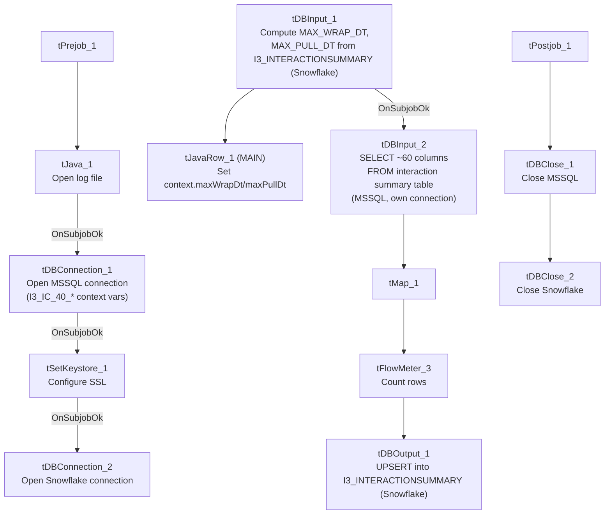

# Talend Job: i3_InteractionSummary_Load

## Overview

Loads interaction-summary records (per-interaction call-center metrics: talk/hold/queue/ACW timing, disposition, wrap-up code, workgroup/agent/line identifiers) from the I3 (Interactive Intelligence) telephony system's MSSQL database into the Snowflake `I3_INTERACTIONSUMMARY` table, using an `UPSERT` write keyed presumably on `INTERACTIONIDKEY`/`SITEID`/`SEQNO` so repeated runs update existing rows rather than duplicate them. Like `i3_CallHistory_Load`, it first computes the latest interaction start time already loaded into Snowflake as an apparent incremental-load marker, though the source query text captured in this metadata is truncated and does not show whether that marker is actually applied as a filter.

## Detail table

| Field | Value |
|---|---|
| Job name | i3_InteractionSummary_Load |
| Version | 0.1 |
| Project | EDW2SF |
| Author | jmach@harriscollect.com |
| Created | 2023-05-22T20:28:30.923-0700 |
| Last Modified | 2025-11-06T10:08:18.619-0800 |

## Step-by-step data flow

**Setup subjob:** `tPrejob_1` → `tJava_1` opens a per-run log file → on success (`OnSubjobOk`), `tDBConnection_1` opens the MSSQL connection (`context.I3_IC_40_*` variables — Server/Port/Schema/Database/Login, password redacted) → on success, `tSetKeystore_1` configures SSL trust/keystore from `context.keystorePath` → on success, `tDBConnection_2` opens the Snowflake connection.

**Main subjob:**

1. `tDBInput_1` (`tSnowflakeInput`) runs a query against `I3_INTERACTIONSUMMARY` in Snowflake to compute `MAX_WRAP_DT` (the latest `StartDateTimeUTC` already loaded, minus a 30-minute safety buffer, defaulting to `'2019-01-01'` if empty) and `MAX_PULL_DT` (current UTC timestamp).
2. `tJavaRow_1` captures those into `context.maxWrapDt` and `context.maxPullDt` (via the `MAIN` connection, labeled `row3`).
3. On success (`OnSubjobOk`), `tDBInput_2` (`tMSSqlInput`, its own separate connection — `USE_EXISTING_CONNECTION=false`, using `context.I3_IC_40_*` variables consistently with `tDBConnection_1`) runs a fixed `SELECT` of ~60 columns against the source interaction-summary table: interaction/site/sequence identifiers, start/connect/terminate timestamps, talk/hold/queue/ACW/park duration metrics, disposition and wrap-up codes, workgroup/agent/line identifiers, and call notes.
4. `tMap_1` passes the ~60 source columns through to a same-shaped uppercase-named target schema.
5. `tFlowMeter_3` counts rows passing through (labeled "MyLabel", not renamed for this job).
6. `tDBOutput_1` upserts the rows into Snowflake table `I3_INTERACTIONSUMMARY` (`UPSERT`, no table-recreate action).

**Teardown subjob:** `tPostjob_1` → `tDBClose_1` (close MSSQL) → `tDBClose_2` (close Snowflake).

## Settings tables

### Incremental-marker query: `tDBInput_1` (`tSnowflakeInput`)

| Setting | Value | What it means |
|---|---|---|
| Query | `SELECT COALESCE(CAST(DATEADD(min,-30,MAX(StartDateTimeUTC)) AS VARCHAR(30)),'2019-01-01') AS MAX_WRAP_DT, CAST(CONVERT_TIMEZONE(...,CURRENT_TIMESTAMP) AS VARCHAR(30)) AS MAX_PULL_DT FROM I3_INTERACTIONSUMMARY;` | Finds the latest interaction start time already in Snowflake (minus a 30-minute buffer) and the current UTC timestamp, mirroring the same pattern used in `i3_CallHistory_Load`. |
| Captured into | `context.maxWrapDt`, `context.maxPullDt` | Set by `tJavaRow_1` immediately after this query runs, before the MSSQL source read begins. |

### Source: `tDBInput_2` (`tMSSqlInput`)

| Setting | Value | What it means |
|---|---|---|
| Connection | `USE_EXISTING_CONNECTION=false`, own `HOST`/`PORT`/etc. set to `context.I3_IC_40_*` | Opens its own separate MSSQL connection rather than reusing `tDBConnection_1` — and unlike `i3_CallHistory_Load`, this component's own parameters correctly match the I3 IC 40 system it's actually reading from (no naming mismatch here). |
| Query | `SELECT InteractionIDKey, SiteID, SeqNo, InteractionID, StartDateTimeUTC, StartDtOffset, Direction...` (truncated) | ~60 columns of interaction-summary metrics; the visible portion does not show a `WHERE` clause referencing `context.maxWrapDt` — see Issues observed. |

### Target: `tDBOutput_1` (`tSnowflakeOutput`)

| Setting | Value | What it means |
|---|---|---|
| Table | `I3_INTERACTIONSUMMARY` | Destination table in Snowflake. |
| Output action | `UPSERT` | Updates existing rows and inserts new ones, avoiding duplicates on re-run assuming a stable match key (likely `INTERACTIONIDKEY`/`SITEID`/`SEQNO`). |
| Table action | `NONE` | No truncate/recreate — consistent with an incremental/upsert design. |

## Dependencies & configuration

- **Triggers/depends on other jobs:** none — no `tRunJob` links found.
- **Context variables used:** `I3_IC_40_Database`, `I3_IC_40_Login`, `I3_IC_40_Port`, `I3_IC_40_Schema`, `I3_IC_40_Server`, `keystorePath`, `logDir`, `maxPullDt`, `maxWrapDt`.
- **1 hardcoded path**: `tSetKeystore_1.SSL_TRUSTSERVER_TRUSTSTORE` (`C:/clientTrustStore.trustStore`), the same project-wide SSL truststore path seen in other jobs.

## Glossary

| Component type | Plain-English meaning |
|---|---|
| `tMSSqlConnection` / `tMSSqlInput` / `tMSSqlClose` | Open a Microsoft SQL Server connection, run a query against it, and close it. |
| `tSnowflakeConnection` / `tSnowflakeInput` / `tSnowflakeOutput` / `tSnowflakeClose` | Open a Snowflake connection, read/write rows, and close the connection. |
| `tJavaRow` | Runs custom Java code once per input row — here used to unpack a single query result row into context variables. |
| `tFlowMeter` | Counts rows passing a point in the flow, for logging/monitoring. |
| `tSetKeystore` | Configures the SSL trust store/keystore used for the job's encrypted database connections. |

## Issues observed

- **Whether this load is actually incremental cannot be confirmed from this metadata.** As with `i3_CallHistory_Load`, the job computes a high-water-mark date (`context.maxWrapDt`) from Snowflake before reading the MSSQL source, but the captured `tDBInput_2.QUERY` text is truncated after the initial column list and does not show a `WHERE` clause referencing `context.maxWrapDt`. Because the write is an `UPSERT` (not a plain insert), a non-filtered full-table re-read would not create duplicate rows, but it could still mean the job unnecessarily reprocesses the entire source table every run. Verify directly in Talend Studio.
- **Unlike `i3_CallHistory_Load`, this job's MSSQL source component (`tDBInput_2`) does not reuse a shared connection and its own connection parameters correctly reference `I3_IC_40_*` variables** — there is no naming mismatch here, which is worth noting precisely because the sibling job in this same batch does have one; the two jobs were evidently built with different care/timing despite their near-identical structure.
- **No job-specific error/row-count logging** (no `tWarn`/`tDie`/`tSendMail`) — a load failure would surface only as a generic Talend execution error, consistent with the majority of load jobs documented across this project (per `05_operational_runbook.md`).
