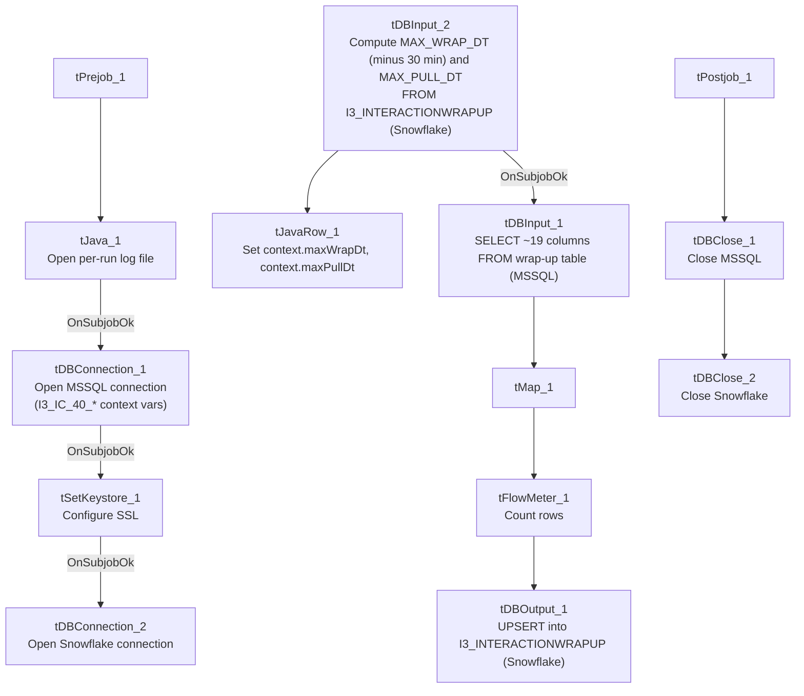

# Talend Job: i3_InteractionWrapup_Load

## Overview

Loads call-center interaction wrap-up data (wrap-up code/category, whether wrap-up was required or left incomplete, connected/hold/ACW/suspend timings, supervisor-request counts, per interaction and per user/workgroup) from the I3 platform's MSSQL database into the Snowflake `I3_INTERACTIONWRAPUP` table, upserting by key. Its incremental-load check is slightly more defensive than similar jobs elsewhere in this project: it looks back 30 minutes before the latest loaded wrap-up start time, presumably to catch records that were still being finalized when the last run captured its watermark.

## Detail table

| Field | Value |
|---|---|
| Job name | i3_InteractionWrapup_Load |
| Version | 0.1 |
| Project | EDW2SF |
| Author | jmach@harriscollect.com |
| Created | 2023-04-20T09:48:19.539-0700 |
| Last Modified | 2025-11-06T10:26:48.670-0800 |

## Step-by-step data flow

**Setup subjob:** `tPrejob_1` → `tJava_1` opens a per-run log file → on success, `tDBConnection_1` opens the **MSSQL** connection first (`context.I3_IC_40_Server`/`Port`/`Schema`/`Database`/`Login`, password redacted) → on success, `tSetKeystore_1` configures SSL trust/keystore from `context.keystorePath` → on success, `tDBConnection_2` opens the Snowflake connection. Note the MSSQL-before-Snowflake connection order here is the reverse of the sequence used in sibling jobs like `i3_AgentActivityLog_Load` (Snowflake opened first there) — not necessarily a problem, just a structural inconsistency worth knowing about.

**Main subjob:**

1. `tDBInput_2` (`tSnowflakeInput`) runs a query computing two values from the target table: `MAX_WRAP_DT` — the latest `WRAPUPSTARTDATETIMEUTC` already loaded, minus 30 minutes (`DATEADD(min,-30,MAX(...))`), defaulting to `'2019-01-01'` if the table is empty — and `MAX_PULL_DT`, the current UTC timestamp at query time.
2. `tJavaRow_1` captures these into `context.maxWrapDt` and `context.maxPullDt`.
3. On success, `tDBInput_1` runs a fixed `SELECT` (shared `tDBConnection_1`) against the source wrap-up table, pulling `InteractionIDKey`, `WrapupSegmentID`, `SourceInteractionIDKey`, `SiteID`, `SeqNo`, `UserID`, `WorkgroupID`, `WrapupRequired`, `WrapupCode`/`Category`/`IncompleteReason`, `WrapupStartDateTimeUTC`, connected/hold/ACW/suspend timing counters, and `nSupervisorRequest`. **The captured query text is truncated after the initial columns and does not visibly reference `context.maxWrapDt`/`context.maxPullDt`** — see Issues observed.
4. `tMap_1` passes the ~19 columns through to an uppercase-named target schema.
5. `tFlowMeter_1` counts rows passing through (labeled "MyLabel", not renamed for this job).
6. `tDBOutput_1` **upserts** the rows into Snowflake table `I3_INTERACTIONWRAPUP`.

**Teardown subjob:** `tPostjob_1` → `tDBClose_1` (close MSSQL) → `tDBClose_2` (close Snowflake).

## Settings tables

### Source: `tDBInput_1` (`tMSSqlInput`)

| Setting | Value | What it means |
|---|---|---|
| Connection | Shared `tDBConnection_1` | Reuses the job's single MSSQL connection. |
| Query | Fixed `SELECT` of ~19 named columns (interaction/wrap-up identifiers, wrap-up code/category/incomplete-reason, connected/hold/ACW/suspend timing counters, supervisor-request count) | The visible portion does not reference `context.maxWrapDt` or `context.maxPullDt` — see Issues observed. |

### Watermark computation: `tDBInput_2` (`tSnowflakeInput`)

| Setting | Value | What it means |
|---|---|---|
| Query | `SELECT COALESCE(CAST(DATEADD(min,-30,MAX(WRAPUPSTARTDATETIMEUTC)) AS VARCHAR(30)),'2019-01-01') AS MAX_WRAP_DT, CAST(CONVERT_TIMEZONE(GET_CURRENT_TIMEZONE(),'UTC',CURRENT_TIMESTAMP) AS VARCHAR(30)) AS MAX_PULL_DT FROM I3_INTERACTIONWRAPUP;` | Computes a lookback watermark 30 minutes before the latest loaded wrap-up start time (to catch late-finalized records), plus the current UTC pull time — both captured into context by `tJavaRow_1`. |

### Target: `tDBOutput_1` (`tSnowflakeOutput`)

| Setting | Value | What it means |
|---|---|---|
| Table | `I3_INTERACTIONWRAPUP` | Destination table for call-center wrap-up data. |
| Output action | `UPSERT` | Inserts new rows and updates existing ones by key — safer against duplication than plain `INSERT` if the source query re-reads overlapping rows because of the 30-minute lookback window. |
| Table action | `NONE` | Table is not recreated/altered by this job. |

## Dependencies & configuration

- **Triggers/depends on other jobs:** none — no `tRunJob` links found, and this job does not appear as a caller or target in `06_dependency_matrix.md`.
- **Context variables used:** `I3_IC_40_Database`, `I3_IC_40_Login`, `I3_IC_40_Port`, `I3_IC_40_Schema`, `I3_IC_40_Server` (MSSQL connection details, correctly labeled for I3 telephony data), `keystorePath`, `logDir`, `maxPullDt`, `maxWrapDt` (both computed internally from the Snowflake watermark query).
- **1 hardcoded developer-workstation path** in `tSetKeystore_1.SSL_TRUSTSERVER_TRUSTSTORE` (`"C:/clientTrustStore.trustStore"`) — same pattern documented project-wide in `05_operational_runbook.md`.

## Glossary

| Component type | Plain-English meaning |
|---|---|
| `tMSSqlConnection` / `tMSSqlInput` / `tMSSqlClose` | Open a Microsoft SQL Server connection, run a query against it, and close it. |
| `tSnowflakeConnection` / `tSnowflakeClose` | Open/close a Snowflake database connection shared by other components in the job. |
| `tSnowflakeInput` | Runs a query against Snowflake and returns its result rows — here used to compute the incremental-load watermark. |
| `tMap` | Maps/transforms columns from one schema to another. |
| `tFlowMeter` | Counts rows passing a point in the flow for logging/monitoring. |
| `tSnowflakeOutput` | Writes rows to a Snowflake table — here configured for `UPSERT`. |
| `tJavaRow` | Runs custom Java code once per input row — here used to unpack the watermark query's two result values into context variables. |
| `tSetKeystore` | Configures SSL trust/keystore settings for the job's secure connections. |

## Issues observed

- **The incremental-load filter may not actually be applied.** The job computes both `context.maxWrapDt` and `context.maxPullDt` from Snowflake before reading the MSSQL source — and the 30-minute lookback logic strongly suggests a deliberate, thoughtfully-designed incremental window — but the `tDBInput_1.QUERY` text captured in this metadata is truncated after the initial column list and does not show a `WHERE`-clause referencing either context variable in the visible portion. **Unable to determine from this metadata whether the query is actually filtered by date.** Because the target write is an `UPSERT` (not a plain `INSERT`), an unfiltered re-read of the whole source table wouldn't create duplicate rows the way it would in `i3_CallDetail_40_Load` or `i3_AgentActivityLog_Load` — but it would mean the job re-transfers and re-processes far more data than necessary on every run. Verify directly in Talend Studio.
- **The setup subjob opens the MSSQL connection before the Snowflake connection** (`tDBConnection_1` → `tSetKeystore_1` → `tDBConnection_2`), the reverse order from sibling jobs like `i3_AgentActivityLog_Load` and `i3_DialerCallListDC_Load` (which open Snowflake first, then MSSQL). This is likely inconsequential given Talend's connection independence, but it's a structural inconsistency across otherwise very similar jobs in the same `i3_*` family — worth knowing if debugging connection-order-sensitive issues (e.g., keystore configuration timing relative to either connection).
- **No error/row-count logging specific to this job's business outcome** (no `tWarn`/`tDie`/`tSendMail`) — a load failure here would only surface as a generic Talend execution error, consistent with most of the 289 jobs per `05_operational_runbook.md`.
