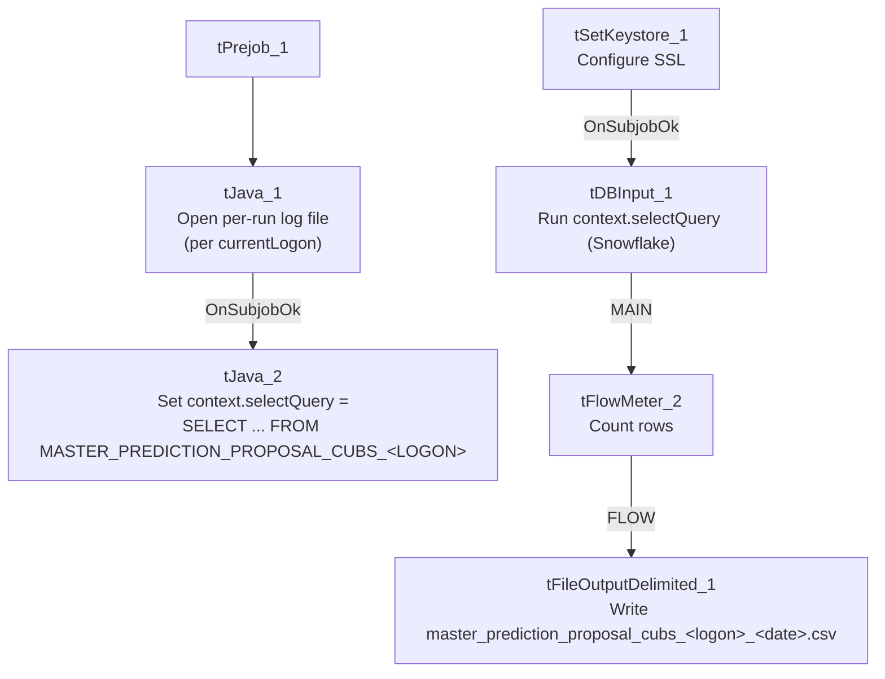

# Talend Job: master_prediction_proposal_cubs_extract

## Overview

Extracts a per-logon "proposed contact channel" prediction dataset (logon, debtor number, and a predicted outreach channel) from a dynamically-named Snowflake table (`MASTER_PREDICTION_PROPOSAL_CUBS_<LOGON>`) and writes it to a per-logon, dated CSV file. This is a small utility/sub-job — per `06_dependency_matrix.md`, it is called via `tRunJob` 5 times each by `Export_Hermes_APC_Master_Prediction` and `Extract_Hermes_Master_Prediction` (10 total invocations project-wide), almost certainly once per site/logon given that its source table name and output filename are both built from `context.currentLogon`.

## Detail table

| Field | Value |
|---|---|
| Job name | master_prediction_proposal_cubs_extract |
| Version | 0.1 |
| Project | EDW2SF |
| Author | jmach@harriscollect.com |
| Created | 2023-05-16T09:15:57.268-0700 |
| Last Modified | 2025-11-05T09:49:06.554-0800 |

## Step-by-step data flow

**Setup subjob (chain 1):** `tPrejob_1` → `tJava_1` opens a per-run log file at `context.logDir+jobName+"_"+context.currentLogon+"_"+<timestamp>+".log"` → on success, `tJava_2` sets `context.selectQuery = "SELECT LOGON,DEBTORNUMBER,PROPOSED_CHANNEL FROM MASTER_PREDICTION_PROPOSAL_CUBS_"+context.currentLogon.toUpperCase()+";"` — dynamically targeting a per-logon Snowflake table.

**Extraction subjob (chain 2 — no explicit link from chain 1; see Issues observed):** `tSetKeystore_1` configures SSL trust/keystore settings from `context.keystorePath` (passwords redacted) → on success, `tDBInput_1` runs the query held in `context.selectQuery` against Snowflake → `tFlowMeter_2` (`MAIN`) counts rows passing through (labeled "MyLabel") → `tFileOutputDelimited_1` (`FLOW`) writes the rows, with header, to `context.importDir+"master_prediction_proposal_cubs_"+context.currentLogon.toLowerCase()+"_"+<date>+".csv"`.

**No `tPostjob`/`tDBClose`, and no `tSnowflakeConnection` component at all, appear anywhere in this job's metadata** — see Issues observed regarding how this job actually obtains its Snowflake connection.

*Note: no connector links the "build query" chain to the "run query" chain in this job's own metadata — see Issues observed.*

## Settings tables

### Query builder: `tJava_2`

| Setting | Value | What it means |
|---|---|---|
| CODE | `context.selectQuery="SELECT LOGON,DEBTORNUMBER,PROPOSED_CHANNEL FROM MASTER_PREDICTION_PROPOSAL_CUBS_"+context.currentLogon.toUpperCase()+";"` | Dynamically builds a query against a per-logon table using `context.currentLogon`. |

### Source: `tDBInput_1` (`tSnowflakeInput`)

| Setting | Value | What it means |
|---|---|---|
| Query | `context.selectQuery` | The query text itself lives in a context variable set by `tJava_2` at runtime, not a literal SQL string on this component. |

### Target: `tFileOutputDelimited_1`

| Setting | Value | What it means |
|---|---|---|
| FILENAME | `context.importDir+"master_prediction_proposal_cubs_"+context.currentLogon.toLowerCase()+"_"+TalendDate.getDate("CCYYMMDD")+".csv"` | Per-logon, dated output file. |
| INCLUDEHEADER | `true` | Header row included. |

### Setup: `tSetKeystore_1`

| Setting | Value | What it means |
|---|---|---|
| SSL_KEYSTORE | `context.keystorePath` | Context-driven client keystore. |
| SSL_TRUSTSERVER_TRUSTSTORE | `"C:/clientTrustStore.trustStore"` (hardcoded) | Local path — see Dependencies & configuration. |

## Dependencies & configuration

- **Triggers/depends on other jobs:** this job's own `runjob_targets` is empty (it calls nothing), but per `06_dependency_matrix.md` it **is** a call target: `Export_Hermes_APC_Master_Prediction` and `Extract_Hermes_Master_Prediction` each call it via `tRunJob` 5 times (10 invocations total project-wide) — "almost certainly once per site/partner context" per that document, consistent with this job's per-logon design.
- **Context variables used:** `currentLogon`, `importDir`, `keystorePath`, `logDir`, `selectQuery`.
- **1 hardcoded path finding:** `tSetKeystore_1.SSL_TRUSTSERVER_TRUSTSTORE` = `"C:/clientTrustStore.trustStore"` — same project-wide portability risk documented in `05_operational_runbook.md`.

## Glossary

| Component type | Plain-English meaning |
|---|---|
| `tSnowflakeInput` | Runs a query against Snowflake and returns its result rows. |
| `tFileOutputDelimited` | Writes rows to a delimited (CSV-style) text file. |
| `tFlowMeter` | Counts rows passing a point in the flow for logging/monitoring. |
| `tSetKeystore` | Configures SSL/TLS keystore and truststore settings used by the job's database connection. |
| `tJava` | Runs custom Java code — here used to open a log file and to build a SQL query string at runtime. |

## Issues observed

- **No `tSnowflakeConnection`/`tSnowflakeClose` component appears anywhere in this job's metadata**, and `tDBInput_1`'s captured parameters don't show a `USE_EXISTING_CONNECTION` setting either. How this job actually establishes its Snowflake connection is not confirmed by this metadata. Since both of its call sites (`Export_Hermes_APC_Master_Prediction`, `Extract_Hermes_Master_Prediction`) invoke it via `tRunJob`, it may rely on a connection shared from the calling parent job — but a child job normally opens its own connection unless explicitly configured otherwise, so this should be verified directly in Talend Studio rather than assumed.
- **No explicit trigger link ties `tJava_2` (which sets `context.selectQuery` from `context.currentLogon`) to the `tSetKeystore_1` → `tDBInput_1` chain that consumes it.** Both subjob chains exist in the same job with no connector between them in this metadata, so the component graph alone does not guarantee `context.selectQuery` is set before `tDBInput_1` runs it. If the two chains aren't otherwise sequenced correctly at runtime, the query could execute against a stale or blank `context.selectQuery`. Verify directly in Talend Studio (e.g., an unshown trigger relationship or an inherited default value not captured by this extraction).
- **No reject/error handling and no row-count check after the extract** (no `tWarn`/`tDie`/`tSendMail`) — a failure, or an unexpectedly-empty result (e.g., if `MASTER_PREDICTION_PROPOSAL_CUBS_<LOGON>` doesn't exist for a given logon), would only surface as a generic Talend execution error or a near-empty CSV, with nothing in this job's own metadata to flag that condition.
- **The source table name is built dynamically from `context.currentLogon.toUpperCase()`** — a logon value with no matching `MASTER_PREDICTION_PROPOSAL_CUBS_<LOGON>` table would fail this job. Which logon values are valid is presumably determined by whatever context each of the two calling jobs passes at each of their 5 invocations — not visible in this job's own metadata; see `06_dependency_matrix.md`'s note that confirming exactly what differs per call "requires opening each `tRunJob` component's context settings individually."
