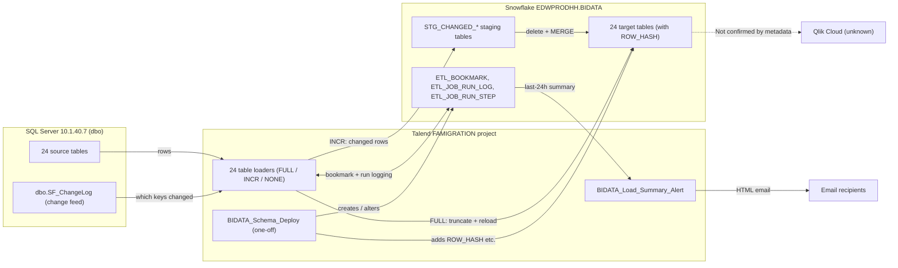

# System Architecture Document

## Overview

This platform moves operational data for a debt-collection agency (Harris & Harris, based on the job authors' `@harriscollect.com` addresses) out of a source SQL Server database and into the `EDWPRODHH.BIDATA` schema in Snowflake, a cloud data warehouse, so it can be reported on. The `FAMIGRATION` Talend project now holds **33 jobs**: 24 active table loaders, 2 BIDATA utility jobs (a one-off schema deployment and a daily load-summary email), and 7 retired jobs parked in an `Older_Inactive_Jobs` folder. The big change since the previous version of this document is that the active loaders no longer blindly empty and reload their table every run. Each one now reads a **bookmark** in Snowflake (`ETL_BOOKMARK`), checks a **change log** on the SQL Server side (`dbo.SF_ChangeLog`) for anything newer, and then does one of three things: a **FULL** reload, an **INCR** (incremental) apply of only the changed rows, or **NONE** (nothing changed, nothing loaded). Every run is recorded in two new run-log tables (`ETL_JOB_RUN_LOG`, `ETL_JOB_RUN_STEP`). From Snowflake the data is intended to be consumed by BI tools such as Qlik, but no Qlik metadata was extracted for this documentation set, so that last leg is unconfirmed.

> **Data-source caveat:** This document is built from `full-documentation/output/talend_metadata.json`, extracted on 2026-11-03 from a local checkout of the `FAMigration` Talend repository (`C:\H_H\Repo\FAMigration-1594247393`, branch `feature/bidata_incremental_changes`, commit `5c013af3bb53929f63c93c2e586a319be4dc918e`, dated 2026-10-29). That branch had **not been merged to `master`** at the time of extraction, so this describes the BIDATA incremental-load design as it stands on the feature branch, not necessarily what is deployed. The Snowflake control-table definitions were cross-checked against `Snowflake_BIDATA_Schema_Change.sql` in the same repository. **No `qlik_metadata.json` was present for this run**, so nothing about Qlik apps, spaces or reload schedules here comes from real metadata. Verify anything else with the team.

## Detail Table

| Item | Value |
|---|---|
| Talend project | FAMIGRATION |
| Total Talend jobs | 33 |
| Active table loaders | 24 (13 "batched" loaders, 11 "single-pass" loaders; see below) |
| BIDATA utility jobs (`process/misc`) | 2 (`BIDATA_Schema_Deploy`, `BIDATA_Load_Summary_Alert`) |
| Retired jobs (`process/Older_Inactive_Jobs`) | 7 |
| Total database connections (defined in Talend) | 1 (`Frostlake_0.1`; detail fields empty, not referenced by any job) |
| Total context (variable) groups | 1 (`Common_0.1`, holding `keystorePath`); jobs also declare their own job-level context variables |
| Snowflake target | Account `xca26579.us-east-1`, database `EDWPRODHH`, schema `BIDATA`, warehouse `COMPUTE_WH` |
| SQL Server source | `10.1.40.7:1433`, schema `dbo` |
| Total Qlik apps | Unable to determine from metadata — verify with team (no `qlik_metadata.json` was available) |

## Data Flow

Solid arrows are backed by the extracted Talend metadata and the schema-change script. The dashed arrow to Qlik is the platform's presumed purpose and is not confirmed by any extracted metadata.

## How a loader decides what to do

All 24 active loaders share one design; only the table, key column and column list change.

1. **Pre-job.** Load the SSL keystore, open SQL Server and Snowflake connections, read the table's `LAST_CHANGE_ID` from `ETL_BOOKMARK`, and ask `dbo.SF_ChangeLog` how many changes exist above it (and whether any of them is a full-reload marker, `change_operation = 'F'`).
2. **Pick a mode.** FULL if the bookmark is 0 or an `F` marker is in range; NONE if there are no new changes; otherwise INCR. A `RUNNING` row is written to `ETL_JOB_RUN_LOG`.
3. **FULL.** Empty the target table and reload it from the source.
   - **Batched loaders (13 jobs):** split the source into key ranges (`BATCH_SIZE` default 5,000,000 rows) and load up to `PARALLEL_BATCHES` (default 4) at once, then a Snowflake script checks every batch finished, at least 99.5% of rows arrived and keys are unique, before advancing the bookmark.
   - **Single-pass loaders (11 jobs):** one read and one `TRUNCATE` + `INSERT` write, then advance the bookmark.
4. **INCR.** Copy the distinct changed keys into `STG_CHANGED_<TABLE>_KEYS` and their current source rows into `STG_CHANGED_<TABLE>`, then in one Snowflake transaction delete keys that no longer exist in the source, `MERGE` the rest (updating only rows whose `ROW_HASH` changed), and advance the bookmark. (`Email_Address_Load` is the exception: it deletes and re-inserts all rows for each changed `CONSUMERID` instead of merging.)
5. **Post-job.** Mark the run `SUCCESS` or `FAILED` (with the error message) in `ETL_JOB_RUN_LOG` and `ETL_JOB_RUN_STEP`.

## Glossary

| Term | Plain-English meaning |
|---|---|
| Talend Studio | The desktop tool used to design each data-loading job. |
| Job | A single Talend program made of connected components; here, each active loader keeps one Snowflake table in step with one SQL Server table. |
| Component | A single step/box inside a job, e.g. "read from SQL Server" or "run this Snowflake SQL". |
| Context variable | A named setting a job reads at run time instead of hardcoding it (e.g. `keystorePath`, `BATCH_SIZE`, `LOAD_MODE`). |
| Bookmark (`ETL_BOOKMARK`) | One row per target table recording the last change-log ID that has been applied, so the next run knows where to pick up. |
| Change log (`dbo.SF_ChangeLog`) | A SQL Server table listing which rows changed, in order. How it is populated is not visible in the Talend metadata. |
| FULL / INCR / NONE | The three load modes: reload the whole table, apply only changed rows, or do nothing. |
| `ROW_HASH` | A 32-byte fingerprint of a row's contents; INCR only updates a target row when its hash differs from the incoming row. |
| Staging table (`STG_CHANGED_*`) | A temporary Snowflake table holding the keys/rows of one INCR run before they are merged into the real table. |
| MERGE | A single SQL statement that updates matching rows and inserts new ones. |
| Run log (`ETL_JOB_RUN_LOG` / `ETL_JOB_RUN_STEP`) | Snowflake tables recording each run's mode, status, row counts, progress and error message, per run and per step. |
| Snowflake warehouse | The compute cluster Snowflake uses to run a query or load; this project uses `COMPUTE_WH`. |
| Reload task / Space (Qlik) | Qlik Cloud scheduling and sharing concepts. Not covered here; no Qlik metadata was extracted. |
